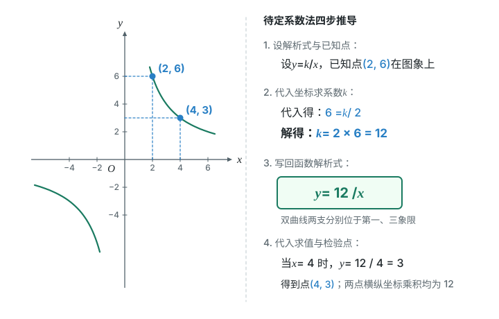
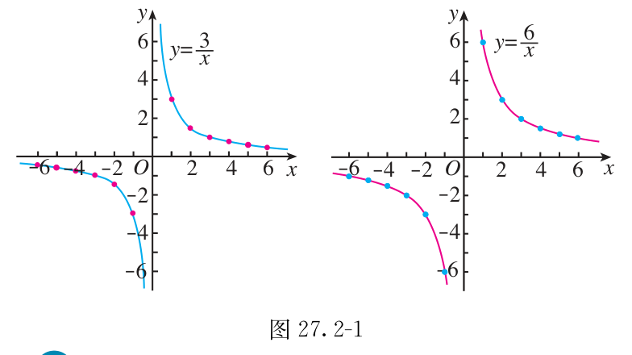
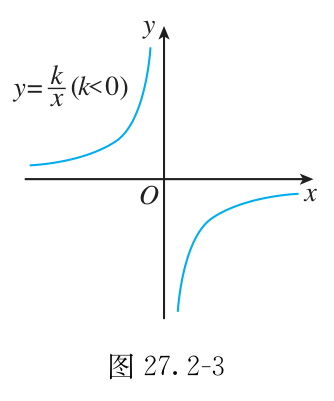
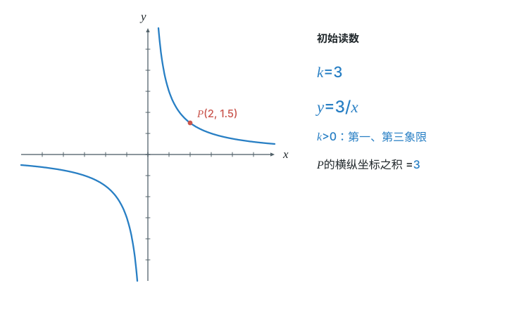
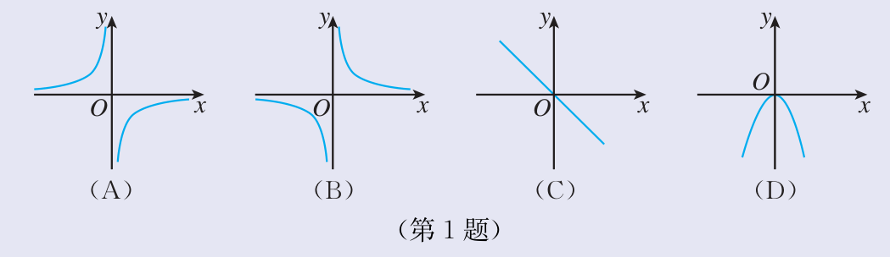
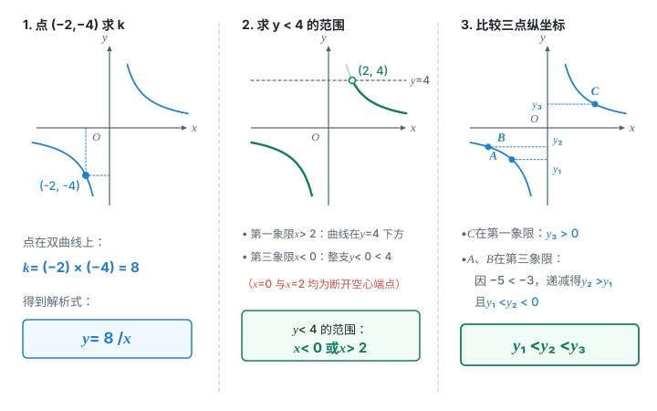

# 第二十七章 反比例函数

两个量的乘积不变，图上却是一条弯曲的双曲线。
这一章把式子、图象与实际数量关系连起来。

## 本章前置自查

- 能判断正负数和绝对值。回看七上第一章1.2“有理数及其大小比较”。
- 能读点的横纵坐标，并用坐标描述水平、竖直线段。回看七下第九章9.1“用坐标描述平面内点的位置”。
- 知道分式的分母不能为零。回看八上第十八章18.1“分式及其基本性质”。
- 会列表、描点、连线。回看八下第二十二章22.2“函数的图象”。
- 会从一次函数的系数读出图象位置。回看八下第二十三章23.1“正比例函数”、23.2“一次函数”。
- 会读抛物线对称轴两侧的增减性。回看九上第二十六章26.2“二次函数的图象和性质”。
- 知道矩形的对边平行，邻边垂直。回看八下第二十一章21.3“特殊的平行四边形”。

## 27.1a 认识反比例函数

```yaml
id: MATH-9A-27-1a
weight: 一般
weight_note: 实查9套有效卷，无直接概念辨识题；积为非零常数是全章基础。
prerequisites:
- id: MATH-8B-22-1b
  strength: hard
  reason: 先理解自变量与函数值
- id: MATH-8A-18-1a
  strength: hard
  reason: 分式的分母不能为零
textbook: 修订版人教数学九上27.1，p.64–66
evidence:
- 判断式子是否能整理为xy等于非零常数
- 通过等式变形辨识非反比例函数的形式
figure: 可选｜图解步骤图。三栏依次显示y=k/x、xy=k、y=kx的负一次幂；用蓝色对应同一个k，x与y用线框色。不引入数值新例。初始完整显示三种等价式；没有辅助线。
sources:
- TB27
- ZY
method:
- MG15 函数思想
```

### 本次只学

认出“两个量的乘积固定不变”的函数关系。

### 先认住

- 一般地，形如 $y=\dfrac{k}{x}$（$k$ 为常数，$k\neq0$）的函数，叫反比例函数。自变量 $x$ 的取值范围是不等于 $0$ 的一切实数。
- **补充**（课本没有讲，做真题时常用）：它可变形为 $xy=k$ 或 $y=kx^{-1}$；关键是 $xy$ 为非零常数。
- **补充**（课本没有讲，做真题时常用）：因 $k\neq0$，函数值 $y\neq0$，所以图象没有坐标轴上的点。

### 容易错

- 分母有 $x$，不一定是反比例函数；先检查 $xy$ 是否为常数。
- “一个增大，另一个减小”还不够；必须检查两者的乘积。

### 练一练

- `Q-MATH-TB9A-27R-1`

## 27.1b 求解析式与检验点

```yaml
id: MATH-9A-27-1b
weight: 重点
weight_note: 4次；广州卷直接考代入、求系数和检验点，必须把坐标与式子对应。
prerequisites:
- id: MATH-9A-27-1a
  strength: hard
  reason: 利用xy=k求非零系数
- id: MATH-7B-09-1a
  strength: hard
  reason: 读出点的横纵坐标
textbook: 修订版人教数学九上27.1，p.65–66；27.2，p.70
walk_source: 课本27.1例，印刷p.65；PDF索引71
evidence:
- 由已知一对横纵坐标求解析式
- 用坐标乘积判断给定点是否在双曲线上
figure: 已完成 figures/inverse-find-k-27-1b.svg（待定系数法求反比例解析式及检验点）
sources:
- TB27
- ZY
method:
- MG15 函数思想
```

### 本次只学

用一对已知坐标求系数，再让解析式与图上的点互相验证。

### 先认住

- 已知是反比例函数，先设 $y=\dfrac{k}{x}$，再用一组对应值求 $k=xy$。
- 求出 $k$ 后写回解析式；普通反比例函数的自变量范围是 $x\neq0$。
- 点在图象上，当且仅当它的横纵坐标满足解析式。已知 $k$ 时，可检查两坐标的乘积。

### 走一遍

已知 $y$ 是 $x$ 的反比例函数，且当 $x=2$ 时，$y=6$。

（1）写出 $y$ 关于 $x$ 的函数解析式；

（2）当 $x=4$ 时，求 $y$ 的值。

1. 设 $y=\dfrac{k}{x}$。代入 $\textcolor{#287fc4}{6}=\dfrac{k}{\textcolor{#287fc4}{2}}$，得 $k=\textcolor{#287fc4}{2}\times\textcolor{#287fc4}{6}=12$。（反比例函数的定义）
2. 写回解析式，得 $\boxed{y=\dfrac{12}{x}}$。（求系数后不能只留下系数）
3. 代入 $x=4$，$y=\dfrac{\textcolor{#287fc4}{12}}{\textcolor{#287fc4}{4}}$，得 $\boxed{y=3}$。（代入求值）

图上 $(2,6)$ 与 $(4,3)$ 的位置不同，横纵坐标的乘积却相同。



### 容易错

- 横纵坐标别颠倒，也别把乘积误写为商。
- 检验点时先检查横坐标非零；代入算出的纵坐标要与给定值相同。

### 练一练

- `Q-MATH-TB9A-27R-4`
- `Q-MATH-GZ2023-24-1`

## 27.2a 由系数判断图象象限

```yaml
id: MATH-9A-27-2a
weight: 重点
weight_note: 2次广州选择题；须结合绝对值、一次函数判断符号，零值是易错点。
prerequisites:
- id: MATH-9A-27-1b
  strength: hard
  reason: 先识别解析式中的系数
- id: MATH-8B-22-2a
  strength: soft
  reason: 会用列表描点表示函数
textbook: 修订版人教数学九上27.2，p.67–70
walk_source: 课本习题27.2第1题，印刷p.72；PDF索引78
evidence:
- 由系数符号判断双曲线所在象限
- 结合其他已学函数的条件判断参数符号
figure: 已完成 figures/tb9a-27-2-fig27-2-1.png（课本图27.2-1原图，放在先认住之后）、figures/tb9a-27-2-fig27-2-3.png（课本图27.2-3原图，放在先认住之后）、inverse-explorer 组件及静态图 figures/inverse-explorer-27-2a.svg
sources:
- TB27
- GZ2023
- GZ2025
- ZY
method:
- MG16 数形结合
```

### 本次只学

从系数的正负，把解析式与双曲线所在象限对应起来。

### 先认住

- 反比例函数的图象是双曲线，由不相连的两支组成，不经过坐标轴。
- $k>0$ 时，$x,y$ 同号，图象位于第一、第三象限。
- $k<0$ 时，$x,y$ 异号，图象位于第二、第四象限。
- 作图按“列表—描点—连线”，正、负两支分别画，不跨过 $x=0$ 连线。





拖动滑块改变 $k$，再移动点 $P$，看双曲线在哪两个象限、$P$ 的横纵坐标之积是多少。

```widget
type: inverse-explorer
k: {min: -6, max: 6, step: 1, value: 3, skip: 0}
point: {x: 2, min: -6, max: 6, step: 0.5, skip: 0}
```


### 数形结合

```bridge
mode: cards
式: $k>0$
图: hyper-13
形: 两支落在第一、第三象限，横纵坐标同号
色: green
---
式: $k<0$
图: hyper-24
形: 两支落在第二、第四象限，横纵坐标异号
色: red
```

### 走一遍

函数 $y=-\dfrac3x$ 的图象大致是（　　）。



1. 式中的系数为 $k=-3<0$。（读解析式）
2. 因此横纵坐标异号，双曲线应在第二、第四象限。（反比例函数的性质）
3. A符合，B在第一、第三象限，C是直线，D是抛物线。选 $\boxed{\mathrm{A}}$。

先确认图形类别，再确认它的两支放在哪儿。

### 容易错

- 象限由整个系数决定，不是由分子里某一个字母决定。
- $k=0$ 不是反比例函数；从条件得到 $k\leq0$ 时，还要排除零值。

### 练一练

- `Q-MATH-GZ2025-07`
- `Q-MATH-GZ2023-06`

## 27.2b 比较函数值与读范围

```yaml
id: MATH-9A-27-2b
weight: 重点
weight_note: 2次直接选择题；跨过零点误用增减性是全章核心陷阱。
prerequisites:
- id: MATH-9A-27-2a
  strength: hard
  reason: 先确定所在象限
- id: MATH-7B-11-1a
  strength: hard
  reason: 分清严格与非严格不等式
- id: MATH-9A-26-2d
  strength: soft
  reason: 综合图中还要读抛物线的增减性
textbook: 修订版人教数学九上27.2，p.68–73
walk_source: 课本习题27.2第4题，印刷p.73；PDF索引79
evidence:
- 能用第一象限内的增减性比较给定四点的函数值
- 能从综合图象读出抛物线与双曲线共同递减的范围
figure: 已完成 figures/compare-values-27-2b.svg（反比例函数读值范围与函数值比较；已放在讲义“走一遍”之后）
sources:
- TB27
- GD2022
- GZ2024
- ZY
method:
- MG16 数形结合
```

### 本次只学

先确定点在哪一支，再比较函数值或读取范围。

### 先认住

- $k>0$ 时，在每一个象限内，$y$ 随 $x$ 的增大而减小。
- $k<0$ 时，在每一个象限内，$y$ 随 $x$ 的增大而增大。
- 两点不在同一支时，先用正负判断大小；不能跨过零点套用增减性。
- 读范围先画出对应图段；检查开口边界与是否包含端点。

### 数形结合

```bridge
mode: cards
式: $y<m$
形: 先画出该高度的水平线，再看曲线在它下方的图段
色: blue
---
式: 沿同一支向右
形: 曲线下降，表示 $x$ 增大时 $y$ 减小；两支断开，要分开读取
色: green
```

### 走一遍

已知点 $(-2,-4)$ 在反比例函数 $y=\dfrac{k}{x}$ 的图象上。

（1）当 $y<4$ 时，求 $x$ 的取值范围；

（2）已知点 $A(-3,y_1)$，$B(-5,y_2)$，$C(4,y_3)$ 在这个反比例函数的图象上，比较 $y_1$，$y_2$，$y_3$ 的大小，并用反比例函数的性质说明理由。

1. $k=\textcolor{#287fc4}{(-2)}\times\textcolor{#287fc4}{(-4)}=8$，所以 $y=\dfrac8x$。（坐标乘积等于系数）
2. 第三象限的整支都有 $y<0<4$，所以 $x<0$ 全部满足。（看图段所在位置）
3. 第一象限中，$y=4$ 对应 $x=\dfrac{\textcolor{#287fc4}{8}}{\textcolor{#287fc4}{4}}=2$。这一支随 $x$ 增大而降低，故 $y<4$ 对应 $x>2$。（同一支的增减性）
4. 合起来，第（1）问为 $\boxed{x<0\text{或}x>2}$。（合并两个分支）
5. A、B在第三象限，且 $-5<-3$，故 $y_2>y_1$；C在第一象限，$y_3>0$，而 $y_1,y_2<0$。所以第（2）问为 $\boxed{y_1<y_2<y_3}$。（先分支，再比较）



把水平线两侧的图段看清，就不会漏掉整个负数分支。

### 容易错

- 不可写成“$k>0$，所以在整个取值范围内递减”；两支中间断开了。
- 解含 $x$ 的不等式时，没查 $x$ 正负就乘 $x$，可能把方向弄反。
- 严格不等式不含边界；读范围不能把端点自动补上。

### 练一练

- `Q-MATH-GD2022-09`
- `Q-MATH-GZ2024-08`

## 27.2c 联系直线与双曲线交点

```yaml
id: MATH-9A-27-2c
weight: 一般
weight_note: 实查9套卷未直接要求求直线与双曲线全部交点；是课本习题27.2第5题及已学方程的联系。
prerequisites:
- id: MATH-9A-27-1b
  strength: hard
  reason: 交点满足反比例解析式
- id: MATH-8B-23-3a
  strength: hard
  reason: 交点同时满足两个函数式
textbook: 修订版人教数学九上27.2，p.73
evidence:
- 用交点同时满足两个解析式的条件求系数
- 在同一分支上判断不含端点的纵坐标范围
figure: 可选｜图解步骤图。对应习题27.2第5题：直线y=-x蓝色，双曲线y=-4/x绿色，图式分别同色；交点(-2,2)保留线框色。再显示第二象限-3小于x小于-1所对应的曲线段及两个空心端点。已知曲线实线，投影虚线；完整初始状态，不给尚未计算的辅助点赋新数值。
sources:
- TB27
method:
- MG16 数形结合
```

### 本次只学

让同一个交点同时满足直线与双曲线的条件。

### 先认住

- 两个图象的交点，坐标同时满足两个解析式；交点可能不止一个，如 $y=-x$ 与 $y=-\dfrac4x$ 有两个交点。
- 知道交点的一个坐标，可先用已知直线求另一个坐标，再求反比例系数。
- 已知两式求交点，可令两式的右边相等；解后检查横坐标非零并补出纵坐标。

### 数形结合

```bridge
mode: cards
式: 交点 $(x_0,\,y_0)$
图: line-hyper
形: 从交点向两坐标轴作垂线，读到的同一对坐标，要分别代入直线与双曲线的式子；两次都应得到成立的等式
色: blue
```

### 容易错

- 只代入其中一个解析式，不能保证点是两个图象的交点。
- 求出横坐标，不等于已经写出了交点坐标。

### 练一练

- `Q-MATH-TB9A-27.2-5`

## 27.2d 用坐标联系几何与面积

```yaml
id: MATH-9A-27-2d
weight: 一般
weight_note: 9次综合子任务；大多叠加后续旋转、相似、三角函数或圆。本章只学坐标转换及积对应面积，不提前训练整道压轴题。
prerequisites:
- id: MATH-9A-27-1b
  strength: hard
  reason: 点坐标乘积等于系数
- id: MATH-7B-09-1b
  strength: hard
  reason: 用坐标表示水平、竖直线段
- id: MATH-8B-21-3a
  strength: soft
  reason: 用矩形性质对应横纵坐标
textbook: 修订版人教数学九上27.1，p.64–65；27.2，p.73
evidence:
- 把矩形的水平竖直关系转为点坐标
- 用含字母的坐标验证另一个顶点也在双曲线上
figure: 已完成 figures/rect-area-coord-27-2d.svg（矩形边平行于坐标轴时的坐标与面积关系；已放在 Q-MATH-GD2024-23-1 的解析之后）
sources:
- TB27
- GD2024
method:
- MG16 数形结合
```

### 本次只学

把水平、竖直线段换成坐标，再用乘积验证点的位置。

### 先认住

- 同一条水平线上的点纵坐标相同；同一条竖直线上的点横坐标相同。
- 点 $(x,y)$ 在第一象限时，它与两坐标轴围成的矩形，边长为 $x,y$，面积为 $xy$。
- 若该点在 $y=\dfrac{k}{x}$ 上，矩形面积就是 $xy=k$；图上边长变化，积可以不变。

### 数形结合

```bridge
mode: hero
式: $xy=k$
图: hyper-rect
形: 在第一象限，把 $xy=k$ 看成固定面积 $k$；点沿双曲线移动，坐标轴矩形可变宽、变窄，面积却不变
色: blue
```

### 容易错

- 坐标可能为负，而线段长不能为负；上面的边长说法限定在第一象限。
- 找另一顶点时，要分别查它与谁同横坐标、与谁同纵坐标。

### 练一练

- `Q-MATH-GD2024-23-1` 第（1）问

## 27.3a 用不变量解决实际问题

```yaml
id: MATH-9A-27-3a
weight: 一般
weight_note: 1次电流代入填空；课本含总量、杠杆、功等应用，统一抓住不变量，不因例题多而一律定重点。
prerequisites:
- id: MATH-9A-27-2b
  strength: hard
  reason: 用正数分支判断条件边界
- id: MATH-7A-03-1b
  strength: soft
  reason: 先列数量关系再化为函数式
textbook: 修订版人教数学九上27.3，p.74–78、82–83
evidence:
- 从加水稀释中找出不变的酒精质量并建模
- 由浓度或总质量求另一个量，区分总量与增加量
figure: 可选｜图解步骤图。对应导引例15.3：三只溶液容器展示同一份40克酒精与变化的总质量，酒精蓝色、水绿色，px=40中酒精总量同色；以示意面积比例展示，不冒充体积。图旁标p为质量分数、x为总质量，初始三步完整，无辅助线。所有数字与导引原页一致。
sources:
- TB27
- MG15-E3
method:
- MG15 函数思想
```

### 本次只学

先找不变量，再把实际数量关系写成反比例函数。

### 先认住

- 先确定哪一个总量不变，再找两个变量的乘积；如总路程固定时 $vt=s$，总工作量固定时“效率乘时间”等于总量。
- 系数 $k$ 有实际意义，也带单位；稀释溶液时，不变的是溶质质量，不是溶液总质量。
- 写出模型后，还要按题意限制变量范围，再代入求值或求范围。

### 容易错

- 求得的溶液总质量，不是应加入的水的质量。
- “低了百分之五”要看题意，是差五个百分点，还是原数乘 $95\%$，不能混用。

### 练一练

- `Q-MATH-MG15-E3`
- `Q-MATH-GD2023-13`

## 27.3b 从数据选择函数模型

```yaml
id: MATH-9A-27-3b
weight: 一般
weight_note: 1次模型辨识：需排除反比例模型，选一次函数；修订版新增近似建模，重点是数据与模型是否吻合。
prerequisites:
- id: MATH-9A-27-1a
  strength: hard
  reason: 用乘积是否近似不变判断模型
- id: MATH-8B-22-2b
  strength: hard
  reason: 读表并对应到散点图
textbook: 修订版人教数学九上27.3，p.78–82
evidence:
- 由多组数据的乘积判断是否适合近似反比例模型
- 检验近似模型并用它估计屏幕尺寸
figure: 已完成 figures/model-data-fit-27-3b.svg（电子屏幕数据反比例模型拟合与估计；已放在 Q-MATH-TB9A-27.3-9 的解析之后）
sources:
- TB27
- GZ2024
method:
- MG15 函数思想
```

### 本次只学

用数据检查模型，而不是只凭“越大越小”猜模型。

### 先认住

- 先读表、画散点，再检查规律：反比例模型的各组乘积应相同或很接近。
- 实测、取整的数据可以近似符合模型，不要求每个点都严格落在曲线上。
- 建模依次做“选类型—求系数—检验—求解”；估计结果按题意取近似值。

### 容易错

- 不要只挑一组数据当成全部数据；至少检查其余各组是否吻合。
- 数据随自变量降低，不等于一定反比例；还要检查乘积。

### 练一练

- `Q-MATH-TB9A-27.3-9`
- `Q-MATH-GZ2024-23-2`
