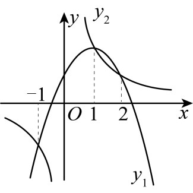
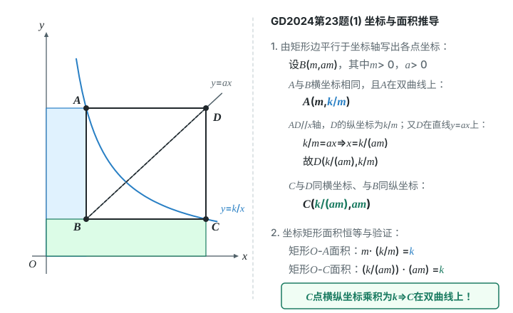
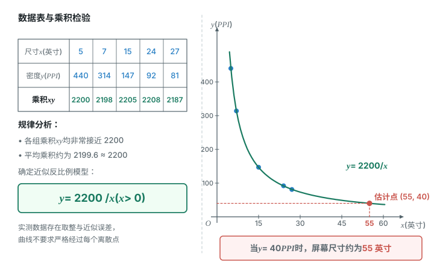
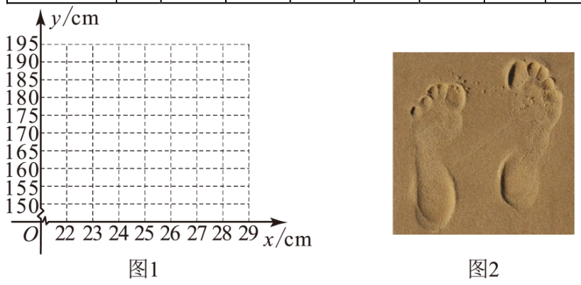

# 第二十七章 反比例函数 · 题目

## 讲义用题

### Q-MATH-TB9A-27R-1

```yaml
category: 课本习题
source: 修订版人教数学九上p.85，复习题27第1题（PDF索引91）
source_quality: 课本原文
kp: MATH-9A-27-1a
type: 选择
grading: 自动
answer_by: 本项目编写，待复核
review:
  概念: MATH-9A-27-1a
  审题: MATH-9A-27-1a
```

**题干**

在下列式子中，$y$ 是 $x$ 的反比例函数的是（　　）。

A. $y=\dfrac{1}{x^2}$

B. $yx=-\sqrt{3}$

C. $y=5x+6$

D. $\sqrt{x}=\dfrac{1}{y}$

**答案**

B

**解析**

1. B中 $xy=-\sqrt{3}$，乘积为非零常数，故选 $\boxed{\mathrm{B}}$。（反比例函数定义）
2. A中 $xy=\dfrac1x$；C中 $xy=5x^2+6x$；D中 $y=\dfrac1{\sqrt{x}}$，故 $xy=\sqrt{x}$。三个乘积都随 $x$ 变化。（等式变形）

### Q-MATH-TB9A-27R-4

```yaml
category: 课本习题
source: 修订版人教数学九上p.85，复习题27第4题（PDF索引91）
source_quality: 课本原文
kp: MATH-9A-27-1b
parts:
  - {part: '1', kp: MATH-9A-27-1b}
  - {part: '2', kp: MATH-9A-27-1b}
type: 解答
grading: 自评
answer_by: 本项目编写，待复核
review:
  公式: MATH-9A-27-1b
  计算: MATH-9A-27-1b
```

**题干**

已知反比例函数 $y=\dfrac{k}{x}$（$k\neq0$），当 $x=-6$ 时，$y=\dfrac23$。

（1）求 $y$ 关于 $x$ 的函数解析式及自变量 $x$ 的取值范围；

（2）判断点 $(-2,2)$，$(1,4)$ 是否在这个函数的图象上。

**答案**

（1）$\boxed{y=-\dfrac4x\text{，}\ x\neq0}$；

（2）$\boxed{(-2,2)\text{在图象上；}(1,4)\text{不在图象上}}$。

**解析**

1. $k=\textcolor{#287fc4}{(-6)}\times\textcolor{#287fc4}{\dfrac23}=-4$，所以 $\boxed{y=-\dfrac4x\text{，}\ x\neq0}$。（坐标乘积等于系数；分母非零）
2. $\textcolor{#287fc4}{(-2)}\times\textcolor{#287fc4}{2}=-4$，符合 $xy=k$，故 $\boxed{(-2,2)\text{在图象上}}$。（点与解析式的对应）
3. $\textcolor{#287fc4}{1}\times\textcolor{#287fc4}{4}=4\neq-4$，故 $\boxed{(1,4)\text{不在图象上}}$。（点与解析式的对应）

### Q-MATH-GZ2025-07

```yaml
category: 真题
source: 2025年广东省广州市中考数学真题第7题，解析PDF第4–5页
source_quality: 原卷
kp: MATH-9A-27-2a
type: 选择
grading: 自动
answer_by: 原卷解析
review:
  概念: MATH-9A-27-2a
  审题: MATH-9A-27-2a
```

**题干**

若 $|k|=-k$（$k\neq0$），反比例函数 $y=\dfrac{k}{x}$ 的图象在（　　）

A. 第一、二象限

B. 第一、三象限

C. 第二、四象限

D. 第三、四象限

**答案**

C

**解析**

1. 因为 $|k|\geq0$，且 $|k|=-k$，所以 $-k\geq0$，即 $k\leq0$。（绝对值的非负性）
2. 又因为 $k\neq0$，所以 $k<0$。（排除零值）
3. 系数为负，双曲线位于第二、第四象限，故选 $\boxed{\mathrm{C}}$。（反比例函数的性质）

### Q-MATH-GZ2023-06

```yaml
category: 真题
source: 2023年广东广州中考数学真题第6题，解析PDF第4页
source_quality: 原卷
kp: MATH-9A-27-2a
type: 选择
grading: 自动
answer_by: 原卷解析
review:
  概念: MATH-9A-27-2a
  审题: MATH-9A-27-2a
```

**题干**

已知正比例函数 $y_1=ax$ 的图象经过点 $(1,-1)$，反比例函数 $y_2=\dfrac{b}{x}$ 的图象位于第一、第三象限，则一次函数 $y=ax+b$ 的图象一定不经过（　　）

A. 第一象限

B. 第二象限

C. 第三象限

D. 第四象限

**答案**

C

**解析**

1. 正比例函数经过第四象限的点 $(1,-1)$，所以图象经过第二、第四象限，故 $a<0$。（正比例函数的性质）
2. 反比例函数的图象位于第一、第三象限，所以 $b>0$。（反比例函数的性质）
3. 一次函数的系数 $a<0$，截距 $b>0$，图象经过第一、第二、第四象限，不经过第三象限，故选 $\boxed{\mathrm{C}}$。（一次函数的性质）

### Q-MATH-GD2022-09

```yaml
category: 真题
source: 2022年广东省中考数学真题第9题，解析PDF第4页
source_quality: 原卷
kp: MATH-9A-27-2b
type: 选择
grading: 自动
answer_by: 原卷解析
review:
  概念: MATH-9A-27-2b
  审题: MATH-9A-27-2b
```

**题干**

点 $(1,y_1)$，$(2,y_2)$，$(3,y_3)$，$(4,y_4)$ 在反比例函数 $y=\dfrac4x$ 图象上，则 $y_1$，$y_2$，$y_3$，$y_4$ 中最小的是（　　）

A. $y_1$

B. $y_2$

C. $y_3$

D. $y_4$

**答案**

D

**解析**

1. 系数 $4>0$，在每个象限内，$y$ 随 $x$ 的增大而减小。（反比例函数的性质）
2. 四个点都在第一象限，且 $1<2<3<4$，所以 $y_1>y_2>y_3>y_4$。（同一分支的增减性）
3. 最小的是 $y_4$，故选 $\boxed{\mathrm{D}}$。

### Q-MATH-GZ2024-08

```yaml
category: 真题
source: 2024年广东省广州市中考数学试题第8题，解析PDF第5页
source_quality: 原卷
kp: MATH-9A-27-2b
type: 选择
grading: 自动
answer_by: 原卷解析
review:
  概念: MATH-9A-27-2b
  前置: MATH-9A-26-2d
```

**题干**

函数 $y_1=ax^2+bx+c$ 与 $y_2=\dfrac{k}{x}$ 的图象如图所示，当（　　）时，$y_1$，$y_2$ 均随着 $x$ 的增大而减小。



A. $x<-1$

B. $-1<x<0$

C. $0<x<2$

D. $x>1$

**答案**

D

**解析**

1. 由图象可知，当 $x>1$ 时，$y_1$ 随着 $x$ 的增大而减小。（开口向下的抛物线在对称轴右侧递减）
2. $y_2$ 位于第一、第三象限，在每个象限内均随 $x$ 的增大而减小。（反比例函数的性质）
3. 因此当 $x>1$ 时，两个函数值均随 $x$ 的增大而减小，故选 $\boxed{\mathrm{D}}$。（取共同成立的范围）

### Q-MATH-TB9A-27.2-5

```yaml
category: 课本习题
source: 修订版人教数学九上p.73，习题27.2第5题（PDF索引79）
source_quality: 课本原文
kp: MATH-9A-27-2c
parts:
  - {part: '1', kp: MATH-9A-27-2c}
  - {part: '2', kp: MATH-9A-27-2b}
type: 解答
grading: 自评
answer_by: 本项目编写，待复核
review:
  概念: MATH-9A-27-2c
  审题: MATH-9A-27-2b
```

**题干**

正比例函数 $y=-x$ 的图象与反比例函数 $y=\dfrac{k}{x}$ 的图象有一个交点的纵坐标是 $2$。

（1）当 $x=-3$ 时，求反比例函数 $y=\dfrac{k}{x}$ 的值；

（2）当 $-3<x<-1$ 时，求反比例函数 $y=\dfrac{k}{x}$ 的取值范围。

**答案**

（1）$\boxed{\dfrac43}$；（2）$\boxed{\dfrac43<y<4}$。

**解析**

1. 交点在直线上，$\textcolor{#287fc4}{2}=-x$，得 $x=-2$，所以交点为 $(-2,2)$。（交点同时满足两个解析式）
2. $k=\textcolor{#287fc4}{(-2)}\times\textcolor{#287fc4}{2}=-4$，得反比例解析式 $y=-\dfrac4x$。（坐标乘积等于系数）
3. 把 $x=-3$ 代入，$y=\dfrac{\textcolor{#287fc4}{-4}}{\textcolor{#287fc4}{-3}}$，得 $\boxed{y=\dfrac43}$。（代入求值）
4. 系数为负，在第二象限内 $y$ 随 $x$ 的增大而增大。两端 $x=-3,-1$ 对应 $y=\dfrac43,4$；横坐标不含端点，故 $\boxed{\dfrac43<y<4}$。（同一分支的增减性）

### Q-MATH-GD2024-23-1

```yaml
category: 真题
source: 2024年广东省中考数学试卷第23题第（1）问，解析PDF第17–18页
source_quality: 原卷
kp: MATH-9A-27-2d
do: 本章只做第（1）问
other_parts:
  第（2）问: 涉及折叠及相似三角形，留到学习相似后处理；本章不作答
  第（3）问: 涉及点与圆、折叠的综合问题，留到后续综合复习；本章不作答
parts:
  - {part: '1', kp: MATH-9A-27-2d}
type: 证明
grading: 自评
answer_by: 原卷解析
review:
  公式: MATH-9A-27-1b
  审题: MATH-9A-27-2d
```

**题干**

【问题背景】

如图1，在平面直角坐标系中，点 $B$，$D$ 是直线 $y=ax$（$a>0$）上第一象限内的两个动点（$OD>OB$），以线段 $BD$ 为对角线作矩形 $ABCD$，$AD\parallel x$ 轴．反比例函数 $y=\dfrac{k}{x}$ 的图象经过点 $A$．

【构建联系】

（1）求证：函数 $y=\dfrac{k}{x}$ 的图象必经过点 $C$．

（2）如图2，把矩形 $ABCD$ 沿 $BD$ 折叠，点 $C$ 的对应点为 $E$．当点 $E$ 落在 $y$ 轴上，且点 $B$ 的坐标为 $(1,2)$ 时，求 $k$ 的值．

【深入探究】

（3）如图3，把矩形 $ABCD$ 沿 $BD$ 折叠，点 $C$ 的对应点为 $E$．当点 $E$，$A$ 重合时，连接 $AC$ 交 $BD$ 于点 $P$．以点 $O$ 为圆心，$AC$ 长为半径作 $\odot O$．若 $OP=3\sqrt2$，当 $\odot O$ 与 $\triangle ABC$ 的边有交点时，求 $k$ 的取值范围．


**答案**

第（1）问：证明见解析。

**解析**

1. 设 $B(m,ma)$。$B$ 在第一象限，故 $m>0$；$A$ 与 $B$ 横坐标相同，且 $A$ 在双曲线上，所以 $A\left(m,\dfrac{k}{m}\right)$。（矩形的边平行于坐标轴；反比例解析式）
2. 因 $AD\parallel x$ 轴，$D$ 的纵坐标为 $\dfrac{k}{m}$。又 $D$ 在直线 $y=ax$ 上，所以 $\dfrac{k}{m}=ax$，得 $x=\dfrac{k}{am}$，故 $D\left(\dfrac{k}{am},\dfrac{k}{m}\right)$。（同一水平线上纵坐标相等；正比例解析式）
3. $C$ 与 $D$ 横坐标相同，与 $B$ 纵坐标相同，故 $C\left(\dfrac{k}{am},am\right)$。（矩形的边平行于坐标轴）
4. $a>0$，$m>0$，$k\neq0$，所以 $C$ 的横坐标非零。把 $x=\dfrac{k}{am}$ 代入 $y=\dfrac{k}{x}$，得 $y=\dfrac{k}{k/(am)}=\dfrac{\cancel{k}\cdot am}{\cancel{k}}=am$，与 $C$ 的纵坐标相同。（代入验证；除数非零）
5. 因此函数 $y=\dfrac{k}{x}$ 的图象必经过点 $C$。



### Q-MATH-MG15-E3

```yaml
category: 导引例题
source: 初中数学思想方法导引，第15章函数思想，例15.3，印刷p.124，PDF索引130
source_quality: 导引原文
kp: MATH-9A-27-3a
parts:
  - {part: '1', kp: MATH-9A-27-3a}
  - {part: '2', kp: MATH-9A-27-3a}
  - {part: '3', kp: MATH-9A-27-3a}
type: 填空
grading: 自评
answer_by: 本项目编写，待复核
review:
  审题: MATH-9A-27-3a
  计算: MATH-9A-27-3a
  单位: MATH-9A-27-3a
```

**题干**

今有质量分数为 $80\%$ 的酒精溶液 $50$ 克，根据所给条件分别填空：

（1）加水 $30$ 克稀释，所得溶液的质量分数是______；

（2）要用它配制质量分数为 $20\%$ 的酒精溶液，最多能配制______克；

（3）若把这 $50$ 克酒精溶液稀释成刚好符合实验需求的溶液，结果因为操作失误，多加了水，得到了 $120$ 克溶液，此时的稀释溶液比要求的质量分数低了 $5\%$，实验要求的质量分数是______（精确到 $1\%$）。

**答案**

（1）$\boxed{50\%}$；（2）$\boxed{200}$；（3）$\boxed{38\%}$。

**解析**

1. 加水只改变溶液总质量，不改变酒精质量。酒精质量为 $\textcolor{#287fc4}{50}\times\textcolor{#287fc4}{80\%}=40$ 克。（质量分数定义）
2. 设溶液总质量为 $x$ 克，质量分数为 $p$，则 $\underbrace{px}_{\text{酒精质量}}=40$，即 $p=\dfrac{40}{x}$，且稀释时 $x\geq50$。（不变量与实际取值范围）
3. 第（1）问中 $x=\textcolor{#287fc4}{50}+\textcolor{#287fc4}{30}=80$，所以 $p=\dfrac{\textcolor{#287fc4}{40}}{\textcolor{#287fc4}{80}}$，得 $\boxed{50\%}$。（代入模型）
4. 第（2）问中 $\textcolor{#287fc4}{20\%}=\dfrac{\textcolor{#287fc4}{40}}{x}$，得 $\boxed{x=200\text{克}}$。这是溶液总质量，不是加水质量。（由函数值求自变量）
5. 第（3）问中设要求的质量分数为 $p$。按原题含义，实际质量分数比要求值低 $5$ 个百分点，故 $p-\textcolor{#287fc4}{5\%}=\dfrac{\textcolor{#287fc4}{40}}{\textcolor{#287fc4}{120}}$。（对应实际与要求的差）
6. 得 $p=\dfrac13+\dfrac1{20}=\dfrac{23}{60}\approx\boxed{38\%}$。（精确到百分之一）

### Q-MATH-TB9A-27.3-9

```yaml
category: 课本习题
source: 修订版人教数学九上p.81–82，习题27.3第9题（PDF索引87–88）
source_quality: 课本原文
kp: MATH-9A-27-3b
parts:
  - {part: '1', kp: MATH-9A-27-3b}
  - {part: '2', kp: MATH-9A-27-3b}
type: 解答
grading: 自评
answer_by: 本项目编写，待复核
review:
  概念: MATH-9A-27-3b
  计算: MATH-9A-27-3b
  单位: MATH-9A-27-3b
```

**题干**

生活中有各式各样的电子屏幕．在相同分辨率下，屏幕尺寸不同，屏幕的像素密度也会不同．下表记录了当分辨率为 $1920\times1080$ 时，某些电子屏幕的尺寸 $x$（单位：英寸）与像素密度 $y$（单位：PPI）的相关数据．

| 屏幕尺寸 $x$/英寸 | 5 | 7 | 15 | 24 | 27 |
| --- | --- | --- | --- | --- | --- |
| 屏幕像素密度 $y$/PPI | 440 | 314 | 147 | 92 | 81 |

（1）试确定屏幕像素密度 $y$ 关于屏幕尺寸 $x$ 的函数解析式；

（2）某电子屏幕的分辨率为 $1920\times1080$，屏幕像素密度约为 $40$ PPI，则该屏幕尺寸为多少（结果取整数）？

**答案**

一种近似模型为 $\boxed{y=\dfrac{2200}{x}\ (x>0)}$；屏幕尺寸约为 $\boxed{55\text{英寸}}$。

**解析**

1. 数据中 $x$ 增大而 $y$ 减小。各组乘积分别为 $2200,2198,2205,2208,2187$，都接近 $2200$，可尝试反比例模型。（检查乘积是否近似不变）
2. 沿用课本气体数据的建模方式，求乘积平均值：$k=\dfrac{\textcolor{#287fc4}{2200}+\textcolor{#287fc4}{2198}+\textcolor{#287fc4}{2205}+\textcolor{#287fc4}{2208}+\textcolor{#287fc4}{2187}}{\textcolor{#287fc4}{5}}=2199.6$。取近似值 $2200$，得 $\boxed{y=\dfrac{2200}{x}\ (x>0)}$。（平均值确定近似系数）
3. 用该模型计算，五个预测值约为 $440,314.29,146.67,91.67,81.48$，与表中整数数据基本吻合。（检验模型）
4. 把 $y=40$ 代入，$\textcolor{#287fc4}{40}=\dfrac{\textcolor{#287fc4}{2200}}{x}$，得 $\boxed{x\approx55\text{英寸}}$。（用模型估计）
5. 若保留平均系数 $2199.6$，估计为 $54.99$ 英寸，取整数仍为 $55$。题目使用近似数据，不应要求曲线严格经过每个点。（近似模型的含义）



### Q-MATH-GZ2023-24-1

```yaml
category: 真题
source: 2023年广州市初中学业水平考试 数学 第24题第（1）问
source_quality: 精品解析原卷Word，对照转出的PDF页核对
kp: MATH-9A-27-1b
type: 填空
grading: 自评
answer_by: 原卷解析
review:
  概念: MATH-9A-27-1b
```

**题干**

已知点 $P(m,n)$ 在函数 $y=-\dfrac2x\ (x<0)$ 的图象上。若 $m=-2$，求 $n$ 的值。

**答案**

$n=1$

**解析**

把 $m=-2$ 代入 $y=-\dfrac2x$，得 $n=-\dfrac{2}{-2}=1$。

### Q-MATH-GD2023-13

```yaml
category: 真题
source: 2023年广东省初中学业水平考试 数学 第13题
source_quality: 精品解析原卷Word，对照转出的PDF页核对
kp: MATH-9A-27-3a
type: 填空
grading: 自评
answer_by: 原卷解析
review:
  概念: MATH-9A-27-3a
```

**题干**

某蓄电池的电压为 48 V，使用此蓄电池时，电流 $I$（单位：A）与电阻 $R$（单位：$\Omega$）的函数表达式为 $I=\dfrac{48}{R}$，当 $R=12\ \Omega$ 时，$I$ 的值为＿＿＿＿ A。

**答案**

$4$

**解析**

把 $R=12$ 代入 $I=\dfrac{48}{R}$，得 $I=\dfrac{48}{12}=4$（A）。

### Q-MATH-GZ2024-23-2

```yaml
category: 真题
source: 2024年广州市初中学业水平考试 数学 第23题第（2）问
source_quality: 精品解析原卷Word，对照转出的PDF页核对
kp: MATH-9A-27-3b
type: 解答
grading: 自评
answer_by: 原卷解析
review:
  概念: MATH-9A-27-3b
```

**题干**

一个人的脚印信息往往对应着这个人某些方面的基本特征。某数学兴趣小组收集了大量不同人群的身高和脚长数据，通过对数据的整理和分析，发现身高 $y$ 和脚长 $x$ 之间近似存在一个函数关系，部分数据如下表：

| 脚长 $x$（cm） | … | 23 | 24 | 25 | 26 | 27 | 28 | … |
|---|---|---|---|---|---|---|---|---|
| 身高 $y$（cm） | … | 156 | 163 | 170 | 177 | 184 | 191 | … |



（2）根据表中数据，从 $y=ax+b\ (a\ne0)$ 和 $y=\dfrac kx\ (k\ne0)$ 中选择一个函数模型，使它能近似地反映身高和脚长的函数关系，并求出这个函数的解析式（不要求写出 $x$ 的取值范围）。

**答案**

$y=7x-5$

**解析**

脚长每增加 1 cm，身高都增加 7 cm，各点大致在一条直线上，所以选一次函数 $y=ax+b$。把 $(23,156)$，$(24,163)$ 代入：$23a+b=156$，$24a+b=163$，解得 $a=7$，$b=-5$，所以 $y=7x-5$。

