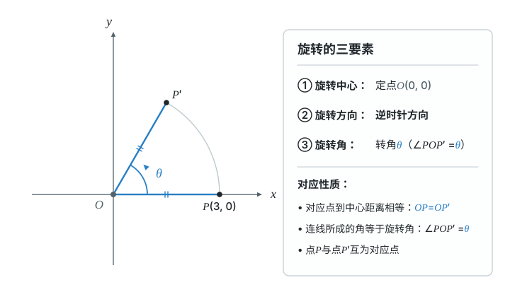
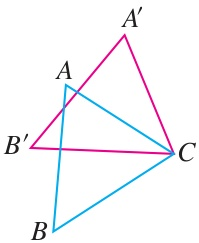
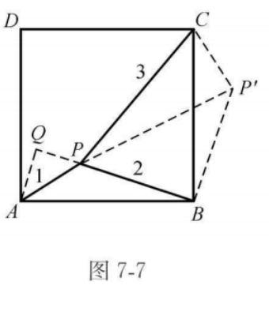
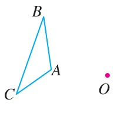

# 第二十八章 旋转

图形转了位置，长度和角不变。
这章先找对应点，再把旋转变成等边、等角和中点关系。

## 本章前置自查

- 会认角、计算角的和差。不会就回看七上第六章6.3“角”。
- 会按对应顺序认全等三角形的边、角。不会就回看八上第十四章14.1、14.2。
- 会用等腰、等边三角形的角。不会就回看八上第十五章15.3“等腰三角形”。
- 会用勾股定理及其逆定理。不会就回看八下第二十章20.1、20.2。
- 会化简、计算二次根式。不会就回看八下第十九章19.1–19.3。
- 会用对角线中点关系判定平行四边形，再用直角判定矩形。不会就回看八下第二十一章21.2、21.3。
- 会读写点的坐标，区分关于两条坐标轴的对称。不会就回看七下第九章9.1、八上第十五章15.2。


## 28.1a 认清旋转中心、方向和角

```yaml
id: MATH-9A-28-1a
weight: 一般
weight_note: 9套有效解析卷无单独命中；是读懂旋转条件的基础，不按压轴题难度加重
prerequisites:
- id: MATH-7A-06-3a
  strength: hard
  reason: 要会认角、比较角度
- id: MATH-7B-07-4a
  strength: soft
  reason: 对比平移与绕点转动
textbook: 九上28.1 图形的旋转，p.92
evidence:
- 能辨认五角星与等边三角形绕中心重合的重复部分
- 能从重复部分的个数求出最小的正旋转角
figure: 已完成 figures/rotation-elements-28-1a.svg（点O(0,0)、P(3,0)旋转三要素示意，图与旁式θ同为蓝色）
sources:
- TB28
- ZN28
```

### 本次只学

读旋转条件时，找齐中心、方向和角度。

### 先认住

- 在平面内，图形绕一个定点转动，叫做旋转。
- 定点是旋转中心；转动的角度是旋转角。还要分清顺时针、逆时针。
- 点 $P$ 转到 $P'$，它们是对应点；中心 $O$ 不动，$OP$ 转到 $OP'$。



### 容易错

- 不要把图形内部随便一个角当作旋转角。
- 指明转角，还不足以确定结果；中心和方向也要明确。

### 练一练

- `Q-MATH-TB9A-28.1-2`


## 28.1b 用旋转性质找等边等角

```yaml
id: MATH-9A-28-1b
weight: 重点
weight_note: 4次；对应点与非对应点易混，广州综合题用它把旋转条件转为角和长度
prerequisites:
- id: MATH-9A-28-1a
  strength: hard
  reason: 先认清旋转中心及对应点
- id: MATH-8A-14-1a
  strength: hard
  reason: 旋转前后的图形全等
- id: MATH-8A-15-3c
  strength: soft
  reason: 练习用到等边三角形的角与中线
textbook: 九上28.1 图形的旋转，p.93、97–98
evidence:
- 能按顶点对应顺序写出等长边与相等角
- 能把旋转角放回原图，求出剩余的角
figure: 已完成 figures/tb28-1-ex1.jpg（课本图原图，不再另画图解步骤图）
sources:
- TB28
- ZN28
method:
- MG7 平移和旋转
walk_source: 课本28.1例1，印刷p.93；PDF索引99
```

### 本次只学

先找对应点，再把旋转条件写成等边、等角。

### 先认住

- 对应点到旋转中心的距离相等：$OP=OP'$。
- 对应点与中心连线形成的转角相同，如 $\angle POP'=\angle QOQ'$。
- 旋转前后图形全等；对应边相等，对应角相等。
- 写出顶点对应顺序，再认边和角。旋转中心若是顶点，它仍对应自身。

### 走一遍

如图，将 $\triangle ABC$ 绕点 $C$ 顺时针旋转 $35^\circ$，得到 $\triangle A'B'C$，若 $\angle BCA'=100^\circ$，求 $\angle B'CA$ 的度数。



1. 对应关系是 $A\to A'$、$B\to B'$、$C\to C$。
2. $\angle BCB'=\angle ACA'=35^\circ$（对应点与中心连线所成的角等于旋转角）。
3. 按图中射线的位置，$\angle BCB'+\angle B'CA+\angle ACA'=\angle BCA'$（角的和）。
4. $\angle B'CA=\textcolor{#287fc4}{100}^\circ-\textcolor{#287fc4}{35}^\circ-\textcolor{#287fc4}{35}^\circ=\boxed{30^\circ}$。

把两个转角放回原角里，剩下的就是所求角。

### 容易错

- “看起来等长”不是依据；先确认是不是对应边。
- 两个旋转角相同，不代表图中每一个角都相同。

### 练一练

- `Q-MATH-TB9A-28.1-5`
- `Q-MATH-GZ2023-23-2`

## 28.1c 确定关键点的旋转位置

```yaml
id: MATH-9A-28-1c
weight: 一般
weight_note: 1次广州尺规作图；先找关键点，再连线，不另加复杂作图题
prerequisites:
- id: MATH-9A-28-1b
  strength: hard
  reason: 用等距离和旋转角定位
- id: MATH-8A-14-2a
  strength: soft
  reason: 尺规作图用已有三角形边长
textbook: 九上28.1 图形的旋转，p.94
evidence:
- 能确定A、B、C在旋转后的对应点
- 能用两条对应边的长度定位新顶点E
figure: 可选｜图解步骤图：沿用广州2023第23题的A、B、C、D、E关系；先标A不动与B到D，再显示E的两条距离条件，最后连接AD、DE、EA。菱形边实线，定位弧虚线；AC与AE同蓝，BC与DE同绿。实际坐标求两圆交点，按逆时针方向选择外侧交点。初始完整展示三个步骤、作图痕迹与旁式，不添圆的定理。
sources:
- TB28
- GZ2023
```

### 本次只学

先找关键点的新位置，再按原顺序连接。

### 先认住

- 找到顶点的对应点，就能确定三角形旋转后的位置。
- 点 $P'$ 要同时满足 $OP'=OP$ 和指定的方向、转角。
- 旋转中心若是顶点，它不用重新定位；其余点都绕同一中心转。

### 容易错

- 距离条件相同，可能有两个候选点；还要核对方向。
- 不要先凭感觉画出整个三角形，再给点名。

### 练一练

- `Q-MATH-GZ2023-23-1` 第（1）问


## 28.1d 旋转后集中几何条件

```yaml
id: MATH-9A-28-1d
weight: 重点
weight_note: 5次综合小问；分值较高，但部分含后续相似；本章只练全等、勾股可解决的题
prerequisites:
- id: MATH-9A-28-1b
  strength: hard
  reason: 移动图形但保留长度与角
- id: MATH-8B-20-1a
  strength: hard
  reason: 将集中后的边长放入直角三角形
- id: MATH-8B-21-3c
  strength: soft
  reason: 正方形提供等边和直角
- id: MATH-8B-20-2a
  strength: hard
  reason: 示范用边长关系判定直角
textbook: 九上28.1 图形的旋转，p.96–97；导引例7.5
evidence:
- 能把BA与BA′识别为等长边，把夹角认作旋转角
- 能在旋转形成的直角三角形中求AA′
figure: 已完成 figures/mg07-e5.png（课本图原图，不再另画图解步骤图）
sources:
- TB28
- MG7
- ZN28
method:
- MG7 平移和旋转
walk_source: 导引例7.5，印刷p.64–65；PDF索引70–71
```

### 本次只学

把分散的边转到一起，回到会做的三角形里。

### 先认住

- 选择中心时，先看哪个点连接着多条已知线段。
- 旋转保留边长与角；新线段能把分散条件集中起来。
- 出现等腰直角三角形，就可用勾股定理求第三边。

### 走一遍

如图，$P$ 是正方形 $ABCD$ 内一点，$PA=1$，$PB=2$，$PC=3$。求 $\angle APB$ 和正方形的面积。



1. 把 $\triangle PAB$ 绕点 $B$ 顺时针旋转 $90^\circ$，点 $A$ 到 $C$，点 $P$ 到 $P'$（正方形相邻边等长且垂直）。
2. $BP'=BP=2$，$CP'=AP=1$，$\angle PBP'=90^\circ$（旋转性质）。
3. $PP'=\sqrt{\textcolor{#287fc4}{2}^2+\textcolor{#287fc4}{2}^2}=2\sqrt2$，$\angle BP'P=45^\circ$（等腰直角三角形）。
4. $CP'^2+PP'^2=\textcolor{#287fc4}{1}^2+(\textcolor{#287fc4}{2\sqrt2})^2=9=PC^2$，所以 $\angle PP'C=90^\circ$（勾股定理的逆定理）。
5. 按图中射线位置，$\angle CP'B=90^\circ+45^\circ=135^\circ$，故 $\angle APB=\boxed{135^\circ}$（角的和、旋转后对应角相等）。
6. 作 $AQ\perp BP$，垂足 $Q$ 在 $BP$ 的延长线上；$\angle APQ=180^\circ-\textcolor{#287fc4}{135}^\circ=45^\circ$（补角）。
7. $AQ=PQ=\dfrac{\sqrt2}{2}$，$BQ=BP+PQ=2+\dfrac{\sqrt2}{2}$（$AP=1$，等腰直角三角形及线段相加）。
8. 正方形的面积等于 $AB^2$，所以 $S_{ABCD}=AQ^2+BQ^2=(\textcolor{#287fc4}{\frac{\sqrt2}{2}})^2+(\textcolor{#287fc4}{2+\frac{\sqrt2}{2}})^2=\boxed{5+2\sqrt2}$（在 $\mathrm{Rt}\triangle AQB$ 中用勾股定理）。

旋转后，三条已知边进入同一个三角形。

### 容易错

- 先说明哪个点转到哪里，再写对应边相等。
- 勾股定理要用在直角三角形中；不能因图看着直就直接用。

### 练一练

- `Q-MATH-TB9A-28.1-7` 第（2）问
- `Q-MATH-GD2024-22-1`

## 28.1e 用旋转重复基本图案

```yaml
id: MATH-9A-28-1e
weight: 了解
weight_note: 9套有效解析卷无独立命中；对应课本图案设计与阅读，不设作答题
prerequisites:
- id: MATH-9A-28-1a
  strength: soft
  reason: 区分旋转中心与转角
textbook: 九上28.1 图形的旋转，p.94–95
evidence:
- 能说明围绕同一点重复旋转可以组成一个图案
figure: 可选｜几何图：取一个不带文字的基本图案，以固定O旋转四次组成整图；并排基本图案、整图，列转角90度与共同中心。基本图案蓝，其余线框色，辅助角弧虚线。点与角用精确旋转坐标，不靠目测拼接。初始完整显示图案与全部四个位置，无互动需求。
sources:
- TB28
```

### 先认住

- 围绕同一点，多次旋转同一个基本图案，可以组成一个新图案。
- 每次都要使用相同的中心；用哪些转角，要和图案的位置对应。


## 28.2a 用中心对称确定中点

```yaml
id: MATH-9A-28-2a
weight: 重点
weight_note: 3次且全在广州；连接对称点并找中点是作图、四边形证明的关键
prerequisites:
- id: MATH-9A-28-1b
  strength: hard
  reason: 中心对称是旋转180度
- id: MATH-8B-21-2b
  strength: hard
  reason: 对角线互相平分判定平行四边形
- id: MATH-8B-21-3a
  strength: soft
  reason: 练习还要用直角判定矩形
textbook: 九上28.2.1 中心对称，p.99–100
evidence:
- 能在对称点连线上把O确定为中点
- 能用两个中点关系证明练习中的四边形是矩形
figure: 已完成 figures/tb28-2-ex1.jpg（课本图原图，不再另画图解步骤图）
sources:
- TB28
- GZ2024
method:
- MG7 平移和旋转
walk_source: 课本28.2.1例1，印刷p.100；PDF索引106
```

### 本次只学

用对称点连线的中点，确定对称中心。

### 先认住

- 一个图形绕点 $O$ 旋转 $180^\circ$，能与另一个图形重合，这两个图形成中心对称。
- 对称点连线经过 $O$，并被 $O$ 平分；即 $A,O,A'$ 共线且 $OA=OA'$。
- 两个成中心对称的图形全等；点 $O$ 本身保持不动。
- 找对称中心，要让各组对称点连线的中点是同一点。

### 走一遍

如图，选择点 $O$ 为对称中心，作出与 $\triangle ABC$ 关于点 $O$ 对称的 $\triangle A'B'C'$。



1. 连接 $AO$，在 $AO$ 的延长线上截取 $OA'=OA$（$O$ 是 $AA'$ 的中点）。
2. 同样作 $B'$、$C'$，使 $O$ 分别是 $BB'$、$CC'$ 的中点（中心对称的性质）。
3. 依次连接 $A'B'$、$B'C'$、$C'A'$，所得三角形就是所求图形（对应顶点已确定）。

连接对称点，比只盯着两个三角形的外形更可靠。

### 容易错

- 中心对称转半圈；轴对称沿直线翻折，不能混用。
- $OA=OA'$ 还不够；$A,O,A'$ 也必须共线。

### 练一练

- `Q-MATH-GZ2024-19-2` 第（2）问


## 28.2b 识别中心对称图形

```yaml
id: MATH-9A-28-2b
weight: 一般
weight_note: 2次低分选择题；重在半周重合，不能用轴对称代替判断
prerequisites:
- id: MATH-9A-28-2a
  strength: hard
  reason: 明确绕点旋转180度
- id: MATH-8A-15-1a
  strength: soft
  reason: 与轴对称图形作区别
textbook: 九上28.2.2 中心对称图形，p.101–102
evidence:
- 能用旋转180度判断图形是否与自身重合
- 能区分既有中心对称又有轴对称的选项
figure: 可选｜几何图：以一般平行四边形与等边三角形对照半周旋转；左图在对角线交点O标180度箭头，右图用重心并保留旋转后的虚线轮廓，显示不能重合。已知轮廓实线，旋转结果虚线，同一顶点及其对应点同蓝，O线框色。按顶点坐标精确半周变换，初始两种结果完整并列；不用折叠图代替旋转检验。
sources:
- TB28
- GD2024
- ZN28
```

### 本次只学

把图形转半圈，检查是否与自身重合。

### 先认住

- 图形绕某一点旋转 $180^\circ$ 后能与自身重合，它就是中心对称图形。
- 中心对称说两个图形的关系；中心对称图形说一个图形自身的性质。
- 中心对称与轴对称要分别检查；符合一个，不保证符合另一个。

### 容易错

- 能沿直线折叠重合，不代表能转半圈重合。
- 能转某个角度重合，也不代表能转 $180^\circ$ 重合。

### 练一练

- `Q-MATH-GD2024-02`


## 28.2c 求关于原点对称的坐标

```yaml
id: MATH-9A-28-2c
weight: 一般
weight_note: 9套有效解析卷无单独命中；是中心对称与坐标的直接联系，保留基础练习
prerequisites:
- id: MATH-9A-28-2a
  strength: hard
  reason: 原点是对应点连线的中点
- id: MATH-7B-09-1a
  strength: hard
  reason: 要会读写点的坐标
textbook: 九上28.2.3 关于原点对称的点的坐标，p.103–104
evidence:
- 能把四个给定点的横纵坐标分别取相反数
- 能用新旧坐标互为相反数检查自己的答案
figure: 已完成 figures/origin-symmetry-28-2c.svg（点A(3,1)关于原点对称到A'(-3,-1)及投影；已放在 Q-MATH-TB9A-28.2P-2 的解析之后）
sources:
- TB28
method:
- MG16 数形结合
```

### 本次只学

把横、纵坐标都取相反数，求原点对称点。

### 先认住

- 点 $(x,y)$ 关于原点的对称点是 $(-x,-y)$；横、纵坐标都取相反数。
- 对称点连线以原点为中点；图上左右、上下同时交换。
- 坐标为 $0$ 的那一项仍是 $0$；原点关于自身对称仍是原点。

### 数形结合

```bridge
mode: cards
式: $(x,y)\to(-x,-y)$
图: origin-sym
形: 点绕原点转了半圈；两点连线穿过原点，且两侧长度相等
色: blue
```

### 容易错

- 只改变一个坐标的符号，是关于坐标轴对称，不是关于原点对称。
- “取相反数”不是“都写成负数”；原坐标为负时，新坐标为正。

### 练一练

- `Q-MATH-TB9A-28.2P-2`
