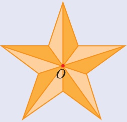
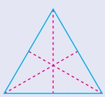
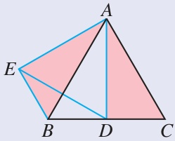
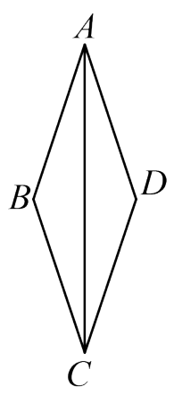
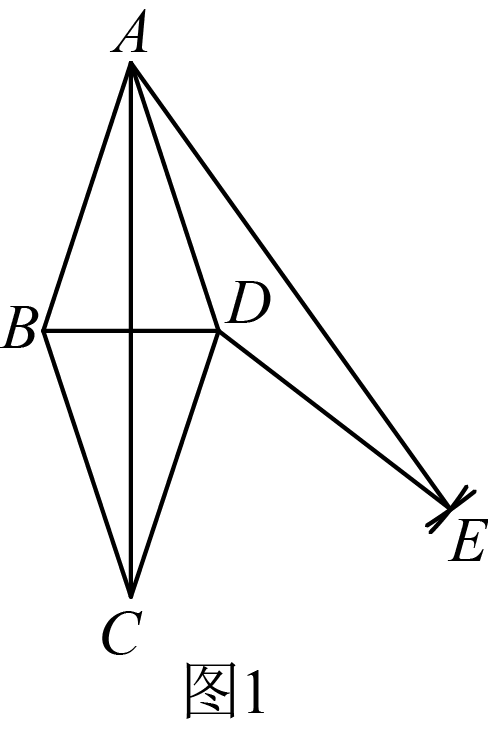
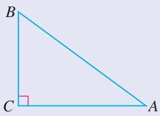
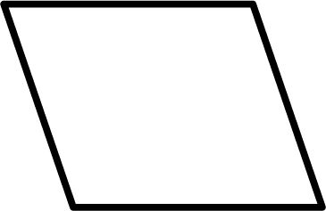
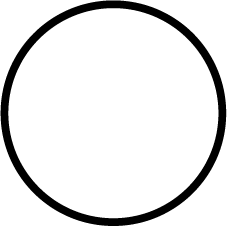
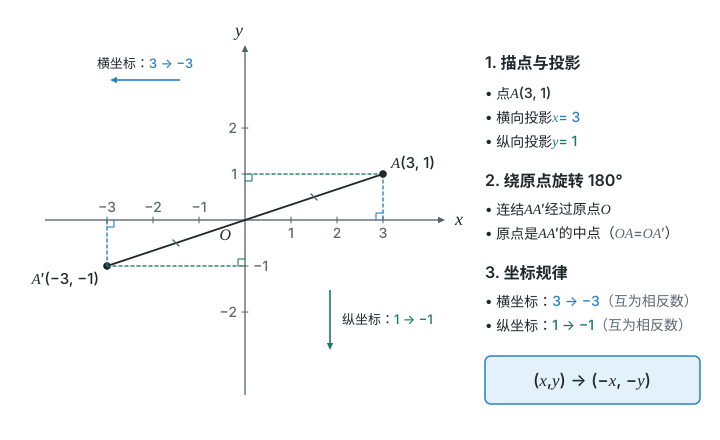
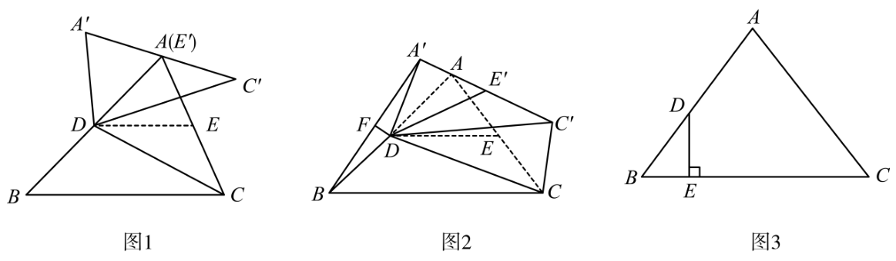

# 第二十八章 旋转 · 题目

## 讲义用题

### Q-MATH-TB9A-28.1-2

```yaml
id: Q-MATH-TB9A-28.1-2
category: 课本习题
source: 人教版数学九上（修订版）p.96，习题28.1第2题
source_quality: 课本原文
kp: MATH-9A-28-1a
type: 解答
grading: 自评
answer_by: 本项目编写，待复核
review:
  概念: MATH-9A-28-1a
  计算: MATH-9A-28-1a
```

**题干**

把图中的五角星图案，绕着它的中心 $O$ 旋转，旋转角至少为多少度时，旋转后的五角星能与自身重合？对等边三角形进行类似的讨论。





**答案**

五角星：$\boxed{72^\circ}$；等边三角形：$\boxed{120^\circ}$。

**解析**

1. 这里求的是非零的最小正旋转角；五角星的中心是 $O$，顺、逆时针均可。
2. 图案绕中心一周有五个相同位置，每相邻两个位置相隔 $\dfrac{\textcolor{#287fc4}{360}^\circ}{\textcolor{#287fc4}{5}}=\boxed{72^\circ}$。
3. 等边三角形绕三条中线的交点旋转，三个顶点依次占据相邻顶点的位置，最小正旋转角为 $\dfrac{\textcolor{#287fc4}{360}^\circ}{\textcolor{#287fc4}{3}}=\boxed{120^\circ}$。

### Q-MATH-TB9A-28.1-5

```yaml
id: Q-MATH-TB9A-28.1-5
category: 课本习题
source: 人教版数学九上（修订版）p.96，习题28.1第5题
source_quality: 课本原文
kp: MATH-9A-28-1b
type: 解答
grading: 自评
answer_by: 本项目编写，待复核
review:
  概念: MATH-9A-28-1b
  审题: MATH-9A-28-1b
```

**题干**

如图，$\triangle ABC$ 是一个等边三角形，$D$ 为边 $BC$ 的中点，把 $\triangle ADC$ 绕点 $A$ 顺时针旋转 $60^\circ$ 得到 $\triangle AEB$，求 $\angle ABE$，$\angle DAE$，$\angle BED$ 的度数。



**答案**

$\angle ABE=\boxed{60^\circ}$，$\angle DAE=\boxed{60^\circ}$，$\angle BED=\boxed{30^\circ}$。

**解析**

1. $\angle ACB=60^\circ$，$AD\perp BC$，所以 $\angle ADC=90^\circ$（等边三角形的内角与“三线合一”）。
2. 旋转的对应关系是 $A\to A$、$D\to E$、$C\to B$，因此 $\angle ABE=\angle ACD=\boxed{60^\circ}$，$\angle AEB=90^\circ$（对应角相等）。
3. $AD=AE$（对应点到旋转中心的距离相等），$\angle DAE=\boxed{60^\circ}$（$\angle DAE$ 等于旋转角 $60^\circ$）。
4. $\triangle ADE$ 是等边三角形，所以 $\angle AED=60^\circ$（等腰三角形顶角为 $60^\circ$）。
5. 按图中射线的位置，$\angle BED=\angle AEB-\angle AED=\textcolor{#287fc4}{90}^\circ-\textcolor{#287fc4}{60}^\circ=\boxed{30^\circ}$（角的差）。

### Q-MATH-GZ2023-23-1

```yaml
id: Q-MATH-GZ2023-23-1
parts:
- {part: '1', kp: MATH-9A-28-1c}
category: 真题
source: 2023年广州中考数学第23题，第（1）问；解析PDF页序18–19
source_quality: 原卷
kp: MATH-9A-28-1c
do: 本章只做第（1）问
other_parts: 第（2）问①使用相似三角形，②使用锐角三角函数；保留原题文字，不在本章作答。
type: 作图
grading: 自评
answer_by: 原卷解析
review:
  概念: MATH-9A-28-1b
  审题: MATH-9A-28-1c
```

**题干**

如图，$AC$ 是菱形 $ABCD$ 的对角线。



（1）尺规作图：将 $\triangle ABC$ 绕点 $A$ 逆时针旋转得到 $\triangle ADE$，点 $B$ 旋转后的对应点为 $D$（保留作图痕迹，不写作法）；

（2）在（1）所作的图中，连接 $BD$，$CE$；

①求证：$\triangle ABD\sim\triangle ACE$；

②若 $\tan\angle BAC=\dfrac13$，求 $\cos\angle DCE$ 的值。

**答案**

第（1）问：$\triangle ADE$ 如图。



**解析**

1. 以点 $D$ 为圆心，$BC$ 长为半径作弧；再以点 $A$ 为圆心，$AC$ 长为半径作弧，交前弧于点 $E$（原卷作图分析）。
2. 如答案图，$\triangle ADE$ 就是所求的图形（原卷第（1）问详解）。

### Q-MATH-TB9A-28.1-7

```yaml
id: Q-MATH-TB9A-28.1-7
parts:
- {part: '2', kp: MATH-9A-28-1d}
category: 课本习题
source: 人教版数学九上（修订版）p.97，习题28.1第7题
source_quality: 课本原文
kp: MATH-9A-28-1d
do: 本章只做第（2）问
other_parts: 第（1）问的作图要求作为原题保留；本章不安排该问作答，不另制课本作图答案图。
type: 解答
grading: 自评
answer_by: 本项目编写，待复核
review:
  概念: MATH-9A-28-1b
  审题: MATH-9A-28-1d
  计算: MATH-9A-28-1d
```

**题干**

如图，在 $\triangle ABC$ 中，$\angle C=90^\circ$。

（1）将 $\triangle ABC$ 绕点 $B$ 逆时针旋转 $90^\circ$，画出旋转后的三角形；

（2）按（1）旋转后，点 $A$ 的对应点为 $A'$，若 $BC=3$，$AC=4$，求 $AA'$ 的长。



**答案**

第（2）问：$\boxed{5\sqrt2}$。

**解析**

1. $AB=\sqrt{\textcolor{#287fc4}{3}^2+\textcolor{#287fc4}{4}^2}=5$（在 $\mathrm{Rt}\triangle ABC$ 中用勾股定理）。
2. $BA'=BA=5$，$\angle ABA'=90^\circ$（旋转的中心为 $B$，转角为 $90^\circ$）。
3. $AA'=\sqrt{\textcolor{#287fc4}{5}^2+\textcolor{#287fc4}{5}^2}=\boxed{5\sqrt2}$（在 $\mathrm{Rt}\triangle ABA'$ 中用勾股定理）。

### Q-MATH-GZ2024-19-2

```yaml
id: Q-MATH-GZ2024-19-2
parts:
- {part: '2', kp: MATH-9A-28-2a}
category: 真题
source: 2024年广州中考数学第19题，第（2）问；解析PDF页序14–15
source_quality: 原卷
kp: MATH-9A-28-2a
do: 本章只做第（2）问
other_parts: 第（1）问尺规作图作为原题条件保留；本章只证明第（2）问，不安排第（1）问作答。
type: 证明
grading: 自评
answer_by: 原卷解析
review:
  概念: MATH-9A-28-2a
  审题: MATH-9A-28-2a
```

**题干**

如图，$\mathrm{Rt}\triangle ABC$ 中，$\angle B=90^\circ$。


（1）尺规作图：作 $AC$ 边上的中线 $BO$（保留作图痕迹，不写作法）；

（2）在（1）所作的图中，将中线 $BO$ 绕点 $O$ 逆时针旋转 $180^\circ$ 得到 $DO$，连接 $AD$，$CD$。求证：四边形 $ABCD$ 是矩形。

**答案**

四边形 $ABCD$ 是矩形。

**解析**


1. $BO$ 是 $AC$ 边上的中线，所以 $A,O,C$ 共线且 $AO=CO$（三角形中线的定义）。
2. $B$ 绕 $O$ 旋转 $180^\circ$ 后到 $D$，所以 $B,O,D$ 共线且 $BO=DO$（中心对称的性质）。
3. 对角线 $AC$、$BD$ 在 $O$ 处互相平分，所以四边形 $ABCD$ 是平行四边形（平行四边形的判定）。
4. 又 $\angle ABC=90^\circ$，所以四边形 $ABCD$ 是矩形（有一个角是直角的平行四边形是矩形）。

### Q-MATH-GD2024-02

```yaml
id: Q-MATH-GD2024-02
category: 真题
source: 2024年广东省中考数学第2题；解析PDF页序1–2
source_quality: 原卷
kp: MATH-9A-28-2b
type: 选择
grading: 自动
answer_by: 原卷解析
review:
  概念: MATH-9A-28-2b
  审题: MATH-9A-28-2b
```

**题干**

下列几何图形中，既是中心对称图形也是轴对称图形的是（　　）

A. 

B. 

C. 

D. 

**答案**

C

**解析**

1. A 的三角形是轴对称图形，但转 $180^\circ$ 不能与自身重合。
2. B 的一般平行四边形能绕对角线交点转 $180^\circ$ 与自身重合，但没有对称轴。
3. C 的圆能绕中心转 $180^\circ$ 与自身重合，也能沿经过中心的直线折叠重合，符合两个条件。
4. D 的五角星是轴对称图形，但转 $180^\circ$ 不能与自身重合，所以选 C。

### Q-MATH-TB9A-28.2P-2

```yaml
id: Q-MATH-TB9A-28.2P-2
category: 课本习题
source: 人教版数学九上（修订版）p.104，28.2.3节内练习第2题
source_quality: 课本原文
kp: MATH-9A-28-2c
type: 解答
grading: 自评
answer_by: 本项目编写，待复核
review:
  概念: MATH-9A-28-2c
  计算: MATH-9A-28-2c
```

**题干**

写出下列各点关于原点的对称点 $A'$，$B'$，$C'$，$D'$ 的坐标：

$A(3,1)$，$B(-2,3)$，$C(-1,-2)$，$D(2,-3)$。

**答案**

$\boxed{A'(-3,-1)}$，$\boxed{B'(2,-3)}$，$\boxed{C'(1,2)}$，$\boxed{D'(-2,3)}$。

**解析**

1. 横、纵坐标都取相反数：$(x,y)\to(-x,-y)$（关于原点对称的点的坐标）。
2. $A(3,1)\to\boxed{A'(-3,-1)}$；检查 $3+(-3)=0$，$1+(-1)=0$。
3. $B(-2,3)\to\boxed{B'(2,-3)}$；检查 $-2+2=0$，$3+(-3)=0$。
4. $C(-1,-2)\to\boxed{C'(1,2)}$；检查 $-1+1=0$，$-2+2=0$。
5. $D(2,-3)\to\boxed{D'(-2,3)}$；检查 $2+(-2)=0$，$-3+3=0$。



### Q-MATH-GZ2023-23-2

```yaml
category: 真题
source: 2023年广州市初中学业水平考试 数学 第23题第（2）问
source_quality: 精品解析原卷Word，对照转出的PDF页核对
kp: MATH-9A-28-1b
type: 解答
grading: 自评
answer_by: 原卷解析
review:
  概念: MATH-9A-28-1b
```

**题干**

如图，$AC$ 是菱形 $ABCD$ 的对角线。


（1）尺规作图：将 $\triangle ABC$ 绕点 $A$ 逆时针旋转得到 $\triangle ADE$，点 $B$ 旋转后的对应点为 $D$（保留作图痕迹，不写作法）；

（2）在（1）所作的图中，连接 $BD$，$CE$。①求证：$\triangle ABD\backsim\triangle ACE$。

**答案**

（1）作图见解析（以点 $D$ 为圆心、$BC$ 长为半径画弧，再以点 $A$ 为圆心、$AC$ 长为半径画弧，两弧交于点 $E$）。（2）①证明见解析。

**解析**

由旋转得 $AB=AD$，$AC=AE$，$\angle BAC=\angle DAE$，所以 $\dfrac{AB}{AC}=\dfrac{AD}{AE}$，且 $\angle BAC+\angle CAD=\angle DAE+\angle CAD$，即 $\angle BAD=\angle CAE$。根据“两边成比例且夹角相等的两个三角形相似”，得 $\triangle ABD\backsim\triangle ACE$。

### Q-MATH-GD2024-22-1

```yaml
category: 真题
source: 2024年广东省初中学业水平考试 数学 第22题第（1）问
source_quality: 精品解析原卷Word，对照转出的PDF页核对
kp: MATH-9A-28-1d
type: 解答
grading: 自评
other_parts: 第（2）（3）问为旋转综合证明，本章不做
answer_by: 原卷解析
review:
  概念: MATH-9A-28-1d
```

**题干**

【知识技能】如图 1，在 $\triangle ABC$ 中，$DE$ 是 $\triangle ABC$ 的中位线。连接 $CD$，将 $\triangle ADC$ 绕点 $D$ 按逆时针方向旋转，得到 $\triangle A'DC'$。当点 $E$ 的对应点 $E'$ 与点 $A$ 重合时，求证：$AB=BC$。



**答案**

证明见解析。

**解析**

因为 $DE$ 是 $\triangle ABC$ 的中位线，所以 $DE=\dfrac12BC$，且 $AD=DB=\dfrac12AB$。又因为 $\triangle ADC$ 绕点 $D$ 旋转得到 $\triangle A'DC'$，点 $E$ 的对应点 $E'$ 与点 $A$ 重合，所以 $DE=DA$。于是 $\dfrac12BC=\dfrac12AB$，即 $AB=BC$。

