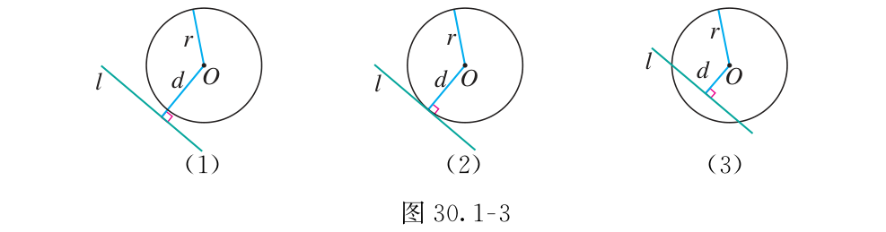
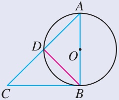
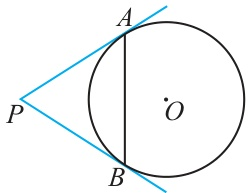
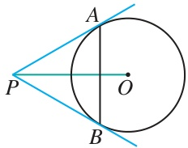
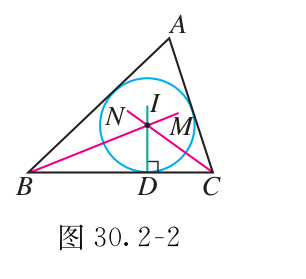
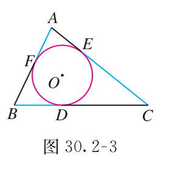
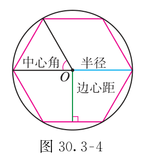

# 第三十章 直线与圆的位置关系

一条直线刚好碰到圆，常能带出一个直角。
这一章把“相切”变成垂直和等长，再用它求边长、角度与面积。

## 本章前置自查

- 会作点到直线的垂线，知道距离沿垂线量取。（七下 第七章第1节 相交线）
- 会用三角形内角和、等腰与等边三角形的性质。（八上 第十三章第3节 三角形的内角与外角；第十五章第3节 等腰三角形）
- 会用三边分别相等证明全等；会用角平分线上的点到两边距离相等。（八上 第十四章第2节 三角形全等的判定、第3节 角的平分线）
- 会用勾股定理；会认定矩形及对边相等。（八下 第二十章第1节 勾股定理；第二十一章第3节 特殊的平行四边形）
- 知道半径、弦、直径；会用垂径定理、圆周角定理和内接四边形对角互补。（九上 第二十九章第1节 圆的有关概念、第2节 圆的有关性质）
- 会认轴对称与中心对称，知道半周转动后重合的含义。（八上 第十五章第1节 图形的轴对称；九上 第二十八章第2节 中心对称）

## 30.1a 用圆心到直线的距离判断位置关系

```yaml
id: MATH-9A-30-1a
weight: 一般
weight_note: 三种位置关系是切线判定的基础，合规真题暂无独立设问。
prerequisites:
- id: MATH-9A-29-1a
  strength: hard
  reason: 认清半径与圆心。
- id: MATH-7B-07-1b
  strength: hard
  reason: 圆心到直线的距离沿垂线量取。
- id: MATH-8B-20-1a
  strength: soft
  reason: 用勾股定理求距离。
textbook: 九上30.1，p.148–149、154
evidence:
- 能先求圆心到直线的垂直距离，再判断相离、相切、相交。
- 能在同一条直线下，分别比较三个半径，不把斜线段当距离。
sources:
- TB9A-30.1
method:
- MG3 分类
- MG16 数形结合
figure: 已完成 figures/tb9a-30-1-fig30-1-3.png（课本图30.1-3原图，放在先认住之后）
```

### 本次只学

先量垂直距离，再判断直线与圆的位置。

### 先认住

- 直线与圆没有公共点时相离；只有一个公共点时相切，这条直线叫作切线，公共点叫作切点；有两个公共点时相交，这条直线叫作割线。
- 设圆的半径为 $r$，圆心到直线的距离为 $d$。$d>r$ 时相离，$d=r$ 时相切，$d<r$ 时相交。
- 图中的 $d$ 是圆心到直线的**垂线段长**。先作垂线，才能把图上的位置写成大小关系。



### 数形结合

```bridge
mode: cards
式: $d>r$
图: tan-out
形: 垂足在圆外
色: red
---
式: $d=r$
图: tan-touch
形: 垂足在圆上
色: green
---
式: $d<r$
图: tan-in
形: 垂足在圆内
色: blue
```

### 容易错

- 圆心到直线上某一点的斜线段，不是圆心到直线的距离。
- 判断的是整条直线，不是图上画出的短线段。

### 练一练

- `Q-MATH-TB9A-30.1-1`

## 30.1b 切线的性质

```yaml
id: MATH-9A-30-1b
weight: 重点
weight_note: 合规真题9个设问需要把切线转化为垂直，常与直径、矩形、勾股定理结合。
prerequisites:
- id: MATH-9A-29-1a
  strength: hard
  reason: 连接圆心与切点得到半径。
- id: MATH-9A-29-2d
  strength: hard
  reason: 直径所对的圆周角是直角。
- id: MATH-8B-21-3a
  strength: soft
  reason: 用三个直角判定矩形。
textbook: 九上30.1，p.150、155习题第4题
walk_source: 课本习题30.1第4题，印刷p.155；PDF索引161
evidence:
- 能由相切条件写出过切点的半径与切线垂直，并说出用的是哪条半径。
- 能结合直径所对的直角，证明矩形，再列勾股方程求半径。
- 能把等大皮带轮的直线段与圆弧分开计算。
sources:
- TB9A-30.1
- SZ2024-18
- MG6-E8
- ZY-tangent
method:
- MG5 化归
- MG6 特殊化和一般化
figure: 已完成 figures/tb30-1-q4.png（课本图原图，不再另画图解步骤图）
```

### 本次只学

看到切线，找到切点，再连接过切点的半径。

### 先认住

- 圆的切线垂直于过切点的半径。
- 若直线 $l$ 与 $\odot O$ 相切于 $T$，连接 $OT$，便有 $OT\perp l$。图上的相切条件，变成了一个直角。
- 得到直角后，再找直径、等腰三角形或矩形；求长度时，检查能否用勾股定理。

### 走一遍

如图，在 $\odot O$ 中，$AB$ 为直径，$AD$ 为弦，过点 $B$ 的切线与 $AD$ 的延长线相交于点 $C$，且 $AD=DC$。求 $\angle ABD$ 的度数。



两个直角先标出来，等长条件才有地方用。

1. $AB\perp BC$（$BC$ 是过点 $B$ 的切线，$OB$ 与 $AB$ 在同一直线上）。
2. $\angle ADB=90^\circ$，所以 $BD\perp AC$（$AB$ 是直径，$A,D,C$ 在同一直线上）。
3. $AD=DC$，所以 $BD$ 是 $AC$ 的垂直平分线，得到 $BA=BC$（垂直平分线上的点到两端距离相等）。
4. $\triangle ABC$ 是等腰直角三角形，$\angle BAC=\dfrac{180^\circ-\textcolor{#287fc4}{90}^\circ}{\textcolor{#287fc4}{2}}=45^\circ$（三角形内角和）。
5. 在 $\triangle ABD$ 中，$\angle ABD=180^\circ-\textcolor{#287fc4}{90}^\circ-\textcolor{#287fc4}{45}^\circ=\boxed{45^\circ}$（三角形内角和）。

### 容易错

- 不是所有半径都与切线垂直，必须是**过切点**的那条。
- 图上看着垂直，不等于已经证明垂直。

### 练一练

- `Q-MATH-SZ2024-18`
- `Q-MATH-MG6-E8`

## 30.1c 切线的判定

```yaml
id: MATH-9A-30-1c
weight: 重点
weight_note: 合规真题3个设问直接要求证明或判断相切，必须区分已知切点和未给切点。
prerequisites:
- id: MATH-9A-30-1a
  strength: hard
  reason: 圆心到直线的距离等于半径时相切。
- id: MATH-9A-30-1b
  strength: hard
  reason: 已知切线先转成垂直。
- id: MATH-8A-14-3a
  strength: hard
  reason: 角平分线上的点到两边距离相等。
textbook: 九上30.1，p.150–151例2
walk_source: 课本30.1例2，印刷p.151；PDF索引157
evidence:
- 能在切点已知时连接半径，先证明垂直，再得出相切。
- 能在切点未知时从圆心作垂线，证明距离等于半径；能用角平分线性质说明等距。
sources:
- TB9A-30.1
- GD2024-17
- ZY-tangent
method:
- MG5 化归
figure: 已完成 figures/tb30-1-ex2.png（课本图原图，不再另画图解步骤图）
```

### 本次只学

分清两种情况，把“相切”证明到位。

### 先认住

- 经过半径的外端并且垂直于这条半径的直线，是圆的切线。
- 已知直线经过圆上的点：连接这个点与圆心，证明半径与直线垂直。
- 未给切点：从圆心向直线作垂线，证明垂线段长等于半径。此时圆心到直线的距离等于半径，直线与圆相切。

### 走一遍

如图，$AB$ 是 $\odot O$ 的弦，$PA$ 是 $\odot O$ 的切线，$PA=PB$。求证：$PB$ 是 $\odot O$ 的切线。



点 $B$ 已在圆上，只差证明 $PB\perp OB$。

1. 连接 $OA,OB,OP$（连接圆心与圆上点）。
2. $OA\perp PA$，所以 $\angle PAO=90^\circ$（切线的性质）。
3. $PA=PB$，$OA=OB$，$OP=OP$，所以 $\triangle PAO\cong\triangle PBO$（三边分别相等）。
4. $\angle PBO=\angle PAO=90^\circ$，即 $PB\perp OB$（全等三角形的对应角相等）。
5. $B$ 是半径 $OB$ 的外端点，且 $PB\perp OB$，所以 $\boxed{PB\text{ 是 }\odot O\text{ 的切线}}$（切线的判定）。

### 容易错

- 直线垂直于某条半径，还不够；它必须经过半径的外端点。
- 还没证明相切，不能先用“切线垂直半径”当理由。
- 未给切点时，垂足是否在圆上也要证明，不能只凭图认定。

### 练一练

- `Q-MATH-GD2024-17-2`

## 30.1d 圆外一点的切线与切线长定理

```yaml
id: MATH-9A-30-1d
weight: 重点
weight_note: 合规真题3个设问涉及圆外点或切线长，等长必须对应同一圆、同一圆外点。
prerequisites:
- id: MATH-9A-30-1b
  strength: hard
  reason: 切线与过切点的半径垂直。
- id: MATH-9A-29-2d
  strength: soft
  reason: 以圆心和圆外点连线为直径作圆。
- id: MATH-8B-20-1a
  strength: hard
  reason: 在直角三角形中求切线段或半径。
textbook: 九上30.1，p.152–154例3、155习题第8题
walk_source: 课本30.1例3，印刷p.153–154；PDF索引159–160
evidence:
- 能辨认同一圆外点引出的两段切线，正确写出等长与夹角平分关系。
- 能把切线、半径、圆心连线组成直角三角形，求边长；能说明以OP为直径作圆为何得到切点。
sources:
- TB9A-30.1
- ZY-tangent
method:
- MG8 对称变换
figure: 已完成 figures/tb30-1-ex3.png（课本图原图，不再另画图解步骤图）
```

### 本次只学

认清同一圆外点的两条切线，把等长与半角用起来。

### 先认住

- 过圆外一点，可以作两条直线与这个圆相切；圆外点到切点之间线段的长，叫作这点到圆的切线长。
- 从圆外一点引圆的两条切线，它们的切线长相等；这一点和圆心的连线平分两条切线的夹角。若 $PA,PB$ 相切于 $A,B$，则 $PA=PB$，$\angle APO=\angle BPO$。
- 连接过切点的半径，便得到直角三角形 $POA$：$OP^2=OA^2+PA^2$。半径、切线段、圆心连线在式子里各占一条边。
- 过圆外点 $P$ 作切线（选学）：以 $OP$ 为直径作圆，与原圆交于 $A,B$，连接 $PA,PB$。$\angle OAP=\angle OBP=90^\circ$，所以两直线都是切线。

### 走一遍

如图，$PA,PB$ 是 $\odot O$ 的两条切线，$A,B$ 是切点，连接 $AB$。若 $\angle APO=30^\circ$，$OP=2$，求 $\triangle PAB$ 的周长。



先看夹角，再看三角形的形状，不必分别求三条边。

1. 连接 $OA$。$PA=PB$，$\angle APO=\angle BPO$，$OA\perp PA$（切线长定理与切线的性质）。
2. $\angle APB=\textcolor{#287fc4}{30}^\circ+\textcolor{#287fc4}{30}^\circ=60^\circ$，所以 $\triangle PAB$ 是等边三角形（等腰三角形的顶角为 $60^\circ$）。
3. 在 $\mathrm{Rt}\triangle POA$ 中，$OA=\dfrac12\times\textcolor{#287fc4}{2}=1$（$30^\circ$ 角所对的直角边等于斜边的一半）。
4. $PA=\sqrt{\textcolor{#287fc4}{2}^2-\textcolor{#287fc4}{1}^2}=\sqrt3$（勾股定理）。
5. $\triangle PAB$ 的周长为 $\textcolor{#287fc4}{3}\times\textcolor{#287fc4}{\sqrt3}=\boxed{3\sqrt3}$（等边三角形三边相等）。

### 容易错

- 两段切线要来自**同一圆、同一圆外点**，才能直接写相等。
- 切线长是圆外点到切点的线段长，不是整条直线的长度。
- $OP$ 平分的是两条切线的夹角；不要把任意一条经过圆心的线都当角平分线。

### 练一练

- `Q-MATH-TB9A-30.1-8`
- `Q-MATH-GZ2025-16`

## 30.1e 圆与圆的位置关系

```yaml
id: MATH-9A-30-1e
weight: 了解
weight_note: 课本阅读与思考内容，合规真题暂无直接设问，不展开综合计算。
prerequisites:
- id: MATH-9A-29-1a
  strength: hard
  reason: 认清两圆的圆心和半径。
textbook: 九上30.1阅读与思考，p.156–157
evidence:
- 能按公共点数分清外离、外切、相交、内切、内含，知道两种相切都只有一个公共点。
sources:
- TB9A-30.1
figure: 可选｜几何图。五图依次外离、外切、相交、内切、内含；固定大小圆半径，按圆心距计算交点与切点，内含图不与内切图画成同一种接触。底图灰，仅公共点蓝#287fc4；文字在图下，初始全部完整显示，不动画、不互动。本轮不制作。
```

### 先认住

- 两圆没有公共点，且在彼此外部，叫作外离；在彼此外部恰有一个公共点，叫作外切。
- 两圆有两个公共点，叫作相交。
- 一个圆在另一个圆内部，恰有一个公共点，叫作内切；没有公共点，叫作内含。

想一想：外切和内切各有几个公共点？两圆的圆心在切点的同侧还是异侧？

## 30.2a 内切圆、内心与作图

```yaml
id: MATH-9A-30-2a
weight: 一般
weight_note: 内心是三个内角平分线的交点，是内切圆计算与作图的基础，暂无独立设问。
prerequisites:
- id: MATH-9A-30-1c
  strength: hard
  reason: 圆心到三边距离等于半径时三边相切。
- id: MATH-8A-14-3a
  strength: hard
  reason: 会作角平分线并用其性质。
textbook: 九上30.2，p.158–159练习第2题
evidence:
- 能由内心位于内角平分线上，求出角OBC与角OCB。
- 能用三角形内角和，由两个半角求出角BOC。
sources:
- TB9A-30.2
- ZY-incircle
figure: 已完成 figures/tb9a-30-2-fig30-2-2.png（课本图30.2-2原图，放在先认住之后）
```

### 本次只学

找对内心，再找内切圆的半径。

### 先认住

- 与三角形各边都相切的圆，叫作三角形的内切圆；这个三角形叫作圆的外切三角形。
- 内切圆的圆心是三角形三条内角平分线的交点，叫作三角形的内心。内心到三边的距离相等，都是内切圆半径。
- 作内切圆：先作两个内角的平分线，交于 $I$；从 $I$ 向一边作垂线，垂足为 $D$；以 $I$ 为圆心、$ID$ 为半径作圆。



内切圆接触三条边；外接圆经过三个顶点。
说一说：作内切圆时，为什么不能直接把 $I$ 到一个顶点的距离当半径？

### 容易错

- 内心是角平分线的交点，不是三条中线的交点。
- 半径是内心到边的垂直距离，不是内心到顶点的距离。

### 练一练

- `Q-MATH-TB9A-30.2P-2`

## 30.2b 内切圆中的切线段与半径

```yaml
id: MATH-9A-30-2b
weight: 一般
weight_note: 合规真题1题把三组切线长、半径垂直与圆周角结合，保留准确基础练习，不堆综合题。
prerequisites:
- id: MATH-9A-30-2a
  strength: hard
  reason: 认清三角形的内切圆和内心。
- id: MATH-9A-30-1d
  strength: hard
  reason: 同一顶点引出的两段切线相等。
- id: MATH-9A-29-2d
  strength: hard
  reason: 用同弧圆周角与圆心角求角。
textbook: 九上30.2，p.158–159例题及练习第3题
evidence:
- 能按同一顶点配对切线段，用等长关系消去BF+CE-BC。
- 能由半径垂直切线，再用圆周角定理求角FDE。
sources:
- TB9A-30.2
- GZ2023-09
- ZY-incircle
method:
- MG10 换元法和整体思想
- MG16 数形结合
figure: 已完成 figures/tb9a-30-2-fig30-2-3.png（课本图30.2-3原图，放在先认住之后）
```

### 本次只学

把三组切线段配好，再找长度或角度。

### 先认住

- 内切圆分别与 $BC,CA,AB$ 相切于 $D,E,F$。从三个顶点分别引切线，可得 $AF=AE$，$BF=BD$，$CD=CE$；不要跨顶点配对。
- 圆心与切点的连线垂直于相应边。求角时，先标这些直角，再找同一条弧所对的圆心角与圆周角。
- 设三角形三边长为 $a,b,c$，内切圆半径为 $r$。连接内心与三个顶点，将面积分成三份：$S=\dfrac12ar+\dfrac12br+\dfrac12cr=\dfrac12(a+b+c)r$；三份图形的高都为 $r$。



### 数形结合

```bridge
mode: cards
式: 三个三角形的面积相加
图: incircle
形: 连接内心与三个顶点，三块的底分别落在三条边上，三条垂直的高都是 $r$
色: blue
```

### 容易错

- 图上的两段都挨着圆，不代表它们相等；先找共同的圆外点。
- 求圆周角时，必须找对它所对的弧，不能只看角的朝向。

### 练一练

- `Q-MATH-GZ2023-09`

## 30.3a 正多边形的中心、中心角与对称性

```yaml
id: MATH-9A-30-3a
weight: 一般
weight_note: 基础概念决定中心角和边心距的辨认，合规真题暂无直接设问。
prerequisites:
- id: MATH-9A-29-1a
  strength: hard
  reason: 认清半径、弦与外接圆。
- id: MATH-8A-13-3a
  strength: hard
  reason: 会用三角形内角和推算多边形的角。
- id: MATH-8A-15-1a
  strength: soft
  reason: 会判断轴对称。
textbook: 九上30.3，p.161–162、165习题第3题
evidence:
- 能说明正多边形都是轴对称图形，并指出对称轴的位置。
- 能用半周转动判断奇数边与偶数边的中心对称性，并指出对称中心。
sources:
- TB9A-30.3
method:
- MG8 对称变换
figure: 已完成 figures/tb9a-30-3-fig30-3-4.png（课本图30.3-4原图，放在先认住之后）
```

### 本次只学

分清中心角、半径和边心距。

### 先认住

- 各边相等、各角也相等的多边形，是正多边形。它有外接圆和内切圆，两个圆的圆心相同。
- 外接圆的圆心叫作中心，外接圆半径叫作正多边形的半径。每一边所对的圆心角叫作中心角；中心到一边的垂直距离叫作边心距。
- 正 $n$ 边形的中心角为 $360^\circ/n$，也等于一个外角；一个内角为 $180^\circ-360^\circ/n$。中心角从圆心出发，内角的顶点在多边形顶点处。



想一想：正多边形都是轴对称图形吗？对称轴经过哪里？绕中心转半圈（$180^\circ$），偶数边和奇数边的顶点都能落到相对顶点吗？做练一练时自己试一试。

### 容易错

- 只说各边相等，还不能断定它是正多边形。
- 半径连到顶点；边心距垂直于边，不是同一条线段。

### 练一练

- `Q-MATH-TB9A-30.3-3`

## 30.3b 正多边形中的直角三角形计算

```yaml
id: MATH-9A-30-3b
weight: 一般
weight_note: 圆的半径、边长、边心距可归入直角三角形，合规真题暂无独立设问，不写长篇示范。
prerequisites:
- id: MATH-9A-30-3a
  strength: hard
  reason: 认清中心角、半径和边心距。
- id: MATH-9A-29-2a
  strength: hard
  reason: 圆心向边作垂线后平分这条弦。
- id: MATH-8B-20-1a
  strength: hard
  reason: 用勾股定理求边心距。
textbook: 九上30.3，p.162–163例题、165习题第5题
evidence:
- 能由正六边形的半径等于边长，构造含半边长和边心距的直角三角形。
- 能把扳手开口认作两条对边间距，用边心距的两倍求最小开口。
sources:
- TB9A-30.3
method:
- MG5 化归
- MG16 数形结合
figure: 已完成 figures/regular-polygon-rt-30-3b.svg（正六边形 a=12 的直角三角形计算；已放在 Q-MATH-TB9A-30.3-5 的解析之后）
```

### 本次只学

把半径、半边长和边心距放进一个直角三角形。

### 先认住

- 设外接圆半径为 $R$，边长为 $a$，边心距为 $r$。连接相邻顶点与中心，再向这一边作垂线，得到 $R^2=r^2+(a/2)^2$（经过圆心且垂直于弦的直线平分弦）。
- 正六边形的中心角为 $60^\circ$，中心与相邻两顶点组成等边三角形，所以边长等于半径。
- 将正 $n$ 边形分成 $n$ 个三角形，它们的底为 $a$、高为 $r$，所以面积 $S=n\cdot\dfrac12ar$；周长为 $na$。


### 数形结合

```bridge
mode: cards
式: $R$、$r$、$\dfrac a2$
图: reg-poly
形: 中心、顶点、边中点组成直角三角形：斜边是 $R$，两条直角边是 $r$ 与 $\dfrac a2$
色: blue
```

### 容易错

- 开口夹住两条对边时，量的是两倍边心距，不是边长或直径。
- 正多边形的半径是外接圆半径，不是内切圆半径。

### 练一练

- `Q-MATH-TB9A-30.3-5`

## 30.3c 圆内接正多边形的作图

```yaml
id: MATH-9A-30-3c
weight: 了解
weight_note: 能按等分圆周理解作图即可，合规真题暂无直接设问。
prerequisites:
- id: MATH-9A-30-3a
  strength: hard
  reason: 正多边形的顶点等分圆周。
textbook: 九上30.3，p.163–164
evidence:
- 能说明用半径作弦长六等分圆周，再顺次连接成正六边形；隔点连接成正三角形。
sources:
- TB9A-30.3
figure: 可选｜图解步骤图。以圆半径为圆规尺长，沿圆周依次截出六点→顺次连接正六边形→隔点连接正三角形；六点坐标精确计算，作图弧为浅灰，保留全部痕迹。已知圆实线、连接边蓝#287fc4，文字固定放图外。初始三个阶段完整可见，不配作答题。本轮不制作。
```

### 先认住

- 等分圆周，再顺次连接分点，得到圆的内接正多边形。
- 正六边形的边长等于半径；用圆半径作圆规尺长，可以依次截出六个等分点。
- 六等分圆周后，顺次连接得到正六边形；隔点连接三个顶点得到正三角形。作两条互相垂直的直径，连接端点得到正方形。

说一说：为什么隔点连接时，每条边对应的弧都一样长？

