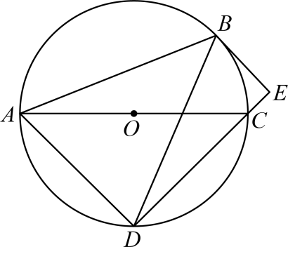
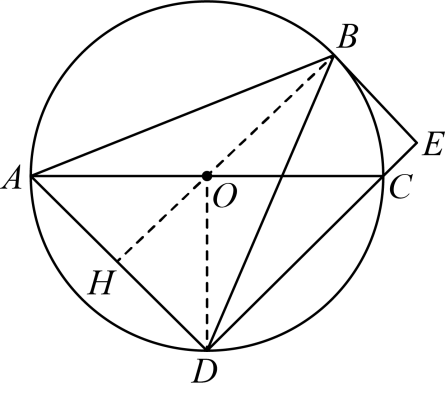
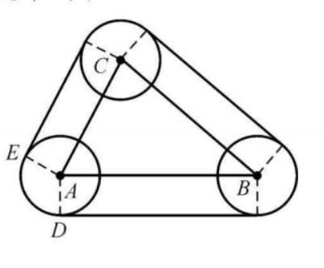
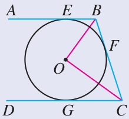
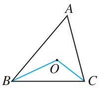
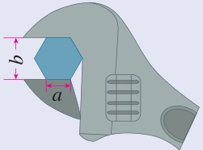
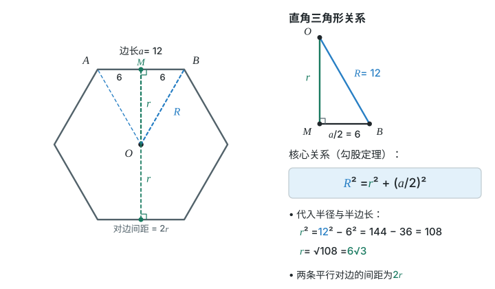

# 第三十章 直线与圆的位置关系 · 题目

## 讲义用题

### Q-MATH-TB9A-30.1-1

```yaml
id: Q-MATH-TB9A-30.1-1
parts:
- {part: '1', kp: MATH-9A-30-1a}
- {part: '2', kp: MATH-9A-30-1a}
- {part: '3', kp: MATH-9A-30-1a}
category: 课本习题
source: 人教版数学九上（修订版）p.154，习题30.1第1题
source_quality: 课本原文
kp: MATH-9A-30-1a
type: 解答
grading: 自评
answer_by: 本项目编写，待复核
review:
  概念: MATH-9A-30-1a
  计算: MATH-9A-30-1a
```

**题干**

在 $\mathrm{Rt}\triangle ABC$ 中，$\angle C=90^\circ$，$AC=3$，$BC=4$，判断以点 $C$ 为圆心，下列 $r$ 为半径的 $\odot C$ 与 $AB$ 的位置关系：

（1）$r=2$；（2）$r=2.4$；（3）$r=3$。

**答案**

（1）$\boxed{\text{相离}}$；（2）$\boxed{\text{相切}}$；（3）$\boxed{\text{相交}}$。

**解析**

1. 过 $C$ 作 $CH\perp AB$，垂足为 $H$。$CH$ 是圆心到直线 $AB$ 的距离（点到直线的距离）。
2. $AB=\sqrt{\textcolor{#287fc4}{3}^2+\textcolor{#287fc4}{4}^2}=5$（勾股定理）。
3. $\dfrac12AC\cdot BC=\dfrac12AB\cdot CH$，所以 $CH=\dfrac{\textcolor{#287fc4}{3}\times\textcolor{#287fc4}{4}}{\textcolor{#287fc4}{5}}=2.4$（用两种底和高表示同一个三角形面积）。
4. （1）$CH>r$，所以 $\odot C$ 与 $AB$ 相离；（2）$CH=r$，所以相切；（3）$CH<r$，所以相交（比较圆心到直线的距离与半径）。

### Q-MATH-SZ2024-18

```yaml
id: Q-MATH-SZ2024-18
category: 真题
source: 2024年深圳市中考数学第18题，原Word及解析版PDF第16–18页
source_quality: 原卷
kp: MATH-9A-30-1b
parts:
  - part: '1'
    kp: MATH-9A-30-1b
  - part: '2'
    kp: MATH-9A-30-1b
type: 解答
grading: 自评
answer_by: 原卷解析
review:
  概念: MATH-9A-30-1b
  前置: MATH-9A-29-2d
  计算: MATH-9A-30-1b
```

**题干**

如图，在 $\triangle ABD$ 中，$AB=BD$，$\odot O$ 为 $\triangle ABD$ 的外接圆，$BE$ 为 $\odot O$ 的切线，$AC$ 为 $\odot O$ 的直径，连接 $DC$ 并延长交 $BE$ 于点 $E$。



（1）求证：$DE\perp BE$；

（2）若 $AB=5\sqrt6$，$BE=5$，求 $\odot O$ 的半径。

**答案**

（1）$\boxed{DE\perp BE}$，证明见解析。

（2）$\boxed{3\sqrt5}$。

**解析**

第（1）问：



1. 连接 $BO$ 并延长，交 $AD$ 于点 $H$，连接 $OD$（原解辅助线）。
2. $AB=BD$，$OA=OD$，所以 $B,O$ 都在 $AD$ 的垂直平分线上，$BO$ 垂直平分 $AD$；得到 $BH\perp AD$，$AH=DH$（线段垂直平分线的判定与性质）。
3. $BE$ 为 $\odot O$ 的切线，所以 $HB\perp BE$（$H,B,O$ 共线，切线垂直于过切点的半径）。
4. $AC$ 是直径，所以 $\angle ADC=90^\circ$；$D,C,E$ 共线，所以 $AD\perp DE$（直径所对的圆周角是直角）。
5. 四边形 $BHDE$ 有三个直角，是矩形，所以 $\boxed{DE\perp BE}$（矩形的判定与性质）。

第（2）问：

1. 由第（1）问知，四边形 $BHDE$ 是矩形，$BH\perp AD$，$AH=DH$，所以 $AH=DH=BE=5$（矩形对边相等）。
2. $BH=\sqrt{(\textcolor{#287fc4}{5\sqrt6})^2-\textcolor{#287fc4}{5}^2}=5\sqrt5$（在 $\mathrm{Rt}\triangle ABH$ 中用勾股定理）。
3. 设 $\odot O$ 的半径为 $r$，则 $OA=OB=r$，$OH=BH-OB=5\sqrt5-r$（图中 $B,O,H$ 的位置关系）。
4. 在 $\mathrm{Rt}\triangle AOH$ 中，$r^2=\textcolor{#287fc4}{5}^2+(\textcolor{#287fc4}{5\sqrt5}-r)^2$（勾股定理）。
5. 展开得 $\cancel{r^2}=25+125-10\sqrt5r+\cancel{r^2}$，所以 $10\sqrt5r=150$，解得 $\boxed{r=3\sqrt5}$（展开平方、移项）。

### Q-MATH-MG6-E8

```yaml
id: Q-MATH-MG6-E8
category: 导引例题
source: 初中数学思想方法导引，第6章例6.8，印刷p.58，PDF索引64，图6-6
source_quality: 导引原文
kp: MATH-9A-30-1b
type: 解答
grading: 自评
answer_by: 本项目编写，待复核
method: [MG6 特殊化和一般化]
review:
  概念: MATH-9A-30-1b
  公式: MATH-9A-29-3a
  审题: MATH-9A-30-1b
```

**题干**

如图6-6，三个直径为 $d$ 的皮带轮的圆心位于 $\triangle ABC$ 的三个顶点处，若 $\triangle ABC$ 的周长为 $s$，求套住这三个皮带轮的皮带的长。



**答案**

$\boxed{s+\pi d}$。

**解析**

把三段弯曲部分拼起来，恰好绕一圈。

1. 每段直线皮带都与相邻两轮相切；连接这段皮带两端的切点与各自圆心，两半径都垂直于这段皮带（切线的性质）。
2. 两半径相等且平行，圆心与两切点组成矩形，所以这段皮带长等于两圆心间距；三段直线部分的总长为 $AB+BC+CA=s$（等圆半径相等、矩形对边相等）。
3. 图中 $AD\perp AB$，$AE\perp AC$，所以轮缘接触弧所对的 $\angle DAE$ 与 $\angle BAC$ 互补，即 $\angle DAE=180^\circ-\angle BAC$（半径垂直切线，直线皮带平行于圆心连线）。
4. 另两轮同理。三段接触弧的圆心角之和为 $\textcolor{#287fc4}{3}\times180^\circ-(\angle A+\angle B+\angle C)=360^\circ$（三角形内角和）。
5. 三轮半径都为 $d/2$，所以三段弧的总长等于一个轮的周长 $\pi d$，皮带总长为 $\boxed{s+\pi d}$（同半径圆的弧长可按圆心角相加）。

### Q-MATH-GD2024-17-2

```yaml
id: Q-MATH-GD2024-17-2
category: 真题
source: 2024年广东省中考数学第17题第（2）问，原Word及解析版PDF第8–9页
source_quality: 原卷
kp: MATH-9A-30-1c
do: 本章只做第（2）问
other_parts: 第（1）问保留原题干，不另要求尺规作图；证明沿用其角平分线AD与交点D的条件。
parts:
  - part: '2'
    kp: MATH-9A-30-1c
type: 证明
grading: 自评
answer_by: 原卷解析
review:
  概念: MATH-9A-30-1c
  审题: MATH-9A-30-1c
```

**题干**

如图，在 $\triangle ABC$ 中，$\angle C=90^\circ$。


（1）实践与操作：用尺规作图法作 $\angle A$ 的平分线 $AD$ 交 $BC$ 于点 $D$；（保留作图痕迹，不要求写作法）

（2）应用与证明：在（1）的条件下，以点 $D$ 为圆心，$DC$ 长为半径作 $\odot D$。求证：$AB$ 与 $\odot D$ 相切。

**答案**

第（2）问：$\boxed{AB\text{ 与 }\odot D\text{ 相切}}$，证明见解析。

**解析**


1. 如图2，作 $DE\perp AB$ 于 $E$（从圆心向待证直线作垂线）。
2. $AD$ 是 $\angle A$ 的平分线，$DE\perp AB$，$DC\perp AC$，所以 $DE=DC$（$D$ 在 $BC$ 上，$\angle C=90^\circ$；角平分线上的点到两边距离相等）。
3. $DC$ 是半径，因此 $DE$ 也是半径，且 $DE\perp AB$，所以 $\boxed{AB\text{ 与 }\odot D\text{ 相切}}$（切线的判定）。

### Q-MATH-TB9A-30.1-8

```yaml
id: Q-MATH-TB9A-30.1-8
category: 课本习题
source: 人教版数学九上（修订版）p.155，习题30.1第8题
source_quality: 课本原文
kp: MATH-9A-30-1d
type: 解答
grading: 自评
answer_by: 本项目编写，待复核
review:
  概念: MATH-9A-30-1d
  计算: MATH-9A-30-1d
```

**题干**

如图，$AB,BC,CD$ 分别与 $\odot O$ 相切于 $E,F,G$ 三点，且 $AB\parallel CD$，$BO=6$，$CO=8$。求 $BC$ 的长。



**答案**

$\boxed{BC=10}$。

**解析**

1. $BE=BF$，$CF=CG$，$BO$ 平分 $\angle EBF$，$CO$ 平分 $\angle FCG$（分别从圆外点 $B,C$ 引两条切线，切线长定理）。
2. $AB\parallel CD$，所以 $\angle EBF+\angle FCG=180^\circ$（两直线平行，同旁内角互补）。
3. $\angle OBC+\angle BCO=\dfrac12(\angle EBF+\angle FCG)=90^\circ$，所以 $\angle BOC=90^\circ$（角平分线、三角形内角和）。
4. $BC=\sqrt{\textcolor{#287fc4}{6}^2+\textcolor{#287fc4}{8}^2}=\boxed{10}$（在 $\mathrm{Rt}\triangle BOC$ 中用勾股定理）。

### Q-MATH-TB9A-30.2P-2

```yaml
id: Q-MATH-TB9A-30.2P-2
category: 课本习题
source: 人教版数学九上（修订版）p.159，30.2节内练习第2题
source_quality: 课本原文
kp: MATH-9A-30-2a
type: 解答
grading: 自评
answer_by: 本项目编写，待复核
review:
  概念: MATH-9A-30-2a
  计算: MATH-9A-30-2a
```

**题干**

如图，在 $\triangle ABC$ 中，$\angle ABC=50^\circ$，$\angle ACB=75^\circ$，点 $O$ 是 $\triangle ABC$ 的内心。求 $\angle BOC$ 的度数。



**答案**

$\boxed{\angle BOC=117.5^\circ}$。

**解析**

1. $O$ 是内心，所以 $BO,CO$ 分别平分 $\angle ABC,\angle ACB$（内心是三条内角平分线的交点）。
2. $\angle OBC=\dfrac12\times\textcolor{#287fc4}{50}^\circ=25^\circ$，$\angle OCB=\dfrac12\times\textcolor{#287fc4}{75}^\circ=37.5^\circ$（角平分线）。
3. $\angle BOC=180^\circ-\textcolor{#287fc4}{25}^\circ-\textcolor{#287fc4}{37.5}^\circ=\boxed{117.5^\circ}$（三角形内角和）。

### Q-MATH-GZ2023-09

```yaml
id: Q-MATH-GZ2023-09
category: 真题
source: 2023年广州市中考数学第9题，原Word及解析版PDF第5–6页
source_quality: 原卷
kp: MATH-9A-30-2b
type: 选择
grading: 自动
answer_by: 原卷解析
review:
  概念: MATH-9A-30-1d
  审题: MATH-9A-30-2b
  前置: MATH-9A-29-2d
```

**题干**

如图，$\triangle ABC$ 的内切圆 $\odot I$ 与 $BC,CA,AB$ 分别相切于点 $D,E,F$，若 $\odot I$ 的半径为 $r$，$\angle A=\alpha$，则 $(BF+CE-BC)$ 的值和 $\angle FDE$ 的大小分别为（　　）


A. $2r$，$90^\circ-\alpha$

B. $0$，$90^\circ-\alpha$

C. $2r$，$90^\circ-\dfrac\alpha2$

D. $0$，$90^\circ-\dfrac\alpha2$

**答案**

D

**解析**


1. 连接 $IF,IE$（原解辅助线）。
2. $BF=BD$，$CD=CE$，$IF\perp AB$，$IE\perp AC$（切线长定理与切线的性质）。
3. $BF+CE-BC=BD+CD-BC=\cancel{BC}-\cancel{BC}=\boxed{0}$（$D$ 在线段 $BC$ 上）。
4. $\angle AFI=\angle AEI=90^\circ$，所以 $\angle EIF=\textcolor{#287fc4}{360}^\circ-\textcolor{#287fc4}{90}^\circ-\textcolor{#287fc4}{90}^\circ-\alpha=180^\circ-\alpha$（四边形 $AFIE$ 的内角和）。
5. $\angle EDF=\dfrac12\angle EIF=\boxed{90^\circ-\dfrac\alpha2}$（圆周角与圆心角所对的是同一段不含 $D$ 的弧 $EF$）。
6. 故选 D。

### Q-MATH-TB9A-30.3-3

```yaml
id: Q-MATH-TB9A-30.3-3
category: 课本习题
source: 人教版数学九上（修订版）p.165，习题30.3第3题
source_quality: 课本原文
kp: MATH-9A-30-3a
type: 简答
grading: 自评
answer_by: 本项目编写，待复核
review:
  概念: MATH-9A-30-3a
  审题: MATH-9A-30-3a
```

**题干**

正多边形都是轴对称图形吗？如果是，它的对称轴在哪里？正多边形都是中心对称图形吗？如果是，它的对称中心在哪里？

**答案**

正多边形都是轴对称图形，对称轴经过它的中心。

正多边形不一定是中心对称图形：边数为偶数时是，对称中心是它的中心；边数为奇数时不是。

**解析**

1. 正多边形的顶点等分圆周，沿相应直径对折，对折两侧的顶点、边会对应重合（等弧及轴对称）。
2. 边数为奇数时，对称轴经过一个顶点与其对边的中点；边数为偶数时，对称轴或经过两个相对顶点，或经过两条对边的中点。它们都经过中心（圆周等分点的对应关系）。
3. 边数为偶数时，绕中心转动 $180^\circ$，每个顶点都能转到相对的顶点，图形重合，所以是中心对称图形（中心对称图形的定义）。
4. 边数为奇数时，半周包含的边数不是整数，顶点会转到两顶点之间，图形不能重合，所以不是中心对称图形（相邻顶点的圆心角都相等）。

### Q-MATH-TB9A-30.3-5

```yaml
id: Q-MATH-TB9A-30.3-5
category: 课本习题
source: 人教版数学九上（修订版）p.165，习题30.3第5题
source_quality: 课本原文
kp: MATH-9A-30-3b
type: 解答
grading: 自评
answer_by: 本项目编写，待复核
review:
  概念: MATH-9A-30-3a
  审题: MATH-9A-30-3b
  计算: MATH-9A-30-3b
```

**题干**

如图，要拧开一个边长 $a=12\ \mathrm{mm}$ 的六角形螺帽，扳手张开的开口 $b$ 至少是多少？



**答案**

$\boxed{12\sqrt3\ \mathrm{mm}}$。

**解析**

1. 螺帽截面是正六边形。取中心 $O$，一条边的端点为 $A,B$，作 $OM\perp AB$，垂足为 $M$；扳手开口夹住两条平行对边（读图，开口不是对角线长）。
2. $\angle AOB=\dfrac{360^\circ}{\textcolor{#287fc4}{6}}=60^\circ$，$OA=OB$，所以 $\triangle AOB$ 是等边三角形，$OA=OB=AB=a=12\ \mathrm{mm}$（正六边形中心角、等边三角形的判定）。
3. $MB=\dfrac12AB=6\ \mathrm{mm}$（经过圆心且垂直于弦的直线平分弦）。
4. $OM=\sqrt{\textcolor{#287fc4}{12}^2-\textcolor{#287fc4}{6}^2}=6\sqrt3\ \mathrm{mm}$（在 $\mathrm{Rt}\triangle OBM$ 中用勾股定理）。
5. 两条对边间距为 $\textcolor{#287fc4}{2}\times\textcolor{#287fc4}{6\sqrt3}=12\sqrt3\ \mathrm{mm}$，所以开口至少为 $\boxed{12\sqrt3\ \mathrm{mm}}$（中心在两条对边之间，两段边心距相等）。



### Q-MATH-GZ2025-16

```yaml
category: 真题
source: 2025年广州市初中学业水平考试 数学 第16题
source_quality: 精品解析原卷Word，对照转出的PDF页核对
kp: MATH-9A-30-1d
type: 填空
grading: 自评
answer_by: 原卷解析
review:
  概念: MATH-9A-30-1d
```

**题干**

已知 $\odot O$ 的半径为 6，$\odot O$ 所在平面内有一动点 $P$，过点 $P$ 可以引 $\odot O$ 的两条切线 $PA$，$PB$，切点分别为 $A$，$B$。点 $P$ 与圆心 $O$ 的距离为 $d$，则 $d$ 的取值范围是＿＿＿＿；若过点 $O$ 作 $OC\parallel PA$ 交直线 $PB$ 于点 $C$（点 $C$ 不与点 $B$ 重合），线段 $OC$ 与 $\odot O$ 交于点 $D$。设 $PA=x$，$CD=y$，则 $y$ 关于 $x$ 的函数解析式为＿＿＿＿。

**答案**

$d>6$；$y=\dfrac{x^2-12x+36}{2x}$

**解析**

过圆外一点才能引两条切线，所以点 $P$ 在 $\odot O$ 外，$d>6$。由切线长定理 $PB=PA=x$，$OB\perp PB$，$\angle OPA=\angle OPB$。又 $OC\parallel PA$，所以 $\angle OPA=\angle POC$，故 $\angle OPC=\angle POC$，$PC=OC=6+y$，$BC=PB-PC$ 的长为 $x-6-y$（按图中位置）。在 $\mathrm{Rt}\triangle OBC$ 中，$OC^2=OB^2+BC^2$，即 $(6+y)^2=6^2+(x-6-y)^2$，整理得 $y=\dfrac{x^2-12x+36}{2x}$。

