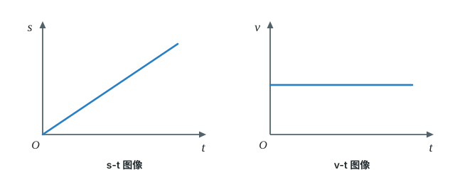

# 第一章 机械运动

这一章我们学习最简单的运动形式：机械运动。先学习怎样准确测量长度和时间，再学习怎样选取参照物来判断物体是运动还是静止。最后我们学习用速度来描述物体运动的快慢，并学习计算和测量速度。

标着**重点**的知识点（长度单位换算与刻度尺读数、用 $v=\dfrac{s}{t}$ 计算速度）几乎年年考，要重点练习。

## 本章前置自查

下面几件事，哪一件没把握，先回看：

1. 会用 $10^n$ 表示较大的数或较小的数。（数学-科学记数法）
2. 会把公式变形，已知两个量求第三个。（数学-方程变形）

---

## 1.1a 长度单位换算与刻度尺读数

```yaml
id: PHY-8A-01-1a
weight: 重点
textbook: 八上 1.1 长度和时间的测量，p.11–13
prerequisites:
  - id: MATH-科学记数法
    strength: soft
    reason: 单位换算常用 10 的幂表示
evidence:
  - 能记住各级长度单位之间的进率，并进行换算
  - 测量长度前，能看对刻度尺的零刻度线、量程、分度值
  - 读数时视线垂直于尺面，并估读到分度值的下一位
figure: 不需要
sources: [TB8A-1.1, GD2022-18, GD2023-01]
```

### 本次只学

认识常用的长度单位，学会用刻度尺准确测量并读出长度。

### 先认住

- **单位与进率**：长度基本单位是米（$\mathrm{m}$）；$1\ \mathrm{km} = 10^3\ \mathrm{m}$；$1\ \mathrm{m} = 10\ \mathrm{dm} = 10^2\ \mathrm{cm} = 10^3\ \mathrm{mm} = 10^6\ \mu\mathrm{m} = 10^9\ \mathrm{nm}$。
- **看尺**：使用刻度尺前，要认清它的零刻度线、量程和分度值。
- **对齐与视线**：测长度时，尺边缘要紧靠被测物体且与被测边保持平行，零刻度线对准一端。读数时，视线要正对刻度线。
- **补充**（课本没有讲，做真题时常用）：读数时，要估读到分度值的下一位。

### 走一遍

**正确使用刻度尺**：

1. **放**：零刻度线对准被测物体的一端，有刻度线的一边紧靠被测物体且与被测边保持平行，不能歪斜。
2. **读**：视线要正对刻度线。
3. **记**：记录数值和单位。没有单位的记录是没有意义的。

### 容易错

- 没有估读：刻度刚好对准刻度线时，估读那一位要写 $0$。
- 单位换算搞反进率：大单位换小单位乘进率，小单位换大单位除以进率。

### 练一练

- `Q-PHY-GD2023-01`
- `Q-PHY-GD2022-18`

## 1.1b 用停表测量时间

```yaml
id: PHY-8A-01-1b
weight: 一般
textbook: 八上 1.1 长度和时间的测量，p.14–15
prerequisites:
  - id: PHY-8A-01-1a
    strength: soft
    reason: 读数方法相同：先看分度值
evidence:
  - 知道时间的常用单位及其换算
  - 会看机械停表的小表盘和大表盘，准确读出时间
figure: 不需要
sources: [TB8A-1.1, SZ2023-13]
```

### 本次只学

认识时间单位，学会读机械停表（课本里叫秒表）。

### 先认住

- **单位与进率**：时间的基本单位是秒（$\mathrm{s}$）。$1\ \mathrm{h} = 60\ \mathrm{min}$；$1\ \mathrm{min} = 60\ \mathrm{s}$。
- **补充**（课本没有讲，做真题时常用）：机械停表（课本里叫秒表）有两个表盘。小表盘读整分钟；小表盘指针没过半分钟刻度，大表盘读 $0\sim30\ \mathrm{s}$ 的数，过了半分钟刻度，读 $31\sim59\ \mathrm{s}$ 的数（大表盘同一圈上两组数字间隔排列）。两个读数相加。

### 容易错

- 没有注意小表盘是否过半分钟刻度：大表盘是读 $0\sim30\ \mathrm{s}$ 还是 $30\sim60\ \mathrm{s}$，取决于小表盘指针是否过了半分钟刻度。

### 练一练

- `Q-PHY-SZ2023-13-2`

## 1.1c 误差与错误

```yaml
id: PHY-8A-01-1c
weight: 了解
textbook: 八上 1.1 长度和时间的测量，p.15
prerequisites:
  - id: PHY-8A-01-1a
    strength: hard
    reason: 误差产生在测量读数中
evidence:
  - 知道误差是测量值和真实值之间的差异，不可避免
  - 知道错误是可以避免的，并能区分误差和错误
  - 知道多次测量求平均值可以减小误差
figure: 不需要
sources: [TB8A-1.1]
```

### 本次只学

了解误差与错误的区别。

### 先认住

- **误差**：受所用仪器和测量方法的限制，测量值与真实值之间总会有差别，这就是误差。
- **误差不可避免**：错误是由于不遵守规则等引起的，可以避免；误差只能减小，不能消除。
- **减小误差的方法**：多次测量求平均值，选用精密的测量工具，改进测量方法。

## 1.2a 用参照物判断运动和静止

```yaml
id: PHY-8A-01-2a
weight: 一般
textbook: 八上 1.2 运动的描述，p.17–18
prerequisites: []
evidence:
  - 知道什么是机械运动和参照物
  - 给定参照物，能判断物体是运动还是静止
figure: 不需要
sources: [TB8A-1.2, GD2024-01]
```

### 本次只学

用参照物判断物体是运动还是静止。

### 先认住

- **机械运动与参照物**：物体位置随时间的变化叫作机械运动。判断运动或静止时作为标准的物体叫作参照物。
- **判断标准**：看所研究的物体相对于参照物的位置是否发生了变化。变化了就是运动的，没变就是静止的。
- **相对性**：物体的运动和静止是相对的。选择不同的参照物，描述同一个物体的运动，结论往往不同。

### 容易错

- 参照物可以根据需要来选择；不要选所研究的物体本身。

### 练一练

- `Q-PHY-GD2024-01`

## 1.3a 速度的含义和单位换算

```yaml
id: PHY-8A-01-3a
weight: 一般
textbook: 八上 1.3 运动的快慢，p.20–21
prerequisites:
  - id: PHY-8A-01-1a
    strength: hard
    reason: 要会长度单位换算
  - id: PHY-8A-01-1b
    strength: soft
    reason: 时间单位要换算成秒或小时
evidence:
  - 知道速度是表示物体运动快慢的物理量
  - 知道速度的公式和单位
  - 能熟练进行 m/s 与 km/h 的单位换算
figure: 不需要
sources: [TB8A-1.3]
```

### 本次只学

认识速度的含义，学会速度单位的换算。

### 先认住

- **定义与公式**：速度是表示物体运动快慢的物理量。路程与时间之比叫作速度，公式 $v = \dfrac{s}{t}$。
- **单位与进率**：速度单位是米每秒（$\mathrm{m/s}$）或千米每小时（$\mathrm{km/h}$）；$1\ \mathrm{m/s} = 3.6\ \mathrm{km/h}$。

### 容易错

- 进率记反：$1\ \mathrm{m/s}$ 比 $1\ \mathrm{km/h}$ 大（$1\ \mathrm{m/s}$ 跑一小时就是 $3600\ \mathrm{m}$，也就是 $3.6\ \mathrm{km}$），所以由 $\mathrm{m/s}$ 换成 $\mathrm{km/h}$ 要乘 $3.6$。

### 练一练

- `Q-PHY-TB8A-01.3-1`

## 1.3b 用 v=s/t 计算速度

```yaml
id: PHY-8A-01-3b
weight: 重点
textbook: 八上 1.3 运动的快慢，p.21–23
prerequisites:
  - id: PHY-8A-01-3a
    strength: hard
    reason: 代入前要统一单位
  - id: MATH-方程变形
    strength: soft
    reason: 已知两个量求第三个，要会变形公式
evidence:
  - 能根据已知条件选择合适的单位组合（m 和 s 对应 m/s，km 和 h 对应 km/h）
  - 会代入公式 v=s/t 并算出正确结果
figure: 不需要
sources: [TB8A-1.3, GD2023-24, GD2024-24]
```

### 本次只学

用速度公式计算速度、路程或时间。

### 先认住

- **基本计算**：用 $v = \dfrac{s}{t}$ 求速度。
- **变形公式**：求路程用 $s = vt$；求时间用 $t = \dfrac{s}{v}$。
- **对应单位**：代入数据前，单位要统一成两套之一：$\mathrm{m}$、$\mathrm{s}$、$\mathrm{m/s}$，或者 $\mathrm{km}$、$\mathrm{h}$、$\mathrm{km/h}$。
- **平均速度**：变速直线运动比匀速直线运动复杂，如果只作粗略研究，也可以用 $v = \dfrac{s}{t}$ 来描述运动的快慢，这样算出来的速度叫作平均速度。

### 破题钥匙

```think
现象: 汽车沿直线匀速行驶
模型: 车走过的路程 $s$，除以所用的时间 $t$
图: phy-speed
关系: $v=\dfrac{s}{t}$
结: 速度就是单位时间里走过的路程
```

### 走一遍

**男子百米跑**：在第32届夏季奥运会田径男子 $100\ \mathrm{m}$ 半决赛中，我国优秀短跑运动员以 $9.83\ \mathrm{s}$ 的成绩打破了亚洲纪录。他在这次比赛中的平均速度是多少？

1. **路程与时间**：$s = \textcolor{#287fc4}{100}\ \mathrm{m}$，$t = \textcolor{#287fc4}{9.83}\ \mathrm{s}$。
2. **代入公式计算**：
   $v = \dfrac{s}{t} = \dfrac{\textcolor{#287fc4}{100}\ \mathrm{m}}{\textcolor{#287fc4}{9.83}\ \mathrm{s}} \approx \boxed{10.2\ \mathrm{m/s}}$
3. **结论**：运动员在这次比赛中的平均速度约是 $10.2\ \mathrm{m/s}$。

### 容易错

- 没有统一单位就代入计算：时间给了分钟，路程给了千米，要求 $\mathrm{km/h}$ 的话，先把分钟换成小时，再求速度。
- $s$ 和 $t$ 张冠李戴：比如分段运动中，求全段平均速度，一定要用总路程除以总时间。

### 练一练

- `Q-PHY-GD2024-24-1a`
- `Q-PHY-GD2023-24-3`

## 1.3c 匀速直线运动与运动图像

```yaml
id: PHY-8A-01-3c
weight: 一般
textbook: 八上 1.3 运动的快慢，p.22–23
prerequisites:
  - id: PHY-8A-01-3b
    strength: hard
    reason: 平均速度也用 v=s/t 计算
  - id: MATH-函数图像
    strength: soft
    reason: 要会读横纵坐标和图线
evidence:
  - 知道什么是匀速直线运动和变速直线运动
  - 能按“相等时间内通过的路程是否相等”判断物体做的是匀速还是变速直线运动
  - 能从 $s$-$t$、$v$-$t$ 图像看出物体是否在做匀速直线运动
figure: 已完成 figures/uniform-motion-graphs.svg（并排两幅：s-t 图像（过原点的倾斜直线）、v-t 图像（平行于时间轴的直线））
sources: [TB8A-1.3]
```

### 本次只学

认识匀速直线运动和变速直线运动，会看匀速直线运动的图像。

### 先认住

- **匀速直线运动**：物体沿着直线且速度不变的运动，叫作匀速直线运动。匀速直线运动是最简单的机械运动。
- **变速直线运动**：物体做直线运动时，其速度的大小常常是变化的（即在相等的时间内通过的路程不相等），这种运动叫作变速直线运动。
- **补充**（课本没有讲，做真题时常用）：匀速直线运动的 $s$-$t$ 图像（横轴时间、纵轴路程）是一条倾斜的直线，从计时起点出发时过原点，直线越陡，速度越大；$v$-$t$ 图像（横轴时间、纵轴速度）是一条平行于时间轴的直线。



### 容易错

- 平均速度不是各段速度的平均值：变速直线运动中，计算平均速度必须用总路程除以总时间，一般不等于各段速度相加再平均。

### 练一练


## 1.4a 测量平均速度

```yaml
id: PHY-8A-01-4a
weight: 了解
textbook: 八上 1.4 测量平均速度，p.25–26
prerequisites:
  - id: PHY-8A-01-3b
    strength: hard
    reason: 实验原理就是 v=s/t
  - id: PHY-8A-01-1a
    strength: hard
    reason: 要用刻度尺量路程
  - id: PHY-8A-01-1b
    strength: hard
    reason: 要用停表测时间
evidence:
  - 知道测量小车平均速度的实验原理和所需器材
  - 能设计实验记录数据的表格
figure: 不需要
sources: [TB8A-1.4]
```

### 本次只学

了解平均速度的测量。

### 先认住

- **原理与器材**：测量平均速度的原理是 $v = \dfrac{s}{t}$。需要刻度尺、停表、斜面、小车和金属片。
- **操作重点**：斜面保持很小的坡度。
- **平均速度的区别**：同一物体做变速运动时，在各段路程上的平均速度通常是不相等的。平均速度不是速度的平均值。
