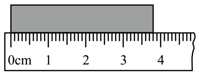
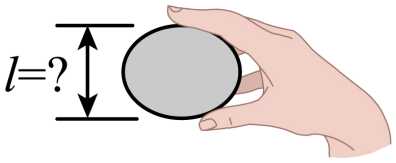
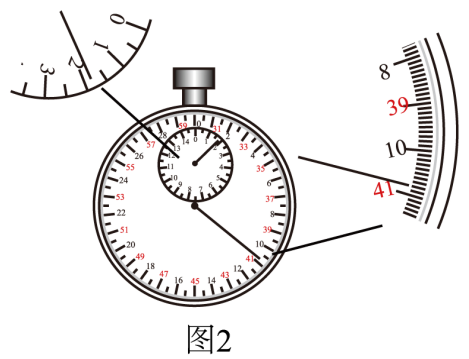
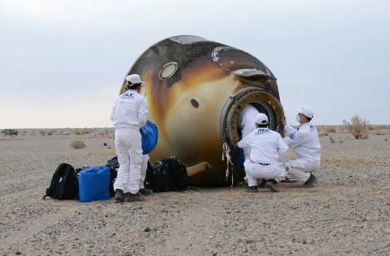

# 第一章 机械运动 题目

## 讲义用题（7 道）

### Q-PHY-GD2022-18

```yaml
category: 真题
source: 2022 年广东第 18 题
source_quality: 原卷
kp: PHY-8A-01-1a
type: 填空
grading: 自评
answer_by: 原卷解析
review:
  概念: PHY-8A-01-1a
```

**题干**

图中，刻度尺的分度值是______$\mathrm{mm}$，木块的长度为________$\mathrm{cm}$。



**答案**

1；3.80

**解析**

1. 图示刻度尺 $1\ \mathrm{cm}$ 又分为 10 个小刻度，故分度值为 $\boxed{1\ \mathrm{mm}}$。
2. 木块起始端对应的刻度值为 $\textcolor{#287fc4}{0.00}\ \mathrm{cm}$；末端对应的刻度值为 $\textcolor{#287fc4}{3.80}\ \mathrm{cm}$，木块长度为 $\boxed{3.80\ \mathrm{cm}}$。


### Q-PHY-GD2023-01

```yaml
category: 真题
source: 2023 年广东第 1 题
source_quality: 原卷
kp: PHY-8A-01-1a
type: 选择
grading: 自动
answer_by: 原卷解析
review:
  概念: PHY-8A-01-1a
```

**题干**

荔枝是一种岭南佳果，小明拿起一个荔枝，如题图所示，它的尺寸 $l$ 大小约为（　　）



A. $0.1\ \mathrm{cm}$
B. $3\ \mathrm{cm}$
C. $0.3\ \mathrm{m}$
D. $1\ \mathrm{m}$

**答案**

B

**解析**

1. 由生活常识可知，一般荔枝的直径约为 $3\sim5\ \mathrm{cm}$，即它的尺寸 $l$ 大小约为 $3\ \mathrm{cm}\sim5\ \mathrm{cm}$，故 ACD 不符合题意；B 符合题意。


### Q-PHY-SZ2023-13-2

```yaml
category: 真题
source: 2023 年深圳第 13 题第（2）问
source_quality: 原卷
kp: PHY-8A-01-1b
do: 本章只做第（2）问
type: 填空
grading: 自评
answer_by: 原卷解析
review:
  概念: PHY-8A-01-1b
```

**题干**

如图所示，乐亮亮同学做了如下测量：



如图 2，停表读数为：______$\mathrm{s}$；

**答案**

100.8

**解析**

1. 由图 2 可得小表盘中读数为 $1\ \mathrm{min}$，指针偏过中间刻度线，所以大表盘读数为 $\textcolor{#287fc4}{40.8}\ \mathrm{s}$。
2. 则停表读数为 $\textcolor{#287fc4}{60}\ \mathrm{s} + \textcolor{#287fc4}{40.8}\ \mathrm{s} = \boxed{100.8\ \mathrm{s}}$。


### Q-PHY-GD2024-01

```yaml
category: 真题
source: 2024 年广东第 1 题
source_quality: 原卷
kp: PHY-8A-01-2a
type: 选择
grading: 自动
answer_by: 原卷解析
review:
  概念: PHY-8A-01-2a
```

**题干**

如图为珠江两岸景观图。下列相对广州塔静止的是（　　）


A. 飞行的客机
B. 两岸的高楼
C. 行驶的游船
D. 流动的江水

**答案**

B

**解析**

1. 判断一个物体是运动的还是静止的，要看这个物体与所选参照物之间是否有位置变化。若位置有变化，则物体相对于参照物是运动的；若位置没有变化，则物体相对于参照物是静止的。
2. 飞行的客机与广州塔之间的位置不断发生变化，是运动的，故 A 不符合题意。
3. 两岸的高楼与广州塔之间的位置没有发生变化，是静止的，故 B 符合题意。
4. 行驶的游船、流动的江水与广州塔之间的位置不断发生变化，是运动的，故 C、D 不符合题意。


### Q-PHY-TB8A-01.3-1

```yaml
category: 课本习题
source: 八上 1.3 练习与应用 第 1 题，p.23
source_quality: 课本原文
kp: PHY-8A-01-3a
type: 计算
grading: 自评
answer_by: 本项目编写，已复核
review:
  公式: PHY-8A-01-3a
  单位: PHY-8A-01-3a
```

**题干**

某老师晨练时，在 $45\ \mathrm{min}$ 内快步行走 $4.5\ \mathrm{km}$。他在这段时间内行走的速度是多少千米每小时？相当于多少米每秒？

**答案**

$6\ \mathrm{km/h}$；约 $1.67\ \mathrm{m/s}$

**解析**

1. 换算时间：$t = \textcolor{#287fc4}{45}\ \mathrm{min} = \dfrac{\textcolor{#287fc4}{45}}{\textcolor{#287fc4}{60}}\ \mathrm{h} = \textcolor{#287fc4}{0.75}\ \mathrm{h}$
2. 行走速度：$v = \dfrac{s}{t} = \dfrac{\textcolor{#287fc4}{4.5}\ \mathrm{km}}{\textcolor{#287fc4}{0.75}\ \mathrm{h}} = \boxed{6\ \mathrm{km/h}}$
3. 换算为米每秒：$v = \dfrac{\textcolor{#287fc4}{6}}{\textcolor{#287fc4}{3.6}}\ \mathrm{m/s} \approx \boxed{1.67\ \mathrm{m/s}}$


### Q-PHY-GD2024-24-1a

```yaml
category: 真题
source: 2024 年广东第 24 题第（1）问①
source_quality: 原卷
kp: PHY-8A-01-3b
do: 本章只做第（1）问①
other_parts: （1）②重力做功 → PHY-8B-11-1b；（2）压强 → PHY-8B-09-1b。这些小问不在本章使用
type: 计算
grading: 自评
answer_by: 原卷解析
review:
  公式: PHY-8A-01-3b
```

**题干**

2024年4月30日，神舟十七号载人飞船返回舱成功着陆，如图所示。若返回舱质量为 $3\times10^3\ \mathrm{kg}$，在着陆过程中，从距地面 $1\ \mathrm{m}$ 高处竖直向下落地，用时 $0.4\ \mathrm{s}$。（$g=10\ \mathrm{N/kg}$）
（1）求返回舱在这段时间内
①平均速度；



**答案**

$2.5\ \mathrm{m/s}$

**解析**

1. 这段时间内返回舱的平均速度：$v = \dfrac{s}{t} = \dfrac{\textcolor{#287fc4}{1}\ \mathrm{m}}{\textcolor{#287fc4}{0.4}\ \mathrm{s}} = \boxed{2.5\ \mathrm{m/s}}$


### Q-PHY-GD2023-24-3

```yaml
category: 真题
source: 2023 年广东第 24 题第（3）问
source_quality: 原卷
kp: PHY-8A-01-3b
do: 本章只做第（3）问
other_parts: （1）重力 → PHY-8B-07-3a；（2）压强 → PHY-8B-09-1b。这些小问不在本章使用
type: 计算
grading: 自评
answer_by: 原卷解析
review:
  公式: PHY-8A-01-3b
```

**题干**

C919 是我国自主研发的一种大型客机，已完成商业首航。假设某架飞机总质量为 $8\times10^4\ \mathrm{kg}$，静止在水平跑道上时，其轮胎与地面接触的总面积约为 $1\ \mathrm{m}^2$，$g$ 取 $10\ \mathrm{N/kg}$。求该飞机：
（3）以 $800\ \mathrm{km/h}$ 匀速直线飞行 $18\ \mathrm{min}$ 所通过的距离。

**答案**

$240\ \mathrm{km}$

**解析**

1. 飞行时间：$t = \textcolor{#287fc4}{18}\ \mathrm{min} = \dfrac{\textcolor{#287fc4}{18}}{\textcolor{#287fc4}{60}}\ \mathrm{h} = \textcolor{#287fc4}{0.3}\ \mathrm{h}$
2. 飞行所通过的距离：$s = vt = \textcolor{#287fc4}{800}\ \mathrm{km}/\cancel{\mathrm{h}} \times \textcolor{#287fc4}{0.3}\ \cancel{\mathrm{h}} = \boxed{240\ \mathrm{km}}$

## 备选

暂未收录。
