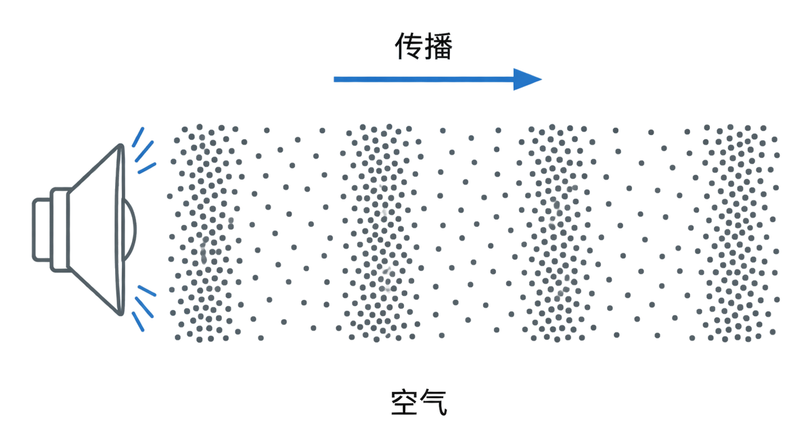
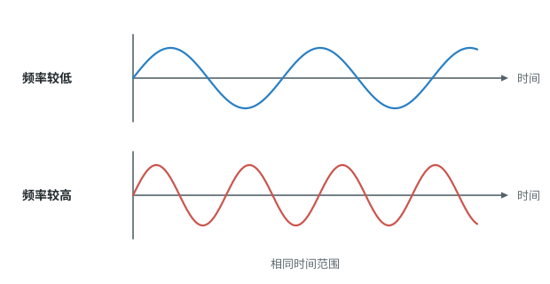
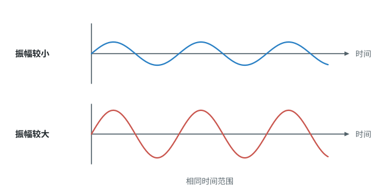
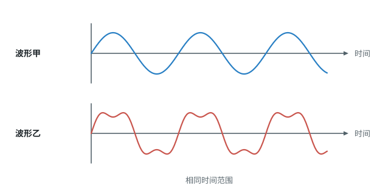

# 第二章 声现象

本章我们将探寻声音是如何产生和传播的，了解声音的特性，以及声在生活中的利用和噪声的控制。标着重点的是音色与三个特性的辨析（2.2c）。

## 本章前置自查

- 会用 $v=\dfrac{s}{t}$ 并变形求路程（八上 第一章第 3 节）

## 2.1a 声音由振动产生

```yaml
id: PHY-8A-02-1a
weight: 一般
weight_note: 2 次，填空送分
textbook: 八上 2.1 声音的产生与传播，p.32–33
prerequisites: []
evidence:
  - 知道声音是由于物体的振动产生的
  - 知道振动停止，发声也就停止
figure: 不需要
sources: [TB, GD2024-11]
```

### 本次只学

知道声音是由物体振动产生的。

### 先认住

- 声音是由物体的**振动**产生的。
- 一切正在发声的物体都在振动，振动停止，发声也停止。

### 容易错

- 发声体停止振动，只是不再发出新的声音；已经发出的声音还会在介质中传播一会儿。

### 练一练

- `Q-PHY-GD2024-11`

## 2.1b 声音的传播与声速

```yaml
id: PHY-8A-02-1b
weight: 一般
weight_note: 2 次，填空送分；“真空不能传声”常作干扰项
textbook: 八上 2.1 声音的产生与传播，p.33–36
prerequisites:
  - id: PHY-8A-02-1a
    strength: hard
    reason: 先知道声音来自振动，才能理解靠介质传递振动
  - id: PHY-8A-01-3b
    strength: soft
    reason: 回声测距要用 s=vt
evidence:
  - 知道声音的传播需要介质，真空不能传声
  - 知道 15°C 空气中的声速，能计算简单的回声测距
figure: 已完成 figures/sound-air-compressions.png（空气疏密相间及声波传播方向；gpt-image-2 生成，已人工核对）
sources: [TB, GD2023-09]
```

### 本次只学

了解声音的传播需要介质，记住空气中的声速并能计算测距。

### 先认住

- 声音的传播需要**介质**（固体、液体和气体都可以），**真空不能传声**。声音以波的形式传播（叫作**声波**）。
- 声音在传播过程中遇到障碍物会被反射，反射回来的声音就是**回声**。
- 声速的大小跟介质的种类有关，还跟介质的温度有关。$15\ ^\circ\mathrm{C}$ 时空气中的声速是 $340\ \mathrm{m}/\mathrm{s}$（另如：常温水中为 $1500\ \mathrm{m}/\mathrm{s}$，铁棒中为 $5200\ \mathrm{m}/\mathrm{s}$）。



### 容易错

- 计算回声测距时，忘记把听到回声的时间除以 2（回声走的是来回双程）。

### 练一练

- `Q-PHY-TB8A-02.1-6`
- `Q-PHY-GD2019-05`

## 2.2a 音调与频率

```yaml
id: PHY-8A-02-2a
weight: 一般
weight_note: 1 次；多数考法放在 2c 的辨析里
textbook: 八上 2.2 声音的特性，p.37–39
prerequisites:
  - id: PHY-8A-02-1a
    strength: hard
    reason: 频率是振动的快慢
evidence:
  - 知道音调的高低由频率决定
  - 知道人耳听觉的频率范围，分清超声波和次声波
figure: 已完成 figures/pitch-waveforms.svg（相同时间范围内不同频率的波形对照）
sources: [TB, GZ2023-05]
```

### 本次只学

了解声音的高低（音调）与物体振动快慢（频率）的关系。

### 先认住

- **音调**是指声音的高低。
- 物理学中用**频率**来描述物体振动的快慢（单位赫兹 $\mathrm{Hz}$）；频率越高，音调越高。
- 多数人能够听到的频率范围是 $20 \sim 20000\ \mathrm{Hz}$。人们把高于 $20000\ \mathrm{Hz}$ 的声波叫作**超声波**，把低于 $20\ \mathrm{Hz}$ 的声波叫作**次声波**。



### 练一练

- `Q-PHY-GZ2023-05`

## 2.2b 响度与振幅

```yaml
id: PHY-8A-02-2b
weight: 一般
weight_note: 3 次，选择、填空送分
textbook: 八上 2.2 声音的特性，p.40
prerequisites:
  - id: PHY-8A-02-1a
    strength: hard
    reason: 振幅是振动的幅度
evidence:
  - 知道响度的大小由振幅决定
  - 知道响度还与距离发声体的远近有关
figure: 已完成 figures/loudness-waveforms.svg（相同频率、不同振幅的波形对照）
sources: [TB, GD2023-09]
```

### 本次只学

了解声音的大小（响度）与物体振动幅度（振幅）的关系。

### 先认住

- **响度**是指声音的大小。
- 物理学中用**振幅**来描述物体振动的幅度；振幅越大，响度越大。人听到的声音是否响亮，还跟人距离发声体的远近有关。
- 人们以**分贝**（$\mathrm{dB}$）为单位来表示人耳感知声音强弱的等级。



### 练一练

- `Q-PHY-GD2023-09`

## 2.2c 音色，分清声音的三个特性

```yaml
id: PHY-8A-02-2c
weight: 重点
weight_note: 广州 2022–2025 每年一道声音特性题，音调、响度混淆是常见失分点
textbook: 八上 2.2 声音的特性，p.40–42
prerequisites:
  - id: PHY-8A-02-2a
    strength: hard
    reason: 要知道音调由频率决定
  - id: PHY-8A-02-2b
    strength: hard
    reason: 要知道响度由振幅决定
evidence:
  - 知道不同发声体的音色不同
  - 能根据生活情境，准确区分音调、响度和音色
figure: 已完成 figures/timbre-waveforms.svg（频率、振幅相同而形状不同的音色波形）
sources: [TB, GZ2022-07, GZ2024-02]
```

### 本次只学

认识音色，并在具体情境中准确区分音调、响度和音色。

### 先认住

- 不同发声体的材料、结构不同，发出声音的**音色**也就不同。不同乐器发出相同音调的声音，波的形状不同，即音色不同。
- 声音的三个特性对照：
  - **音调**：由声源振动的频率决定，频率越高，音调越高；
  - **响度**：由声源振动的振幅决定，振幅越大，响度越大（还跟人距离发声体的远近有关）；
  - **音色**：由声源的材料、结构决定，材料、结构不同，音色不同。



### 走一遍

课本复习与提高第 3 题：“声纹锁”运用声纹识别技术，能识别主人说出的“口令”并自动解锁，而其他人说出同样的“口令”却无法打开。声纹锁主要是依据声音的什么特性来识别身份的？

- 音调是指声音的高低，响度是指声音的强弱。
- 即使不同的人用同样的音调和响度说出相同的口令，由于每个人的声带结构等不同，声音的**音色**也是不同的。
- 所以，声纹锁主要是依据声音的音色来识别主人身份的。

### 容易错

- 将“音调”和“响度”混淆：日常说的“声音高、声音低”，有时指音调（女高音），有时指响度（引吭高歌）。判断时看说的是振动快慢（音调）还是声音强弱（响度）。

### 练一练

- `Q-PHY-GZ2022-07`
- `Q-PHY-GZ2024-02`

## 2.3a 声传递信息和能量

```yaml
id: PHY-8A-02-3a
weight: 一般
weight_note: 2 次；声呐、回声定位常作选项
textbook: 八上 2.3 声的利用，p.44–46
prerequisites:
  - id: PHY-8A-02-1b
    strength: hard
    reason: 声要靠介质传播才能传信息、能量
evidence:
  - 知道声可以传递信息，也可以传递能量
  - 能判断具体情境中声传递的是信息还是能量
figure: 不需要
sources: [TB, GD2022-04]
```

### 本次只学

判断生活中利用声的例子是传递信息还是传递能量。

### 先认住

- 声可以传递**信息**（如：交谈、听诊器、B 超；蝙蝠发出超声波，靠回声定位；科学家利用回声定位的方法发明了声呐）。
- 声可以传递**能量**（如：超声波清洗机、超声波碎石）。

### 练一练

- `Q-PHY-GD2022-04`

## 2.4a 噪声的来源和危害

```yaml
id: PHY-8A-02-4a
weight: 了解
weight_note: 10 套卷未直接考
textbook: 八上 2.4 噪声的危害和控制，p.49–50
prerequisites:
  - id: PHY-8A-02-2b
    strength: soft
    reason: 噪声强弱用分贝表示，与响度有关
evidence:
  - 了解什么是噪声以及噪声的强弱等级
figure: 不需要
sources: [TB]
```

### 先认住

- 从物理学的角度讲，发声体做**无规则振动**时会发出噪声。
- 从环境保护的角度，妨碍人们正常工作和生活的声音也称为**噪声**。
- 人们以**分贝**（$\mathrm{dB}$）为单位来表示人耳感知声音强弱的等级。为了保护听力，声音不能超过 $90\ \mathrm{dB}$。

## 2.4b 控制噪声的三条途径

```yaml
id: PHY-8A-02-4b
weight: 一般
weight_note: 1 次，深圳选择送分
textbook: 八上 2.4 噪声的危害和控制，p.51
prerequisites:
  - id: PHY-8A-02-1b
    strength: hard
    reason: 三条途径对应声音产生、传播、接收三个环节
evidence:
  - 知道控制噪声的三条途径
  - 能在具体情境中分辨出是在哪条途径控制噪声
figure: 不需要
sources: [TB, SZ2022-01]
```

### 本次只学

掌握控制噪声的三条途径，并能对生活中的防噪措施进行分类。

### 先认住

- 控制噪声有三条途径：
  1. 在**声源处**防止噪声产生（如：摩托车安装消声器、禁止鸣笛）。
  2. 在**传播过程中**阻断噪声的传播（如：道路旁建隔音墙、道路旁植树）。
  3. 在**人耳处**防止噪声进入耳朵（如：戴防噪声耳罩）。

### 练一练

- `Q-PHY-SZ2022-01`
