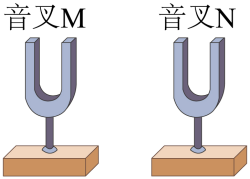
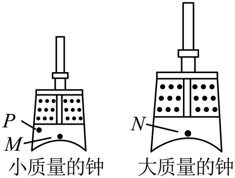

# 第二章 声现象 · 题目

讲义只用 `lesson.md` 里引用的题，按知识点顺序排在前面。真题按“精品解析”原卷录入，题干已与原卷逐段比对；课本习题原文已对照课本 PDF 原页，答案和解析为本项目编写，**发布前需要复核**。

---

## 讲义用题（8 道）

### Q-PHY-GD2024-11

```yaml
category: 真题
source: 2024 年广东省初中学业水平考试 物理 第 11 题第 1、2 空
source_quality: 原卷（精品解析整理版）
kp: PHY-8A-02-1a
type: 填空
grading: 自评
answer_by: 原卷解析
do: 本章只做第 1、2 空
other_parts: 第 3 空（流体压强与流速的关系）→ 八下流体压强 PHY-8B-09-5a。该空不在本章使用
review:
  概念: PHY-8A-02-1a
  前置: PHY-8A-02-1b
```

**题干**

声音是由物体的___________产生的。乘客听到列车即将进站的广播声，广播声通过___________传播到人耳。由于空气流速越大的位置压强越___________，乘客候车时不应越过安全线。

**答案**

①. 振动    ②. 空气    ③. 小

**解析**

1. 声音是由物体的振动产生的，停止振动发声就会马上停止。
2. 声音的传播需要介质，乘客听到列车即将进站的广播声，广播声是通过空气传播到人的耳中的。
3. 当火车驶过车站时，安全线以内的地方空气流速增大压强减小。人外侧受到的压强大于内侧受到的压强，人被压向列车，发生交通事故，所以乘客候车时需站在安全线以外。

### Q-PHY-TB8A-02.1-6

```yaml
category: 课本习题
source: 八上 2.1 练习与应用 第 6 题
source_quality: 课本原文
kp: PHY-8A-02-1b
type: 计算
grading: 自评
answer_by: 本项目编写，已复核
review:
  概念: PHY-8A-02-1b
  计算: PHY-8A-01-3b
```

**题干**

向前传播的声音遇到障碍物能反射回来。一个同学向着远处的山崖大喊一声，约 1.5 s 后听到回声，那么该同学距山崖大约多少米？

**答案**

$255\ \mathrm{m}$

**解析**

1. 声音在空气中传播（通常默认 15°C）的速度 $v = 340\ \mathrm{m/s}$。
2. 听到回声的时间 $t = 1.5\ \mathrm{s}$，这是声音一个来回的时间，因此单程的时间是 $t' = \dfrac{t}{2} = \dfrac{\textcolor{#287fc4}{1.5}\ \mathrm{s}}{\textcolor{#287fc4}{2}} = 0.75\ \mathrm{s}$。
3. 该同学距山崖的距离 $s = v t' = \textcolor{#287fc4}{340}\ \mathrm{m}/\cancel{\mathrm{s}} \times \textcolor{#287fc4}{0.75}\ \cancel{\mathrm{s}} = \boxed{255\ \mathrm{m}}$。

### Q-PHY-GZ2023-05

```yaml
category: 真题
source: 2023 年广州市初中学业水平考试 物理 第 5 题
source_quality: 原卷（精品解析整理版）
kp: PHY-8A-02-2a
type: 选择
grading: 自动
answer_by: 原卷解析
review:
  概念: PHY-8A-02-2a
```

**题干**

如图，音叉 M、N 完全相同，M 发出 440Hz 的声音，原来静止的 N 随之振动，N 也发出 440Hz 的声音，则（　　）



A. M 发声时每分钟振动 440 次
B. M 和 N 发出的声音的频率相同
C. M 和 N 发声时的振幅一定相同
D. M 发出的声音无需介质就能传播

**答案**

B

**解析**

1. 频率表示每秒钟内振动的次数。已知 M 发出声音的频率为 440Hz，表示该音叉每秒钟振动 440 次，故 A 不符合题意；
2. 已知 M 和 N 发出声音的频率都为 440Hz，所以 M 和 N 发出的声音的频率相同，故 B 符合题意；
3. 引起 N 音叉振动的能量是由 M 音叉传递来的，传递过程中存在能量损耗，所以 N 音叉发声振动的振幅应比 M 音叉小，故 C 不符合题意；
4. 声音的传播需要介质，故 D 不符合题意。

### Q-PHY-GD2023-09

```yaml
category: 真题
source: 2023 年广东省初中学业水平考试 物理 第 9 题
source_quality: 原卷（精品解析整理版）
kp: PHY-8A-02-2b
type: 填空
grading: 自评
answer_by: 原卷解析
review:
  概念: PHY-8A-02-2b
  前置: PHY-8A-02-1b
```

**题干**

用古琴弹奏名曲《高山流水》时，琴声是由琴弦的___________产生，经___________传播到聆听者耳中，演奏者不断拨动同一根琴弦，使其振幅越来越大，琴弦发出声音的响度变___________。

**答案**

①. 振动    ②. 空气    ③. 大

**解析**

1. 当演奏者用古琴弹奏名曲时，琴弦由于拨动而振动，发出声音，在通过空气传播到聆听者耳中。
2. 声音的响度和发声体的振动幅度有关，振幅越大，响度越大；演奏者不断拨动同一根琴弦，使其振幅越来越大，琴弦发出声音的响度变大。

### Q-PHY-GZ2022-07

```yaml
category: 真题
source: 2022 年广州市初中学业水平考试 物理 第 7 题
source_quality: 原卷（精品解析整理版）
kp: PHY-8A-02-2c
type: 选择
grading: 自动
answer_by: 原卷解析
review:
  概念: PHY-8A-02-2c
```

**题干**

编钟是我国瑰宝，如图，敲 M 处发出的声音音调比敲 N 处的高，比敲 P 处的低，则（　　）



A. 编钟发出的声音频率只与其质量有关
B. 敲 P 处发出的声音频率高于敲 N 处的
C. 敲 P 处时，钟的振幅一定比敲 M 处时大
D. 敲 N 处时，发出的声音响度一定比敲 M 处时大

**答案**

B

**解析**

1. 声音频率越大，则物体发出声音的音调越高。由图可知，第一个编钟的质量小，第二个编钟的质量大，敲 M 处发出的声音的音调比敲 N 处的高，说明声音的频率与物体的质量有关；在同一个编钟上敲 M 处发出的声音的音调比敲 P 处的低，说明声音的频率还与振动物体的长度有关，故 A 不符合题意；
2. 音调的高低与声音频率有关，音调越高，声音频率则越大，P 处的音调比 N 处的音调高，则 P 处的声音频率比 N 处的大，故 B 符合题意；
3. 声音的响度与振幅有关，而振幅的大小与敲击的力度大小有关，与敲击的位置无关，故 C、D 不符合题意。

### Q-PHY-GZ2024-02

```yaml
category: 真题
source: 2024 年广州市初中学业水平考试 物理 第 2 题
source_quality: 原卷（精品解析整理版）
kp: PHY-8A-02-2c
type: 选择
grading: 自动
answer_by: 原卷解析
review:
  审题: PHY-8A-02-2c
```

**题干**

监测器测得某次鸟鸣和猫叫的声音信息如下表，则（　　）

| 声音 | 鸟鸣 | 猫叫 |
| --- | --- | --- |
| 声音的频率/Hz | 5000 | 800 |
| 声音强弱的等级/dB | 30 | 60 |

A. 鸟鸣的响度大
B. 猫叫是超声波
C. 鸟鸣的频率高
D. 猫叫的音调高

**答案**

C

**解析**

1. 分析数据可知，猫叫的声音强弱的等级大于鸟鸣的声音强弱的等级，所以猫叫的响度大，故 A 不符合题意；
2. 超声波的频率大于 20000Hz，猫叫声音的频率为 800Hz，不是超声波，故 B 不符合题意；
3. 鸟鸣的频率为 5000Hz，猫叫的频率为 800Hz，所以鸟鸣的频率高，音调高，故 C 符合题意，D 不符合题意。

### Q-PHY-GD2022-04

```yaml
category: 真题
source: 2022 年广东省初中学业水平考试 物理 第 4 题
source_quality: 原卷（精品解析整理版）
kp: PHY-8A-02-3a
type: 选择
grading: 自动
answer_by: 原卷解析
review:
  概念: PHY-8A-02-3a
```

**题干**

下列关于声音的说法，不正确的是（　　）

A. 临街住宅安装双层玻璃可以减弱噪声
B. 长期佩戴耳机开大音量听音乐可能损伤听力
C. 北京天坛的回音壁利用了声音反射的原理
D. 声呐通过次声波的回声定位探索海洋的秘密

**答案**

D

**解析**

1. 为了改善室内的居住环境，建筑师在设计窗户时常采用双层玻璃，这样做的主要优点是：①隔热，②隔声；故 A 正确，不符合题意；
2. 长期戴着耳机听高分贝音量的音乐，有可能损伤鼓膜，致使听力下降，故 B 正确，不符合题意；
3. 驰名中外的北京天坛里的回音壁、三音石、圜丘三处建筑有非常美妙的声音现象，它是我国古代建筑师利用声音的反射形成的音响效果，故 C 正确，不符合题意；
4. 声呐利用超声波进行回声定位，而不是利用次声波，故 D 错误，符合题意。

### Q-PHY-SZ2022-01

```yaml
category: 真题
source: 2022 年深圳市初中学业水平考试 物理 第 1 题
source_quality: 原卷（精品解析整理版）
kp: PHY-8A-02-4b
type: 选择
grading: 自动
answer_by: 原卷解析
review:
  概念: PHY-8A-02-4b
```

**题干**

深圳市是全国文明城市，公民应该控制噪声，下列不属于在声源处减弱噪声的做法是（　　）

A. 不高声喧哗
B. 调低跳舞音响设备的音量
C. 在公路上不鸣笛
D. 在学校周围植树

**答案**

D

**解析**

1. 不高声喧哗是在声源处减弱噪音，故 A 不符合题意；
2. 调低跳舞音响设备的音量在声源处减弱噪音，故 B 不符合题意；
3. 在公路上不鸣笛在声源处减弱噪音，故 C 不符合题意；
4. 在学校周围植树是在传播过程中减弱噪音，故 D 符合题意。

---

### Q-PHY-GD2019-05

```yaml
category: 真题
source: 2019 年广东省初中学业水平考试 物理 第 5 题
source_quality: 原卷（本地存档 Word 转 PDF 页，逐页核对）
kp: PHY-8A-02-1b
type: 选择
grading: 自动
answer_by: 原卷解析
review:
  概念: PHY-8A-02-1b
```

**题干**

赛龙舟不仅是一项体育娱乐活动，更体现我国悠久历史文化传承。关于比赛中的声现象，下列说法错误的是

A．选手根据鼓声齐心协力划桨，鼓声是由鼓面振动产生的

B．选手听到鼓声大作，震耳欲聋，说明此时鼓声的响度大

C．选手能从现场各种声音中听出鼓声，主要是通过鼓声的音色来辨别的

D．鼓手敲击鼓面越快，鼓声在空气中传播的速度也越快

**答案**

D

**解析**

A 声音由物体振动产生，对；B 震耳欲聋指响度大，对；C 辨别不同发声体靠音色，对；D 声速由介质种类和温度决定，与敲击快慢无关，错。

---

## 备选（1 道）

### Q-PHY-GZ2025-01

```yaml
category: 真题
source: 2025 年广州市初中学业水平考试 物理 第 1 题
source_quality: 原卷（精品解析整理版）
kp: PHY-8A-02-2b
type: 选择
grading: 自动
answer_by: 原卷解析
review:
  概念: PHY-8A-02-2b
```

**题干**

AI 智能音箱收到调低音量的指令时，就会自动改变声音的（　　）

A. 音调
B. 响度
C. 音色
D. 频率

**答案**

B

**解析**

1. 音调指的声音的高低，音调与频率相关，不受音量调节影响，故 A 不符合题意；
2. 响度指的是声音的大小，调低音量时，音箱减小了扬声器的振幅，而振幅决定响度，因此改变的是响度，故 B 符合题意；
3. 音色指的是声音的特色，音色由发声体本身决定，不受音量调节影响，故 C 不符合题意；
4. 频率指的是振动的快慢，频率是音调的决定因素，但题目中“调低音量”并未直接改变频率，故 D 不符合题意。

