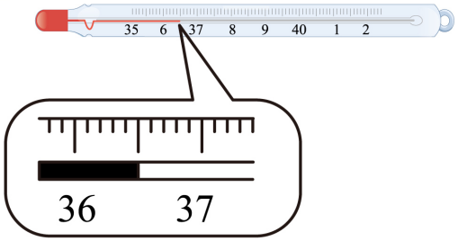
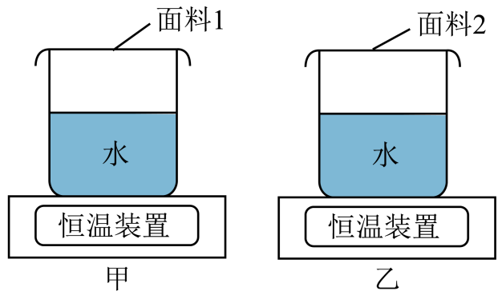
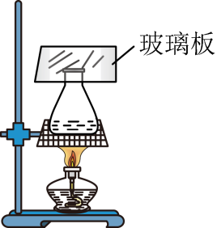

# 第三章 物态变化 · 题目

讲义只用 `lesson.md` 里引用的题，按知识点顺序排在前面。真题按“精品解析”原卷录入；题干已与原卷逐段比对。

---

## 讲义用题（8 道）

### Q-PHY-GD2024-20

```yaml
category: 真题
source: 2024 年广东省中考物理 第 20 题
source_quality: 原卷（精品解析整理版）
kp: PHY-8A-03-1a
type: 填空
grading: 自评
answer_by: 原卷解析
review:
  概念: PHY-8A-03-1a
```

**题干**

自制液体温度计利用了液体______的性质。为提高温度计的精确度，应选择内径更______的玻璃管。

**答案**

热胀冷缩；细

**解析**

1. 液体具有遇热体积膨胀、遇冷体积收缩的性质，液体温度计就是利用这一性质制成的。
2. 玻璃泡内的液体膨胀或收缩一定的体积时，玻璃管内径越细，液体升高或下降的高度越大，温度计的精确度就越高。

---

### Q-PHY-GD2022-20

```yaml
category: 真题
source: 2022 年广东省中考物理 第 20 题
source_quality: 原卷（精品解析整理版）
kp: PHY-8A-03-1b
type: 填空
grading: 自评
answer_by: 原卷解析
review:
  概念: PHY-8A-03-1b
```

**题干**

体温计是根据液体______的规律制成的。体温计离开人体后，直管内的水银______（选填“能”或“不能”）自动退回玻璃泡，所以体温计能离开人体读数。图中的体温计示数是______℃。



**答案**

热胀冷缩；不能；36.5

**解析**

1. 体温计属于液体温度计，玻璃泡内装有液态的水银，工作时利用液体的热胀冷缩的性质来测量人的体温。
2. 由于体温计的玻璃泡和直玻璃管之间有一个很细的弯管，在温度下降时水银在细弯管处断开而不能自动流回到玻璃泡内，因此体温计能离开被测人体读数。
3. 体温计的测量范围为 $35\sim 42\ \mathrm{^\circ C}$，体温计的一个大格表示 $1\ \mathrm{^\circ C}$，里面有 $10$ 个小格，分度值为 $0.1\ \mathrm{^\circ C}$，则图中体温计的示数为 $\boxed{36.5}$ ℃。

---

### Q-PHY-GZ2022-02

```yaml
category: 真题
source: 2022 年广州市中考物理 第 2 题
source_quality: 原卷（精品解析整理版）
kp: PHY-8A-03-2a
type: 选择
grading: 自动
answer_by: 原卷解析
review:
  概念: PHY-8A-03-2a
```

**题干**

一种合金魔术道具，久提在 34℃的手中不熔化，放在60℃的水中会熔化，则该合金的熔点可能是（　　）

A. 16°C
B. 30°C
C. 47°C
D. 70°C

**答案**

C

**解析**

一种合金魔术道具，久提在 34℃的手中不熔化，放在60℃的水中会熔化，则该合金的熔点可能是大于 34℃小于60℃，故C符合题意，ABD不符合题意。
故选C。

---

### Q-PHY-SZ2023-17-2

```yaml
category: 真题
source: 2023 年深圳市中考物理 第 17 题第（2）问
source_quality: 原卷（精品解析整理版）
kp: PHY-8A-03-3a
type: 填空
grading: 自评
do: 本章只做第（2）问
other_parts:
  - 第（1）问（温度计读数）→ PHY-8A-03-1b（本章已收录 GD2022-20，未重复收录）
  - 第（3）问（沸点与气压）→ 八下第九章（大气压强对沸点的影响，PHY-8B-09-3b）
  - 第（4）问（减少加热时间的建议）→ PHY-8A-03-3a（开放式建议题，本章未收）
  - 第（5）问（热量计算）→ 九全第十三章（比热容与热量计算，PHY-9-13-1c）
  - 第（6）问（汽化吸热与比热容综合计算）→ PHY-9-13-1c
answer_by: 原卷解析
review:
  概念: PHY-8A-03-3a
```

**题干**

思考乐琴琴同学探究“水的沸腾与加热时间的关系”，水的质量为 100g，实验过程中温度随时间变化的关系如下表。

| 时间 / $\mathrm{min}$ | $0$ | $0.5$ | $1$ | $1.5$ | $2$ | $\dots$ | $12$ |
| --- | --- | --- | --- | --- | --- | --- | --- |
| 温度 / $\mathrm{^\circ C}$ | $94$ | ？ | $96$ | $97$ | $98$ | $\dots$ | $98$ |

根据示数研究得出水沸腾时的温度变化特征是：水沸腾时持续吸热，温度______（选填“升高”、“降低”或“不变”）。

**答案**

不变

**解析**

由表中数据可知，从第 2min 开始，水温保持 98℃ 不变，所以可得出水沸腾时的温度变化特征是：水沸腾时持续吸热，温度不变。

---

### Q-PHY-GD2024-26-3

```yaml
category: 真题
source: 2024 年广东省中考物理 第 26 题第（3）问
source_quality: 原卷（精品解析整理版）
kp: PHY-8A-03-3c
type: 填空
grading: 自评
do: 本章只做第（3）问
other_parts:
  - 第（1）（2）（4）问（控制变量、读表计算、生活应用）未归入知识点，本章不做
answer_by: 原卷解析
review:
  概念: PHY-8A-03-3c
```

**题干**

鞋子面料的透水汽性会影响脚的舒适感。透水汽性是指单位时间内透过单位面积的水蒸气质量。为比较两款鞋子面料的透水汽性，小明用两个装置进行实验。在相同规格的容器中盛放等质量的水，用恒温装置维持水温不变，面料与容器口紧密贴合。容器口的面积为 $40\ \mathrm{cm^2}$，装置甲中的水温为 $37\ \mathrm{^\circ C}$，实验室温度为 $23\ \mathrm{^\circ C}$。

实验过程中，容器的______（选填“内”或“外”）表面会有小水珠形成。



**答案**

内

**解析**

实验过程中，由于水蒸气集中在容器内，小水珠是水蒸气遇冷液化形成的，故在容器的内表面会有小水珠形成。

---

### Q-PHY-GD2023-21

```yaml
category: 真题
source: 2023 年广东省中考物理 第 21 题
source_quality: 原卷（精品解析整理版）
kp: PHY-8A-03-4a
type: 填空
grading: 自评
answer_by: 原卷解析
review:
  概念: PHY-8A-03-4a
```

**题干**

如题图所示，小明在某次观察晶体升华现象时，用酒精灯加热装有某晶体颗粒的锥形瓶，发现锥形瓶内出现有色气体，玻璃板瓶内底部还出现少量液体。气体形成的过程需要______（选填“吸热”或“放热”）；该晶体熔化的原因是______。



**答案**

吸热；酒精灯火焰的温度高于晶体的熔点

**解析**

1. 由于用酒精灯加热晶体颗粒，说明气体形成的过程需要吸热。
2. 玻璃板瓶内底部还出现少量液体，该晶体熔化的原因是酒精灯火焰的温度高于晶体的熔点。

---

### Q-PHY-GZ2024-05

```yaml
category: 真题
source: 2024 年广州市中考物理 第 5 题
source_quality: 原卷（精品解析整理版）
kp: PHY-8A-03-4b
type: 选择
grading: 自动
answer_by: 原卷解析
review:
  概念: PHY-8A-03-4b
```

**题干**

广州春季“回南天”到来时，课室的黑板、墙壁和玻璃都容易“出水”。这些“水”是由于水蒸气（　　）

A. 遇热汽化吸热形成的
B. 遇热汽化放热形成的
C. 遇冷液化放热形成的
D. 遇冷液化吸热形成的

**答案**

C

**解析**

广州春季“回南天”到来时，课室的黑板、墙壁和玻璃都容易“出水”，原因是广州地处我国的南方，春季南风吹来温暖的带有大量水蒸气的空气，这些水蒸气温度较高，遇到温度较低的黑板、墙壁和玻璃就液化形成小水滴，附着在课室的黑板、墙壁和玻璃上造成的，液化需要放出热量，故 C 符合题意，ABD 不符合题意。
故选 C。

---

### Q-PHY-GD2022-02

```yaml
category: 真题
source: 2022 年广东省中考物理 第 2 题
source_quality: 原卷（精品解析整理版）
kp: PHY-8A-03-4b
type: 选择
grading: 自动
answer_by: 原卷解析
review:
  概念: PHY-8A-03-4b
```

**题干**

小明发现衣柜里防虫用的樟脑丸会越来越小，此现象属于哪种物态变化（　　）

A. 熔化
B. 升华
C. 汽化
D. 液化

**答案**

B

**解析**

樟脑丸会越来越小是因为樟脑丸逐渐由固体直接变为气体，这属于升华现象。故 ACD 不符合题意，B 符合题意。
故选 B。
