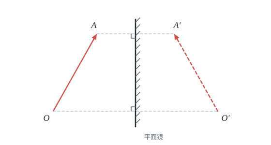
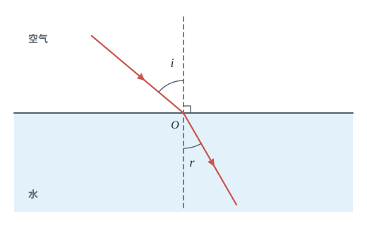

# 第四章 光现象

本章学习光的传播和生活中的光现象。主要记住三个规律：光在同一种均匀介质中沿直线传播；光射到物体表面发生反射（反射定律）；光从一种介质斜射入另一种介质发生折射。

反射、折射、平面镜成像常考画图，学完后请自己在纸上画一画光路。

## 本章前置自查

下面几件事，哪一件没把握，先回看：

1. 用刻度尺测长度（八上 第一章第 1 节）；
2. 会画垂线、用量角器量角（数学）；
3. 知道什么叫轴对称（数学）。

---

## 4.1a 光源与光沿直线传播

```yaml
id: PHY-8A-04-1a
weight: 一般
weight_note: 2 次；影子、小孔成像、光源判断
textbook: 八上 4.1 光的直线传播，p.88–90
prerequisites: []
evidence:
  - 能判断一个物体是不是光源
  - 能说出光在同种均匀介质中沿直线传播，并用它解释影子、小孔成像
figure: 不需要
sources: [TB8A-4.1, GD2023-04]
```

### 本次只学

认出光源，知道光是直线传播的，并用它解释影子等现象。

### 先认住

- 能够发光的物体叫作光源。太阳是光源，月亮不是光源（它反射太阳光）。
- 光在同种均匀介质中沿直线传播。为了表示光的传播情况，我们通常用一条带有箭头的直线表示一束光传播的径迹和方向。这样的直线叫作光线。
- 影子、小孔成像、日食、月食，都是光沿直线传播形成的。

### 容易错

- 沿直线传播的条件是“同种均匀介质”，如果介质不均匀，光可能会弯曲（如海市蜃楼）。
- 光线是为了表示光的传播情况画出来的直线，不要把它当成一根真的“线”。

### 练一练

- `Q-PHY-GD2023-04`

---

## 4.1b 光速

```yaml
id: PHY-8A-04-1b
weight: 了解
weight_note: 未直接考；“各色光真空中速度相同”在电磁波题里出现
textbook: 八上 4.1 光的直线传播，p.91
prerequisites:
  - id: PHY-8A-04-1a
    strength: soft
    reason: 先知道光怎样传播
evidence:
  - 知道光在真空中的传播速度
figure: 不需要
sources: [TB8A-4.1]
```

### 先认住

- 光可以在真空中传播。在物理学中，真空中的光速用字母 $c$ 表示，在通常情况下，近似取 $c=3\times10^8\ \mathrm{m/s}$。
- 光在空气中的速度非常接近 $c$。光在水中的速度约为 $\frac{3}{4}c$，在玻璃中的速度约为 $\frac{2}{3}c$。
- 光年是一个距离单位，它等于光在真空中传播 1 年所经过的距离。

---

## 4.2a 光的反射定律与反射作图

```yaml
id: PHY-8A-04-2a
weight: 重点
weight_note: 7 次，作图题常客
textbook: 八上 4.2 光的反射，p.93–95
prerequisites:
  - id: PHY-8A-04-1a
    strength: hard
    reason: 光线用带箭头的直线表示
  - id: MATH-角与垂线
    strength: hard
    reason: 要会作法线、量角
evidence:
  - 能说出光的反射定律，找出入射角、反射角并计算大小
  - 能根据反射定律画出反射光线、入射光线或平面镜的位置
  - 知道在反射现象中光路可逆
figure: 不需要
sources: [TB8A-4.2, SZ2024-10]
```

### 本次只学

记住反射定律：反射角等于入射角，能画出反射的光路。

### 先认住

- 经过入射点并垂直于反射面的直线叫作法线。
- 入射角是入射光线与法线的夹角；反射角是反射光线与法线的夹角。
- **光的反射定律**：在反射现象中，反射光线、入射光线和法线在同一平面内；反射光线和入射光线分别位于法线两侧；反射角等于入射角。
- 在反射现象中，光路可逆。

### 破题钥匙

```think
现象: 一束光射到平面镜上被反射
模型: 法线把两条光线分在两侧，两个角相等
图: phy-reflect
关系: $\angle r=\angle i$
招: 画图
结: 先画法线，再画光线
```

### 走一遍

课本练习与应用第 1 题（只求角的大小，不画图）：光与镜面成 $30^\circ$ 角射在平面镜上，反射角是多少？如果光垂直射到平面镜上，反射光如何射出？

1. 光与镜面成 $30^\circ$ 角，则入射角为 $90^\circ-\textcolor{#287fc4}{30}^\circ=60^\circ$。
2. 根据反射定律，反射角等于入射角，即反射角等于 $\textcolor{#287fc4}{60}^\circ$。所以反射角是 $\boxed{60^\circ}$。
3. 如果光垂直射到平面镜上，入射光线与法线重合，入射角为 $0^\circ$。
4. 反射角等于入射角，即反射角等于 $\textcolor{#287fc4}{0}^\circ$。所以反射角是 $\boxed{0^\circ}$，光原路返回。

### 容易错

- 入射角、反射角都是光线与“法线”的夹角，不是与“镜面”的夹角。

### 练一练

- `Q-PHY-SZ2024-10`

---

## 4.2b 镜面反射和漫反射

```yaml
id: PHY-8A-04-2b
weight: 一般
weight_note: 1 次；“看见不发光的物体”靠反射
textbook: 八上 4.2 光的反射，p.95–96
prerequisites:
  - id: PHY-8A-04-2a
    strength: hard
    reason: 两种反射都遵守反射定律
evidence:
  - 能分清镜面反射和漫反射
  - 能用漫反射解释为什么能从不同方向看到不发光的物体
figure: 不需要
sources: [TB8A-4.2, SZ2023-20]
```

### 本次只学

分清镜面反射和漫反射。

### 先认住

- **镜面反射**：平行光照射到平整、光滑的表面上后，会被平行地反射。只能在特定方向看到反射光（如玻璃幕墙反光、水面波光）。
- **漫反射**：平行光照射到凹凸不平的表面上后，会向着四面八方反射。正是由于漫反射，我们才可以从不同方向看到桌椅、书本等不发光的物体。
- 镜面反射和漫反射都遵守光的反射定律。

### 容易错

- 漫反射中，每一条光线在反射点依然严格遵守反射定律，只是各个点的法线方向不同，导致反射光线射向四面八方。

### 练一练

- `Q-PHY-SZ2023-20-3a`

---

## 4.3a 平面镜成像的特点（实验）

```yaml
id: PHY-8A-04-3a
weight: 重点
weight_note: 4 次，且是 2026 广州实验操作考试题目
lab_exam: 试题二：平面镜成像，描出像点并测距离
textbook: 八上 4.3 平面镜成像，p.98–100
prerequisites:
  - id: PHY-8A-04-2a
    strength: hard
    reason: 平面镜成像的原理是光的反射
  - id: PHY-8A-01-1a
    strength: soft
    reason: 要量像距、物距
evidence:
  - 能说出平面镜成的是等大、对称的虚像
  - 知道探究实验中用玻璃板代替平面镜、用两支相同的蜡烛的目的
figure: 不需要
sources: [TB8A-4.3, GD2022-13, GD2024-21]
```

### 本次只学

记住平面镜成的像是虚像，大小与物体相等，位置关于镜面对称。

### 先认住

- **平面镜成像的特点**：平面镜所成的像为虚像，其大小与物体的大小相等，像和物体到平面镜的距离相等，像和物体的连线与镜面垂直。（即：像与物体关于镜面对称）
- 平面镜成像的原理是光的反射。平面镜后并不存在光源，进入眼睛的光并非真正来自像点，所以叫虚像。光屏承接不到虚像。
- 探究实验中，用玻璃板代替平面镜，既能成像又能透光，便于确定像的位置；用两支相同的蜡烛是为了比较像与物的大小关系。

### 走一遍

课本练习与应用第 2 题：小芳面向平面镜，站在镜前 $1\ \mathrm{m}$ 处，镜中的像与她相距多少米？若她后退 $0.5\ \mathrm{m}$ 远离平面镜，则镜中的像与她相距多少米？镜中像的大小会改变吗？

1. 开始时，物距是 $1\ \mathrm{m}$，根据平面镜成像特点，像距等于物距，即像距为 $1\ \mathrm{m}$。所以像与她相距 $\textcolor{#287fc4}{1}\ \mathrm{m} + \textcolor{#287fc4}{1}\ \mathrm{m} = \boxed{2\ \mathrm{m}}$。
2. 她后退 $0.5\ \mathrm{m}$ 后，物距变为 $\textcolor{#287fc4}{1}\ \mathrm{m} + \textcolor{#287fc4}{0.5}\ \mathrm{m} = 1.5\ \mathrm{m}$，像距也变为 $1.5\ \mathrm{m}$。所以像与她相距 $\textcolor{#287fc4}{1.5}\ \mathrm{m} + \textcolor{#287fc4}{1.5}\ \mathrm{m} = \boxed{3\ \mathrm{m}}$。
3. 平面镜所成的像始终与物体大小相等。她远离镜子，像的大小 $\boxed{\text{不变}}$。

### 容易错

- 人走近镜子，觉得像变大了，这是眼睛看上去的感觉；像的大小始终等于人的大小。
- 水中倒影是平面镜成像（反射）；影子是光沿直线传播被挡住形成的黑暗区域。两者完全不同。

### 练一练

- `Q-PHY-GD2022-13`
- `Q-PHY-GD2024-21`

---

## 4.3b 平面镜成像作图

```yaml
id: PHY-8A-04-3b
weight: 重点
weight_note: 3 次作图（广州 2023、2025，深圳 2024）
textbook: 八上 4.3 平面镜成像，p.100
prerequisites:
  - id: PHY-8A-04-3a
    strength: hard
    reason: 依据像与物关于镜面对称
  - id: PHY-8A-04-2a
    strength: soft
    reason: 也可以用反射光线反向延长找像
evidence:
  - 能根据像与物关于镜面对称，画出物体在平面镜中的像
  - 知道虚像要用虚线画
figure: 已完成 figures/mirror-from-image.svg（AO 与像 A′O′，作出的镜面、垂直符号和短斜线）
sources: [TB8A-4.3]
```

### 本次只学

利用“对称”画出平面镜里的像。

### 先认住

- 作图方法：找物体的关键点，分别向平面镜作垂线并延长相同距离，找到对称点（虚像点），用虚线连接虚像点画出像。
- 实物用实线，虚像和法线、辅助线用虚线。

### 破题钥匙

```think
现象: 人站在平面镜前，镜子里有一个像
模型: 像和物关于镜面对称，连线被镜面垂直平分
图: phy-mirror
关系: $v=u$
招: 画图
结: 像到镜面的距离等于物到镜面的距离
```

### 走一遍

课本练习与应用第 4 题：$A'O'$ 是 $AO$ 在平面镜中的像。请你画出平面镜的位置。

1. 连接对应点 $AA'$ 与 $OO'$，用虚线表示。
2. 平面镜在对应点连线 $AA'$ 和 $OO'$ 的垂直平分线上。
3. 画出镜面所在直线，在镜面不反光的一侧画几条短斜线；检查镜面是否垂直平分 $AA'$ 与 $OO'$，在交点处标出垂直符号。



### 容易错

- 常常忘了画垂直符号。
- 虚像必须画成虚线，不能画实线。

### 练一练

- `Q-PHY-GZ2023-10`
- `Q-PHY-GZ2025-13-1`
- `Q-PHY-SZ2024-08-1`

---

## 4.3c 凸面镜和凹面镜

```yaml
id: PHY-8A-04-3c
weight: 了解
weight_note: 10 套卷未考
textbook: 八上 4.3 平面镜成像，p.101
prerequisites:
  - id: PHY-8A-04-2a
    strength: hard
    reason: 也遵守反射定律
evidence:
  - 知道凸面镜能扩大视野，凹面镜能会聚光线
figure: 不需要
sources: [TB8A-4.3]
```

### 先认住

- 汽车的后视镜和街头路口的反光镜都是凸面镜。凸面镜能起到扩大视野的作用。
- 太阳灶利用凹面镜会聚太阳光；汽车前灯的反光装置相当于凹面镜，有了它，射出的光接近于平行光。

---

## 4.4a 光的折射规律与折射作图

```yaml
id: PHY-8A-04-4a
weight: 重点
weight_note: 3 次，都是作图题（广东每年必有作图）
textbook: 八上 4.4 光的折射，p.103–104
prerequisites:
  - id: PHY-8A-04-2a
    strength: hard
    reason: 画法线、标角度的方法和反射一样
evidence:
  - 能说出折射规律中光向哪个方向偏折
  - 能画出光从空气进入水或玻璃，以及从水或玻璃进入空气的折射光路
figure: 已完成 figures/refraction-air-water.svg（光从空气斜射入水中的折射光路，标出法线、入射角 i、折射角 r）
sources: [TB8A-4.4, TB8A-4R]
```

### 本次只学

光斜射入另一种介质时发生折射，记住偏向哪边。

### 先认住

- 光从空气斜射入水中或玻璃中时，传播方向发生偏折，这种现象叫作光的折射。
- 光从空气斜射入水或玻璃时折射角小于入射角；从水或玻璃斜射入空气时折射角大于入射角。
- 在折射现象中，光路可逆。
- 当光垂直射入时，传播方向不变。

### 破题钥匙

```think
现象: 光从空气斜射入水中，传播方向偏折
模型: 折射光线靠近法线，折射角比入射角小
图: phy-refract
关系: $\angle r<\angle i$
招: 画图
结: 空气射入水，偏向法线；水射入空气，偏离法线
```

### 走一遍

光从空气斜射入水中，画出折射光线的作图步骤：

1. 过入射点作垂直于界面的法线（用虚线表示，标出垂直符号）。
2. 光从空气斜射入水中，折射光线向法线偏折。
3. 在法线另一侧画出折射光线（用实线表示，标出传播方向的箭头），折射角小于入射角。



### 容易错

- 折射光线和入射光线分居法线两侧。
- 光斜射时，空气中的角总是大角（无论是入射角还是折射角，只要在空气中，就比水或玻璃中的角大；垂直射入时两个角都是 $0^\circ$）。

### 练一练

- `Q-PHY-TB8A-04R-9`
- `Q-PHY-GD2022-16`
- `Q-PHY-GD2024-16`

---

## 4.4b 生活中的折射现象

```yaml
id: PHY-8A-04-4b
weight: 一般
weight_note: 未单独考；是 4c 辨析的基础
textbook: 八上 4.4 光的折射，p.104–105
prerequisites:
  - id: PHY-8A-04-4a
    strength: hard
    reason: 要用折射规律解释
evidence:
  - 能用光的折射解释池水变浅、筷子弯折、海市蜃楼等现象
  - 知道逆着折射光看去感觉水中物体的位置升高了
figure: 不需要
sources: [TB8A-4.4]
```

### 本次只学

用光的折射解释池水变浅、筷子弯折等生活现象。

### 先认住

- 池底或水中物体反射的光，从水中斜射入空气时发生折射，折射角大于入射角。逆着折射光看去，感觉这点的位置升高了。
- 因此，池水看起来比实际的浅；水中的鱼看起来比实际的位置高。叉鱼时要瞄准看到的鱼的下方。
- 海市蜃楼是由于空气疏密不均，光发生折射形成的现象。

### 容易错

- 看到的“水底”、“水中的鱼”位置都升高了。向水中的鱼照射手电筒或激光时，应该直接对准看到的鱼照射（因为光路可逆）。

### 练一练

- `Q-PHY-TB8A-04.4-6`
- `Q-PHY-GD2020-03`

---

## 4.4c 分清直线传播、反射和折射现象

```yaml
id: PHY-8A-04-4c
weight: 一般
weight_note: 3 次，选择题送分但常设陷阱（倒影 vs 影子）
textbook: 八上 4.1-4.4
prerequisites:
  - id: PHY-8A-04-1a
    strength: hard
    reason: 直线传播的现象
  - id: PHY-8A-04-2a
    strength: hard
    reason: 反射的现象
  - id: PHY-8A-04-4b
    strength: hard
    reason: 折射的现象
evidence:
  - 给出一个现象，能准确判断是直线传播、反射还是折射引起的
  - 能分清影子和倒影的区别
figure: 不需要
sources: [SZ2022-03]
```

### 本次只学

看到一个光现象，能判断出它是直线传播、反射还是折射。

### 先认住

- **直线传播**：影子、日食、月食、小孔成像、射击瞄准。
- **光的反射**：水中倒影、照镜子、潜望镜、看见不发光的物体。
- **光的折射**：池水变浅、筷子“折断”、海市蜃楼、早晨太阳还在地平线以下时，人就可以看到它。

### 容易错

- 影子（直线传播）和倒影（反射）常常混淆。
- 水中的月亮是平面镜成像（反射）；水底的硬币看起来变高是折射。

### 练一练

- `Q-PHY-SZ2022-03`

---

## 4.5a 光的色散和色光的混合

```yaml
id: PHY-8A-04-5a
weight: 了解
weight_note: 未直接考
textbook: 八上 4.5 光的色散，p.107–108
prerequisites:
  - id: PHY-8A-04-4a
    strength: soft
    reason: 色散本质是不同色光折射程度不同
evidence:
  - 知道白光是由各种色光混合而成的
  - 知道色光的三原色是红、绿、蓝
figure: 不需要
sources: [TB8A-4.5]
```

### 先认住

- 太阳光通过三棱镜后，被分解成红、橙、黄、绿、蓝、靛、紫等各种颜色的光，这种现象叫作光的色散。
- 白光是由各种色光混合而成的。彩虹是太阳光在水滴里发生色散产生的。
- 色光的三原色是红、绿、蓝。

---

## 4.5b 红外线和紫外线

```yaml
id: PHY-8A-04-5b
weight: 一般
weight_note: 3 次，应用辨认
textbook: 八上 4.5 光的色散，p.109
prerequisites:
  - id: PHY-8A-04-5a
    strength: soft
    reason: 它们在可见光谱两端之外
evidence:
  - 能分别举出红外线和紫外线在生活中的应用
  - 知道红外线有热效应，紫外线能杀死微生物
figure: 不需要
sources: [TB8A-4.5, GD2022-26]
```

### 本次只学

分清红外线和紫外线的应用。

### 先认住

- 它们都是人眼看不见的光。
- **红外线**：有热效应（温度计升温、红外相机、夜视仪、测温枪）；可用来遥控（电视遥控器）。
- **紫外线**：能杀死微生物（医院消毒灯）；能使荧光物质发光（验钞机防伪标记）。

### 练一练

- `Q-PHY-GD2022-26-2`
