# 题目

### Q-PHY-GD2023-04
```yaml
id: Q-PHY-GD2023-04
category: 真题
source: 2023 年广东省中考物理试题第 4 题
source_quality: 原卷
kp: PHY-8A-04-1a
type: 选择
grading: 自动
answer_by: 原卷解析
review:
  概念: PHY-8A-04-1a
```
**题干**

在阳光照射下，广东省南澳岛北回归线标志塔在地面上形成影子，如图所示。影子形成的原因是（　　）
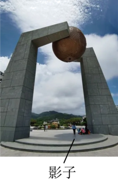

A. 光沿直线传播
B. 光的反射
C. 光的折射
D. 光的色散

**答案**
A

**解析**
阳光下广东省南澳岛北回归线标志塔的影子形成的原因是光在同种均匀介质中沿直线传播的，故 B、C、D 不符合题意；A 符合题意。
故选 A。

### Q-PHY-SZ2024-10
```yaml
id: Q-PHY-SZ2024-10
category: 真题
source: 2024 年广东省深圳市中考物理试题第 10 题
source_quality: 原卷
kp: PHY-8A-04-2a
type: 填空
grading: 自评
answer_by: 原卷解析
review:
  概念: PHY-8A-04-2a
  前置: PHY-8A-04-1a
```
**题干**

巴黎奥运会即将开幕，爱思考的乐达达同学去巴黎旅游，发现奥运五环被挡住看不见是因为光沿 \_\_\_\_\_\_\_\_\_ 传播，埃菲尔铁塔无灯的栏杆被人看见是因为栏杆 \_\_\_\_\_\_\_\_\_ 的光进入达达同学的眼睛。

**答案**
直线
反射

**解析**
光在同种均匀介质中沿直线传播。发现奥运五环被挡住看不见是因为光沿直线传播；
埃菲尔铁塔无灯的栏杆不是光源，被人看见是因为栏杆反射的光进入达达同学的眼睛。

### Q-PHY-SZ2023-20-3a
```yaml
id: Q-PHY-SZ2023-20-3a
category: 真题
source: 2023 年广东省深圳市中考物理试题第 20 题第（3）问
source_quality: 原卷
kp: PHY-8A-04-2b
do: 本章只做第（3）问的第一空
type: 填空
grading: 自评
answer_by: 原卷解析
review:
  概念: PHY-8A-04-2b
other_parts: （1）连通器与机械运动 → PHY-8B-09-2c / PHY-8A-01-2a；（2）定滑轮 → PHY-8B-12-3a；（3）第二空浮力 → PHY-8B-10-3b；（4）速度与功率 → PHY-8B-11-2a；（5）电功率 → PHY-9-18-2a。这些部分不在本章使用
```
**题干**

思考乐琴琴同学在大坝上看到水面波光，是因为水面部分区域发生了 \_\_\_\_\_\_\_\_\_ 反射。

**答案**
镜面

**解析**
在大坝上看到水面波光，是因为水面部分区域发生镜面反射，有大量的光反射进眼睛，使水面看起来波光粼粼。

### Q-PHY-GD2022-13
```yaml
id: Q-PHY-GD2022-13
category: 真题
source: 2022 年广东省中考物理试题第 13 题
source_quality: 原卷
kp: PHY-8A-04-3a
type: 填空
grading: 自评
answer_by: 原卷解析
review:
  概念: PHY-8A-04-3a
```
**题干**

“西塞山前白鹭飞，桃花流水鳜鱼肥”（[唐]张志和《渔歌子》）。图是白鹭在如镜的水面上飞行的情形。水中的“白鹭”是由光的 \_\_\_\_\_\_\_\_\_ 形成的 \_\_\_\_\_\_\_\_\_ （选填“实”或“虚”）像。若水深 $3\ \mathrm{m}$，当白鹭距离水面 $5\ \mathrm{m}$ 时，它的像距离水面 \_\_\_\_\_\_\_\_\_ $\mathrm{m}$。
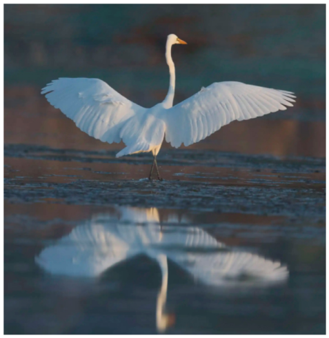

**答案**
反射
虚
5

**解析**
平静的水面相当于平面镜，所以水中的“白鹭”相当于平面镜成像，平面镜成像成的是虚像，其原理是光的反射。
根据平面镜成像的特点，像到镜面的距离等于物体到镜面的距离，故白鹭距离水面 $5\ \mathrm{m}$ 时，它的像距离水面 $5\ \mathrm{m}$。

### Q-PHY-GD2024-21
```yaml
id: Q-PHY-GD2024-21
category: 真题
source: 2024 年广东省中考物理试题第 21 题
source_quality: 原卷
kp: PHY-8A-04-3a
type: 填空
grading: 自评
answer_by: 原卷解析
review:
  概念: PHY-8A-04-3a
```
**题干**

探究平面镜成像特点的实验，如图所示。
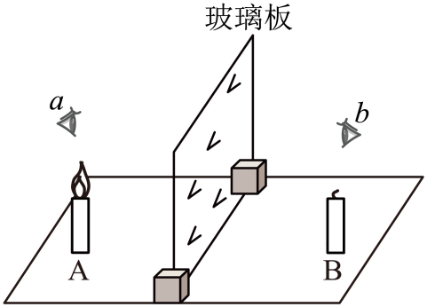

① 点燃蜡烛 A，眼睛应在图中 \_\_\_\_\_\_\_\_\_ （选填“a”或“b”）处观察 A 在玻璃板后的像；移动与 A 外形相同的蜡烛 B，发现 B 与 A 的像重合，说明平面镜所成像与物的大小 \_\_\_\_\_\_\_\_\_ ；
② 得到平面镜成像规律后，若换用面积较大的玻璃板进行实验，蜡烛 A 的像的大小 \_\_\_\_\_\_\_\_\_ （选填“变大”、“变小”或“不变”）。

**答案**
a
相等
不变

**解析**
① 平面镜成像原理是光的反射，所成的像是反射光线反向延长线会聚成的虚像，所以眼睛应在图中 a 处观察 A 在玻璃板后的像。
选用两支等大的蜡烛，是为了研究像与物的大小关系。与 A 外形相同的蜡烛 B 与 A 的像重合，说明平面镜所成像与物的大小相等。
② 平面镜所成像的大小与物体大小有关，与物体到平面镜的距离无关、与平面镜的大小无关，所以换用面积较大的玻璃板进行实验，蜡烛 A 的像的大小不变。

### Q-PHY-TB8A-04R-9
```yaml
id: Q-PHY-TB8A-04R-9
category: 课本习题
source: 八年级上册第四章复习与提高第 9 题（p.112）
source_quality: 课本原文
kp: PHY-8A-04-4a
type: 简答
grading: 自评
answer_by: 本项目编写，已复核
review:
  概念: PHY-8A-04-4a
```
**题干**

某人探究光的折射现象及其特点。他不断改变入射角，使光从空气中斜射入半圆形玻璃砖，发现折射角始终小于入射角。于是，他得出结论：光在发生折射时，折射角总小于入射角。你认为他的结论正确吗？为什么？

**答案**
不正确。他只做了光从空气斜射入玻璃的情况；光从玻璃斜射入空气时，折射角大于入射角。

**解析**
1. 他的实验只有一种情况：光从空气斜射入玻璃，这时折射角小于入射角。
2. 在折射现象中，光路可逆。让光从玻璃斜射入空气，折射角大于入射角。
3. 所以“折射角总小于入射角”不正确，要说明光是从哪种物质斜射入哪种物质。

### Q-PHY-TB8A-04.4-6
```yaml
id: Q-PHY-TB8A-04.4-6
category: 课本习题
source: 八年级上册 4.4 节练习与应用第 6 题
source_quality: 课本原文
kp: PHY-8A-04-4b
type: 简答
grading: 自评
answer_by: 本项目编写，已复核
review:
  概念: PHY-8A-04-4b
```
**题干**

我们能看到斜放入水中的筷子在水面处发生弯折。动手做一做，你看到水中的筷子是向上弯折还是向下弯折？为什么？

**答案**
向上弯折。
水中筷子反射的光从水斜射入空气时发生折射，折射角大于入射角。逆着折射光看去，感觉水中部分的位置升高了，所以看起来向上弯折。

**解析**
水中筷子反射的光从水斜射入空气中时，折射光线远离法线偏折，折射角大于入射角。眼睛逆着折射光线看过去，觉得光线是从水中物体各点的偏高位置发出的，因此感觉水中的筷子在水面处向上弯折了。

### Q-PHY-SZ2022-03
```yaml
id: Q-PHY-SZ2022-03
category: 真题
source: 2022 年广东省深圳市中考物理试题第 3 题
source_quality: 原卷
kp: PHY-8A-04-4c
type: 选择
grading: 自动
answer_by: 原卷解析
review:
  概念: PHY-8A-04-4c
```
**题干**

下列说法错误的是（　　）

A. 月亮是光源
B. 灯光秀的光——光的直线传播
C. 桥的倒影——光的反射
D. 彩虹——光的色散

**答案**
A

**解析**
A．自身能发光的物体叫做光源，月亮本身不发光，在夜晚能看见月亮，那是因为月亮是反射太阳的光，故 A 错误，符合题意；
B．我们能看到灯光秀的光是由于光的直线传播，故 B 正确，不符合题意；
C．桥的倒影属于平面镜成像，是光的反射现象，故 C 正确，不符合题意；
D．雨后，空气中有大量小水滴，太阳光经这些水滴折射后可分解成七种色光，这就是光的色散现象，故 D 正确，不符合题意。
故选 A。

### Q-PHY-GD2022-26-2
```yaml
id: Q-PHY-GD2022-26-2
category: 真题
source: 2022 年广东省中考物理试题第 26 题第（2）问
source_quality: 原卷
kp: PHY-8A-04-5b
do: 本章只做第（2）问
type: 选择
grading: 自动
answer_by: 原卷解析
review:
  概念: PHY-8A-04-5b
other_parts: （1）电磁波及波速 → PHY-9-21-1a；（3）防晒霜实验 → PHY-8A-04-5b。这些小问不在本题使用
```
**题干**

下列实例中，属于紫外线应用的是（　　）

A. 遥控器控制电视
B. 体检时拍 X 光片
C. 医院杀菌消毒灯
D. “测温枪”测量体温

**答案**
C

**解析**
A．遥控器是利用红外线可以进行遥控来工作的，不符合题意；
B．拍 X 光片利用的是 X 射线，不属于紫外线，不符合题意；
C．医院杀菌消毒灯，利用的是紫外线具有杀菌作用，符合题意；
D．测温枪的工作原理是利用红外线的热效应，不符合题意。
故选 C。

# 备选

无

### Q-PHY-GZ2023-10

```yaml
category: 真题
source: 2023 年广州市中考物理试题第 10 题
source_quality: 原卷（精品解析整理版）
kp: PHY-8A-04-3b
type: 作图
grading: 自评
answer_by: 原卷解析
review:
  概念: PHY-8A-04-3b
```

**题干**

如图，S 为光源，画出①光线 a 的反射光线；②S 在平面镜中的像。

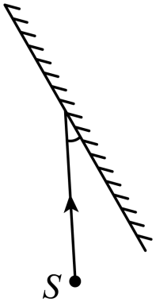

**答案**

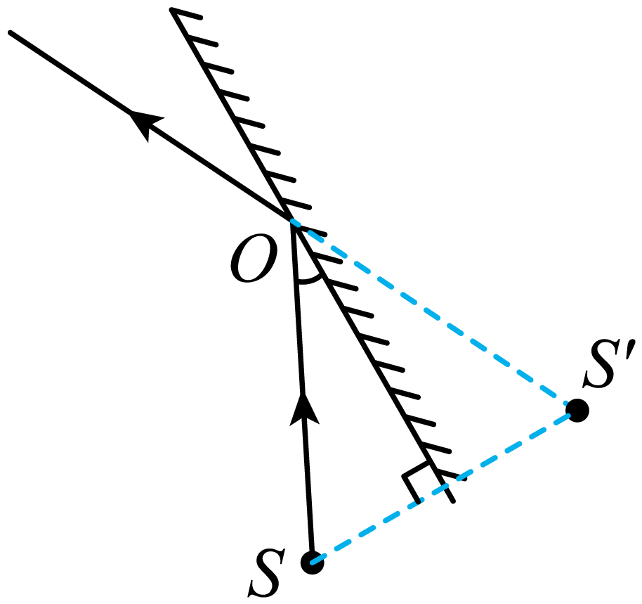

**解析**

1. 过镜面作出点 S 的对称点 S′，S′ 就是 S 在平面镜中的像。
2. 像是虚像，用虚线画；连接 S′ 和光线 a 在镜面上的入射点 O 并延长，OS′ 的延长部分就是反射光线（反射光线的反向延长线过像点）。

### Q-PHY-GZ2025-13-1

```yaml
category: 真题
source: 2025 年广州市中考物理试题第 13 题第（1）问
source_quality: 原卷（精品解析整理版）
kp: PHY-8A-04-3b
type: 作图
grading: 自评
do: 本章只做第（1）问
other_parts:
  - 第（2）问（靠近平面镜才能看到鞋子的像、像的大小不变）→ PHY-8A-04-3a（平面镜成像的特点，本章已收录）
answer_by: 原卷解析
review:
  概念: PHY-8A-04-3b
```

**题干**

如图 a，顾客站在倾斜放置的平面镜前观察自己的像。用 $AB$ 表示站在平面镜前的顾客，在图 b 中画出其在镜中的像。

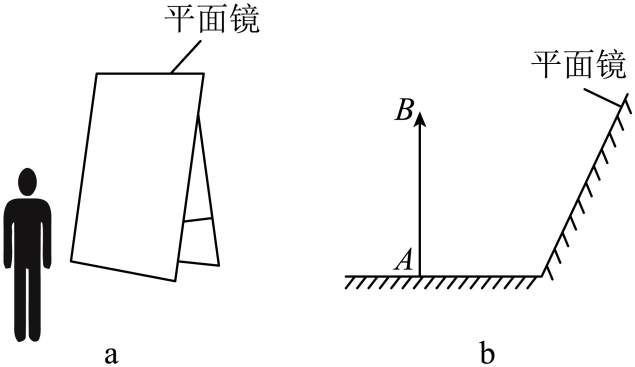

**答案**

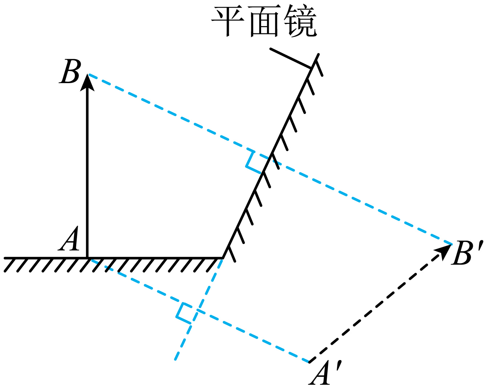

**解析**

1. 平面镜成像时，像与物体关于镜面对称。
2. 过 $A$、$B$ 分别向平面镜作垂线，并延长到镜后相同距离，得到对称点 $A'$、$B'$。
3. 像是虚像，用虚线连接 $A'B'$，就是 $AB$ 在镜中的像。

### Q-PHY-SZ2024-08-1

```yaml
category: 真题
source: 2024 年深圳市中考物理试题第 8 题第（1）问
source_quality: 原卷（精品解析整理版）
kp: PHY-8A-04-3b
type: 作图
grading: 自评
do: 本章只做第（1）问
other_parts:
  - 第（2）问（画拉力的力臂）→ PHY-8B-12-1a（杠杆五要素与力臂作图），本章不使用
answer_by: 原卷解析
review:
  概念: PHY-8A-04-3b
```

**题干**

图甲是飞鸟经过无背索斜拉桥的情景。图乙是其简化的模型，用 $S$ 表示飞鸟。请在图乙中画出：飞鸟 $S$ 经水面反射形成的虚像 $S'$。

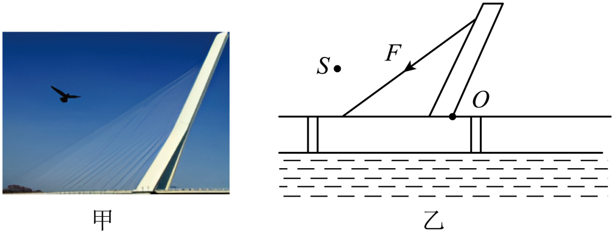

**答案**

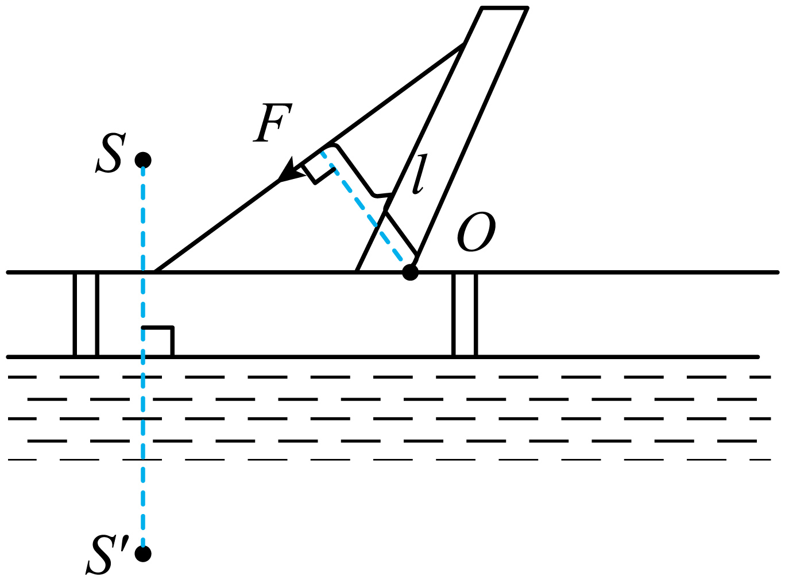

**解析**

平静的水面相当于平面镜。像与物关于镜面对称，所以过 $S$ 向水面作垂线，在水面下方取相同距离，得到虚像 $S'$。

### Q-PHY-GD2022-16

```yaml
category: 真题
source: 2022 年广东省中考物理试题第 16 题
source_quality: 原卷（精品解析整理版）
kp: PHY-8A-04-4a
type: 作图
grading: 自评
answer_by: 原卷解析
review:
  概念: PHY-8A-04-4a
```

**题干**

如图所示，一束光从水中射向水面 $O$ 点，画出法线、反射光线和大致的折射光线。

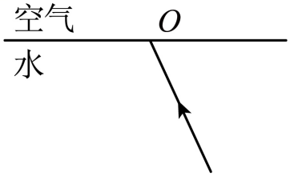

**答案**

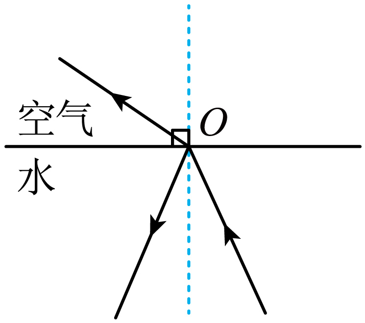

**解析**

1. 过 $O$ 点作垂直于水面的虚线，就是法线。
2. 反射光线与入射光线分居法线两侧，反射角等于入射角，据此画出反射光线。
3. 光从水中斜射入空气，折射光线与入射光线分居法线两侧，折射角大于入射角（折射光线偏离法线），据此画出折射光线。

### Q-PHY-GD2024-16

```yaml
category: 真题
source: 2024 年广东省中考物理试题第 16 题
source_quality: 原卷（精品解析整理版）
kp: PHY-8A-04-4a
type: 作图
grading: 自评
answer_by: 原卷解析
review:
  概念: PHY-8A-04-4a
```

**题干**

如图所示，一束光从空气斜射入水中，请画出光在水中的折射光线。

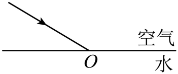

**答案**

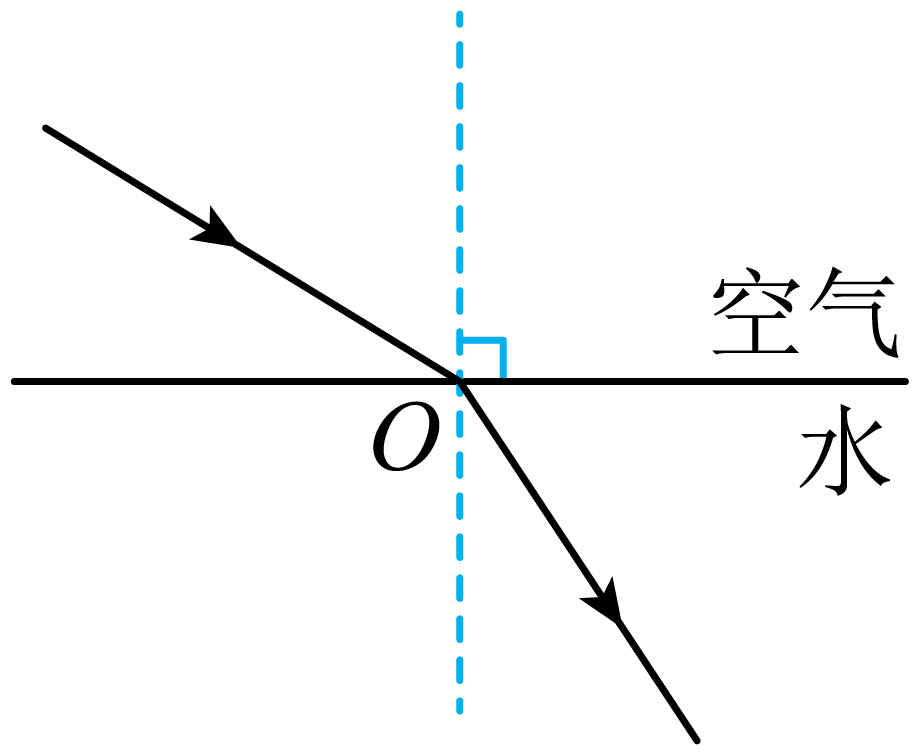

**解析**

1. 过入射点垂直水面作出法线。
2. 折射光线与入射光线分居法线两侧；光从空气斜射入水中，折射光线向法线偏折，折射角小于入射角。据此在水中法线的另一侧画出折射光线。

### Q-PHY-GD2020-03

```yaml
category: 真题
source: 2020 年广东省初中学业水平考试 物理 第 3 题
source_quality: 原卷（本地存档 Word 转 PDF 页，逐页核对）
kp: PHY-8A-04-4b
type: 选择
grading: 自动
answer_by: 原卷解析
review:
  概念: PHY-8A-04-4b
```

**题干**

岸上的人看到水中小鱼的光路图是（　　）

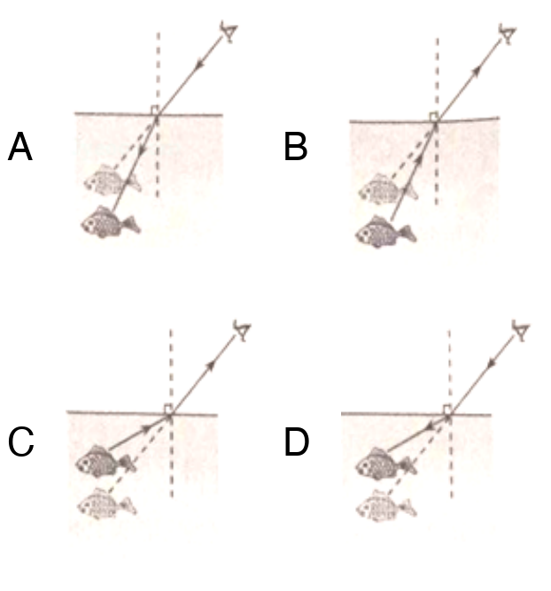

A．图 A　　B．图 B　　C．图 C　　D．图 D

**答案**

B

**解析**

鱼反射的光从水中斜射入空气，在水面处发生折射，折射角大于入射角，折射光线远离法线。人逆着折射光线看去，觉得“鱼”的位置比实际位置高。所以光线的方向应是从水中射向眼睛，且折射光线偏离法线，选 B。

