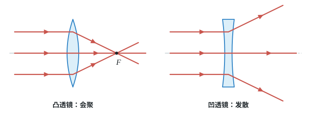
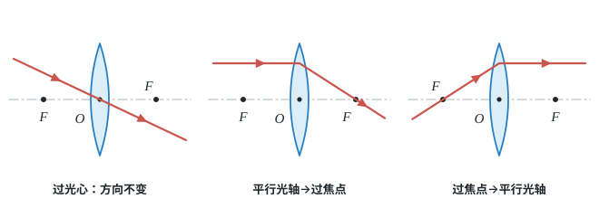
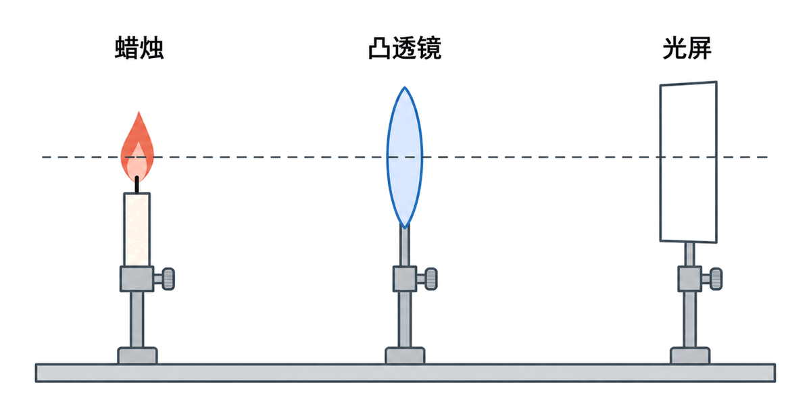

# 第五章 透镜及其应用

上一章学了光在平滑表面上的反射和折射。这一章我们看光穿过透镜时，怎样被折射“会聚”或“发散”：照相机怎样把大大的风景缩进小小的相片里，投影仪又怎样把小小的画面放大到屏幕上。

标着**重点**的两个知识点（特殊光线作图、凸透镜成像规律）中考常常考，要花最多时间去记规律；标着**一般**的，知道是怎么回事就行。

## 本章前置自查

下面两件事，哪一件没把握，先回看：

1. 说出光从空气斜射入玻璃时的折射规律（靠近法线还是远离法线）。（第四章第 4 节）
2. 说出平面镜成的是实像还是虚像。（第四章第 3 节）

---

## 5.1a 凸透镜、凹透镜对光的作用

```yaml
id: PHY-8A-05-1a
weight: 一般
weight_note: 未单独考；是透镜作图和成像的基础
textbook: 八上 5.1 透镜，p.114–116
prerequisites:
  - id: PHY-8A-04-4a
    strength: hard
    reason: 透镜靠折射改变光路
evidence:
  - 能分清凸透镜和凹透镜的形状特征
  - 能说出凸透镜对光有会聚作用，凹透镜对光有发散作用
  - 知道焦点、焦距、光心分别是什么
figure: 已完成 figures/lens-converge-diverge.svg（凸透镜会聚、凹透镜发散的对比）
sources: [TB8A-5.1]
```

### 本次只学

认清透镜的形状，知道它们对光有什么作用，认识焦点和光心。

### 先认住

- **光心与透镜分类**：远视镜片中间厚、边缘薄，是**凸透镜**；近视镜片中间薄、边缘厚，是**凹透镜**。通过透镜中心**光心**的光传播方向不变。
- **作用**：凸透镜对光有**会聚**作用；凹透镜对光有**发散**作用。
- **焦点与焦距**：凸透镜能使跟主光轴平行的光会聚在一点，叫**焦点**；焦点到凸透镜光心的距离叫**焦距**。凸透镜两侧各有一个焦点，两侧的两个焦距相等；焦距越小，对光的会聚作用越强。



### 练一练

- `Q-PHY-TB8A-05.1-6`

---

## 5.1b 透镜的三条特殊光线作图

```yaml
id: PHY-8A-05-1b
weight: 重点
weight_note: 4 次作图
textbook: 八上 5.1 透镜，p.116–117
prerequisites:
  - id: PHY-8A-05-1a
    strength: hard
    reason: 要知道焦点、焦距、光心
evidence:
  - 能画出过光心的光线怎样传播
  - 能画出平行于主光轴的光线经过凸透镜后怎样传播
figure: 已完成 figures/convex-three-rays.svg（三幅小图分别画三条特殊光线）
sources: [TB8A-5.1, GZ2023-11]
```

### 本次只学

画出三条特殊光线经过凸透镜后的光路。

### 先认住

凸透镜有三条特殊光线：
- 过光心的光线，经过透镜后传播方向不改变。
- 平行于主光轴的光线，经过透镜后过焦点。
- 过焦点的光线，经过透镜后平行于主光轴。



### 破题钥匙

```think
现象: 一束平行于主光轴的光射向凸透镜
模型: 折射后的光线都汇聚到焦点
图: phy-lens
关系: 平行于主光轴 → 过焦点 $F$
招: 画图
结: 作图只需抓住三条特殊光线
```

### 走一遍

课本练习与应用第 4 题：同种材料制成的甲、乙两个凸透镜的焦距分别为 2 cm 和 3 cm，哪个凸透镜使光偏折得更显著些？

1. 焦距是焦点到凸透镜光心的距离。甲的焦距为 2 cm，乙的焦距为 3 cm，甲的焦距较小。
2. 课本指出：凸透镜的焦距越小，对光的会聚作用越强。
3. 会聚作用越强，说明透镜对光的偏折越显著。
4. 因此，焦距较小的甲凸透镜使光偏折得更显著。

### 练一练

- `Q-PHY-TB8A-05.1-5`
- `Q-PHY-GZ2022-11`
- `Q-PHY-GZ2024-11-2`

---

## 5.2a 照相机、投影仪、放大镜与实像虚像

```yaml
id: PHY-8A-05-2a
weight: 一般
weight_note: 3 次，应用对应
textbook: 八上 5.2 生活中的透镜，p.118–121
prerequisites:
  - id: PHY-8A-05-1a
    strength: hard
    reason: 都用凸透镜
  - id: PHY-8A-04-3a
    strength: soft
    reason: 和平面镜的虚像对比
evidence:
  - 能说出照相机、投影仪、放大镜成的是放大的还是缩小的、倒立还是正立的像
  - 能分清实像和虚像的区别，知道光屏能不能承接到虚像
figure: 不需要
sources: [TB8A-5.2, SZ2023-08]
```

### 本次只学

记住常见仪器的成像特点，分清实像和虚像。

### 先认住

- **照相机与投影仪**：照相机成缩小、倒立的实像（物体离镜头较远）；投影仪成放大、倒立的实像（物体离镜头较近）。
- **放大镜**：成放大、正立的虚像（物体离镜头比较近）。
- **实像与虚像**：实像是光线实际会聚成的，光屏能承接到；虚像不是光线实际会聚成的，光屏不能承接到。

### 练一练

- `Q-PHY-SZ2023-08`

---

## 5.3a 探究凸透镜成像的规律（实验操作）

```yaml
id: PHY-8A-05-3a
weight: 一般
weight_note: 2 次（广东 2023 实验题的操作小问）
textbook: 八上 5.3 凸透镜成像的规律，p.122–123
prerequisites:
  - id: PHY-8A-05-1a
    strength: hard
    reason: 要先测焦距
  - id: PHY-8A-01-1a
    strength: soft
    reason: 要读光具座上的物距、像距
evidence:
  - 能说出怎样调节高度使像成在光屏中央
  - 像偏上时，知道该怎么移动蜡烛
figure: 已完成 figures/optical-bench-apparatus.png（光具座上的器材顺序与中心同高；gpt-image-2 生成，已人工核对）
sources: [TB8A-5.3, GD2023-22]
```

### 本次只学

做凸透镜成像实验时，怎样把器材摆对位置，怎样把像调到光屏中央。

### 先认住

- **调整高度**：实验前要调节发光物体、凸透镜和光屏，使它们的中心大致在同一高度。这是为了让像能成在光屏的中央。
- **调整像的位置**：光屏上的实像是倒立的；像偏上，就是蜡烛相对透镜偏低，可以把蜡烛往上调。



### 练一练

- `Q-PHY-GD2023-22-2`

---

## 5.3b 用成像规律判断像的性质和变化

```yaml
id: PHY-8A-05-3b
weight: 重点
weight_note: 7 次，选择、填空、实验都考，“物近像远像变大”易错
textbook: 八上 5.3 凸透镜成像的规律，p.124–125、p.136
prerequisites:
  - id: PHY-8A-05-3a
    strength: hard
    reason: 规律来自实验
  - id: PHY-8A-05-2a
    strength: soft
    reason: 三种应用对应三个物距范围
evidence:
  - 能根据物距范围（大于 2f，在 f 和 2f 之间，小于 f）判断像的大小和正倒
  - 能熟练运用“物近像远像变大”判断物距改变时像的变化
  - 能由像的性质反推物距范围，进而求出焦距范围
figure: 不需要
sources: [TB8A-5.3, GD2023-22, GD2024-09]
```

### 本次只学

熟练背出凸透镜成像的规律，并用来判断像会怎么变。

### 先认住

- 当物距 $u > 2f$ 时，成倒立、缩小的实像，像距 $f < v < 2f$。（照相机）
- 当物距 $f < u < 2f$ 时，成倒立、放大的实像，像距 $v > 2f$。（投影仪）
- 当物距 $u < f$ 时，成正立、放大的虚像。（放大镜）
- **物近像远像变大**：成实像时，物体靠近透镜，像就会远离透镜，并且像会变大。

### 走一遍

课本复习与提高第 2 题：用焦距为 10 cm 的凸透镜自制了一个照相机。为了使景物在薄膜上成缩小的像，薄膜和镜头间的距离在什么范围内调节？拍照时，如果想让景物的像变大一些，应该怎样操作？

1. 照相机成倒立、缩小的实像。根据凸透镜成像规律，像距应在 1 倍到 2 倍焦距之间，即 $f < v < 2f$。
2. 焦距 $f=\textcolor{#287fc4}{10}\ \mathrm{cm}$，代入得 $\textcolor{#287fc4}{10}\ \mathrm{cm}<v<2\times\textcolor{#287fc4}{10}\ \mathrm{cm}$，解得 $\boxed{10\ \mathrm{cm}<v<20\ \mathrm{cm}}$。薄膜和镜头间的距离应在 10 cm 到 20 cm 之间调节。
3. 要让景物的像变大，根据“物近像远像变大”，应减小物距、增大像距。
4. 所以应该把照相机靠近景物，同时拉长镜头，增大镜头与薄膜间的距离。

### 容易错

- 焦距 $f$ 是透镜固有的，物距 $u$ 是物体到透镜的距离，像距 $v$ 是像到透镜的距离，不要把它们混淆。
- 成虚像时，“物近像远像变大”是不适用的，虚像实际上是物近像也近、像变小。

### 练一练

- `Q-PHY-GD2023-22-3`
- `Q-PHY-GZ2023-11`

---

## 5.4a 眼睛与近视、远视的矫正

```yaml
id: PHY-8A-05-4a
weight: 了解
weight_note: 10 套卷未考
textbook: 八上 5.4 眼睛和眼镜，p.126–129
prerequisites:
  - id: PHY-8A-05-3b
    strength: hard
    reason: 眼睛成像就是凸透镜成实像
  - id: PHY-8A-05-1a
    strength: hard
    reason: 矫正要用凸透镜或凹透镜
evidence:
  - 能说出近视眼和远视眼分别需要用什么透镜矫正
figure: 不需要
sources: [TB8A-5.4]
```

### 先认住

- 眼睛的晶状体和角膜相当于一个凸透镜，把光会聚在视网膜上。
- **近视眼**：只能看清近处的物体，看不清远处的物体。原因是晶状体太厚，折光能力太强，或者眼球在前后方向上太长，像成在视网膜前。配戴**凹透镜**矫正。
- **远视眼**：只能看清远处的物体，看不清近处的物体。原因是晶状体太薄，折光能力太弱，或者眼球在前后方向上太短，像成在视网膜后。配戴**凸透镜**矫正。
