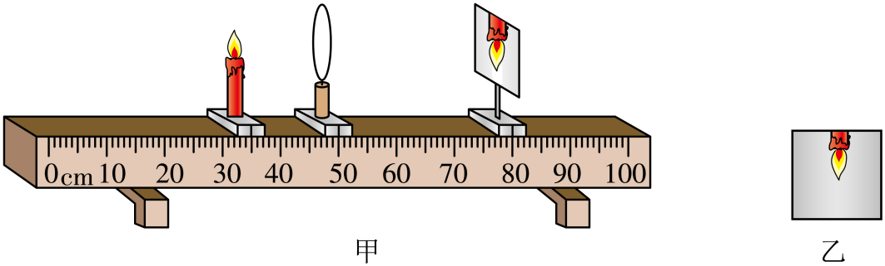
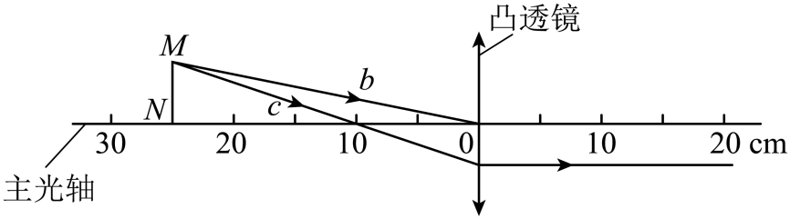
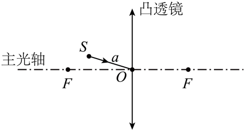
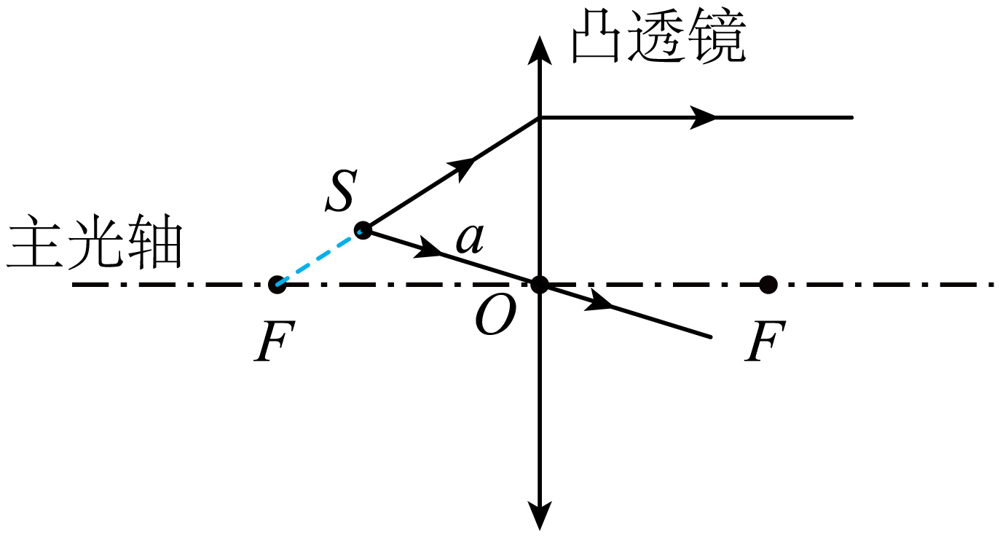
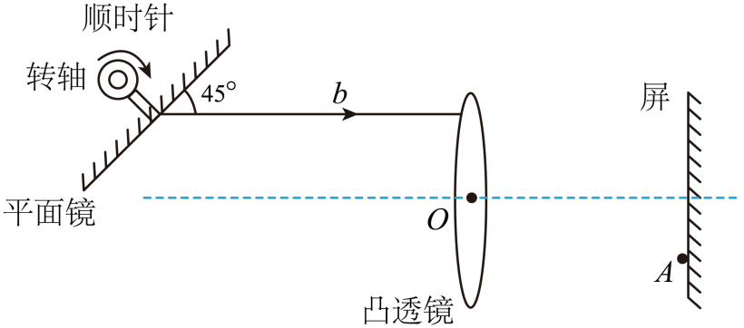
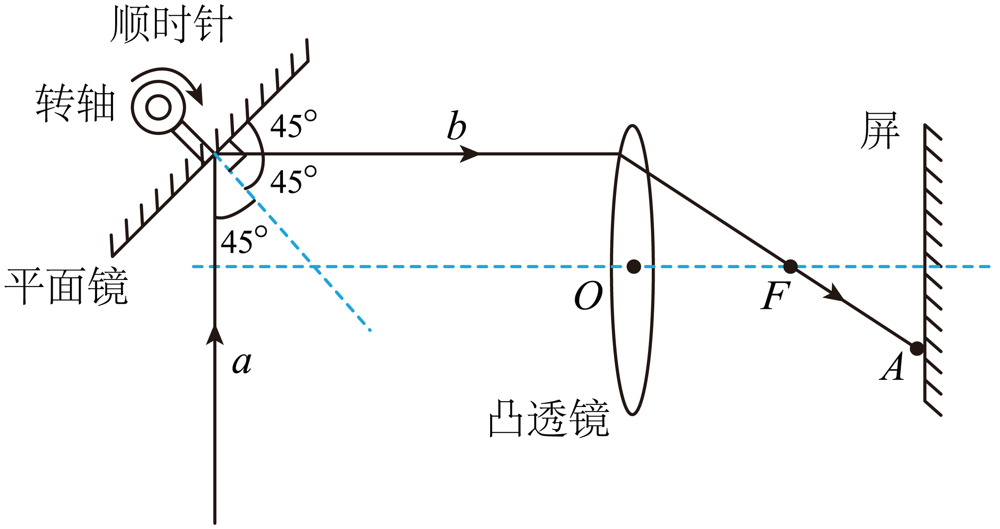
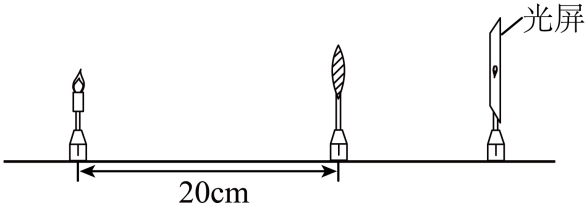

# 第五章 透镜及其应用 · 题目

---

## 讲义用题（6 道）

### Q-PHY-TB8A-05.1-6

```yaml
category: 课本习题
source: 八上 5.1 练习与应用 第 6 题
source_quality: 课本原文
kp: PHY-8A-05-1a
type: 简答
grading: 自评
answer_by: 本项目编写，已复核
review:
  概念: PHY-8A-05-1a
```

**题干**

据新闻报道，一辆家用轿车在太阳下“自燃”。调查发现，火灾是由放在仪表盘上方防滑垫上的瓶装水引发的。瓶装水是怎样引发火灾的？我们在森林中游玩时应该如何处理没有喝完的瓶装水？

**答案**

装水的瓶子相当于凸透镜，对光有会聚作用，会聚处温度很高，可能引燃枯叶等；所以不要把喝剩的瓶装水留在森林里。

**解析**

1. 装有水的圆形瓶子，中间厚、边缘薄，相当于一个凸透镜。
2. 凸透镜对光有会聚作用，太阳光穿过瓶装水后会聚在一点，该处的温度很高，如果照射到仪表盘或易燃物品（如枯叶等），就可能引发火灾。
3. 因此，在森林中游玩时，应将喝剩下的瓶装水随身带走，或者妥善回收，绝不能随意丢弃在森林里。

---

### Q-PHY-TB8A-05.1-5

```yaml
category: 课本习题
source: 八上 5.1 练习与应用 第 5 题
source_quality: 课本原文
kp: PHY-8A-05-1b
type: 简答
grading: 自评
answer_by: 本项目编写，已复核
review:
  概念: PHY-8A-05-1b
  前置: PHY-8A-04-4a
```

**题干**

要想利用凸透镜使小灯泡发出的光变成平行光，应该把小灯泡放在凸透镜的什么位置？试试看。在解决这个问题的时候，你利用了前面学过的什么知识？

**答案**

放在焦点上；利用了光在折射时光路是可逆的。

**解析**

1. 平行于主光轴的光线经过凸透镜后，折射光线会聚在焦点上。
2. 在折射现象中，光路是可逆的。如果把小灯泡放在焦点上，发出的光线经过凸透镜折射后，就会变成平行于主光轴的光。
3. 因此，应该把小灯泡放在凸透镜的焦点上；在解决这个问题时，利用了在折射时光路是可逆的知识（第四章已学）。

---

### Q-PHY-SZ2023-08

```yaml
category: 真题
source: 2023 年广东省深圳市中考物理试题 第 8 题
source_quality: 原卷（精品解析整理版）
kp: PHY-8A-05-2a
type: 选择
grading: 自动
answer_by: 原卷解析
review:
  概念: PHY-8A-05-2a
  前置: PHY-8A-04-3a
```

**题干**

如图，是一张思考乐大厦的照片，关于下列说法正确的是（　　）


A. 照相机的镜头对光线有发散作用
B. 照相机成倒立放大的虚像
C. 水中的像是光的反射造成的
D. 在太阳下的大楼是光源

**答案**

C

**解析**

1. 照相机镜头是凸透镜，凸透镜对光线有会聚作用，故A错误。
2. 使用照相机时，物距大于二倍焦距，所以成倒立缩小的实像，故B错误。
3. 水中的像是平面镜成像现象，是光的反射造成的，故C正确。
4. 光源能自己发光，大楼反射太阳光，大楼自己不会发光，所以大楼不是光源，故D错误。
故选C。

---

### Q-PHY-GD2023-22-2

```yaml
category: 真题
source: 2023 年广东省初中学业水平考试 物理 第 22 题第（2）问
source_quality: 原卷（精品解析整理版）
kp: PHY-8A-05-3a
do: 本章只做第（2）问
type: 填空
grading: 自评
answer_by: 原卷解析
review:
  概念: PHY-8A-05-3a
other_parts: （1）判断实像还是虚像 → PHY-8A-05-2a；（3）判断焦距 → Q-PHY-GD2023-22-3；（4）换光源后的像 → PHY-8A-05-3b；（5）探究直径关系 → PHY-8A-05-3a。这些小问不在本章使用或已单独列出
```

**题干**

小明在学习了凸透镜成像的规律后，继续深入探究，选用某一规格的凸透镜做实验，调整好器材后，此时烛焰在光屏上成放大的像；

（2）一段时间后，小明发现烛焰的像如图乙所示，此时将蜡烛向______调节可以使烛焰的像移到光屏中央；



**答案**

上

**解析**

1. 凸透镜成实像时，像是倒立的。一段时间后，蜡烛越烧越短，火焰向下移动。
2. 因为像是倒立的，物体向下移动，像就会向上移动，所以像在光屏上方呈现（如乙图）。
3. 为了使烛焰的像移到光屏中央，可以将蜡烛上移，使得烛焰、透镜的光心和光屏中央在同一高度上。

---

### Q-PHY-GD2023-22-3

```yaml
category: 真题
source: 2023 年广东省初中学业水平考试 物理 第 22 题第（3）问
source_quality: 原卷（精品解析整理版）
kp: PHY-8A-05-3b
do: 本章只做第（3）问
type: 填空
grading: 自评
answer_by: 原卷解析
review:
  概念: PHY-8A-05-3b
  前置: PHY-8A-01-1a
other_parts: （1）判断实像还是虚像 → PHY-8A-05-2a；（2）像偏上调节 → Q-PHY-GD2023-22-2；（4）换光源后的像 → PHY-8A-05-3b；（5）探究直径关系 → PHY-8A-05-3a。这些小问不在本章使用或已单独列出
```

**题干**

小明在学习了凸透镜成像的规律后，继续深入探究，选用题表中某一规格的凸透镜做实验，调整好器材后如题图甲所示，此时烛焰在光屏上成放大的像；

| 凸透镜编号 | 焦距/cm | 直径/cm |
| --- | --- | --- |
| ① | 5 | 3.5 |
| ② | 5 | 4.5 |
| ③ | 10 | 4.5 |
| ④ | 15 | 4.5 |

（3）小明选的凸透镜焦距为______cm。


**答案**

10

**解析**

1. 由图甲可知，蜡烛在 $\textcolor{#287fc4}{35.0}\ \mathrm{cm}$ 刻度处，凸透镜在 $\textcolor{#287fc4}{50.0}\ \mathrm{cm}$ 刻度处，物距 $u = \textcolor{#287fc4}{50.0}\ \mathrm{cm} - \textcolor{#287fc4}{35.0}\ \mathrm{cm} = 15.0\ \mathrm{cm}$。
2. 光屏在 $\textcolor{#287fc4}{80.0}\ \mathrm{cm}$ 刻度处，像距 $v = \textcolor{#287fc4}{80.0}\ \mathrm{cm} - \textcolor{#287fc4}{50.0}\ \mathrm{cm} = 30.0\ \mathrm{cm}$。
3. 题目已知此时成放大的像（且由于是光屏承接，所以是实像），根据成像规律，此时物距在一倍到两倍焦距之间，即 $f < \textcolor{#287fc4}{15.0}\ \mathrm{cm} < 2f$，解得 $7.5\ \mathrm{cm} < f < 15.0\ \mathrm{cm}$。
4. 像距在两倍焦距之外，即 $\textcolor{#287fc4}{30.0}\ \mathrm{cm} > 2f$，解得 $f < 15.0\ \mathrm{cm}$。
5. 综合得 $7.5\ \mathrm{cm} < f < 15.0\ \mathrm{cm}$，对照表格中四个凸透镜的焦距，只有焦距为 10 cm 的凸透镜符合条件，所以小明选的凸透镜焦距为 $\boxed{10\ \mathrm{cm}}$。

---

### Q-PHY-GZ2023-11

```yaml
category: 真题
source: 2023 年广州市初中学业水平考试 物理 第 11 题
source_quality: 原卷（精品解析）
kp: PHY-8A-05-3b
do: 本章只做第②问
other_parts: ①作图 → PHY-8A-05-1b（作图题不收）
type: 填空
grading: 自评
answer_by: 原卷解析
review:
  概念: PHY-8A-05-3b
  前置: PHY-8A-05-1b
```

**题干**

如图，凸透镜的光心在0cm处，物体MN上M发出的光线b经过光心，M发出的光线c经过凸透镜后的光线平行于主光轴。



②该凸透镜的焦距为___________cm；MN经凸透镜成的像相对于MN是___________（选填“放大”“缩小”“等大”）、___________（选填“正立”“倒立”）的像。

**答案**

10；缩小；倒立

**解析**

1. 由图可知，光线a经凸透镜折射平行于主光轴，光线a与主光轴的交点即为焦点，光心O到这一点的距离为焦距，则该凸透镜的焦距为 $\boxed{10\ \mathrm{cm}}$。
2. 由图知，物距 $u=\textcolor{#287fc4}{25}\ \mathrm{cm}$，$u>2f$，根据凸透镜成像规律可知此时成倒立缩小的实像，即物体MN经凸透镜成的像相对于物是 $\boxed{\text{缩小}}$ 的、$\boxed{\text{倒立}}$ 的。

---

### Q-PHY-GZ2022-11

```yaml
category: 真题
source: 2022 年广州市中考物理试题第 11 题
source_quality: 原卷（精品解析整理版）
kp: PHY-8A-05-1b
type: 作图
grading: 自评
answer_by: 原卷解析
review:
  概念: PHY-8A-05-1b
```

**题干**

如图，凸透镜的焦点为 $F$，光心为 $O$。

① 在图中画出 $S$ 点发出的光线 $a$ 经过透镜光心后的光线；

② $S$ 点发出的一条光线经过透镜后与主光轴平行，在图中画出上述光路。



**答案**



**解析**

1. 过光心的光线，经凸透镜后传播方向不改变，沿原方向画出。
2. 经过透镜后与主光轴平行的光线，它的入射光线一定过焦点：连接 $S$ 与焦点 $F$，交透镜于一点，再从这一点画一条平行于主光轴的折射光线。

---

### Q-PHY-GZ2024-11-2

```yaml
category: 真题
source: 2024 年广州市中考物理试题第 11 题第（2）问
source_quality: 原卷（精品解析整理版）
kp: PHY-8A-05-1b
type: 作图
grading: 自评
do: 本章只做第（2）问
other_parts:
  - 第（1）问（由反射光线画入射光线）→ PHY-8A-04-2a（光的反射定律与反射作图）
  - 第（3）问（转动平面镜使反射光线过光心）→ PHY-8A-04-2a
answer_by: 原卷解析
review:
  概念: PHY-8A-05-1b
```

**题干**

如图，光线 $a$（图中未画出）射到平面镜上，其反射光线 $b$ 平行凸透镜的主光轴，$b$ 经凸透镜折射后，射到屏上的 $A$ 点。画出光线 $b$ 经凸透镜折射后的光路，并标出凸透镜右侧的焦点 $F$。



**答案**



**解析**

平行于主光轴的光线经凸透镜折射后通过焦点。所以 $b$ 经凸透镜后的折射光线沿透镜到 $A$ 点的方向画出，它与主光轴的交点就是右侧的焦点 $F$。

---

## 备选（不进入讲义，不再维护）

### Q-PHY-GD2024-09

```yaml
category: 真题
source: 2024 年广东省初中学业水平考试 物理 第 9 题
source_quality: 原卷（精品解析整理版）
kp: PHY-8A-05-3b
type: 填空
grading: 自评
answer_by: 原卷解析
review:
  概念: PHY-8A-05-3b
  前置: PHY-8A-05-2a
```

**题干**

广东生产的无人驾驶电动垂直起降航空器首飞成功，彰显了我国科技在城市空中交通领域的领先地位。航空器可用于高空摄影、旅游观光等，航空器的摄像头相当于______透镜，远处的物体通过摄像头成倒立缩小的______（选填“实”或“虚”）像。在摄像头远离物体的过程中，像的大小将变______。

**答案**

凸；实；小

**解析**

1. 航空器的摄像头相当于凸透镜，其成像原理与照相机相同。
2. 照相机在物体位于二倍焦距以外时，成倒立、缩小的实像。
3. 根据“物近像远像变大”，在摄像头远离物体（物距变大）的过程中，像距将变小，像的大小将变小。

---


### Q-PHY-GZ2025-05

```yaml
category: 真题
source: 2025 年广州市初中学业水平考试 物理 第 5 题
source_quality: 原卷（精品解析）
kp: PHY-8A-05-3b
type: 选择
grading: 自动
answer_by: 原卷解析
review:
  概念: PHY-8A-05-3b
```

**题干**

如图，蜡烛距凸透镜 20cm 时，烛焰在光屏上成清晰的倒立缩小像，则该凸透镜的焦距可能是（　　）



A. 5cm
B. 20cm
C. 30cm
D. 40cm

**答案**

A

**解析**

1. 蜡烛距凸透镜 20 cm 时，烛焰在光屏上成清晰的倒立缩小像，说明物距大于两倍焦距。
2. 即 $u = \textcolor{#287fc4}{20}\ \mathrm{cm} > 2f$。
3. 解得 $f < 10\ \mathrm{cm}$。
4. 四个选项中，只有 $5\ \mathrm{cm}$ 符合题意，故选 A。
