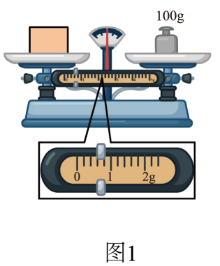
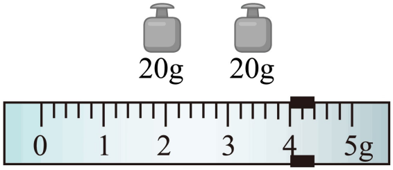
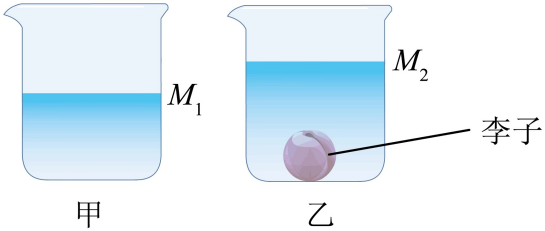

# 第六章 质量与密度 · 题目

讲义只用 `lesson.md` 里引用的题，按知识点顺序排在前面。真题按原卷录入；课本习题原文已对照课本 PDF 原页核对，答案和解析为本项目编写，**发布前需要复核**。

---

## 讲义用题（6 道）

### Q-PHY-GD2024-02

```yaml
id: Q-PHY-GD2024-02
category: 真题
source: 2024 年广东卷第 2 题
source_quality: 原卷
kp: PHY-8A-06-1a
type: 选择
grading: 自动
answer_by: 原卷解析
review:
  概念: PHY-8A-06-1a
```

**题干**

嫦娥五号携带月壤样品返回地球。从月球到地球，样品的质量（　　）
A. 变为原来的一半
B. 保持不变
C. 变为原来的 2 倍
D. 变为原来的 4 倍

**答案**

B

**解析**

质量是物体的一种属性，它不随物体的形状、状态、位置和温度的改变而改变；
月壤样品从月球到地球，位置发生变化，但物质多少没有变化，所以质量不变。
故选 B。

### Q-PHY-SZ2023-13-1

```yaml
id: Q-PHY-SZ2023-13-1
category: 真题
source: 2023 年深圳卷第 13 题
source_quality: 原卷
kp: PHY-8A-06-1b
do: 本章只做图 1 的质量读数
other_parts: 停表已在第一章（PHY-8A-01-1b）使用，测力计留到八下第七章（PHY-8B-07-2a）
type: 填空
grading: 自评
answer_by: 原卷解析
review:
  概念: PHY-8A-06-1b
```

**题干**

如图，乐亮亮同学做了如下测量：



如图，物体质量为：______g；

**答案**

100.6

**解析**

标尺分度值为 $0.2\ \mathrm{g}$，天平称得物体的质量为
$\textcolor{#287fc4}{100}\ \mathrm{g}+\textcolor{#287fc4}{0.6}\ \mathrm{g}=\boxed{100.6\ \mathrm{g}}$

### Q-PHY-TB8A-06.1-3

```yaml
id: Q-PHY-TB8A-06.1-3
category: 课本习题
source: 课本 八上 p.143 练习与应用第 3 题
source_quality: 原文
kp: PHY-8A-06-1b
type: 简答
grading: 自评
answer_by: 本项目编写，已复核
review:
  概念: PHY-8A-06-1b
```

**题干**

某同学注意到托盘天平上有两个平衡螺母。如果称量前指针偏向分度盘右侧，他该怎样调节平衡螺母？

**答案**

向左调节平衡螺母，直到指针指在分度盘中央。

**解析**

天平调平时，指针偏向分度盘哪一侧，平衡螺母就向相反方向调。
指针偏向分度盘右侧，说明右侧偏重，应向左调节平衡螺母（左侧或右侧的平衡螺母均可向左调），直到指针指在分度盘中央。

### Q-PHY-SZ2024-03

```yaml
id: Q-PHY-SZ2024-03
category: 真题
source: 2024 年深圳卷第 3 题
source_quality: 原卷
kp: PHY-8A-06-2a
type: 选择
grading: 自动
answer_by: 原卷解析
review:
  概念: PHY-8A-06-2a
```

**题干**

2024年6月10日是我国传统节日端午节，端午节划龙舟是传统的习俗，弘扬中国传统文化是我们义不容辞的责任。思考乐丽丽同学发现划龙舟的船桨改成碳纤维的原因（　　）
A. 导热好
B. 可导电
C. 密度小
D. 耐高温

**答案**

C

**解析**

划龙舟的船桨改成碳纤维，因为碳纤维的密度较小，与体积相同的其它物体相比，由 $\rho=\frac{m}{V}$ 可知质量减小，使用时更省力。
故选 C。

### Q-PHY-GD2024-23

```yaml
id: Q-PHY-GD2024-23
category: 真题
source: 2024 年广东卷第 23 题
source_quality: 原卷
kp: PHY-8A-06-3a
parts:
  - part: '1'
    kp: PHY-8A-06-1b
    answer: '零刻度线'
    review: {概念: PHY-8A-06-1b}
  - part: '2'
    kp: PHY-8A-06-3a
    answer: '44；1.1'
    review: {概念: PHY-8A-06-1b, 计算: PHY-8A-06-3a}
  - part: '3'
    kp: PHY-8A-06-3a
    answer: '$M_2$；1.05；无；取出李子后向烧杯中加凉茶使液面上升至位置 $M_2$ 时已经将被带走的凉茶补齐了'
    review: {计算: PHY-8A-06-3a}
type: 填空
grading: 自评
answer_by: 原卷解析
review:
  概念: PHY-8A-06-1b
  计算: PHY-8A-06-3a
```

**题干**

小明摘来李子，用天平、量筒和水测量李子的密度。

（1）调节天平时，应先将游码移至标尺的___________处，然后调节平衡螺母，使天平平衡。
（2）用天平测量李子的质量，当天平平衡时，右盘中的砝码和标尺上游码的位置如图所示，李子的质量为___________g；用量筒和水测得李子的体积为 $40\ \mathrm{cm}^3$，则李子的密度为___________$\mathrm{g/cm}^3$。



（3）完成上述实验后，在不用量筒的情况下，小明利用天平、烧杯和该李子测量凉茶的密度，实验步骤如下：
①在烧杯中加入适量的凉茶，如图甲所示，并在烧杯上标记此时液面的位置 $M_1$，测得凉茶和烧杯的总质量为 $240\ \mathrm{g}$。
②将李子放入凉茶中，李子沉底，如图乙所示，在烧杯上标记此时液面的位置 $M_2$。



③取出李子，然后向烧杯中加凉茶，使液面上升至位置___________，测得此时凉茶和烧杯的总质量为 $282\ \mathrm{g}$。根据实验数据，可得凉茶的密度为___________$\mathrm{g/cm}^3$。从烧杯中拿出李子时会带出一些凉茶，这对凉茶密度的测量结果___________（选填“有”或“无”）影响，原因是___________。

**答案**

（1）零刻度线
（2）44；1.1
（3）$M_2$；1.05；无；取出李子后向烧杯中加凉茶使液面上升至位置 $M_2$ 时已经将被带走的凉茶补齐了

**解析**

（1）在调节天平平衡时，应先将游码移至标尺的左端零刻度线处，这是天平使用前的必要步骤，以确保测量的准确性。
（2）根据图示的天平读数，右盘中的砝码总质量为 $\textcolor{#287fc4}{20}\ \mathrm{g}+\textcolor{#287fc4}{20}\ \mathrm{g}=40\ \mathrm{g}$，标尺上游码的示数为 $4\ \mathrm{g}$。
李子的质量 $m$ 为砝码总质量与游码示数之和，即 $m=\textcolor{#287fc4}{40}\ \mathrm{g}+\textcolor{#287fc4}{4}\ \mathrm{g}=\boxed{44\ \mathrm{g}}$。
已知李子的体积 $V=\textcolor{#287fc4}{40}\ \mathrm{cm}^3$，根据密度公式 $\rho=\frac{m}{V}$，计算出李子的密度为 $\rho=\frac{\textcolor{#287fc4}{44}\ \mathrm{g}}{\textcolor{#287fc4}{40}\ \mathrm{cm}^3}=\boxed{1.1\ \mathrm{g/cm}^3}$。
（3）取出李子后向烧杯中加凉茶，使液面重新上升至位置 $M_2$。液面回到标记处，加进去的凉茶体积就等于李子的体积，即 $V_{\text{茶}}=V_{\text{李}}=\textcolor{#287fc4}{40}\ \mathrm{cm}^3$。
加入凉茶后凉茶和烧杯的总质量为 $282\ \mathrm{g}$，最初凉茶和烧杯的总质量为 $240\ \mathrm{g}$。
加进去的凉茶质量为 $m_{\text{茶}}=\textcolor{#287fc4}{282}\ \mathrm{g}-\textcolor{#287fc4}{240}\ \mathrm{g}=42\ \mathrm{g}$。
凉茶的密度 $\rho_{\text{茶}}$ 可以通过公式 $\rho=\frac{m}{V}$ 计算得出，即 $\rho_{\text{茶}}=\frac{\textcolor{#287fc4}{42}\ \mathrm{g}}{\textcolor{#287fc4}{40}\ \mathrm{cm}^3}=\boxed{1.05\ \mathrm{g/cm}^3}$。
关于实验误差的分析，从烧杯中拿出李子时会带出一些凉茶，这对凉茶密度的测量结果无影响。因为取出李子后向烧杯中加凉茶使液面上升至位置 $M_2$ 时，已经将被带走的凉茶补齐了，所加凉茶的体积仍然等于李子的体积。

### Q-PHY-GD2022-10

```yaml
id: Q-PHY-GD2022-10
category: 真题
source: 2022 年广东卷第 10 题
source_quality: 原卷
kp: PHY-8A-06-4a
type: 填空
grading: 自评
answer_by: 原卷解析
review:
  计算: PHY-8A-06-4a
  概念: PHY-8A-06-1a
```

**题干**

一枚实心纪念币的质量为 $16\ \mathrm{g}$，体积为 $2\ \mathrm{cm}^3$，纪念币的密度是___________$\mathrm{g/cm}^3$。可见，这枚纪念币___________（选填“是”或“不是”）纯金制成。若宇航员将这枚纪念币带到太空，其质量___________（选填“变大”、“变小”或“不变”）。（$\rho_{\text{金}}=19.3\times10^3\ \mathrm{kg/m}^3$）

**答案**

8；不是；不变

**解析**

纪念币的密度 $\rho=\frac{m}{V}=\frac{\textcolor{#287fc4}{16}\ \mathrm{g}}{\textcolor{#287fc4}{2}\ \mathrm{cm}^3}=\boxed{8\ \mathrm{g/cm}^3}$。
由于纪念币的密度小于纯金的密度（$19.3\ \mathrm{g/cm}^3$），则纪念币不是纯金制作的。
质量是物质的一种属性，它不随形状、状态、位置和温度的改变而变化，因此将纪念币带到太空，其质量不变。
