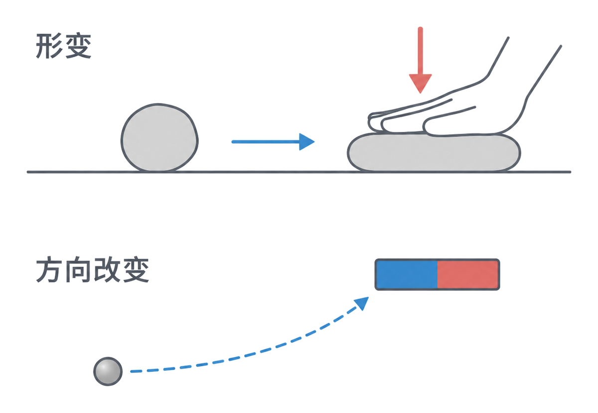
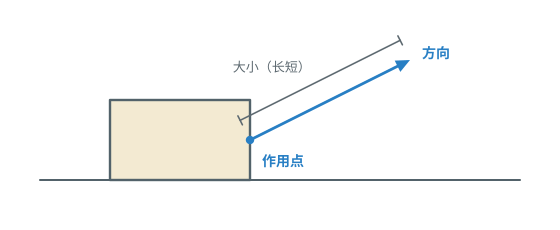
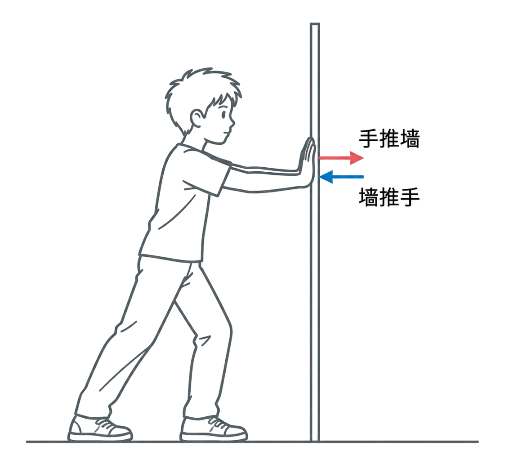
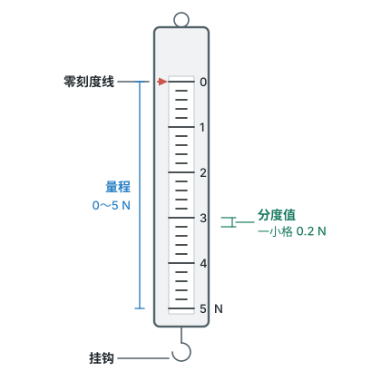
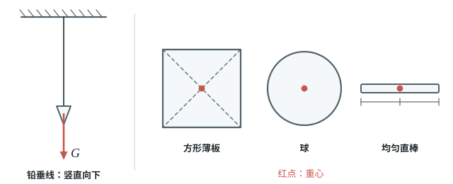

# 第七章 力

这一章先认识力，看看力怎样改变物体的形状和运动状态；再学习弹力、弹簧测力计和重力，弄清常见的力从哪里来、怎样描述。

## 本章前置自查

开始前确认三件事：

1. 会读刻度：先看量程和分度值。（八上第一章第 1 节）
2. 会用千克表示质量。（八上第六章第 1 节）
3. 会比较两个量是否成正比。（数学）

---

## 7.1a 力的概念和力的作用效果

```yaml
id: PHY-8B-07-1a
weight: 一般
weight_note: 未单独考；是本册所有力学的基础
textbook: 八下 7.1 力，p.2–3
prerequisites: []
evidence:
  - 能用“物体对物体的作用”解释力，并指出施力物体和受力物体
  - 能区分力使物体发生形变和改变运动状态这两种作用效果
figure: 已完成 figures/force-effects-clay-magnet.png（形变与运动方向改变两种作用效果；gpt-image-2 生成，已人工核对）
sources: [TB8B-07.1]
```

### 本次只学

知道什么是力，并识别力的两种常见作用效果。

### 先认住

- **力**是物体对物体的作用。发生作用的两个物体，一个是施力物体，一个是受力物体。
- 力用 $F$ 表示，单位是牛顿，简称牛，符号是 $\mathrm{N}$。
- 力可以使物体发生形变，也可以改变物体的运动状态；运动状态改变包括由静止变为运动、由运动变为静止，以及运动快慢或方向发生变化。



### 容易错

- 两个物体不一定要接触才有力的作用，磁体可以吸引铁钉。

### 练一练

- `Q-PHY-TB8B-07.1-1`
- `Q-PHY-GD2019-02`

---

## 7.1b 力的三要素和力的示意图

```yaml
id: PHY-8B-07-1b
weight: 一般
weight_note: 1 次；受力作图多数计入 8B-08-2b
textbook: 八下 7.1 力，p.4
prerequisites:
  - id: PHY-8B-07-1a
    strength: hard
    reason: 先知道力是什么
evidence:
  - 能说出力的大小、方向和作用点是力的三要素
  - 能从力的示意图中读出力的方向、作用点，并在同一幅图中比较力的大小
  - 能用例子说明力的方向会影响作用效果
figure: 已完成 figures/force-three-elements.svg（一个箭头分别标出作用点、方向、大小）
sources: [TB8B-07.1]
```

### 本次只学

知道哪些因素会影响力的作用效果，并读懂力的示意图。

### 先认住

- 力的大小、方向和作用点叫作力的三要素。
- 力的示意图：沿力的方向画一条带箭头的线段，箭头表示力的方向，线段的起点或终点表示作用点；同一幅图中，力越大，线段越长。
- 力的大小、方向或作用点不同，力的作用效果可能不同。



### 练一练

- `Q-PHY-TB8B-07.1-3`
- `Q-PHY-HN2025-15`

---

## 7.1c 力的作用是相互的

```yaml
id: PHY-8B-07-1c
weight: 一般
weight_note: 2 次填空送分（火箭、旋翼）
textbook: 八下 7.1 力，p.5
prerequisites:
  - id: PHY-8B-07-1a
    strength: hard
    reason: 先知道力是物体对物体的作用
evidence:
  - 能说明一个物体对另一个物体施力时，另一个物体也同时对它施力
  - 能从火箭喷气、手推墙等情境中指出两个相互作用的物体
figure: 已完成 figures/mutual-force-wall.png（手推墙与墙推手的相互作用；gpt-image-2 生成，已人工核对）
sources: [TB8B-07.1, GD2023]
```

### 本次只学

知道两个物体发生力的作用时，彼此同时受到对方的力。

### 先认住

- 一个物体对另一个物体施力时，另一个物体也同时对它施力，这说明物体间力的作用是相互的。
- 两个相互作用的力分别作用在两个物体上，方向相反。



### 练一练

- `Q-PHY-GD2023-11`

---

## 7.2a 弹力和弹簧测力计

```yaml
id: PHY-8B-07-2a
weight: 重点
weight_note: 5 次，广州 2023、2024 都有弹簧伸长量探究题
textbook: 八下 7.2 弹力，p.7–10
prerequisites:
  - id: PHY-8B-07-1a
    strength: hard
    reason: 弹力是一种力
  - id: MATH-比例
    strength: soft
    reason: 伸长量与拉力成正比
evidence:
  - 能说明弹力是发生形变的物体要恢复原状时产生的力
  - 能说出弹簧测力计的量程、分度值，并检查指针是否对准零刻度线
  - 能说出在弹性限度内，弹簧受到的拉力越大，伸长量越大
figure: 已完成 figures/spring-scale-parts.svg（标出零刻度线、量程、分度值和挂钩）
sources: [TB8B-07.2, GD2023-23, GZ2024-18]
```

### 本次只学

认识弹力，按步骤使用弹簧测力计。

### 先认住

- 物体受力时发生形变，不受力时又恢复原状，这种性质叫作弹性。
- 发生形变的物体要恢复原状时，会对与它接触的物体产生力，这种力叫作弹力。桌面对水杯的支持力、水杯对桌面的压力都是弹力。
- 在弹性限度内，弹簧受到的拉力越大，弹簧的伸长量就越大。
- 弹簧测力计利用弹簧受到的拉力越大、伸长量越大的原理测量力的大小；读数时先看量程和分度值，按分度值读数；测量时不能超过最大测量值。

### 走一遍

课本实验：用弹簧测力计测量力。

1. 看清测量范围，并确认每个小格表示多少牛。
2. 检查指针是否指在零刻度线上；如果没有，先调零。
3. 分别感受弹簧测力计示数为 $1\ \mathrm{N}$、$3\ \mathrm{N}$、$5\ \mathrm{N}$ 时的力。
4. 测量拉力：把文具袋悬挂在挂钩上读出拉力；再沿水平方向拖动桌面上的文具袋，读出拉力。（注意：由竖直方向转为水平方向测量前，要按新的测量方向重新检查指针并调零。）
5. 总结使用弹簧测力计时应该注意的操作要求。



### 容易错

- 使用前先认量程、分度值并检查零刻度线；超过最大测量值会损坏弹簧测力计。
- 压力和支持力也可以是弹力，不只弹簧能产生弹力。

### 练一练

- `Q-PHY-GD2023-23-1`
- `Q-PHY-GZ2024-18-1`

---

## 7.3a 重力的大小 $G=mg$

```yaml
id: PHY-8B-07-3a
weight: 一般
weight_note: 3 次直接考；几乎所有力学计算第一步都要算重力
textbook: 八下 7.3 重力，p.11–13
prerequisites:
  - id: PHY-8A-06-1a
    strength: hard
    reason: 要用质量求重力
  - id: PHY-8B-07-2a
    strength: soft
    reason: 用弹簧测力计测重力
evidence:
  - 能说出重力是由于地球吸引而使物体受到的力
  - 能写出 $G=mg$，分清重力用牛、质量用千克
  - 已知质量和 $g$，能计算地球附近物体所受重力
figure: 不需要
sources: [TB8B-07.3, GD2023-24]
```

### 本次只学

用 $G=mg$ 由质量算出物体受到的重力。

### 先认住

- 由于地球的吸引而使物体受到的力叫作重力，用 $G$ 表示。
- 地球附近物体所受的重力跟它的质量成正比：$G=mg$。重力的单位是牛，质量的单位是千克。
- $g=9.8\ \mathrm{N/kg}$；粗略计算时，$g$ 可以取 $10\ \mathrm{N/kg}$。

### 容易错

- 代入 $G=mg$ 时，质量要用千克；算出的重力单位是牛。

### 练一练

- `Q-PHY-GD2023-24-1`

---

## 7.3b 重力的方向和重心

```yaml
id: PHY-8B-07-3b
weight: 一般
weight_note: 2 次作图（只受重力）
textbook: 八下 7.3 重力，p.13–14
prerequisites:
  - id: PHY-8B-07-1b
    strength: hard
    reason: 要画力的示意图
evidence:
  - 能说出重力方向是竖直向下，并说明铅垂线怎样确定竖直方向
  - 能解释形状规则、质量分布均匀的物体的重心位置
figure: 已完成 figures/gravity-direction-cg.svg（铅垂线 + 方形薄板、球、均匀直棒的重心）
sources: [TB8B-07.3]
```

### 本次只学

说出重力的方向，并找到规则、均匀物体的重心。

### 先认住

- 重力的方向是竖直向下；沿细线向下的方向与悬挂物体所受重力的方向一致。
- 地球对物体各部分的吸引作用，整体上好像作用在一个点上，这个点叫作物体的重心；形状规则、质量分布均匀的物体，重心在几何中心（方形薄板在两条对角线的交点，球在球心，粗细均匀的直棒在中点）。
- 画力的示意图时，常把力的作用点画在重心上。



### 容易错

- 物体放在斜面上，重力仍然竖直向下，不是垂直于斜面。

### 练一练

- `Q-PHY-TB8B-07.3-5`
- `Q-PHY-GZ2024-12-2`
