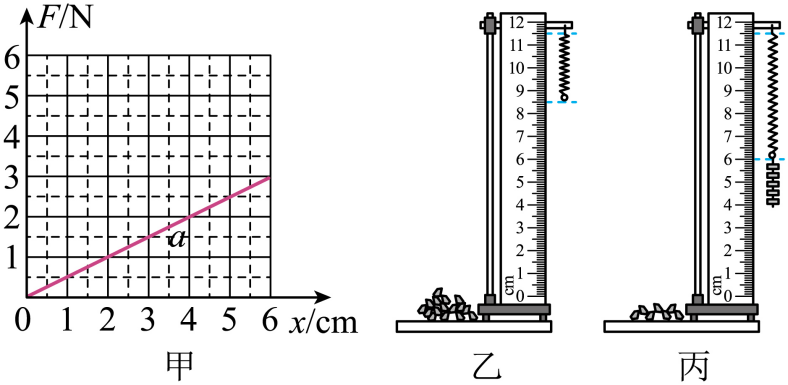
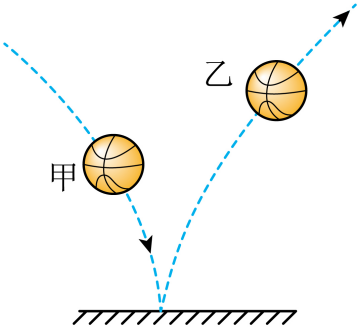
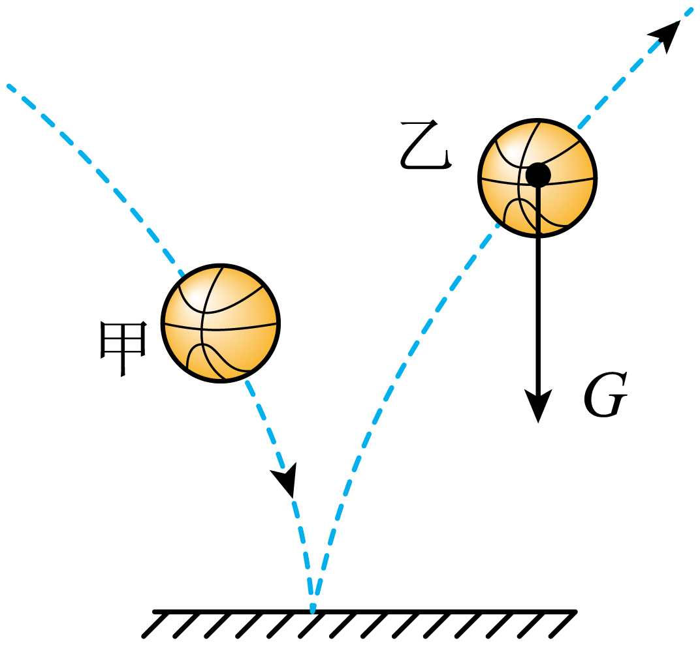
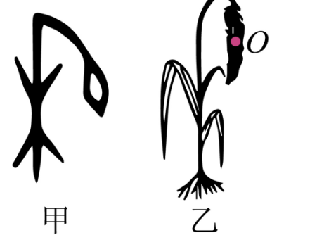
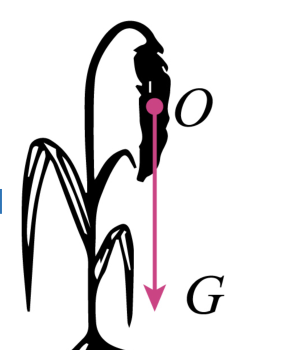

# 第七章 力 · 题目

讲义只用 lesson.md 里引用的题，按知识点顺序排列。真题按原卷录入；课本习题答案由本项目编写，**待复核**。

## 讲义用题（7 道）

### Q-PHY-TB8B-07.1-1

```yaml
id: Q-PHY-TB8B-07.1-1
category: 课本习题
source: 八下 7.1 练习与应用第 1 题，p.6
source_quality: 课本原文
kp: PHY-8B-07-1a
type: 简答
grading: 自评
answer_by: 本项目编写，待复核
review:
  概念: PHY-8B-07-1a
```

**题干**

手拉弹簧、手提书包、石块压地面、磁体吸引铁钉，这些都是一个物体对另一个物体的作用，请分别指出上述事例中的施力物体和受力物体。

**答案**

1. 手拉弹簧：施力物体是手，受力物体是弹簧。
2. 手提书包：施力物体是手，受力物体是书包。
3. 石块压地面：施力物体是石块，受力物体是地面。
4. 磁体吸引铁钉：施力物体是磁体，受力物体是铁钉。

**解析**

1. 先找哪个物体发出了“拉”“提”“压”“吸引”的作用，它就是施力物体。
2. 再找哪个物体受到了这个作用，它就是受力物体。
3. 磁体和铁钉可以不接触，仍然能发生力的作用。

### Q-PHY-TB8B-07.1-3

```yaml
id: Q-PHY-TB8B-07.1-3
category: 课本习题
source: 八下 7.1 练习与应用第 3 题，p.6
source_quality: 课本原文
kp: PHY-8B-07-1b
type: 简答
grading: 自评
answer_by: 本项目编写，待复核
review:
  概念: PHY-8B-07-1b
```

**题干**

请举例说明，力的大小和作用点相同时，力的方向会影响力的作用效果。

**答案**

在足球的同一位置，用相同大小的力沿不同方向踢球，足球运动的方向会不同。

**解析**

1. 比较两次踢球时，让力的大小和作用点相同。
2. 改变力的方向，足球的运动方向也会不同，说明方向会影响力的作用效果。

### Q-PHY-GD2023-11

```yaml
id: Q-PHY-GD2023-11
category: 真题
source: 2023 年广东省初中学业水平考试 物理第 11 题
source_quality: 原卷
kp: PHY-8B-07-1c
type: 填空
grading: 自评
answer_by: 原卷解析
review:
  概念: PHY-8B-07-1c
parts:
  - part: 第 1 空
    kp: PHY-8B-07-1c
    review:
      概念: PHY-8B-07-1c
  - part: 第 2 空
    kp: PHY-8A-06-1a
    review:
      概念: PHY-8A-06-1a
```

**题干**

火箭搭载飞船升空过程中：火箭向下喷出气体而向上运动，说明力的作用是___________的，火箭外壳与空气摩擦会发热，这是通过做功的方式改变外壳内能；宇航员座椅的质量___________（选填“变大”“变小”或“不变”）。

**答案**

相互；不变

**解析**

1. 火箭向下喷出气体，气体也给火箭一个向上的力，说明力的作用是相互的。
2. 质量与所含物质的多少有关，与物体的温度高低无关，所以宇航员座椅的质量不变。

### Q-PHY-GD2023-23-1

```yaml
id: Q-PHY-GD2023-23-1
category: 真题
source: 2023 年广东省初中学业水平考试 物理第 23 题第（1）问
source_quality: 原卷
kp: PHY-8B-07-2a
do: 本章只做第（1）问
type: 填空
grading: 自评
answer_by: 原卷解析（调零理由由本项目补充说明）
review:
  概念: PHY-8B-07-2a
other_parts: （2）—（5）浮力探究，后续学习
```

**题干**

在“探究浮力大小与哪些因素有关”的实验中；

（1）观察弹簧测力计的零刻度线、___________和分度值；调零时，弹簧测力计应在___________（选填“竖直”或“水平”）方向上调零；

**答案**

量程；竖直

**解析**

1. 使用弹簧测力计前，先观察零刻度线、量程和分度值。
2. 本实验后面要把物块竖直挂在测力计下测量，弹簧轴线沿竖直方向，因此应在竖直方向调零。

### Q-PHY-GZ2024-18-1

```yaml
id: Q-PHY-GZ2024-18-1
category: 真题
source: 2024 年广州市初中学业水平考试 物理第 18 题第（1）问
source_quality: 原卷
kp: PHY-8B-07-2a
do: 本章只做第（1）问
type: 填空
grading: 自评
answer_by: 原卷解析（图中数值已核对并重算）
review:
  公式: PHY-8B-07-2a
  单位: PHY-8B-07-2a
other_parts: （2）探究弹簧截短后比值k的变化，未在本章使用
```

**题干**

实验小组在探究弹簧伸长量（$x$）与弹簧受到拉力（$F$） 关系的实验中，得到如图甲所示的 $F$-$x$ 关系图像（图线记为a）。



（1）分析图甲的数据，得到实验结论：$\dfrac{\text{弹簧受到的拉力}}{\text{弹簧的伸长量}}=k$（常量），则比值 $k$ 的单位是______，这根弹簧 $k$ 的大小为______；（本问只用图甲）

**答案**

$\mathrm{N/cm}$；$0.5\ \mathrm{N/cm}$

**解析**

1. 拉力的单位是 $\mathrm{N}$，伸长量的单位是 $\mathrm{cm}$，所以比值 $k$ 的单位是 $\mathrm{N/cm}$。
2. 由图线a读取一组数据：$F=3\ \mathrm{N}$，$x=6\ \mathrm{cm}$。因此 $k=\dfrac{F}{x}=\dfrac{\textcolor{#287fc4}{3}\ \mathrm{N}}{\textcolor{#287fc4}{6}\ \mathrm{cm}}=\boxed{0.5\ \mathrm{N/cm}}$。

### Q-PHY-GD2023-24-1

```yaml
id: Q-PHY-GD2023-24-1
category: 真题
source: 2023 年广东省初中学业水平考试 物理第 24 题第（1）问
source_quality: 原卷
kp: PHY-8B-07-3a
do: 本章只做第（1）问
type: 计算
grading: 自评
answer_by: 原卷解析（公式图片数值已读出并重算）
review:
  公式: PHY-8B-07-3a
  单位: PHY-8B-07-3a
  计算: PHY-8B-07-3a
other_parts: （2）压强 → PHY-8B-09-1b；（3）速度 → PHY-8A-01-3b
```

**题干**

C919是我国自主研发的一种大型客机，已完成商业首航。假设某架飞机总质量为 $8\times10^{4}\ \mathrm{kg}$，静止在水平跑道上时，其轮胎与地面接触的总面积约为 $1\ \mathrm{m^2}$，$g$ 取 $10\ \mathrm{N/kg}$。求该飞机：

（1）受到的重力；

**答案**

$8\times10^{5}\ \mathrm{N}$

**解析**

根据 $G=mg$，飞机受到的重力为

$G=mg=\textcolor{#287fc4}{8\times10^{4}}\ \cancel{\mathrm{kg}}\times\textcolor{#287fc4}{10}\ \mathrm{N}/\cancel{\mathrm{kg}}=\boxed{8\times10^{5}\ \mathrm{N}}$

### Q-PHY-TB8B-07.3-5

```yaml
id: Q-PHY-TB8B-07.3-5
category: 课本习题
source: 八下 7.3 练习与应用第 5 题，p.16
source_quality: 课本原文
kp: PHY-8B-07-3b
type: 简答
grading: 自评
answer_by: 本项目编写，待复核
review:
  概念: PHY-8B-07-3b
```

**题干**

我们通常用水平仪来判断一个面是否水平。请你利用三角板和铅垂线制作一个水平仪，说明怎样利用它来判断桌面是否水平。

**答案**

1. 制作与放置：把铅垂线悬挂在三角板一条直角边的顶点，将另一条直角边平放在待测桌面上。
2. 判断方法：如果铅垂线与竖直方向的直角边重合，说明该直角边竖直，与它垂直的另一条直角边水平，此时桌面是水平的；若不重合，说明桌面不水平。

**解析**

1. 重力的方向总是竖直向下的，悬挂的铅垂线指示竖直方向。
2. 三角板的两条直角边互相垂直。当一条直角边与铅垂线重合处于竖直方向时，另一条直角边必定处于水平方向。
3. 若平放的直角边与桌面贴合且铅垂线与竖直边重合，即可判断桌面水平。

### Q-PHY-GZ2024-12-2

```yaml
category: 真题
source: 2024 年广州市中考物理试题第 12 题第（2）问
source_quality: 原卷（精品解析整理版）
kp: PHY-8B-07-3b
type: 作图
grading: 自评
do: 本章只做第（2）问
other_parts:
  - 第（1）问（长度单位估测、$G=mg$）→ 重力计算，本章不使用
  - 第（3）问（机械能损失、动能）→ 九年级机械能，本章不使用
answer_by: 原卷解析
review:
  概念: PHY-8B-07-3b
```

**题干**

如图，某同学将篮球掷向地面，经过甲位置后碰到地面，接着向上反弹经过乙位置，忽略空气的作用力。请在图中乙位置画出篮球的受力示意图。



**答案**



**解析**

忽略空气的作用力，篮球在乙位置只受重力。重力的方向竖直向下：在篮球的重心（球心）处沿竖直方向向下画一条有向线段，标上 $G$。

### Q-PHY-GD2019-02

```yaml
category: 真题
source: 2019 年广东省初中学业水平考试 物理 第 2 题
source_quality: 原卷（本地存档 Word 转 PDF 页，逐页核对）
kp: PHY-8B-07-1a
type: 选择
grading: 自动
answer_by: 原卷解析
review:
  概念: PHY-8B-07-1a
```

**题干**

头球（运动员用头碰撞飞行中的足球）是足球比赛中常用的技术，下列说法正确的是（　　）

A．头球过程中，头对足球的力改变了足球的运动状态

B．足球被顶飞，是因为头对足球的力大于足球对头的力

C．头对足球的作用力消失时，足球的惯性也消失

D．足球在空中飞行时，以运动员为参照物，足球是静止的

**答案**

A

**解析**

力可以改变物体的运动状态，头对足球的力使足球飞出去，A 正确。头对足球的力和足球对头的力是一对相互作用力，大小相等，B 错。惯性是物体本身的性质，与是否受力无关，C 错。足球飞行时相对于运动员位置在变化，是运动的，D 错。

### Q-PHY-HN2025-15

```yaml
category: 外省真题
source: 2025 年河南省初中学业水平考试 物理 第 15 题
source_quality: 原卷（外省卷，Word 转 PDF 页，逐页核对）
kp: PHY-8B-07-1b
type: 作图
grading: 自评
answer_by: 原卷解析
review:
  概念: PHY-8B-07-1b
```

**题干**

我们熟悉的“禾”字在甲骨文中如图甲所示，它形象地表现出沉甸甸的谷穗弯向大地的情景。请在图乙中画出谷穗所受重力的示意图。（$O$ 点为谷穗的重心）



**答案**

从重心 $O$ 点沿竖直方向向下画一条带箭头的线段，在箭头旁标出 $G$（见解析图）。



**解析**

重力的方向竖直向下，作用点在重心。所以从 $O$ 点画竖直向下的箭头，标 $G$。

