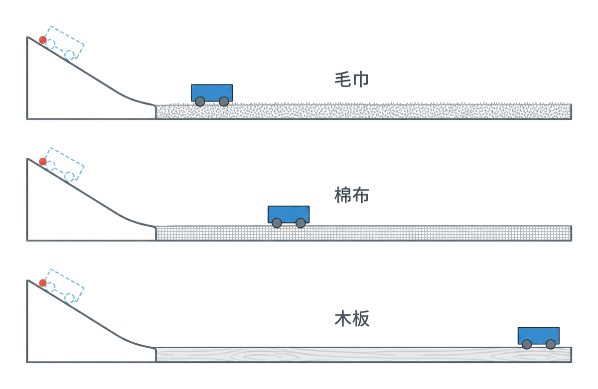
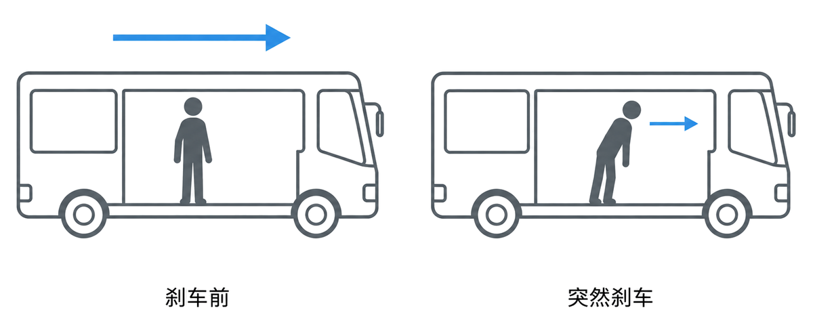
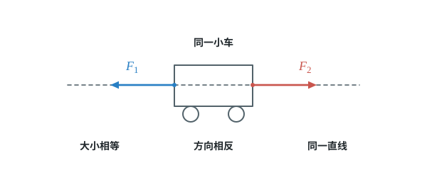
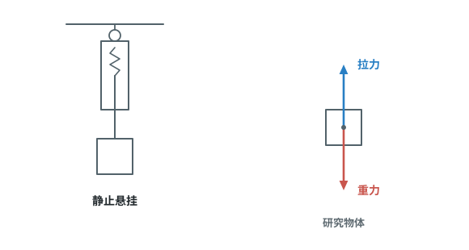
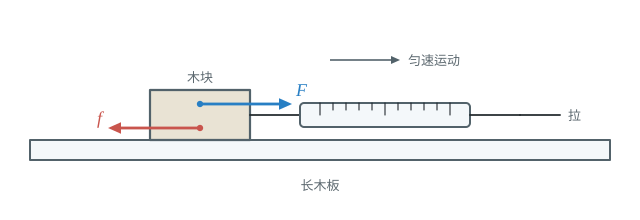
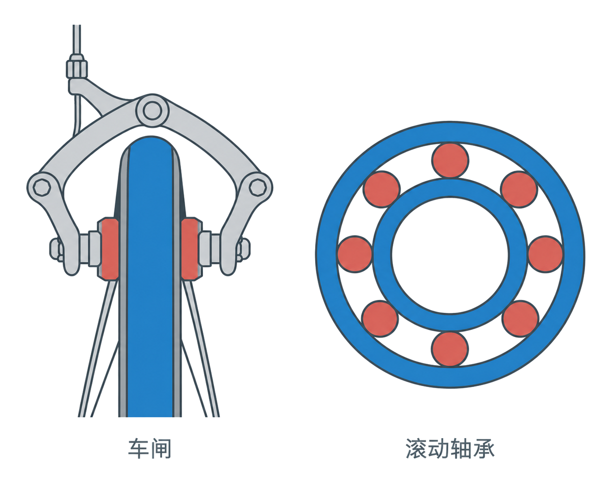
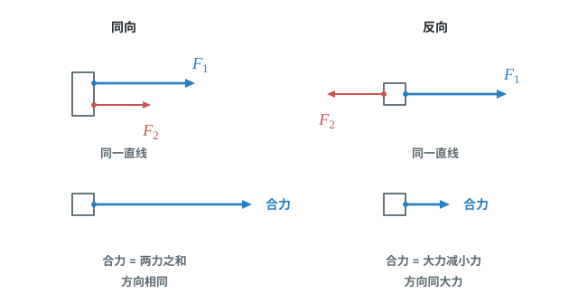

# 第八章 运动和力

运动和力有什么关系？这一章从牛顿第一定律和惯性讲起，再用二力平衡分析物体受力，并学习摩擦力与同一直线上二力的合成。

## 本章前置自查

开始前确认四件事：

1. 会用力的大小、方向和作用点描述力，并读懂力的示意图。（八下第七章）
2. 知道静止和匀速直线运动的含义。（八上第一章第三节）
3. 会用 $G=mg$ 算重力（第七章第 3 节）。
4. 会读弹簧测力计（第七章第 2 节）。

---

## 8.1a 牛顿第一定律

```yaml
id: PHY-8B-08-1a
weight: 一般
weight_note: 未单独考；“力不是维持运动的原因”是惯性和二力平衡的基础
textbook: 八下 8.1 牛顿第一定律，p.19–20
prerequisites:
  - id: PHY-8B-07-1a
    strength: hard
    reason: 力能改变运动状态
  - id: PHY-8A-01-3c
    strength: soft
    reason: 要知道匀速直线运动
evidence:
  - 能说出牛顿第一定律中物体保持的两种运动状态
  - 能解释运动的滑板车会停下是因为受到阻力，而不是因为运动需要力维持
figure: 已完成 figures/cart-surface-comparison.png（相同释放条件下不同表面的小车滑行；gpt-image-2 生成，已人工核对）
sources: [TB8B-08.1]
```

### 本次只学

理解物体的运动不需要力来维持，力是改变物体运动状态的原因。

### 先认住

- 牛顿第一定律：一切物体总保持匀速直线运动状态或静止状态，除非作用在它上面的力迫使它改变这种状态。
- 运动的小车会停下来，是因为受到了阻力；如果运动的物体不受力，它会保持原来的运动状态。



### 容易错

- 不能因为生活中的物体常会停下来，就认为运动必须靠力维持；要找出使运动状态改变的力。

### 练一练

- `Q-PHY-TB8B-08.1-1`

---

## 8.1b 惯性

```yaml
id: PHY-8B-08-1b
weight: 重点
weight_note: 5 次，广州 2022、2025 都考；“受到惯性”是常见错误说法
textbook: 八下 8.1 牛顿第一定律，p.20–22
prerequisites:
  - id: PHY-8B-08-1a
    strength: hard
    reason: 惯性就是保持原来运动状态的性质
  - id: PHY-8A-01-2a
    strength: soft
    reason: 判断“向哪边倾”要选好参照物
evidence:
  - 能说出惯性是物体保持原来匀速直线运动状态或静止状态的性质
  - 能根据汽车突然启动或刹车时乘客的倾斜方向解释惯性现象
  - 能说明安全带可以减轻汽车急停时惯性带来的伤害
figure: 已完成 figures/inertia-braking.png（刹车前、突然刹车两格对照，乘客上身向前倾；gpt-image-2 生成，已人工核对）
sources: [TB8B-08.1, GZ2025-09, SZ2024-05]
```

### 本次只学

用惯性解释物体保持原来运动状态的现象，以及惯性可能带来的危害。

### 先认住

- 物体保持原来匀速直线运动状态或静止状态的性质叫作惯性。
- 一切物体都具有惯性。惯性是物体的固有属性，跟物体的受力情况及运动状态无关。
- 惯性不是物体受到的力，不能说“受到惯性”。
- 惯性有时也会给人们带来危害，需要防范。例如，交通工具必须配备刹车系统，行驶时要保持一定的安全距离；乘客与驾驶员必须系上安全带，以免造成危险。

### 走一遍

课本情境：汽车突然刹车，乘客的身体向前倾。

1. 刹车前，汽车和乘客都向前运动。
2. 汽车突然减速时，乘客的脚随车减速；身体上部由于惯性，仍保持原来的运动状态。
3. 身体上部相对车厢向前，所以乘客会向前倾。



### 容易错

- 汽车突然启动时乘客会向后仰，突然刹车时乘客会向前倾；都是身体试图保持原来的运动状态。
- 不能说物体“失去惯性”或“受到惯性”；所有物体都具有惯性。

### 练一练

- `Q-PHY-GZ2025-09`
- `Q-PHY-SZ2024-05`

---

## 8.2a 二力平衡的条件

```yaml
id: PHY-8B-08-2a
weight: 一般
weight_note: 未单独考；是 2b 的基础
textbook: 八下 8.2 二力平衡，p.23–25
prerequisites:
  - id: PHY-8B-07-1b
    strength: hard
    reason: 要用三要素描述两个力
  - id: PHY-8B-08-1a
    strength: hard
    reason: 平衡状态是静止或匀速直线运动
evidence:
  - 能说出物体处于平衡状态时保持静止或匀速直线运动
  - 能逐项检查作用在同一物体上的两个力是否等大、反向并在同一直线上
figure: 已完成 figures/cart-balanced-pulls.svg（小车两端等大、反向、共线的水平拉力）
sources: [TB8B-08.2]
```

### 本次只学

判断物体是否处于平衡状态，并掌握两个力平衡的条件。

### 先认住

- 物体受到几个力作用时，如果保持静止或匀速直线运动状态，就处于平衡状态。
- 作用在同一个物体上的两个力，如果大小相等、方向相反，并且在同一直线上，这两个力就彼此平衡。



### 破题钥匙

```think
现象: 小车静止，两端各受一个水平拉力
模型: 两条箭头等长、方向相反，在同一直线上
图: phy-pull-pull
关系: $F_1=F_2$
结: 静止或匀速直线运动，受到的力就平衡
```

### 容易错

- 两个力大小相等、方向相反还不够；还要作用在同一个物体上，并且在同一直线上。

### 练一练

- `Q-PHY-TB8B-08.2-4`
- `Q-PHY-TJ2024-6`

---

## 8.2b 用二力平衡分析受力（含受力示意图）

```yaml
id: PHY-8B-08-2b
weight: 重点
weight_note: 11 次，全科最常考的力学技能：由运动状态求摩擦力、牵引力、浮力
textbook: 八下 8.2 二力平衡，p.25–26
prerequisites:
  - id: PHY-8B-08-2a
    strength: hard
    reason: 要会判断两个力是否平衡
  - id: PHY-8B-07-3a
    strength: hard
    reason: 几乎总要先算重力
  - id: PHY-8B-07-1c
    strength: soft
    reason: 要分清平衡力和相互作用力
evidence:
  - 能从物体的静止或匀速直线运动判断它处于平衡状态
  - 已知一对平衡力中的一个力，能判断另一个力的大小和方向
  - 能在受力示意图中辨认作用在同一物体上的平衡力
figure: 已完成 figures/suspended-force-balance.svg（讲义走一遍中的静止悬挂物体与竖直平衡力）
sources: [TB8B-08.2, GD2022-23, GD2023-15]
```

### 本次只学

从物体的运动状态判断受力是否平衡，并用一对平衡力求未知力。

### 先认住

- 在平直轨道上做匀速直线运动的列车，水平方向受到向前的牵引力和向后的阻力，二力平衡；在竖直方向，列车受到向下的重力和轨道对它向上的支持力，二力平衡。
- 物体静止或做匀速直线运动时，若某一方向只受到两个力的作用，这两个力大小相等、方向相反，并在同一直线上。

### 破题钥匙

```think
现象: 列车在平直轨道上匀速前进
模型: 水平一对、竖直一对，四条箭头两两等长
图: phy-train
关系: $F_{牵}=f$，$F_{支}=G$
招: 画图
结: 一个方向上，一对平衡力
```

### 走一遍

课本例子：用弹簧测力计测量静止物体所受的重力。

1. 选悬挂的物体为研究对象；它静止，处于平衡状态。
2. 物体受到竖直向下的重力和弹簧测力计竖直向上的拉力。
3. 两力作用在同一物体、大小相等、方向相反且在同一直线上，所以物体所受重力的大小等于测力计拉力的大小。



### 容易错

- 平衡力作用在同一个物体上；相互作用力分别作用在两个物体上。
- 做匀速直线运动的物体也处于平衡状态，不是只有静止才叫平衡。
- 平衡的两个力，示意图中两条箭头线段要画得一样长。

### 练一练

- `Q-PHY-GD2022-23-2`
- `Q-PHY-GD2023-15`

---

## 8.3a 滑动摩擦力及其影响因素（实验）

```yaml
id: PHY-8B-08-3a
weight: 重点
weight_note: 5 次，且是 2026 广州实验操作考试题目（测木块所受摩擦力）
textbook: 八下 8.3 摩擦力，p.27–29
prerequisites:
  - id: PHY-8B-08-2b
    strength: hard
    reason: 匀速拉动时拉力等于摩擦力
  - id: PHY-8B-07-2a
    strength: hard
    reason: 要读弹簧测力计
evidence:
  - 能说出滑动摩擦力阻碍接触面间的相对运动
  - 能用弹簧测力计水平匀速拉动木块来测量滑动摩擦力
  - 能描述压力、接触面粗糙程度和材料对滑动摩擦力大小的影响
figure: 已完成 figures/friction-measure.svg（木块在长木板上被弹簧测力计水平匀速拉动，标出拉力 F 和摩擦力 f）
sources: [TB8B-08.3, GZ2023-13]
```

### 本次只学

认识滑动摩擦力，并通过实验探究它与哪些因素有关。

### 先认住

- 两个相互接触的物体，当它们相对滑动时，在接触面上会产生阻碍相对运动的力，这种力叫作滑动摩擦力。
- 大量实验表明，滑动摩擦力的大小与接触面所受的压力、接触面的粗糙程度和接触面的材料有关；其他条件相同时，压力越大或接触面越粗糙，滑动摩擦力越大。

### 破题钥匙

```think
现象: 弹簧测力计水平匀速拉动木块
模型: 木块水平方向只受拉力和摩擦力，两条箭头等长
图: phy-drag
关系: $f=F_{拉}$
招: 转换
结: 摩擦力看不见，就读测力计的示数
```

### 走一遍

课本实验：测量木块与长木板之间的滑动摩擦力。

1. 检查弹簧测力计的量程和分度值，并按水平方向检查零刻度线、调零。
2. 用弹簧测力计水平拉动木块，使木块沿水平长木板匀速滑动，同时读出拉力。
3. 木块做匀速直线运动，水平方向的拉力与滑动摩擦力是一对平衡力，所以拉力大小等于滑动摩擦力大小。
4. 探究影响因素时，先保持接触面粗糙程度不变，改变压力；再保持压力不变，换用粗糙程度不同的木板，比较测得的摩擦力。



### 容易错

- 在这套实验中，要水平匀速拉动木块，才能用二力平衡直接得出拉力与滑动摩擦力等大。
- 比较压力或接触面粗糙程度的影响时，要控制另一个因素不变。

### 练一练

- `Q-PHY-GZ2023-13-1`

---

## 8.3b 增大和减小摩擦的方法

```yaml
id: PHY-8B-08-3b
weight: 一般
weight_note: 1 次
textbook: 八下 8.3 摩擦力，p.30–32
prerequisites:
  - id: PHY-8B-08-3a
    strength: hard
    reason: 方法来自影响因素
evidence:
  - 能根据需要说出增大或减小摩擦的方法
  - 能从“滑动改为滚动”判断摩擦变化
figure: 已完成 figures/brake-and-bearing.png（车闸接触与滚动轴承的结构对照；gpt-image-2 生成，已人工核对）
sources: [TB8B-08.3, GD2023-03]
```

### 本次只学

根据生活中的需要，选择增大或减小摩擦的方法。

### 先认住

- 需要增大摩擦时，可以增大压力或增大接触面的粗糙程度；自行车车闸和手上涂防滑粉都是例子。
- 需要减小摩擦时，可以减小接触面的粗糙程度、用滚动代替滑动，或使相互接触的表面分离。
- 给门轴上的合页加润滑剂可以减小摩擦；人们利用滚木移动巨石、巨木或使用滚动轴承，是用滚动代替滑动来大大减小摩擦。



### 练一练

- `Q-PHY-GD2023-03`

---

## 8.4a 同一直线上二力的合成

```yaml
id: PHY-8B-08-4a
weight: 了解
weight_note: 10 套卷未考
textbook: 八下 8.4 同一直线上二力的合成，p.33–38
prerequisites:
  - id: PHY-8B-07-1b
    strength: hard
    reason: 要用力的三要素
evidence:
  - 能判断同一直线上两个力的合力大小和方向
figure: 已完成 figures/collinear-resultants.svg（同向与反向共线二力的合力；同向箭头错开显示）
sources: [TB8B-08.4]
```

### 先认住

- 如果一个力单独作用的效果与几个力共同作用的效果相同，这个力就叫作那几个力的合力。
- 作用在同一个物体上、沿同一直线的两个力方向相同时，合力大小等于这两个力的大小之和，方向与这两个力相同；方向相反时，合力大小等于较大的力减较小的力，方向与较大的力相同。
- 如果两个力大小相等、方向相反，则合力等于 0，二力平衡。



---
