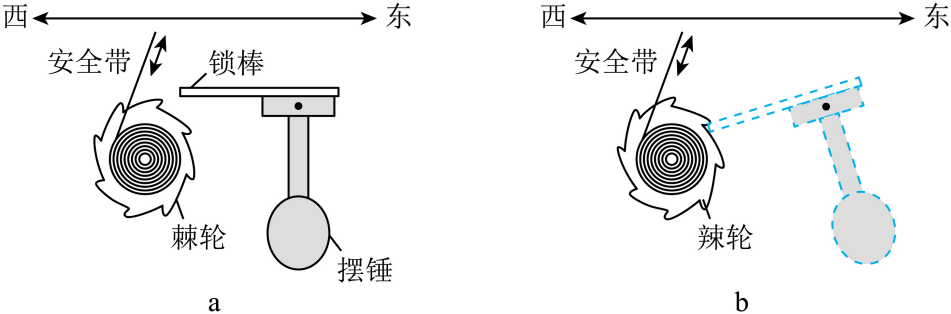
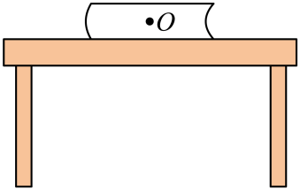
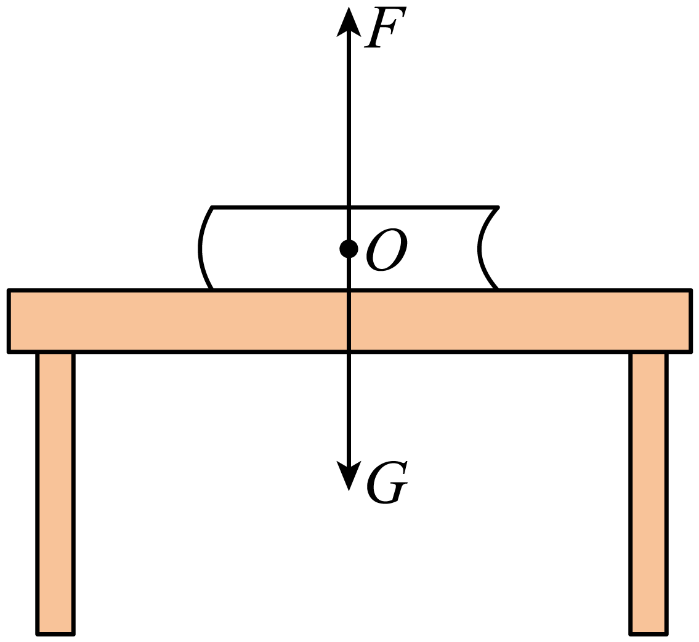
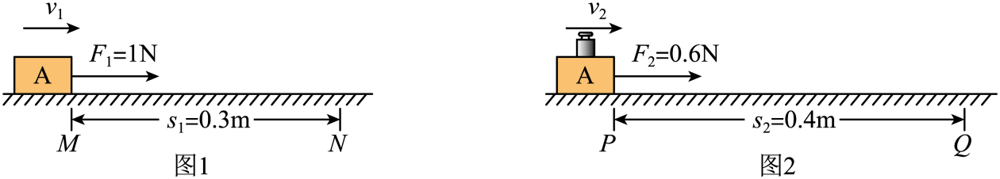
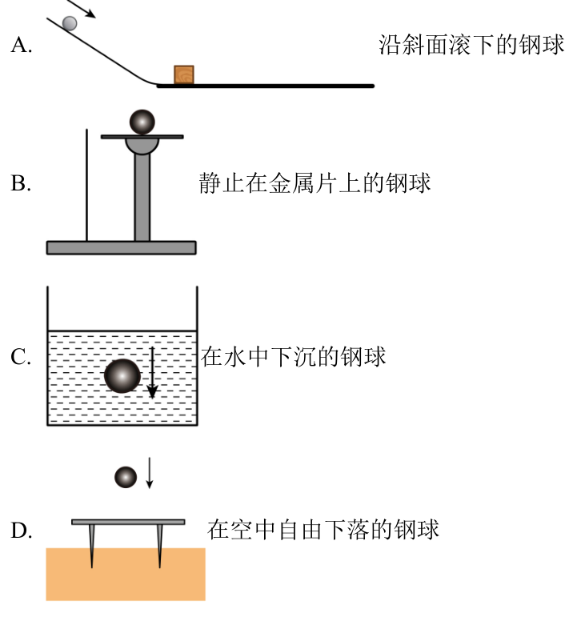
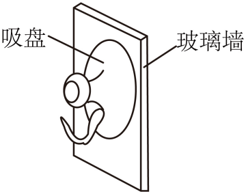

# 第八章 运动和力 · 题目

讲义只用 lesson.md 里引用的题，按知识点顺序排列。真题按原卷录入；课本习题答案由本项目编写，**待复核**。

## 讲义用题（8 道）

### Q-PHY-TB8B-08.1-1

```yaml
id: Q-PHY-TB8B-08.1-1
category: 课本习题
source: 八下 8.1 练习与应用第 1 题，p.22
source_quality: 课本原文
kp: PHY-8B-08-1a
type: 简答
grading: 自评
answer_by: 本项目编写，待复核
review:
  概念: PHY-8B-08-1a
```

**题干**

同学们在一起讨论运动和力的关系。甲同学认为，一切物体只有受力才能保持匀速直线运动，不受力总是静止的；乙同学认为，一切物体只有受力才能保持静止状态，不受力总是做匀速直线运动。他们的说法对吗？为什么？

**答案**

甲、乙的说法都不对。不受力的物体会保持原来的运动状态：原来静止的仍静止，原来做匀速直线运动的仍做匀速直线运动。力不是维持物体运动的原因。

**解析**

根据牛顿第一定律，物体不受力时保持原来的运动状态。甲认为不受力的物体总是静止，忽略了原来做匀速直线运动的物体会继续做匀速直线运动；乙认为不受力的物体总是做匀速直线运动，忽略了原来静止的物体会保持静止。因此甲、乙的说法都不对。

### Q-PHY-GZ2025-09

```yaml
id: Q-PHY-GZ2025-09
category: 真题
source: 2025 年广州市初中学业水平考试 物理第 9 题
source_quality: 原卷
kp: PHY-8B-08-1b
type: 选择
grading: 自动
answer_by: 原卷解析
review:
  概念: PHY-8B-08-1b
```

**题干**

某种汽车安全带控制装置如图a，摆锤竖直悬挂时，锁棒水平，棘轮可以自由转动，安全带能被拉动，由此可判断汽车静止或正常行驶：如图b，摆锤摆起时，锁棒锁定棘轮，安全带不能被拉动，由此可判断汽车可能（　　）



A. 向西匀速行驶

B. 向东匀速行驶

C. 向西紧急刹车

D. 向东紧急刹车

**答案**

D

**解析**

1. 图b中摆锤相对车向东摆起；汽车向东减速时，摆锤由于惯性保持原来的运动状态，相对车向东摆。
2. 汽车向西加速也会产生这种偏摆；四个选项中只有向东紧急刹车符合，选 D。

### Q-PHY-SZ2024-05

```yaml
id: Q-PHY-SZ2024-05
category: 真题
source: 2024 年深圳市初中学业水平考试 物理第 5 题
source_quality: 原卷
kp: PHY-8B-08-1b
type: 选择
grading: 自动
answer_by: 原卷解析
review:
  概念: PHY-8B-08-1b
```

**题干**

2024年6月 10日是我国传统节日端午节，端午节划龙舟是传统的习俗，弘扬中国传统文化是我们义不容辞的责任。运动员停止划桨后，龙舟会向前运动，小丁同学觉得是因为（　　）

A. 具有摩擦力向前运动

B. 具有惯性向前运动

C. 受到重力停止运动

D. 受到质量停止运动

**答案**

B

**解析**

运动员停止划桨后，龙舟仍向前运动，是因为龙舟具有惯性，会保持原来的运动状态。

### Q-PHY-TB8B-08.2-4

```yaml
id: Q-PHY-TB8B-08.2-4
category: 课本习题
source: 八下 8.2 练习与应用第 4 题，p.26
source_quality: 课本原文
kp: PHY-8B-08-2a
do: 本章只做前两问
type: 简答
grading: 自评
answer_by: 本项目编写，待复核
review:
  概念: PHY-8B-08-2a
other_parts: 最后一问为作图题，本章不使用
```

**题干**

在水平公路上沿直线匀速行驶的汽车受到几对平衡力的作用？为什么说它们是互相平衡的？

**答案**

两对——竖直方向重力与支持力，水平方向牵引力与阻力；每对都大小相等、方向相反、作用在同一直线上、作用在同一物体（汽车）上。

**解析**

做匀速直线运动的汽车处于平衡状态。在竖直方向上，汽车受到向下的重力和地面向上的支持力，这两个力互相平衡；在水平方向上，汽车受到向前的牵引力和向后的阻力，这两个力互相平衡。所以它受到两对平衡力的作用。

这些力之所以互相平衡，是因为每对力都满足二力平衡的条件：作用在同一个物体（汽车）上、大小相等、方向相反，并且在同一直线上。

### Q-PHY-GD2022-23-2

```yaml
id: Q-PHY-GD2022-23-2
category: 真题
source: 2022 年广东省初中学业水平考试 物理第 23 题第（2）问
source_quality: 原卷
kp: PHY-8B-08-2b
do: 本章只做第（2）问
type: 计算
grading: 自评
answer_by: 原卷解析
review:
  公式: PHY-8B-08-2b
  单位: PHY-8B-08-2b
  计算: PHY-8B-08-2b
other_parts: （1）压强、（3）功，不在本章使用
```

**题干**

某智能机器人的质量为 $80\ \mathrm{kg}$，其轮子与水平地面接触的总面积为 $5\times10^{-4}\ \mathrm{m^2}$。在水平地面上工作时，该机器人匀速直线移动的速度为 $1\ \mathrm{m/s}$，所受阻力是机器人重力的 $0.05$ 倍。求：（取 $g=10\ \mathrm{N/kg}$）

（2）机器人在水平地面上匀速直线移动时的牵引力；

**答案**

$40\ \mathrm{N}$

**解析**

机器人的重力为

$G=mg=\textcolor{#287fc4}{80}\ \cancel{\mathrm{kg}}\times\textcolor{#287fc4}{10}\ \mathrm{N}/\cancel{\mathrm{kg}}=800\ \mathrm{N}$

机器人匀速直线运动，水平方向的牵引力与阻力平衡，因此牵引力等于阻力：

$F_{\text{牵}}=f=\textcolor{#287fc4}{0.05}\times\textcolor{#287fc4}{800}\ \mathrm{N}=\boxed{40\ \mathrm{N}}$

### Q-PHY-GD2023-15

```yaml
id: Q-PHY-GD2023-15
category: 真题
source: 2023 年广东省初中学业水平考试 物理第 15 题
source_quality: 原卷
kp: PHY-8B-08-2b
type: 作图
grading: 自评
answer_by: 原卷解析
review:
  概念: PHY-8B-08-2b
```

**题干**

如题图所示，书静止放在水平桌面上，请在O点画出书受到的重力G和支持力F的示意图。



**答案**



**解析**

静止在水平桌面上物体受到重力和支持力的共同作用，保持静止状态，重力从重心竖直向下画，标出符号G，支持力从重心竖直向上画，标出符号F，注意两个力大小相等，所画线段的长度要相等。

### Q-PHY-GZ2023-13-1

```yaml
id: Q-PHY-GZ2023-13-1
category: 真题
source: 2023 年广州市初中学业水平考试 物理第 13 题第（1）问
source_quality: 原卷
kp: PHY-8B-08-3a
do: 本章只做第（1）问
type: 填空
grading: 自评
answer_by: 原卷解析（图中数值已核对并重算）
review:
  概念: PHY-8B-08-3a
  计算: PHY-8B-08-3a
other_parts: （2）功和功率，不在本章使用
parts:
  - part: 速度比较空
    kp: PHY-8A-01-3b
    review:
      计算: PHY-8A-01-3b
  - part: 摩擦力比较空
    kp: PHY-8B-08-3a
    review:
      概念: PHY-8B-08-3a
```

**题干**

物体A重 $5\ \mathrm{N}$，如图1，A在水平拉力 $F_{1}$ 作用下，在水平面从M匀速直线运动到N用时3s；如图2，在A上放置一个钩码，A在水平拉力 $F_{2}$ 作用下，在另一水平面从P匀速直线运动到Q用时2s。



（1）在MN，PQ段，A的速度分别为 $v_{1}$、$v_{2}$，A所受摩擦力分别为 $f_{1}$、$f_{2}$，则 $v_{1}$______ $v_{2}$，$f_{1}$______ $f_{2}$；（均选填“>”“=”“<”）

**答案**

$v_{1}<v_{2}$；$f_{1}>f_{2}$

**解析**

1. 在MN段，物体A的速度为 $v_{1}=\dfrac{s_{1}}{t_{1}}=\dfrac{\textcolor{#287fc4}{0.3}\ \mathrm{m}}{\textcolor{#287fc4}{3}\ \mathrm{s}}=0.1\ \mathrm{m/s}$。
2. 在PQ段，物体A的速度为 $v_{2}=\dfrac{s_{2}}{t_{2}}=\dfrac{\textcolor{#287fc4}{0.4}\ \mathrm{m}}{\textcolor{#287fc4}{2}\ \mathrm{s}}=0.2\ \mathrm{m/s}$，所以 $\boxed{v_{1}<v_{2}}$。
3. 图 2 的接触面不同，不能只比压力，要用匀速时摩擦力等于拉力来比较。两次都做匀速直线运动，水平方向的拉力与摩擦力平衡。由图可读出 $f_{1}=F_{1}=1\ \mathrm{N}$，$f_{2}=F_{2}=0.6\ \mathrm{N}$，所以 $\boxed{f_{1}>f_{2}}$。

### Q-PHY-GD2023-03

```yaml
id: Q-PHY-GD2023-03
category: 真题
source: 2023 年广东省初中学业水平考试 物理第 3 题
source_quality: 原卷
kp: PHY-8B-08-3b
type: 选择
grading: 自动
answer_by: 原卷解析
review:
  概念: PHY-8B-08-3b
```

**题干**

小明买了一个方便移动的储物箱。储物箱安装轮子的目的是（　　）

A. 增大摩擦

B. 减小摩擦

C. 增大压强

D. 减小压强

**答案**

B

**解析**

储物箱安装滚轮，是用滚动代替滑动来减小摩擦力，选 B。

---

### Q-PHY-TJ2024-6

```yaml
category: 外省真题
source: 2024 年天津市初中学业水平考试 物理 第 6 题
source_quality: 原卷（外省卷，Word 转 PDF 页，逐页核对）
kp: PHY-8B-08-2a
type: 选择
grading: 自动
answer_by: 原卷解析
review:
  概念: PHY-8B-08-2a
```

**题干**

在如图所示的实验情景中，小钢球受到平衡力作用的是（　　）

A. 沿斜面滚下的钢球
B. 静止在金属片上的钢球
C. 在水中下沉的钢球
D. 在空中自由下落的钢球



**答案**

B

**解析**

物体受平衡力时，处于静止或匀速直线运动状态，运动状态不变。A 沿斜面滚下、C 在水中下沉、D 在空中自由下落的钢球，速度都越来越大，运动状态在改变，不受平衡力。B 中静止在金属片上的钢球处于平衡状态，受平衡力。选 B。

---

## 备选（不进入讲义）

### Q-PHY-GZ2024-04

```yaml
id: Q-PHY-GZ2024-04
category: 真题
source: 2024 年广州市初中学业水平考试 物理第 4 题
source_quality: 原卷
kp: PHY-8B-08-2b
type: 选择
grading: 自动
answer_by: 原卷解析
review:
  概念: PHY-8B-08-2b
```

**题干**

如图，把吸盘压在竖直的玻璃墙上，挤出空气，它就“吸”在玻璃墙上静止不动，则吸盘所受摩擦力（　　）



A. 方向竖直向下

B. 方向竖直向上

C. 大于其所受重力

D. 小于其所受重力

**答案**

B

**解析**

1. 物体静止也可能受到摩擦力；题目已告诉受摩擦力，用二力平衡判断。
2. 吸盘静止，竖直方向受到的摩擦力与重力是一对平衡力，大小相等、方向相反。
3. 重力竖直向下，所以摩擦力竖直向上，选 B。
