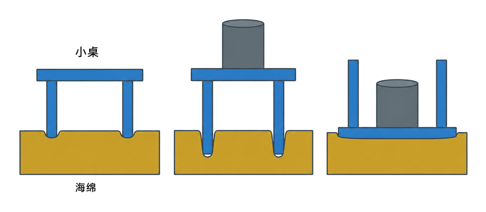
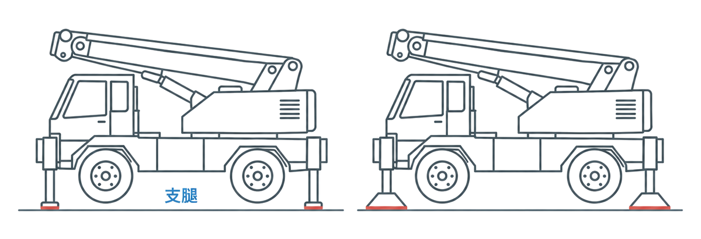
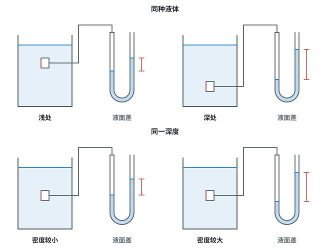
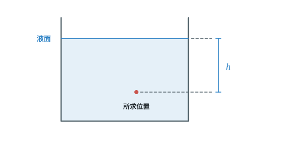
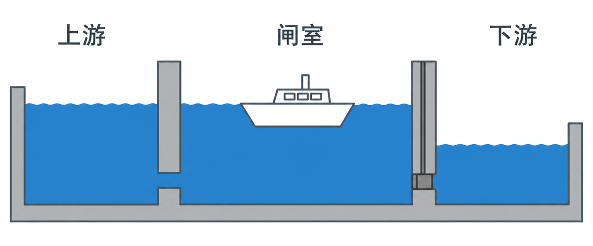
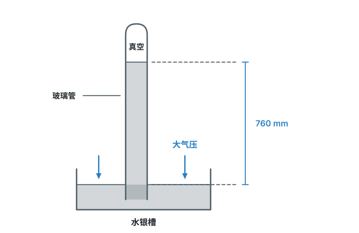
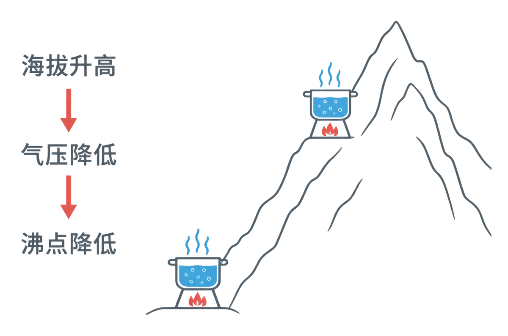
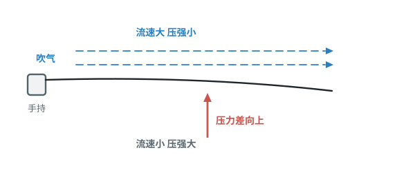

# 第九章 压强

这一章先从压力作用在不同面积上会产生什么效果开始，再学习液体、大气和流动的空气怎样产生压强。你要能比较压强大小、用公式计算，并用压强差解释流体中的现象。本章的重点是计算固体压强（9.1b）、计算液体压强（9.2b），以及解释流体压强与流速的关系（9.5a）。

## 本章前置自查

开始前，检查下面几件事；有一项不熟，就先回看相应内容：

1. 会描述力的方向和作用点。（第七章第 1 节）
2. 能分析水平桌面上静止物体受到的重力和支持力。（第八章第 2 节）
3. 会用 $G=mg$ 求重力，会把平方厘米换成平方米。（第七章第 3 节；数学）
4. 知道密度的含义。（八上第六章第 2 节）

---

## 9.1a 压力和压强的概念（探究）

```yaml
id: PHY-8B-09-1a
weight: 一般
weight_note: 4 次（深圳 2023 探究题占 3 小问）
textbook: 八下 9.1 压强，p.40–41
prerequisites:
  - {id: PHY-8B-07-1b, strength: hard, reason: 压力是一种力}
  - {id: PHY-8B-08-2b, strength: soft, reason: 水平面上压力大小等于重力}
evidence:
  - 能说出压力作用效果与压力大小、受力面积有关
  - 能用“压力相同、受力面积较小”比较压强大小
figure: 已完成 figures/sponge-table-pressure.png（控制压力与受力面积的海绵实验；gpt-image-2 生成，已人工核对）
sources: [TB8B-09.1, GZ2022]
```

### 本次只学

分清压力和压强，并说出压力作用效果与哪些因素有关。

### 先认住

- 压力是垂直作用在接触面上的力；它的方向垂直于接触面。
- 物体所受压力的大小与受力面积之比叫作压强，符号是 $p$。
- 受力面积相同时，压力越大，作用效果越明显；压力相同时，受力面积越小，作用效果越明显。



### 容易错

- 物体静止（或匀速运动）在水平面上，竖直方向只受重力和支持力时，压力大小等于重力；在斜面上、被手按住、上面还压着别的物体时，不能直接说压力等于重力。
- 比较压力作用效果时，不能只看压力大小，还要看受力面积。

### 练一练

- `Q-PHY-GZ2022-15`

---

## 9.1b 用 $p=F/S$ 计算压强

```yaml
id: PHY-8B-09-1b
weight: 重点
weight_note: 7 次，计算题常见第一问
textbook: 八下 9.1 压强，p.41–42
prerequisites:
  - {id: PHY-8B-09-1a, strength: hard, reason: 要知道压强的定义}
  - {id: PHY-8B-07-3a, strength: hard, reason: 压力常要先由 G=mg 求出}
  - {id: PHY-8A-01-1a, strength: soft, reason: 面积单位 cm² 与 m² 换算}
evidence:
  - 能选对压力大小和受力面积，代入 $p=F/S$
  - 能先统一面积单位，再写出帕斯卡
figure: 不需要。用公式和单位换算即可完成本知识点
sources: [TB8B-09.1, GZ2025, GD2023]
```

### 本次只学

用压力和受力面积求压强，计算前先把面积换成平方米。

### 先认住

- 压强公式：$p=F/S$，其中 $F$ 是压力，$S$ 是受力面积。
- 压强单位是帕斯卡，简称帕，符号为 $\mathrm{Pa}$；$1\ \mathrm{Pa}=1\ \mathrm{N/m^2}$。面积常需换算：$1\ \mathrm{cm^2}=10^{-4}\ \mathrm{m^2}$。
- 物体静止在水平面上且没有其他竖直方向的力时，对水平面的压力大小等于重力。

### 破题钥匙

```think
现象: 物体压在水平面上
模型: 压力 $F$ 压在接触的面积 $S$ 上
图: phy-press
关系: $p=\dfrac{F}{S}$
结: 压力一定时，受力面积越小，压强越大
```

### 走一遍

课本例题：水平桌面上静止放一本书，书所受的重力为 $3\ \mathrm{N}$，与桌面的接触面积为 $5\times10^{-2}\ \mathrm{m^2}$，求书对桌面的压强。

1. 书静止在水平桌面上，压力大小等于重力：$F=G=\textcolor{#287fc4}{3}\ \mathrm{N}$。
2. 代入压强公式：

   $p=\dfrac{F}{S}=\dfrac{\textcolor{#287fc4}{3}\ \mathrm{N}}{\textcolor{#287fc4}{5\times10^{-2}}\ \mathrm{m^2}}=\boxed{60\ \mathrm{Pa}}$

### 容易错

- $S$ 取实际接触面积，不取物体全部表面积；单位要换成 $\mathrm{m^2}$。
- 物体静止（或匀速运动）在水平面上，竖直方向只受重力和支持力时，压力大小等于重力；在斜面上、被手按住、上面还压着别的物体时，不能直接说压力等于重力。

### 练一练

- `Q-PHY-GZ2025-10`
- `Q-PHY-GD2023-24-2`

---

## 9.1c 增大和减小压强

```yaml
id: PHY-8B-09-1c
weight: 一般
weight_note: 2 次
textbook: 八下 9.1 压强，p.42–43
prerequisites:
  - {id: PHY-8B-09-1a, strength: hard, reason: 方法来自 p=F/S}
evidence:
  - 能判断增大压力或减小受力面积会增大压强
  - 能判断减小压力或增大受力面积会减小压强
figure: 已完成 figures/crane-outrigger-footprints.png（吊车两种支腿的接触面积对照；gpt-image-2 生成，已人工核对）
sources: [TB8B-09.1, GZ2024]
```

### 本次只学

根据压力和受力面积的变化，判断压强怎样变化。

### 先认住

- 增大压强：受力面积不变时增大压力，或压力不变时减小受力面积。
- 减小压强：受力面积不变时减小压力，或压力不变时增大受力面积。



### 容易错

- 受力面积变大只能说明压强会减小的条件之一；还要确认压力没有同时增大。

### 练一练

- `Q-PHY-GZ2024-16-1`

---

## 9.2a 液体压强的特点

```yaml
id: PHY-8B-09-2a
weight: 一般
weight_note: 4 次
textbook: 八下 9.2 液体的压强，p.45–47
prerequisites:
  - {id: PHY-8B-09-1a, strength: hard, reason: 先知道压强是什么}
  - {id: PHY-8A-06-2a, strength: soft, reason: 液体压强与液体密度有关}
evidence:
  - 能说出液体内部同一深度各方向压强相等
  - 能比较深度不同或密度不同的液体压强
figure: 已完成 figures/liquid-pressure-manometers.svg（U 形管压强计分别比较深度、液体密度的影响）
sources: [TB8B-09.2, SZ2024]
```

### 本次只学

比较液体内部压强时，要同时关注深度和液体密度。

### 先认住

- 液体内部向各个方向都有压强；同一种静止液体的同一深度，向各个方向的压强都相等。
- 同种液体中，深度越大，压强越大。
- 深度相同时，液体密度越大，压强越大。



### 容易错

- 深度从液面竖直向下量，不是从容器底部或侧壁量。

### 练一练

- `Q-PHY-SZ2024-14-1`

---

## 9.2b 用 $p=\rho gh$ 计算液体压强

```yaml
id: PHY-8B-09-2b
weight: 重点
weight_note: 4 次计算（广州 2024、2025 都考）
textbook: 八下 9.2 液体的压强，p.47–48
prerequisites:
  - {id: PHY-8B-09-2a, strength: hard, reason: 要知道深度从液面往下量}
  - {id: PHY-8A-06-4a, strength: soft, reason: 常要和密度计算配合}
evidence:
  - 能确定所求位置到液面的竖直深度
  - 能代入 $p=\rho gh$ 求液体压强并写对单位
figure: 已完成 figures/liquid-depth-h.svg（液面到所求位置的竖直深度 h）
sources: [TB8B-09.2, GZ2024]
```

### 本次只学

用液体密度、深度和题目给定的 $g$，计算液体内部的压强。

### 先认住

- 液面下深度为 $h$ 处的液体压强：$p=\rho gh$。
- $h$ 是该点到液面的竖直距离；液体压强不由容器形状决定。



### 破题钥匙

```think
现象: 杯子里的水，对水中的一点有压强
模型: 从液面竖直向下量到该点，得到深度 $h$
图: phy-depth
关系: $p=\rho gh$
结: $h$ 是到液面的竖直距离，不是杯子的高度
```

### 走一遍

课本以万米深的海水为例估算压强。取海水密度 $\rho=1\times10^3\ \mathrm{kg/m^3}$、$g=10\ \mathrm{N/kg}$，深度 $h=10000\ \mathrm{m}$。

1. 选用液体压强公式：$p=\rho gh$。
2. 代入数值并约去单位：

   $p=\textcolor{#287fc4}{1\times10^3}\ \cancel{\mathrm{kg}}/\mathrm{m^3}\times\textcolor{#287fc4}{10}\ \mathrm{N}/\cancel{\mathrm{kg}}\times\textcolor{#287fc4}{10000}\ \mathrm{m}=1\times10^8\ \mathrm{N/m^2}=\boxed{1\times10^8\ \mathrm{Pa}}$

### 容易错

- 公式中的 $h$ 是液面下的深度，不是容器的总高度或液体的长度。
- 代入前检查密度、深度和 $g$ 的单位是否一致。

### 练一练

- `Q-PHY-GZ2024-10`

---

## 9.2c 连通器

```yaml
id: PHY-8B-09-2c
weight: 一般
weight_note: 1 次（船闸）
textbook: 八下 9.2 液体的压强，p.49–50
prerequisites:
  - {id: PHY-8B-09-2a, strength: hard, reason: 连通器原理来自液体压强}
evidence:
  - 能识别上端开口、下端连通的容器
  - 能说明连通器中液体不流动时各容器的液面相平
figure: 已完成 figures/ship-lock-upper-level.png（上游连通、下游隔断时的船闸水位；gpt-image-2 生成，已人工核对）
sources: [TB8B-09.2, SZ2023]
```

### 本次只学

知道连通器的结构，并用液面相平的条件解释船闸工作原理。

### 先认住

- 上端开口、下端连通的容器叫作连通器。
- 连通器里只有一种液体且液体不流动时，各容器中的液面相平。
- 船闸通过闸室与上游或下游水道组成连通器，使闸室水面升高或降低到相应水位。



### 练一练

- `Q-PHY-SZ2023-20-1a`

---

## 9.3a 大气压的存在和测量

```yaml
id: PHY-8B-09-3a
weight: 一般
weight_note: 1 次
textbook: 八下 9.3 大气压强，p.52–54
prerequisites:
  - {id: PHY-8B-09-2b, strength: hard, reason: 托里拆利实验用液柱压强表示大气压}
evidence:
  - 能用吸盘等现象说明大气压确实存在
  - 能说明托里拆利实验中大气压怎样由水银柱测出
figure: 已完成 figures/torricelli-mercury.svg（托里拆利实验的真空、水银槽和 760 mm 竖直液面高度差）
sources: [TB8B-09.3, GD2023]
```

### 本次只学

用生活现象说明大气压存在，认识托里拆利实验和标准大气压。

### 先认住

- 大气压强确实是存在的，大气压强简称大气压；挤压出空气的吸盘被大气压在墙上，若吸盘内外与大气连通、气压相等，就吸不住。
- 托里拆利实验中，管内水银柱上方是真空；大气压支持水银柱，大小等于这段水银柱产生的压强。
- $760\ \mathrm{mm}$ 高的水银柱产生的压强约为 $1.013\times10^5\ \mathrm{Pa}$，称为标准大气压；粗略计算可取 $1\times10^5\ \mathrm{Pa}$。



### 练一练

- `Q-PHY-GD2023-10`

---

## 9.3b 大气压与高度、沸点

```yaml
id: PHY-8B-09-3b
weight: 一般
weight_note: 2 次
textbook: 八下 9.3 大气压强，p.54–55
prerequisites:
  - {id: PHY-8B-09-3a, strength: hard, reason: 先知道大气压存在}
  - {id: PHY-8A-03-3a, strength: soft, reason: 知道水沸腾时温度不变}
evidence:
  - 能判断海拔升高时大气压怎样变化
  - 能解释气压降低时水的沸点也降低
figure: 已完成 figures/altitude-boiling-water.png（海拔、大气压和水沸点的定性关系；gpt-image-2 生成，已人工核对）
sources: [TB8B-09.3, GD2023, SZ2023]
```

### 本次只学

说明大气压与高度的关系，并用气压变化解释水的沸点变化。

### 先认住

- 随着高度增加，大气压逐渐减小。
- 在标准大气压下，水的沸点是 $100\ ^\circ\mathrm{C}$；气压降低时，水的沸点也降低。



### 练一练

- `Q-PHY-SZ2023-17-3`
- `Q-PHY-GD2023-10`

---

## 9.5a 流体压强与流速的关系

```yaml
id: PHY-8B-09-5a
weight: 重点
weight_note: 6 次，广州 2022–2024 每年都考，要写清“流速大→压强小→压力差”
textbook: 八下 9.5 流体压强与流速的关系，p.59–60
prerequisites:
  - {id: PHY-8B-09-3a, strength: hard, reason: 比较的是两侧气压}
  - {id: PHY-8B-09-1a, strength: soft, reason: 压强差产生压力差}
evidence:
  - 能判断流速较大处的压强较小
  - 能按“流速差→压强差→压力差”解释现象
figure: 已完成 figures/blow-over-paper.svg（纸条上方吹气，标出上下流速、压强和向上的压力差）
sources: [TB8B-09.5, GZ2022]
```

### 本次只学

先比较流速，再比较压强，最后用两侧压强差解释压力差。

### 先认住

- 具有流动性的液体和气体统称为流体。
- 在气体和液体中，流速越大的位置，压强越小。
- 两侧流速不同会造成压强差；压强差会形成压力差。

### 走一遍

课本的纸条实验：手持纸条，在纸条上方水平吹气。

1. 吹气后，观察到纸条向上运动，说明吹气后纸条上、下表面受力情况发生了变化。
2. 纸条下方气压变化不大，纸条向上运动说明是纸条上方气压变小了。
3. 这和“流速越大的位置压强越小”一致（课本用两张纸的实验和更多实验得出这条规律）。



### 容易错

- 只写“流速大、压强小”还不够；解释物体运动时，要接着写两侧压强差形成了什么方向的压力差。
- 先确认比较的是同一种流体中的不同位置。

### 练一练

- `Q-PHY-GZ2022-06`

