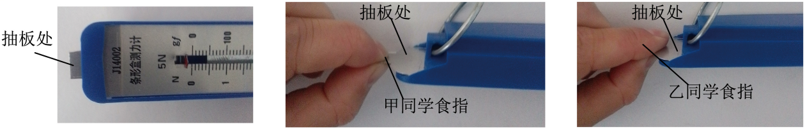
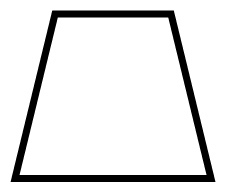
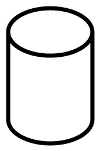
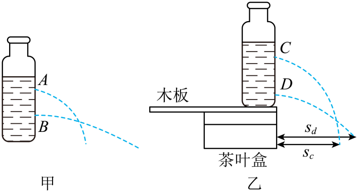
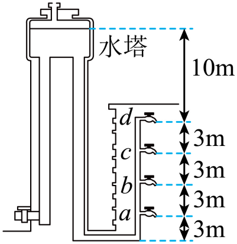
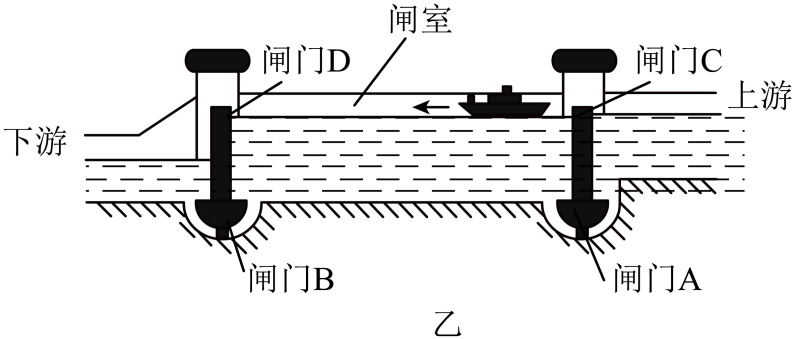
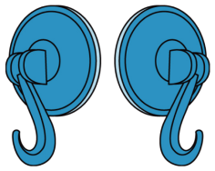
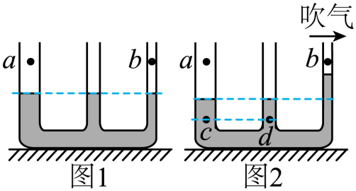
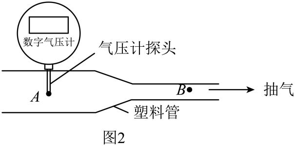
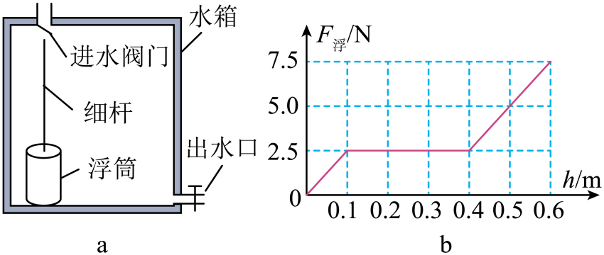

# 第九章 压强 · 题目

讲义用题按知识点顺序排列；本章共有 10 道不同真题（另有 2 道备选用题）。跨知识点使用的真题只在此定义一次。

## 讲义用题

### Q-PHY-GZ2022-15

```yaml
id: Q-PHY-GZ2022-15
category: 真题
source: 2022 年广州市初中学业水平考试物理第 15 题
source_quality: 原卷
kp: PHY-8B-09-1a
type: 填空
grading: 自评
answer_by: 原卷解析
review:
  概念: PHY-8B-09-1a
```

**题干**

15. 如图，甲、乙两同学分别对测力计调零。若抽板处对两同学食指的压力相等，则食指承受压强较大的是甲还是乙？___________，依据是___________。



**答案**

甲；压力相同，甲的受力面积更小。

**解析**

1. 抽板处对两名同学食指的压力相等。
2. 图中甲与抽板的接触面积较小。
3. 根据 $p=F/S$，压力相同时，受力面积较小的一侧压强较大，因此甲的食指承受压强较大。

---

### Q-PHY-GZ2025-10

```yaml
id: Q-PHY-GZ2025-10
category: 真题
source: 2025 年广州市初中学业水平考试物理第 10 题
source_quality: 原卷
kp: PHY-8B-09-1b
type: 选择
grading: 自动
answer_by: 原卷解析（数值为公式图片，已读出并重算核对）
review:
  公式: PHY-8B-09-1b
  单位: PHY-8B-09-1b
  计算: PHY-8B-09-1b
```

**题干**

10. 用于测量汽车轮胎内气体压强的胎压计，其数值的单位是“$\mathrm{kg/cm^2}$”，表示 $1\ \mathrm{cm^2}$ 的受力面积上，所受的压力大小相当于 $1\ \mathrm{kg}$ 物体的重力大小。若 $g$ 取 $10\ \mathrm{N/kg}$，则 $1\ \mathrm{kg/cm^2}$ 相当于（　　）


A. $1\times10^2\ \mathrm{Pa}$

B. $1\times10^3\ \mathrm{Pa}$

C. $1\times10^4\ \mathrm{Pa}$

D. $1\times10^5\ \mathrm{Pa}$

**答案**

D

**解析**

1. $1\ \mathrm{cm^2}=\textcolor{#287fc4}{1.0\times10^{-4}}\ \mathrm{m^2}$。
2. $p=F/S=mg/S$。
3. $p=\dfrac{\textcolor{#287fc4}{1}\ \cancel{\mathrm{kg}}\times\textcolor{#287fc4}{10}\ \mathrm{N}/\cancel{\mathrm{kg}}}{\textcolor{#287fc4}{1.0\times10^{-4}}\ \mathrm{m^2}}=\boxed{1.0\times10^5\ \mathrm{Pa}}$，选 D。

---

### Q-PHY-GD2023-24-2

```yaml
id: Q-PHY-GD2023-24-2
category: 真题
source: 2023 年广东省初中学业水平考试物理第 24 题第（2）问
source_quality: 原卷
kp: PHY-8B-09-1b
do: 本章只做第（2）问
type: 计算
grading: 自评
answer_by: 原卷解析（已按规范重写计算过程）
review:
  公式: PHY-8B-09-1b
  单位: PHY-8B-09-1b
  计算: PHY-8B-09-1b
other_parts: （1）重力 → PHY-8B-07-3a；（3）速度 → PHY-8A-01-3b。这些小问不在本章使用
```

**题干**

24. C919 是我国自主研发的一种大型客机，已完成商业首航。假设某架飞机总质量为 $8\times10^4\ \mathrm{kg}$，静止在水平跑道上时，其轮胎与地面接触的总面积约为 $1\ \mathrm{m^2}$，$g$ 取 $10\ \mathrm{N/kg}$。求该飞机：

（2）静止时对水平跑道的压强；

**答案**

$8\times10^5\ \mathrm{Pa}$。

**解析**

1. 客机静止在水平跑道上，对地面的压力大小等于客机的重力：

   $F=G=mg=\textcolor{#287fc4}{8\times10^4}\ \cancel{\mathrm{kg}}\times\textcolor{#287fc4}{10}\ \mathrm{N}/\cancel{\mathrm{kg}}=8\times10^5\ \mathrm{N}$。

2. 压强 $p=\dfrac{F}{S}=\dfrac{\textcolor{#287fc4}{8\times10^5}\ \mathrm{N}}{\textcolor{#287fc4}{1}\ \mathrm{m^2}}=\boxed{8\times10^5\ \mathrm{Pa}}$。


---

### Q-PHY-GZ2024-16-1

```yaml
id: Q-PHY-GZ2024-16-1
category: 真题
source: 2024 年广州市初中学业水平考试物理第 16 题第（1）问
source_quality: 原卷
kp: PHY-8B-09-1c
do: 本章只做第（1）问
type: 填空
grading: 自评
answer_by: 原卷解析
review:
  概念: PHY-8B-09-1c
other_parts: 第（2）（3）问是滑轮组速度、功率和机械效率计算，本章不使用。
```

**题干**

16. 如图，吊车在建筑工地进行作业时，由支腿将吊车撑起并脱离地面，吊臂上的滑轮组在 $1\ \mathrm{s}$ 内，将重为 $9\times10^3\ \mathrm{N}$ 的建筑材料沿竖直方向匀速提升 $1\ \mathrm{m}$，滑轮组上钢丝绳自由端受到的拉力 $F$ 为 $5\times10^3\ \mathrm{N}$；（本问只看支腿形状）

（1）支腿做成“”形而非“”形的作用是：__________。

**答案**

减小压强。

**解析**

1. 吊车对地面的压力不变。
2. 第一种支腿的受力面积较大。
3. 根据 $p=F/S$，压力不变、受力面积增大，压强减小。

---

### Q-PHY-SZ2024-14-1

```yaml
id: Q-PHY-SZ2024-14-1
category: 真题
source: 2024 年深圳市初中学业水平考试物理第 14 题第（1）问
source_quality: 原卷
kp: PHY-8B-09-2a
do: 本章只做第（1）问
type: 填空
grading: 自评
answer_by: 原卷解析
review:
  概念: PHY-8B-09-2a
other_parts: 第（2）—（4）问涉及水流射程和结论评价，本章不使用。
```

**题干**

14. 学习“液体压强”时，老师展示了如图甲所示的实验，辉辉同学观察实验后，得出结论：深度越大，水的压强越大，水喷出的最远距离就越大。下课后，辉辉将自己的结论告诉老师，老师表扬了辉辉爱思考的好习惯，然后和辉辉一起到了思考乐实验室，另找一个矿泉水瓶，在侧边扎了两个小圆孔 C 和 D（圆孔 A、B、C、D 的直径相同），并进行了以下实验：观察得 $s_c$ 小于 $s_d$。



（1）现已知 $h_c<h_d$，求 $p_c$________$p_d$。

**答案**

$p_c<p_d$。

**解析**

1. 两处液体都是水，液体密度相同。
2. 已知 $h_c<h_d$，根据 $p=\rho gh$，深度较小处压强较小。
3. 所以 $p_c<p_d$。

---

### Q-PHY-GZ2024-10

```yaml
id: Q-PHY-GZ2024-10
category: 真题
source: 2024 年广州市初中学业水平考试物理第 10 题
source_quality: 原卷
kp: PHY-8B-09-2b
type: 选择
grading: 自动
answer_by: 原卷解析（数值为公式图片，已读出并重算核对）
review:
  公式: PHY-8B-09-2b
  单位: PHY-8B-09-2b
  计算: PHY-8B-09-2b
```

**题干**

10. 某居民楼水塔液面与各楼层水龙头的竖直距离如图所示，若 $\rho_{\text{水}}=1.0\times10^3\ \mathrm{kg/m^3}$，$g=10\ \mathrm{N/kg}$，水龙头关闭时，c 处所受水的压强为（　　）

A. $3.0\times10^4\ \mathrm{Pa}$
B. $9.0\times10^4\ \mathrm{Pa}$
C. $1.0\times10^5\ \mathrm{Pa}$
D. $1.3\times10^5\ \mathrm{Pa}$



**答案**

D

**解析**

1. 由题图可知，水龙头关闭时，c 处水的深度 $h=10\ \mathrm{m}+3\ \mathrm{m}=13\ \mathrm{m}$。
2. 所以 c 处水龙头所受水的压强为：

   $p=\rho gh=\textcolor{#287fc4}{1.0\times10^3}\ \cancel{\mathrm{kg}}/\mathrm{m^3}\times\textcolor{#287fc4}{10}\ \mathrm{N}/\cancel{\mathrm{kg}}\times\textcolor{#287fc4}{13}\ \mathrm{m}=\boxed{1.3\times10^5\ \mathrm{Pa}}$。


---

### Q-PHY-SZ2023-20-1a

```yaml
id: Q-PHY-SZ2023-20-1a
category: 真题
source: 2023 年深圳市初中学业水平考试物理第 20 题第（1）问
source_quality: 原卷
kp: PHY-8B-09-2c
do: 本章只做第（1）问
type: 填空
grading: 自评
answer_by: 原卷解析
review:
  概念: PHY-8B-09-2c
other_parts: 第（2）—（5）问涉及滑轮、光反射、浮力和电功率，本章不使用。
parts:
  - part: 船闸原理空
    kp: PHY-8B-09-2c
    review:
      概念: PHY-8B-09-2c
  - part: 运动状态空
    kp: PHY-8A-01-2a
    review:
      概念: PHY-8A-01-2a
```

**题干**



（1）船闸的工作原理是______，图乙中船相对于大坝是______（填“运动”或“静止”）。

**答案**

连通器；运动。

**解析**

1. 船闸通过闸室与上游或下游水道连通，使闸室中的液面与相应水道的液面相平，利用的是连通器原理。
2. 图中箭头表示船正在向左行驶，相对于大坝的位置在改变，所以是运动的。

---

### Q-PHY-GD2023-10

```yaml
id: Q-PHY-GD2023-10
category: 真题
source: 2023 年广东省初中学业水平考试物理第 10 题
source_quality: 原卷
kp: PHY-8B-09-3a
type: 填空
grading: 自评
answer_by: 原卷解析
review:
  概念: PHY-8B-09-3a
parts:
  - part: 第 1 空
    kp: PHY-8B-09-3a
    review:
      概念: PHY-8B-09-3a
  - part: 第 2 空
    kp: PHY-8B-09-3a
    review:
      概念: PHY-8B-09-3a
  - part: 第 3 空
    kp: PHY-8B-09-3b
    review:
      概念: PHY-8B-09-3b
```

**题干**

10. 如题图所示，用两个吸盘模拟马德堡半球实验；将两个吸盘对接，用力挤压出空气后难以将其分开，说明吸盘内部气体压强___________（选填“大于”“等于”或“小于”）大气压强；若在吸盘上截一个小孔，吸盘内部气体压强会变___________；若在海拔更高的地方做同样的实验，将其分开所需的力更小，说明海拔越高，大气压强越___________。



**答案**

小于；大；小。

**解析**

1. 挤出吸盘中的空气后，吸盘内压强小于外界大气压，外界大气压把吸盘压紧。
2. 在吸盘上开孔后，空气进入，吸盘内部气体压强变大。
3. 海拔更高时，分开吸盘所需的力更小，说明内外压强差更小；吸盘内部条件相同，因此当地大气压更小。

---

### Q-PHY-SZ2023-17-3

```yaml
id: Q-PHY-SZ2023-17-3
category: 真题
source: 2023 年深圳市初中学业水平考试物理第 17 题第（3）问
source_quality: 原卷
kp: PHY-8B-09-3b
do: 本章只做第（3）问
type: 填空
grading: 自评
answer_by: 原卷解析
review:
  概念: PHY-8B-09-3b
other_parts: 第（1）（2）（4）—（6）问涉及温度计读数、沸腾特征和热量计算，本章不使用。
```

**题干**

17. 思考乐琴琴同学探究“水的沸腾与加热时间的关系”，水的质量为 $100\ \mathrm{g}$，实验过程中温度随时间变化的关系如下表。


| 时间/min | 0 | 0.5 | 1 | 1.5 | 2 | …… | 12 |
| --- | --- | --- | --- | --- | --- | --- | --- |
| 温度/℃ | 94 | ？ | 96 | 97 | 98 | …… | 98 |

（3）思考乐琴琴同学实验过程中，水沸腾时温度小于 $100\ ^\circ\mathrm{C}$，原因是___________。

**答案**

当地大气压小于 $1$ 标准大气压。

**解析**

1. 标准大气压下水的沸点是 $100\ ^\circ\mathrm{C}$。
2. 大气压降低时，水的沸点降低。
3. 水沸腾时温度小于 $100\ ^\circ\mathrm{C}$，说明当地大气压小于 $1$ 标准大气压。

---

### Q-PHY-GZ2022-06

```yaml
id: Q-PHY-GZ2022-06
category: 真题
source: 2022 年广州市初中学业水平考试物理第 6 题
source_quality: 原卷
kp: PHY-8B-09-5a
type: 选择
grading: 自动
answer_by: 原卷解析
review:
  概念: PHY-8B-09-5a
```

**题干**

6. 如图 1，连通器中的水静止，此时水面上方 a、b 处的气压为 $p_{a0}$、$p_{b0}$。在 b 上方持续水平吹气，水面稳定后如图 2 所示，此时 a、b 处的气压为 $p_{a}$、$p_{b}$。水面下 c、d 处水的压强为 $p_{c}$、$p_{d}$，若大气压保持不变，则（　　）

A. $p_{c}> p_{d}$
B. $p_{a}> p_{b}$
C. $p_{a0}>p_{a}$
D. $p_{b0}=p_{b}$



**答案**

B

**解析**

1. 图 2 中 b 处上方空气流速大，压强小；a 处流速小，压强大。因此 $p_a>p_b$，B 正确。
2. c、d 两处在水面下同一深度，根据 $p=\rho gh$，两处水的压强相等，即 $p_c=p_d$，A 错误。
3. 大气压保持不变，a 处未吹气，气压等于大气压，所以 $p_{a0}=p_a$，C 错误。
4. b 处吹气后压强变小，所以 $p_{b0}>p_b$，D 错误。
5. 综上所述，选 B。

## 备选（不进入讲义，不再维护）

### Q-PHY-GZ2023-14-2

```yaml
id: Q-PHY-GZ2023-14-2
category: 真题
source: 2023 年广州市初中学业水平考试物理第 14 题第（2）问
source_quality: 原卷
kp: PHY-8B-09-2b
do: 本章只做第（2）问
type: 选填
grading: 自评
answer_by: 原卷解析（数值为公式图片，已读出并重算核对）
review:
  概念: PHY-8B-09-5a
  公式: PHY-8B-09-2b
  单位: PHY-8B-09-2b
  计算: PHY-8B-09-2b
other_parts: 第（1）问是测力计对桌面的压强计算，本题不使用。
parts:
  - part: 气压比较空
    kp: PHY-8B-09-5a
    review:
      概念: PHY-8B-09-5a
  - part: 水柱高度空
    kp: PHY-8B-09-2b
    review:
      公式: PHY-8B-09-2b
```

**题干**

14. （2）如图 2，塑料管两端开口，抽气时，A 点的空气流速小于 B 点的，A 点的气压___________B 点的气压（选填“大于”“等于”“小于”）；用气压计测出 A 点的气压是 $9.9\times10^4\ \mathrm{Pa}$，该气压值等于___________$\mathrm{m}$ 高的静止水柱所产生的压强（水的密度为 $1.0\times10^3\ \mathrm{kg/m^3}$，$g$ 取 $10\ \mathrm{N/kg}$）。



**答案**

大于；$9.9$。

**解析**

1. A 点空气流速小于 B 点，根据流体压强与流速的关系，A 点气压大于 B 点气压。
2. 把 A 点气压换算成水柱高度：

   $h=\dfrac{p}{\rho g}=\dfrac{\textcolor{#287fc4}{9.9\times10^4}\ \cancel{\mathrm{N}}/\mathrm{m^2}}{\textcolor{#287fc4}{1.0\times10^3}\ \cancel{\mathrm{kg}}/\mathrm{m^3}\times\textcolor{#287fc4}{10}\ \cancel{\mathrm{N}}/\cancel{\mathrm{kg}}}=\boxed{9.9\ \mathrm{m}}$。

---


### Q-PHY-GZ2025-15-2a

```yaml
id: Q-PHY-GZ2025-15-2a
category: 真题
source: 2025 年广州市初中学业水平考试物理第 15 题第（2）问第①小问
source_quality: 原卷
kp: PHY-8B-09-2b
do: 本章只做第（2）问第①小问
type: 填空
grading: 自评
answer_by: 原卷解析（数值为公式图片，已读出并重算核对）
review:
  公式: PHY-8B-09-2b
  单位: PHY-8B-09-2b
  计算: PHY-8B-09-2b
other_parts: 第（1）问讨论浮筒受力，第（2）问第②小问计算浮力，本章不使用。
```

**题干**

15. 图 a 是实践小组设计的自动储水箱简图，竖直细杆固定在水箱底部，浮筒可沿细杆上下移动，水箱中水深为 $0.1\ \mathrm{m}$ 时，浮筒对水箱底部的压力刚好为零；水深为 $0.4\ \mathrm{m}$ 时，浮筒开始接触进水阀门；水深为 $0.6\ \mathrm{m}$ 时，浮筒使进水阀门完全关闭，浮筒所受浮力和水深关系的图像如图 b。已知 $\rho_{\text{水}}=1.0\times10^3\ \mathrm{kg/m^3}$，$g$ 取 $10\ \mathrm{N/kg}$。



（2）阀门完全关闭时，求：

① 水对箱底产生的压强________。

**答案**

$6.0\times10^3\ \mathrm{Pa}$。

**解析**

1. 水对箱底的深度为 $0.6\ \mathrm{m}$。
2. $p=\rho gh$。
3. $p=\textcolor{#287fc4}{1.0\times10^3}\ \cancel{\mathrm{kg}}/\mathrm{m^3}\times\textcolor{#287fc4}{10}\ \mathrm{N}/\cancel{\mathrm{kg}}\times\textcolor{#287fc4}{0.6}\ \mathrm{m}=\boxed{6.0\times10^3\ \mathrm{Pa}}$。

---