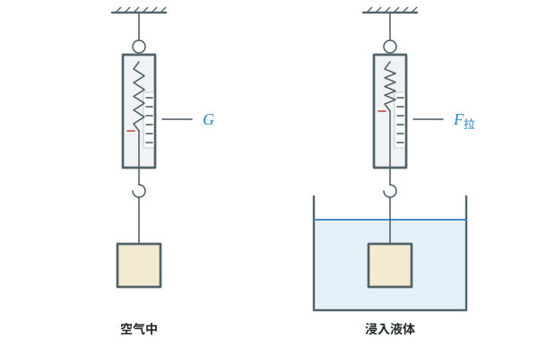
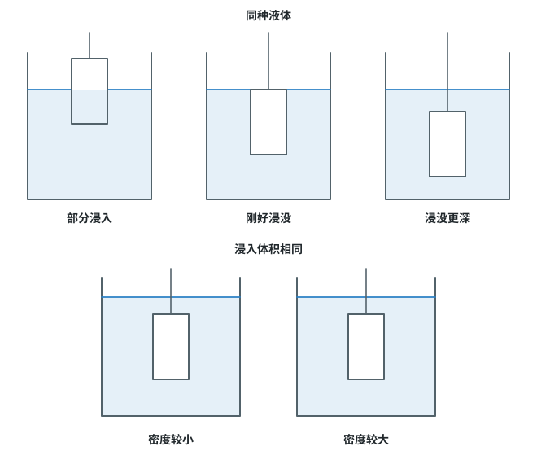
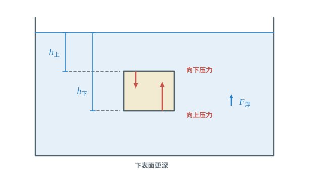
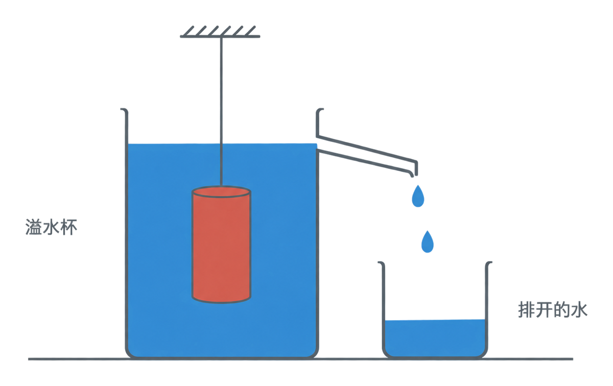
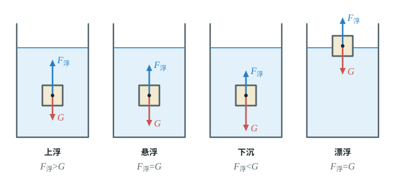
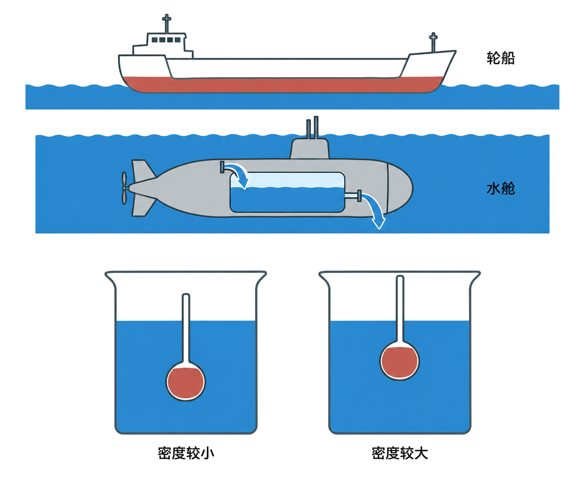

# 第十章 浮力

水对浸在其中的物体有向上的托力，这就是浮力。本章先学怎样测量浮力、浮力与哪些因素有关，再用阿基米德原理计算，最后比较浮力和重力来判断物体的浮沉，并解释轮船和潜水艇怎样工作。

## 本章前置自查

开始前，检查下面几件事；有一项不熟，就先回看相应内容：

1. 会用二力平衡分析静止物体受到的力。（第八章第 2 节）
2. 会读弹簧测力计，知道重力公式 $G=mg$。（第七章第 2、3 节）
3. 会用密度公式，并能换算立方厘米和立方米。（八上第六章第 2、4 节）

---

## 10.1a 浮力与称重法测浮力

```yaml
id: PHY-8B-10-1a
weight: 一般
weight_note: 2 次
textbook: 八下 10.1 浮力，p.64–65
prerequisites:
  - {id: PHY-8B-08-2b, strength: hard, reason: 称重法 F浮=G−F拉 来自受力平衡}
  - {id: PHY-8B-07-2a, strength: hard, reason: 要读弹簧测力计}
evidence:
  - 能指出浸在液体里的物体受到竖直向上的浮力
  - 能用空气中和液体中弹簧测力计示数之差求浮力
figure: 已完成 figures/buoyancy-weighing.svg（空气中与浸入液体后的称重法对照，示数只标符号）
sources: [TB8B-10.1, GD2023]
```

### 本次只学

认识浮力，并用称重法测量物体浸在液体中时所受的浮力。

### 先认住

- 浸在液体中的物体受到液体向上的浮力；“浸没”指物体完全处在液面下方。
- 弹簧测力计示数：悬挂在空气中静止时是重力 $G$；浸入液体静止、不碰容器时是 $F_{\text{拉}}$。
- 称重法：$F_{\text{浮}}=G-F_{\text{拉}}$。



### 容易错

- $F_{\text{拉}}$ 是物体浸入液体后弹簧测力计的示数，不是物体在空气中的重力。
- 称重法要求物体静止悬挂，且不与容器底、壁接触，避免出现额外的支持力或摩擦力。

### 练一练

- `Q-PHY-GD2023-23-2`

---

## 10.1b 探究浮力大小的影响因素

```yaml
id: PHY-8B-10-1b
weight: 一般
weight_note: 3 次，集中在广东 2023 一道实验题
textbook: 八下 10.1 浮力，p.65–66
prerequisites:
  - {id: PHY-8B-10-1a, strength: hard, reason: 实验用称重法测浮力}
evidence:
  - 能说出物体浸在液体中的体积变大时，浮力怎样变化
  - 能设计比较同一物体在不同液体中浮力大小的实验
figure: 已完成 figures/buoyancy-factor-comparisons.svg（同一物体的浸入体积、不同液体密度两组控制变量对照）
sources: [TB8B-10.1, GD2023]
```

### 本次只学

探究浮力大小与物体浸在液体中的体积、液体密度有什么关系。

### 先认住

- 其他条件相同时，物体浸在液体中的体积越大，所受浮力越大。
- 其他条件相同时，液体密度越大，物体所受浮力越大。
- 比较时一次只改变一个条件，其余条件保持不变。



### 容易错

- 物体浸没后继续下沉，浸在液体中的体积不再变化，浮力不变。

### 练一练

- `Q-PHY-GD2023-23-5`

---

## 10.1c 浮力产生的原因

```yaml
id: PHY-8B-10-1c
weight: 了解
weight_note: 10 套卷未考
textbook: 八下 10.1 浮力，p.66–67
prerequisites:
  - {id: PHY-8B-09-2a, strength: hard, reason: 上下表面液体压强不同}
evidence:
  - 能用物体上、下表面的压力差说明浮力方向向上
figure: 已完成 figures/buoyancy-pressure-origin.svg（液面到上下表面的深度、压力方向与向上浮力）
sources: [TB8B-10.1]
```

### 先认住

- 以完全浸没的长方体为例，上、下表面所处的深度不同，下表面受到的液体压强较大。
- 上、下表面面积相同时，下表面受到的向上压力大于上表面受到的向下压力；这个压力差就是浮力。



---

## 10.2a 阿基米德原理

```yaml
id: PHY-8B-10-2a
weight: 一般
weight_note: 2 次（排开液体的重力、浮力随液体密度变化）
textbook: 八下 10.2 阿基米德原理，p.68–70
prerequisites:
  - {id: PHY-8B-10-1b, strength: hard, reason: 原理是影响因素的定量结论}
evidence:
  - 能说出阿基米德原理中浮力与排开液体重力的关系
  - 能根据液体密度和排开体积判断浮力的变化
figure: 已完成 figures/overflow-displaced-water.png（溢水杯收集物体排开的水；gpt-image-2 生成，已人工核对）
sources: [TB8B-10.2, GZ2024]
```

### 本次只学

理解浮力大小等于物体排开液体所受的重力，并据此判断浮力变化。

### 先认住

- 浸在液体中的物体受到的浮力，大小等于它排开的液体所受的重力：$F_{\text{浮}}=G_{\text{排}}$。
- 因为 $G_{\text{排}}=m_{\text{排}}g=\rho_{\text{液}}V_{\text{排}}g$，所以 $F_{\text{浮}}=\rho_{\text{液}}gV_{\text{排}}$。
- 阿基米德原理也适用于气体。



### 容易错

- 排开液体的体积 $V_{\text{排}}$ 不一定等于物体总体积；只有物体完全浸没时，两者才相等。

### 练一练

- `Q-PHY-GZ2024-06`

---

## 10.2b 用阿基米德原理计算浮力

```yaml
id: PHY-8B-10-2b
weight: 重点
weight_note: 7 次，压轴计算常客
textbook: 八下 10.2 阿基米德原理，p.70–72
prerequisites:
  - {id: PHY-8B-10-2a, strength: hard, reason: F浮=ρ液gV排}
  - {id: PHY-8A-06-4a, strength: hard, reason: 常要换算体积、求质量}
  - {id: PHY-8B-07-3a, strength: hard, reason: 要用 G=mg}
evidence:
  - 能从题目中找出液体密度、排开液体体积和 $g$
  - 能按单位换算后代入 $F_{\text{浮}}=\rho_{\text{液}}gV_{\text{排}}$ 计算
figure: 不需要。根据已知量写公式、统一单位并计算即可
sources: [TB8B-10.2, GD2022, GZ2023]
```

### 本次只学

选对排开液体的体积，代入阿基米德原理计算浮力。

### 先认住

- $F_{\text{浮}}=\rho_{\text{液}}gV_{\text{排}}$。
- 物体部分浸入液体时，$V_{\text{排}}$ 是浸入部分的体积；物体完全浸没时，$V_{\text{排}}$ 等于物体体积。
- 体积代入公式前统一换算成 $\mathrm{m^3}$。
- 物体漂浮时，浮力等于物体受到的重力：$F_{\text{浮}}=G$。

### 破题钥匙

```think
现象: 物体浸入液体，排开了一部分液体
模型: 物体受到的浮力，等于排开的液体受到的重力
图: phy-displace
关系: $F_{浮}=G_{排}=\rho_{液}gV_{排}$
结: 先找排开了多少体积
```

### 走一遍

课本的塑料块例题：塑料块重 $0.22\ \mathrm{N}$，密度为 $1.1\times10^3\ \mathrm{kg/m^3}$；取 $g=10\ \mathrm{N/kg}$，水的密度为 $1.0\times10^3\ \mathrm{kg/m^3}$。

1. 先求塑料块的质量：
   $m=\dfrac{G}{g}=\dfrac{\textcolor{#287fc4}{0.22}\ \cancel{\mathrm{N}}}{\textcolor{#287fc4}{10}\ \cancel{\mathrm{N}}/\mathrm{kg}}=0.022\ \mathrm{kg}$
2. 求塑料块体积；完全浸没时，$V_{\text{排}}=V_{\text{塑料}}$：
   $V_{\text{塑料}}=\dfrac{m}{\rho_{\text{塑料}}}=\dfrac{\textcolor{#287fc4}{0.022}\ \cancel{\mathrm{kg}}}{\textcolor{#287fc4}{1.1\times10^3}\ \cancel{\mathrm{kg}}/\mathrm{m^3}}=2\times10^{-5}\ \mathrm{m^3}$
3. 用阿基米德原理求它浸没在水中受到的浮力：
   $F_{\text{浮}}=\rho_{\text{水}}gV_{\text{排}}=\textcolor{#287fc4}{1.0\times10^3}\ \cancel{\mathrm{kg}}/\cancel{\mathrm{m^3}}\times\textcolor{#287fc4}{10}\ \mathrm{N}/\cancel{\mathrm{kg}}\times\textcolor{#287fc4}{2\times10^{-5}}\ \cancel{\mathrm{m^3}}=\boxed{0.20\ \mathrm{N}}$
4. 课本例题还把塑料块放入盐水，塑料块漂浮且浸入体积为总体积的 $90\%$。塑料块处于平衡状态，漂浮时 $F_{\text{浮}}=G=0.22\ \mathrm{N}$；由阿基米德原理，$G_{\text{排}}=F_{\text{浮}}=0.22\ \mathrm{N}$；所以排开盐水的质量：
   $m_{\text{排}}=\dfrac{G_{\text{排}}}{g}=\dfrac{\textcolor{#287fc4}{0.22}\ \cancel{\mathrm{N}}}{\textcolor{#287fc4}{10}\ \cancel{\mathrm{N}}/\mathrm{kg}}=0.022\ \mathrm{kg}$
   $V_{\text{排}}=V_{\text{塑料}}\times90\%=\textcolor{#287fc4}{2\times10^{-5}}\ \mathrm{m^3}\times\textcolor{#287fc4}{90\%}=1.8\times10^{-5}\ \mathrm{m^3}$
   $\rho_{\text{盐水}}=\dfrac{m_{\text{排}}}{V_{\text{排}}}=\dfrac{\textcolor{#287fc4}{0.022}\ \mathrm{kg}}{\textcolor{#287fc4}{1.8\times10^{-5}}\ \mathrm{m^3}}\approx\boxed{1.22\times10^3\ \mathrm{kg/m^3}}$

### 容易错

- 不要把浸入液体的深度直接代替 $V_{\text{排}}$；要先求排开液体的体积。
- 物体漂浮时可用 $F_{\text{浮}}=G$，但计算排开液体体积时仍要使用排开液体的密度。

### 练一练

- `Q-PHY-GD2022-25-3a`

---

## 10.3a 物体的浮沉条件

```yaml
id: PHY-8B-10-3a
weight: 重点
weight_note: 7 次（广州 2023 第 17 题占 4 小问）
textbook: 八下 10.3 物体的浮沉条件及应用，p.73–74
prerequisites:
  - {id: PHY-8B-08-2b, strength: hard, reason: 漂浮、悬浮时浮力等于重力}
  - {id: PHY-8B-10-2a, strength: hard, reason: 比较浮力和重力要用阿基米德原理}
evidence:
  - 能根据浮力和重力的大小关系判断物体上浮、悬浮或下沉
  - 能判断漂浮或悬浮时浮力与重力的关系
figure: 已完成 figures/sink-float-forces.svg（四格受力图：上浮、悬浮、下沉、漂浮）
sources: [TB8B-10.3, GD2022, GZ2023]
```

### 本次只学

比较浮力和重力，判断浸没物体由静止释放后的运动方向。

### 先认住

以下判断限于物体只受到重力和浮力；上浮、下沉从浸没且由静止释放开始判断。

- 比较浮力与重力（浸没且静止释放）：$F_{\text{浮}}>G$ 时上浮，$F_{\text{浮}}<G$ 时下沉。
- 静止处于平衡状态：悬浮和漂浮时都有 $F_{\text{浮}}=G$。
- 比较密度（完全浸没时）：$\rho_{\text{物}}<\rho_{\text{液}}$ 上浮，$\rho_{\text{物}}=\rho_{\text{液}}$ 悬浮，$\rho_{\text{物}}>\rho_{\text{液}}$ 下沉。
- 漂浮时物体密度小于液体密度（$\rho_{\text{物}}<\rho_{\text{液}}$）。



### 破题钥匙

```think
现象: 物体浸没在水中，松手
模型: 物体只受浮力和重力，比一比谁大
图: phy-float
关系: $F_{浮}>G$，上浮
招: 画图
结: $F_{浮}<G$ 下沉；$F_{浮}=G$ 悬浮或漂浮
```

### 走一遍

用前面塑料块例题的数据做判断：

1. 塑料块浸没在水中：浮力 $F_{\text{浮}}=0.20\ \mathrm{N}<G=0.22\ \mathrm{N}$，合力向下，所以由静止释放后塑料块 $\boxed{\text{下沉}}$，这与 $\rho_{\text{塑料}}=1.1\times10^3\ \mathrm{kg/m^3}>\rho_{\text{水}}$ 一致。
2. 塑料块在盐水里漂浮：受力平衡，浮力等于重力（$F_{\text{浮}}=G=0.22\ \mathrm{N}$），塑料块处于 $\boxed{\text{漂浮}}$ 状态，这与 $\rho_{\text{盐水}}\approx1.22\times10^3\ \mathrm{kg/m^3}>\rho_{\text{塑料}}$ 一致。

### 容易错

- “上浮”描述运动方向；“漂浮”描述物体静止在液面上的状态。漂浮和悬浮时浮力都等于重力。
- 物体上浮过程中露出液面后，排开液体的体积会改变，浮力也会随之改变。

### 练一练

- `Q-PHY-GZ2023-17-1b`
- `Q-PHY-GD2022-25-3b`

---

## 10.3b 浮沉条件的应用（轮船、潜水艇、密度计）

```yaml
id: PHY-8B-10-3b
weight: 一般
weight_note: 4 次
textbook: 八下 10.3 物体的浮沉条件及应用，p.74–76
prerequisites:
  - {id: PHY-8B-10-3a, strength: hard, reason: 应用都靠浮沉条件}
evidence:
  - 能说明轮船漂浮时浮力与重力的关系
  - 能说明潜水艇通过改变自身重力实现上浮或下潜
  - 能根据密度计漂浮时液面位置判断液体密度
figure: 已完成 figures/buoyancy-applications.png（轮船、水舱与密度计的浮沉应用；gpt-image-2 生成，已人工核对）
sources: [TB8B-10.3, GD2022]
```

### 本次只学

用浮沉条件解释轮船、潜水艇和密度计的工作原理。

### 先认住

- 轮船船体做成空心，排开水的体积大；漂浮时浮力等于船和货物的总重力；排水量是轮船满载时排开水的质量。
- 潜水艇浸没时排开水的体积基本不变；通过向水舱充水变重下潜、排水变轻上浮来实现浮沉。
- 密度计漂浮时浮力等于重力。同一支密度计在密度较大的液体中浸入较浅。



### 练一练

- `Q-PHY-GD2022-25-1`
