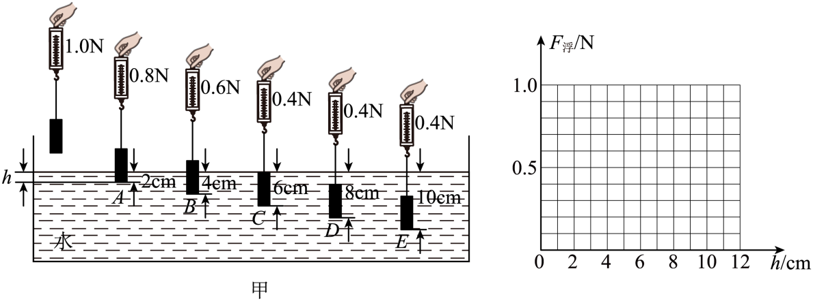
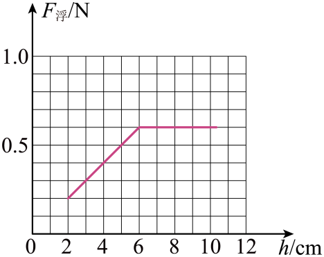
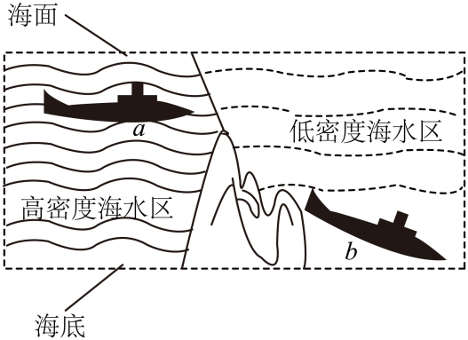
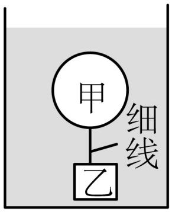
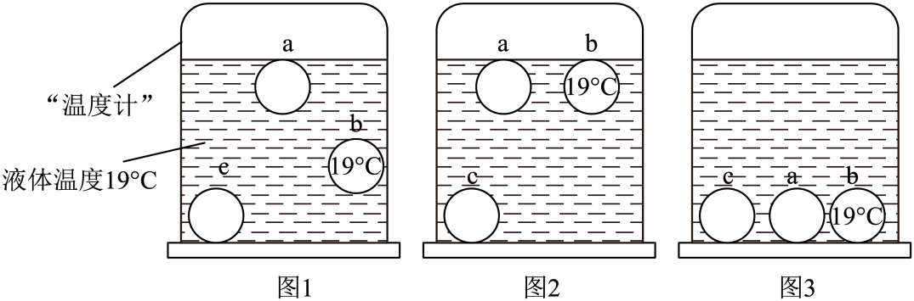

# 第十章 浮力 · 题目

讲义用题按知识点顺序排列；本章选用 6 个不同真题（其中 GD2022-25(3) 拆为 -3a、-3b 两题），共 7 道真题小问，了解级知识点不放题。

## 讲义用题

### Q-PHY-GD2023-23-2

```yaml
id: Q-PHY-GD2023-23-2
category: 真题
source: 2023 年广东省初中学业水平考试物理第 23 题第（2）问
source_quality: 原卷
kp: PHY-8B-10-1a
do: 本章只做第（2）问
type: 作图
grading: 自评
answer_by: 原卷解析
review:
  公式: PHY-8B-10-1a
  计算: PHY-8B-10-1a
other_parts: 第（1）（3）—（5）问本题不做。
```

**题干**

23. 在“探究浮力大小与哪些因素有关”的实验中：



（2）如题图甲所示，在弹簧测力计下悬挂一个高为 $6\ \mathrm{cm}$ 的长方体物块（可塑），测出重力，将它缓慢浸入水中，记录悬停在 A、B、C、D、E 这五个位置弹簧测力计的示数和深度 $h$，请根据实验数据，在图乙中画出物块所受浮力 $F_{\text{浮}}$ 随 $h$ 变化的图像。（右侧方格图即图乙）

**答案**



**解析**

1. 物块重力为 $1.0\ \mathrm{N}$。称重法测浮力：$F_{\text{浮}}=G-F_{\text{拉}}$。
2. 当 $h=2\ \mathrm{cm}$ 时，$F_{\text{浮}}=\textcolor{#287fc4}{1.0}\ \mathrm{N}-\textcolor{#287fc4}{0.8}\ \mathrm{N}=\boxed{0.2\ \mathrm{N}}$。
3. 当 $h=4\ \mathrm{cm}$ 时，$F_{\text{浮}}=\textcolor{#287fc4}{1.0}\ \mathrm{N}-\textcolor{#287fc4}{0.6}\ \mathrm{N}=\boxed{0.4\ \mathrm{N}}$。
4. 当 $h=6\ \mathrm{cm}$ 时，$F_{\text{浮}}=\textcolor{#287fc4}{1.0}\ \mathrm{N}-\textcolor{#287fc4}{0.4}\ \mathrm{N}=\boxed{0.6\ \mathrm{N}}$；物块已完全浸没，继续浸入至 $h=8\ \mathrm{cm}$、$10\ \mathrm{cm}$ 时，弹簧测力计示数仍为 $0.4\ \mathrm{N}$，浮力保持 $0.6\ \mathrm{N}$。
5. 按各点描点后连线；完全浸没后浮力保持不变，折线成为水平段。

---

### Q-PHY-GD2023-23-5

```yaml
id: Q-PHY-GD2023-23-5
category: 真题
source: 2023 年广东省初中学业水平考试物理第 23 题第（5）问
source_quality: 原卷
kp: PHY-8B-10-1b
do: 本章只做第（5）问
type: 填空
grading: 自评
answer_by: 原卷解析
review:
  概念: PHY-8B-10-1b
other_parts: 第（1）—（4）问本题不做。
```

**题干**

23. 在“探究浮力大小与哪些因素有关”的实验中：


（5）若继续探究浮力的大小与液体密度的关系，还需添加一种材料：___________。

**答案**

酒精（任何密度与水不同的液体都可以，如盐水）。

**解析**

1. 若继续探究浮力的大小与液体密度的关系，只需要增加密度不等于水的液体（如酒精、盐水等），重复上述实验，形成对比数据。
2. 实验中控制物块排开液体的体积相同，只改变液体密度，比较浮力大小。

---

### Q-PHY-GZ2024-06

```yaml
id: Q-PHY-GZ2024-06
category: 真题
source: 2024 年广州市初中学业水平考试物理第 6 题
source_quality: 原卷
kp: PHY-8B-10-2a
type: 选择
grading: 自动
answer_by: 原卷解析
review:
  概念: PHY-8B-10-2a
```

**题干**

6. 潜水艇从海水高密度区驶入低密度区，急剧下降的过程称为“掉深”。如图，某潜水艇从 a 处驶入低密度海水区，“掉深”到 b 处。与 a 处相比，潜水艇在 b 处（　　）



A. 受到浮力大小变小

B. 受到浮力大小变大

C. 排开液体重力不变

D. 排开液体重力变大

**答案**

A

**解析**

1. 潜水艇完全浸没且体积不变，排开海水的体积不变。
2. 从高密度海水区驶入低密度海水区，$\rho_{\text{液}}$ 变小。
3. 根据 $F_{\text{浮}}=\rho_{\text{液}}gV_{\text{排}}$，浮力变小；由阿基米德原理，排开液体的重力也变小，因此选 A。

---

### Q-PHY-GD2022-25-3a

```yaml
id: Q-PHY-GD2022-25-3a
category: 真题
source: 2022 年广东省初中学业水平考试物理第 25 题第（3）问
source_quality: 原卷
kp: PHY-8B-10-2b
do: 本章只做第（3）问前两空
type: 填空
grading: 自评
answer_by: 原卷解析（数值为公式图片，已读出并重算核对）
review:
  公式: PHY-8B-10-2b
  单位: PHY-8B-10-2b
  计算: PHY-8B-10-2b
other_parts: 第（1）问是潜水艇改变自身重力，第（2）问是深海压强计算；第（3）问后两空见 Q-PHY-GD2022-25-3b。
parts:
  - part: 乙的浮力空
    kp: PHY-8B-10-2b
    review:
      公式: PHY-8B-10-2b
  - part: 细线拉力空
    kp: PHY-8B-10-2b
    review:
      计算: PHY-8B-10-2b
```

**题干**

25. 我国自主研制的载人深潜器下潜深度已突破 $10000\ \mathrm{m}$，在载人深潜领域达到世界领先水平。（取 $\rho_{\text{海水}}=1.03\times10^3\ \mathrm{kg/m^3}$，$\rho_{\text{水}}=1.0\times10^3\ \mathrm{kg/m^3}$，$g=10\ \mathrm{N/kg}$）



（3）小明阅读资料后，利用图的装置模拟深潜器在水中的运动过程。物体甲、乙由一条细线连接且在水中处于静止状态，已知乙的质量为 $0.2\ \mathrm{kg}$，体积为 $25\ \mathrm{cm^3}$，则乙所受浮力的大小为___________$\mathrm{N}$，乙受到细线的拉力为___________$\mathrm{N}$。

**答案**

$0.25\ \mathrm{N}$；$1.75\ \mathrm{N}$。

**解析**

1. 乙浸没在水中，$V_{\text{排}}=V_{\text{乙}}=25\ \mathrm{cm^3}=\textcolor{#287fc4}{25\times10^{-6}}\ \mathrm{m^3}$。
2. $F_{\text{浮乙}}=\rho_{\text{水}}gV_{\text{排}}=\textcolor{#287fc4}{1.0\times10^3}\ \cancel{\mathrm{kg}}/\cancel{\mathrm{m^3}}\times\textcolor{#287fc4}{10}\ \mathrm{N}/\cancel{\mathrm{kg}}\times\textcolor{#287fc4}{25\times10^{-6}}\ \cancel{\mathrm{m^3}}=\boxed{0.25\ \mathrm{N}}$。
3. $G_{\text{乙}}=mg=\textcolor{#287fc4}{0.2}\ \cancel{\mathrm{kg}}\times\textcolor{#287fc4}{10}\ \mathrm{N}/\cancel{\mathrm{kg}}=2\ \mathrm{N}$。
4. 乙静止，竖直方向受力平衡：$F_{\text{拉}}=G_{\text{乙}}-F_{\text{浮乙}}=\textcolor{#287fc4}{2}\ \mathrm{N}-\textcolor{#287fc4}{0.25}\ \mathrm{N}=\boxed{1.75\ \mathrm{N}}$。

---

### Q-PHY-GD2022-25-3b

```yaml
id: Q-PHY-GD2022-25-3b
category: 真题
source: 2022 年广东省初中学业水平考试物理第 25 题第（3）问
source_quality: 原卷
kp: PHY-8B-10-3a
do: 本章只做第（3）问后两空
type: 选填
grading: 自评
answer_by: 原卷解析
review:
  概念: PHY-8B-10-3a
other_parts: 第（1）问是潜水艇改变自身重力，第（2）问是深海压强计算；第（3）问前两空见 Q-PHY-GD2022-25-3a。
parts:
  - part: 甲的运动空
    kp: PHY-8B-10-3a
    review:
      概念: PHY-8B-10-3a
  - part: 甲的浮力变化空
    kp: PHY-8B-10-3a
    review:
      概念: PHY-8B-10-3a
```

**题干**

25. 我国自主研制的载人深潜器下潜深度已突破 $10000\ \mathrm{m}$，在载人深潜领域达到世界领先水平。（取 $\rho_{\text{海水}}=1.03\times10^3\ \mathrm{kg/m^3}$，$\rho_{\text{水}}=1.0\times10^3\ \mathrm{kg/m^3}$，$g=10\ \mathrm{N/kg}$）


（3）小明阅读资料后，利用图的装置模拟深潜器在水中的运动过程。物体甲、乙由一条细线连接且在水中处于静止状态，已知乙的质量为 $0.2\ \mathrm{kg}$，体积为 $25\ \mathrm{cm^3}$。若剪断细线，甲将___________（选填“上浮”“悬浮”或“下沉”），此时甲所受浮力___________（填字母）。

A. 增大，且大于重力

B. 不变，且等于重力

C. 不变，且大于重力

D. 减小，且小于重力

**答案**

上浮；C。

**解析**

1. 物体甲、乙在水中静止，受力平衡。乙浸没在水中，重力 $G_{\text{乙}}=mg=\textcolor{#287fc4}{0.2}\ \cancel{\mathrm{kg}}\times\textcolor{#287fc4}{10}\ \mathrm{N}/\cancel{\mathrm{kg}}=2\ \mathrm{N}$，浮力 $F_{\text{浮乙}}=\rho_{\text{水}}gV_{\text{排}}=\textcolor{#287fc4}{1.0\times10^3}\ \cancel{\mathrm{kg}}/\cancel{\mathrm{m^3}}\times\textcolor{#287fc4}{10}\ \mathrm{N}/\cancel{\mathrm{kg}}\times\textcolor{#287fc4}{25\times10^{-6}}\ \cancel{\mathrm{m^3}}=0.25\ \mathrm{N}$。
2. 乙受竖直向下的重力、竖直向上的浮力和细线拉力：$F_{\text{拉}}=G_{\text{乙}}-F_{\text{浮乙}}=\textcolor{#287fc4}{2}\ \mathrm{N}-\textcolor{#287fc4}{0.25}\ \mathrm{N}=1.75\ \mathrm{N}$。
3. 根据力的相互作用，细线对甲有竖直向下的拉力 $F_{\text{拉}}$。剪断前甲处于平衡状态，竖直方向受竖直向下的重力 $G_{\text{甲}}$、细线向下的拉力 $F_{\text{拉}}$ 和竖直向上的浮力 $F_{\text{浮甲}}$，即 $F_{\text{浮甲}}=G_{\text{甲}}+F_{\text{拉}}$，所以 $F_{\text{浮甲}}>G_{\text{甲}}$。
4. 刚剪断细线时，甲尚未改变浸没状态，排开水的体积不变，所受浮力不变；由于 $F_{\text{浮甲}}>G_{\text{甲}}$，合力向上，甲将 $\boxed{\text{上浮}}$，选 $\boxed{\text{C}}$。

---

### Q-PHY-GZ2023-17-1b

```yaml
id: Q-PHY-GZ2023-17-1b
category: 真题
source: 2023 年广州市初中学业水平考试物理第 17 题第（1）问第②小问
source_quality: 原卷
kp: PHY-8B-10-3a
do: 本章只做第（1）问第②小问
type: 计算
grading: 自评
answer_by: 原卷解析（数值为公式图片，已读出并重算核对）
review:
  公式: PHY-8B-10-3a
  单位: PHY-8B-10-3a
  计算: PHY-8B-10-3a
other_parts: 第（1）问第①小问要求作力的示意图，第③小问求排开液体体积；第（2）—（4）问本题不做。
```

**题干**

17. 小明自制的“温度计”中有密度随温度升高而变小的液体。如图 1，当该液体温度为 $19\ ^\circ\mathrm{C}$ 时，质量为 $4\times10^{-3}\ \mathrm{kg}$ 的小球 b 悬浮，b 标记“$19\ ^\circ\mathrm{C}$”；另外两个小球分别标记“$15\ ^\circ\mathrm{C}$”“$23\ ^\circ\mathrm{C}$”，当小球悬浮时，它标记的温度与液体温度相等。图 1、图 2、图 3 中小球 a、b、c 均静止，忽略小球体积变化，$g$ 取 $10\ \mathrm{N/kg}$。



（1）图 1 中 b 悬浮。

② 求此时 b 受到的浮力。

**答案**

$0.04\ \mathrm{N}$。

**解析**

1. b 悬浮且静止，竖直方向受力平衡，所以 $F_{\text{浮}}=G$。
2. $F_{\text{浮}}=mg=\textcolor{#287fc4}{4\times10^{-3}}\ \cancel{\mathrm{kg}}\times\textcolor{#287fc4}{10}\ \mathrm{N}/\cancel{\mathrm{kg}}=\boxed{0.04\ \mathrm{N}}$。

---

### Q-PHY-GD2022-25-1

```yaml
id: Q-PHY-GD2022-25-1
category: 真题
source: 2022 年广东省初中学业水平考试物理第 25 题第（1）问
source_quality: 原卷
kp: PHY-8B-10-3b
do: 本章只做第（1）问
type: 填空
grading: 自评
answer_by: 原卷解析
review:
  概念: PHY-8B-10-3b
other_parts: 第（2）问计算深海压强，第（3）问分析甲、乙物体的浮力和浮沉；本题不做。
```

**题干**

25. 我国自主研制的载人深潜器下潜深度已突破 $10000\ \mathrm{m}$，在载人深潜领域达到世界领先水平。（取 $\rho_{\text{海水}}=1.03\times10^3\ \mathrm{kg/m^3}$，$\rho_{\text{水}}=1.0\times10^3\ \mathrm{kg/m^3}$，$g=10\ \mathrm{N/kg}$）

（1）潜水艇活动的海水深度一般为 $300\ \mathrm{m}$ 至 $600\ \mathrm{m}$。它可以通过水舱排水或充水来改变___________，从而实现浮沉。

**答案**

自身重力。

**解析**

1. 潜水艇完全浸没时，排开水的体积不变，受到的浮力基本不变。
2. 向水舱充水或排水，会改变潜水艇的自身重力。
3. 因此潜水艇通过改变自身重力实现浮沉。

---
