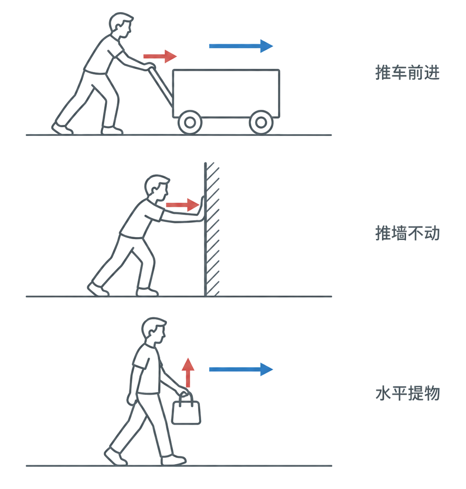
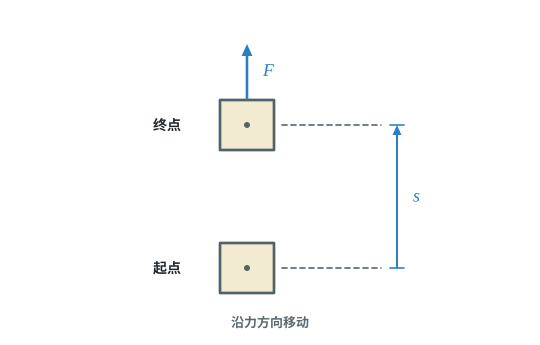
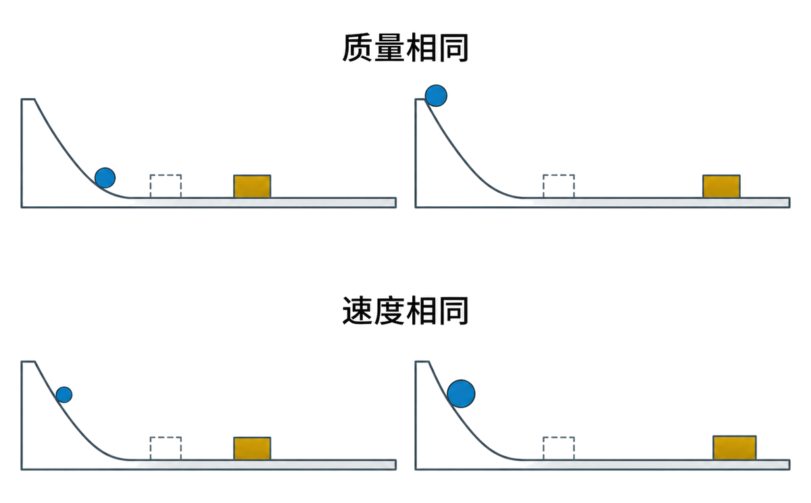
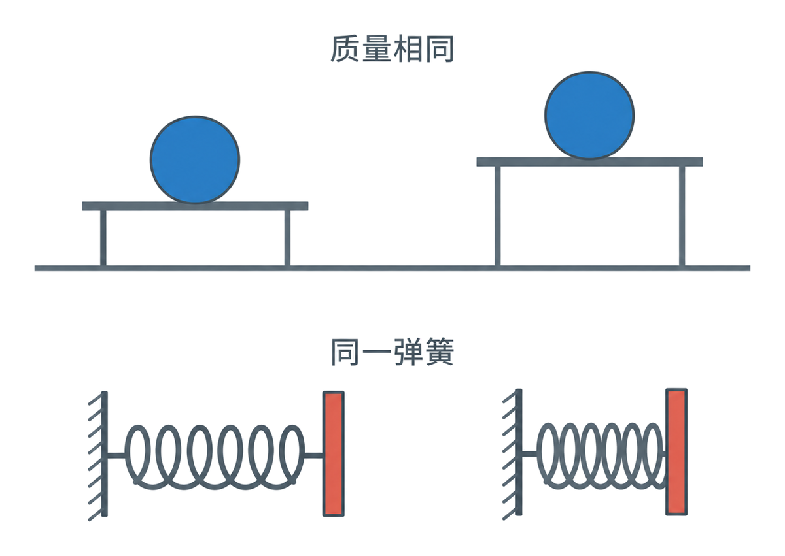
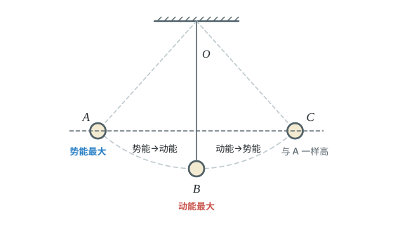

# 第十一章 功和机械能

这一章先看力怎样对物体做功、做功有多快，再认识动能、势能和机械能。遇到题目时，先看力的方向和物体移动的方向，再选择公式。

## 本章前置自查

下面几件事，哪一件没把握，先回看：

1. 判断物体是否受到某个力，以及物体沿哪个方向移动。（第七章第 1 节）
2. 知道物体匀速直线运动时受力平衡，能用重力公式 $G=mg$。（第七、八章）
3. 会用速度公式 $v=s/t$，并比较质量、速度的大小。（八年级上册第一、六章）

---

## 11.1a 做功的两个必要因素

```yaml
id: PHY-8B-11-1a
weight: 一般
weight_note: 2 次（重力不做功、松手后不做功）
textbook: 八下 11.1 功，p.84–85
prerequisites:
  - id: PHY-8B-07-1a
    strength: hard
    reason: 做功要有力
evidence:
  - 能说出一个力对物体做功的两个必要因素
  - 能根据力和物体移动的方向判断这个力是否做功
figure: 已完成 figures/work-motion-comparison.png（施力与移动方向的三种对照；gpt-image-2 生成，已人工核对）
sources: [TB8B-11.1, GZ2025-07]
```

### 本次只学

判断一个力是否对物体做功，必须同时检查力和物体沿力方向的移动。

### 先认住

- 力作用在物体上，物体在这个力的方向上移动了一段距离，这个力才对物体做了功。
- 物体没有在力的方向上移动距离，这个力没有做功。



### 容易错

- 物体还在移动，不代表某个力一定做了功；要看它有没有沿这个力的方向移动。
- 要看这个力此刻有没有作用在物体上，物体有没有沿力的方向移动。

### 练一练

- `Q-PHY-GZ2025-07`

---

## 11.1b 功的计算 $W=Fs$

```yaml
id: PHY-8B-11-1b
weight: 重点
weight_note: 8 次计算
textbook: 八下 11.1 功，p.84–86
prerequisites:
  - id: PHY-8B-11-1a
    strength: hard
    reason: 先判断力有没有做功
  - id: PHY-8B-08-2b
    strength: hard
    reason: 匀速运动时由平衡求力
  - id: PHY-8B-07-3a
    strength: soft
    reason: 重力做功 W=Gh
evidence:
  - 能找出公式中沿力方向移动的距离
  - 能用 $W=Fs$ 计算功，并写出焦耳
  - 能判断垂直于力的方向移动时该力做功为零
figure: 已完成 figures/work-force-distance.svg（拉力 F 的方向与沿力方向的距离 s）
sources: [TB8B-11.1, GD2022-23(3)]
```

### 本次只学

用力和物体沿力方向移动的距离，计算这个力做的功。

### 先认住

- 功的计算公式：$W=Fs$。$F$ 是力，$s$ 是物体在力的方向上移动的距离。
- 功的单位是焦耳，简称焦，符号是 $\mathrm{J}$；$1\ \mathrm{J}=1\ \mathrm{N\cdot m}$。



### 破题钥匙

```think
现象: 用力拉物体，物体沿力的方向移动
模型: 力 $F$ 乘以物体沿力的方向移动的距离 $s$
图: phy-work
关系: $W=Fs$
结: $s$ 要沿着力的方向量
```

### 走一遍

课本例题：质量为 $1.5\ \mathrm{t}$ 的构件匀速提升 $30\ \mathrm{m}$，$g$ 取 $10\ \mathrm{N/kg}$。求竖直拉力做的功；再将构件沿水平方向匀速移动 $3\ \mathrm{m}$，求竖直拉力做的功。

1. 单位换算：$1.5\ \mathrm{t}=1.5\times10^{3}\ \mathrm{kg}$。
2. 匀速提升时拉力与重力平衡：
   $F=G=mg=\textcolor{#287fc4}{1.5\times10^3}\ \cancel{\mathrm{kg}}\times\textcolor{#287fc4}{10}\ \mathrm{N}/\cancel{\mathrm{kg}}=1.5\times10^4\ \mathrm{N}$
3. 竖直移动距离与拉力方向相同：
   $W=Fs=\textcolor{#287fc4}{1.5\times10^4}\ \mathrm{N}\times\textcolor{#287fc4}{30}\ \mathrm{m}=\boxed{4.5\times10^5\ \mathrm{J}}$
4. 水平移动时，构件没有沿竖直拉力方向移动，沿力方向的距离为零：
   $W'=Fs'=\textcolor{#287fc4}{1.5\times10^4}\ \mathrm{N}\times\textcolor{#287fc4}{0}\ \mathrm{m}=\boxed{0\ \mathrm{J}}$

### 容易错

- 公式中的距离是物体沿力方向移动的距离，不一定是物体移动的总路程。
- 力和移动方向垂直时，物体沿力方向没有移动距离，该力做功为零。

### 练一练

- `Q-PHY-GD2022-23-3`

---

## 11.2a 功率及计算

```yaml
id: PHY-8B-11-2a
weight: 重点
weight_note: 5 次，含 P=Fv
textbook: 八下 11.2 功率，p.88–90
prerequisites:
  - id: PHY-8B-11-1b
    strength: hard
    reason: 先求功
  - id: PHY-8A-01-3b
    strength: soft
    reason: P=Fv 用到速度
evidence:
  - 能用功与时间之比计算功率
  - 能在力与运动方向相同时由 P=W/t 推出 P=Fv
  - 能使用瓦特作为功率单位
figure: 不需要
sources: [TB8B-11.2, GZ2023-13(2)]
```

### 本次只学

用功率比较做功的快慢，并根据条件计算功率。

### 先认住

- 功与做功所用时间之比叫作功率：$P=\dfrac{W}{t}$。$W$ 是功，$t$ 是做这些功所用的时间。
- 功率的单位是瓦特，符号是 $\mathrm{W}$；$1\ \mathrm{kW}=10^3\ \mathrm{W}$。
- **补充**（课本没有讲，做真题时常用）：由 $P=\dfrac{W}{t}=\dfrac{Fs}{t}$ 得 $P=Fv$（力与运动方向相同时）。

### 走一遍

课本例题：质量为 $6\ \mathrm{t}$ 的大石头被起重机沿竖直方向匀速提升 $1\ \mathrm{m}$，用时 $15\ \mathrm{s}$，$g$ 取 $10\ \mathrm{N/kg}$。求起重机提升大石头的功率。

1. 单位换算：$6\ \mathrm{t}=6\times10^{3}\ \mathrm{kg}$。
2. 匀速提升时，拉力等于重力：
   $F=G=mg=\textcolor{#287fc4}{6\times10^3}\ \cancel{\mathrm{kg}}\times\textcolor{#287fc4}{10}\ \mathrm{N}/\cancel{\mathrm{kg}}=6\times10^4\ \mathrm{N}$
3. 拉力做的功：
   $W=Fs=\textcolor{#287fc4}{6\times10^4}\ \mathrm{N}\times\textcolor{#287fc4}{1}\ \mathrm{m}=6\times10^4\ \mathrm{J}$
4. 功率：
   $P=\dfrac{W}{t}=\dfrac{\textcolor{#287fc4}{6\times10^4}\ \mathrm{J}}{\textcolor{#287fc4}{15}\ \mathrm{s}}= \boxed{4\times10^3\ \mathrm{W}}$

### 容易错

- 功率大，表示做功快；不表示做功总量一定大。
- 力与速度方向相同时才能用 $P=Fv$，匀速时最常用。

### 练一练

- `Q-PHY-GZ2023-13-2`

---

## 11.3a 动能及其影响因素

```yaml
id: PHY-8B-11-3a
weight: 一般
weight_note: 未单独考；是机械能转化的基础
textbook: 八下 11.3 动能和势能，p.91–93
prerequisites:
  - id: PHY-8A-01-3a
    strength: hard
    reason: 动能与速度有关
  - id: PHY-8A-06-1a
    strength: hard
    reason: 动能与质量有关
evidence:
  - 能说出动能是物体由于运动而具有的能
  - 能在其他条件相同时，判断质量或速度变化对动能的影响
figure: 已完成 figures/kinetic-energy-ball-block.png（小球撞木块比较质量和速度对动能的影响；gpt-image-2 生成，已人工核对）
sources: [TB8B-11.3]
```

### 本次只学

认识动能，并比较质量、速度对动能大小的影响。

### 先认住

- 物体由于运动而具有的能叫作动能。
- 质量相同时，物体的速度越大，动能越大；速度相同时，物体的质量越大，动能越大。



### 容易错

- 比较动能时要说清哪个量相同：质量相同看速度，速度相同看质量。

### 练一练

- `Q-PHY-GZ2024-12-3`

---

## 11.3b 重力势能和弹性势能

```yaml
id: PHY-8B-11-3b
weight: 一般
weight_note: 1 次
textbook: 八下 11.3 动能和势能，p.93–95
prerequisites:
  - id: PHY-8B-11-3a
    strength: soft
    reason: 和动能对比学
evidence:
  - 能分辨重力势能和弹性势能
  - 能根据物体的质量、高度或弹性形变判断势能变化
figure: 已完成 figures/potential-height-deformation.png（静止物体高度与同一弹簧压缩程度的对照；gpt-image-2 生成，已人工核对）
sources: [TB8B-11.3]
```

### 本次只学

分清重力势能和弹性势能，并判断它们怎样变化。

### 先认住

- 物体由于受到重力并处在一定高度时所具有的能，叫作重力势能；高度相同时，质量越大，重力势能越大；质量相同时，位置越高，重力势能越大。
- 物体由于发生弹性形变而具有的能，叫作弹性势能；同一物体的弹性形变越大，弹性势能越大。



### 容易错

- 物体有高度，不等于它一定有动能；静止的物体可以有重力势能。
- 弹性势能对应弹性形变，不是所有形变都能直接称为弹性势能。

### 练一练

- `Q-PHY-TB8B-11.3-2`
- `Q-PHY-GD2019-08`

---

## 11.4a 机械能及其转化

```yaml
id: PHY-8B-11-4a
weight: 重点
weight_note: 7 次，选择、填空常考，注意“有摩擦时机械能减小”
textbook: 八下 11.4 机械能及其转化，p.96–97
prerequisites:
  - id: PHY-8B-11-3a
    strength: hard
    reason: 要判断动能变化
  - id: PHY-8B-11-3b
    strength: hard
    reason: 要判断势能变化
evidence:
  - 能说出机械能由动能、重力势能和弹性势能组成
  - 能描述动能与势能相互转化的过程
  - 能说出机械能守恒的条件，并判断机械能转化为其他形式的能后总量会减小
figure: 已完成 figures/pendulum-energy.svg（铁锁摆动的 A、B、C 三个位置和动能、势能的转化（机械能转化为其他形式的能写在正文，不入图））
sources: [TB8B-11.4, GZ2022-14, GZ2023-07(1)]
```

### 本次只学

追踪动能、势能的变化，判断机械能是否守恒。

### 先认住

- 在物理学中，把动能、重力势能和弹性势能统称为机械能。
- 只有动能和势能相互转化时，机械能不变；没有别的力对物体做功，却有摩擦或空气阻力时，一部分机械能转化为其他形式的能，机械能减小。

### 走一遍

课本问题：把铁锁拉到鼻子附近，稳定后松手，不额外推它。铁锁摆出去再摆回来，会不会打到鼻子？

1. 铁锁向下摆时，高度降低，重力势能减小；速度增大，动能增大。
2. 铁锁向上摆时，速度减小，动能转化为重力势能。
3. 忽略空气阻力时，铁锁的动能和重力势能相互转化，机械能守恒；它回摆时不会高过松手时的位置，所以不会打到鼻子。



### 容易错

- 机械能守恒的条件是只有动能和势能相互转化；不能把它说成所有过程中机械能都不变。
- 判断机械能增减，先看有没有摩擦或阻力，以及有没有别的力对物体做功。

### 练一练

- `Q-PHY-GZ2022-14`
- `Q-PHY-GZ2023-07-1`
