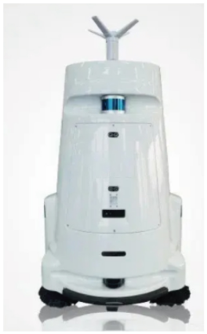
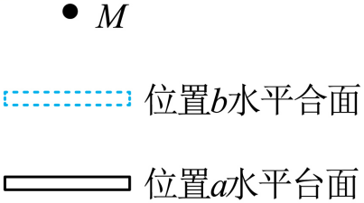
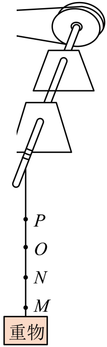
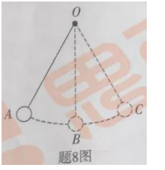

# 第十一章 功和机械能 · 题目

讲义只用 lesson.md 里引用的题目，按知识点顺序排列。课本题答案和解析由本项目编写，待复核。

## 讲义用题

### Q-PHY-GZ2025-07

```yaml
id: Q-PHY-GZ2025-07
category: 真题
source: 2025 年广州市初中学业水平考试物理第 7 题
source_quality: 原卷
kp: PHY-8B-11-1a
type: 选择
grading: 自动
answer_by: 原卷解析
review:
  概念: PHY-8B-11-1a
  前置: PHY-8B-08-3a
```

**题干**

7. 在如图所示的粗糙程度相同的水平冰面上，运动员用水平推力从 a 点推动冰壶，经过 b 点时松手，冰壶到达 c 点停止运动，由 a 到 b 和由 b 到 c 的过程中，设冰壶受到的滑动摩擦力分别为 $f_{ab}$ 和 $f_{bc}$，运动员对冰壶做的功分别为 $W_{ab}$ 和 $W_{bc}$，则（　　）


A. $f_{ab}<f_{bc}$

B. $f_{ab}=f_{bc}$

C. $W_{ab}<W_{bc}$

D. $W_{ab}=W_{bc}$

**答案**

B

**解析**

1. a 到 b 与 b 到 c 的冰面粗糙程度相同，冰壶的重力相同，水平面支持力相同，所以两个过程中冰壶受到的滑动摩擦力相同，A 错、B 对。
2. a 到 b 时运动员对冰壶有水平推力，冰壶沿推力方向移动，运动员做功；经过 b 点松手后，运动员的推力不再作用于冰壶，运动员不做功。
3. 所以 $W_{ab}>W_{bc}$，C、D 都错，选 B。

---

### Q-PHY-GD2022-23-3

```yaml
id: Q-PHY-GD2022-23-3
category: 真题
source: 2022 年广东省初中学业水平考试物理第 23 题第（3）问
source_quality: 原卷
type: 计算
grading: 自评
answer_by: 原卷解析
kp: PHY-8B-11-1b
do: 本章只做第（3）问
review:
  公式: PHY-8B-11-1b
  前置: PHY-8B-08-2b
other_parts: （1）压强 → PHY-8B-09-1b；（2）牵引力 → PHY-8B-08-2b（Q-PHY-GD2022-23-2）。这些小问不在本章使用
```

**题干**

图中某智能机器人的质量为 $80\ \mathrm{kg}$。在水平地面上工作时，该机器人匀速直线移动的速度为 $1\ \mathrm{m/s}$，所受阻力是机器人重力的 $0.05$ 倍。求机器人在水平地面上匀速直线移动 $30\ \mathrm{s}$，此过程中牵引力做的功。（取 $g=10\ \mathrm{N/kg}$）



**答案**

$1200\ \mathrm{J}$

**解析**

1. 机器人的重力：
   $G=mg=\textcolor{#287fc4}{80}\ \cancel{\mathrm{kg}}\times\textcolor{#287fc4}{10}\ \mathrm{N}/\cancel{\mathrm{kg}}=800\ \mathrm{N}$

2. 机器人在水平地面上匀速直线移动时受平衡力，牵引力等于阻力：
   $F=f=0.05G=\textcolor{#287fc4}{0.05}\times\textcolor{#287fc4}{800}\ \mathrm{N}=40\ \mathrm{N}$

3. 机器人在水平地面上匀速直线移动 $30\ \mathrm{s}$ 移动的距离：
   $s=vt=\textcolor{#287fc4}{1}\ \mathrm{m}/\cancel{\mathrm{s}}\times\textcolor{#287fc4}{30}\ \cancel{\mathrm{s}}=30\ \mathrm{m}$

4. 此过程中牵引力做的功：
   $W=Fs=\textcolor{#287fc4}{40}\ \mathrm{N}\times\textcolor{#287fc4}{30}\ \mathrm{m}=\boxed{1200\ \mathrm{J}}$

---

### Q-PHY-GZ2023-13-2

```yaml
id: Q-PHY-GZ2023-13-2
category: 真题
source: 2023 年广州市初中学业水平考试物理第 13 题第（2）问
source_quality: 原卷
kp: PHY-8B-11-2a
do: 本章只做第（2）问
type: 填空
grading: 自评
answer_by: 原卷解析
review:
  公式: PHY-8B-11-1b
  计算: PHY-8B-11-2a
other_parts: （1）比较两段的速度和摩擦力 → PHY-8B-08-3a（Q-PHY-GZ2023-13-1）
parts:
  - part: 功的数值空
    kp: PHY-8B-11-1b
    review:
      公式: PHY-8B-11-1b
  - part: 功率的数值空
    kp: PHY-8B-11-2a
    review:
      公式: PHY-8B-11-2a
  - part: 重力做功空
    kp: PHY-8B-11-1a
    review:
      概念: PHY-8B-11-1a
```

**题干**

13. 物体 A 重 5 N，如图 1，A 在水平拉力 $F_1$ 作用下，在水平面从 M 匀速直线运动到 N 用时 3 s；如图 2，在 A 上放置一个钩码，A 在水平拉力 $F_2$ 作用下，在另一水平面从 Р 匀速直线运动到 Q 用时 2 s。


（2）A 从 M 运动到 N，$F_1$ 做的功为______J、功率为______W，A 所受重力做的功为______J。

**答案**

0.3；0.1；0

**解析**

1. 图中 $F_1=1\ \mathrm{N}$，MN 的距离为 $0.3\ \mathrm{m}$，拉力做功：
   $W=F_1s=\textcolor{#287fc4}{1}\ \mathrm{N}\times\textcolor{#287fc4}{0.3}\ \mathrm{m}=\boxed{0.3\ \mathrm{J}}$
2. 做这些功用时 $3\ \mathrm{s}$，功率：
   $P=\dfrac{W}{t}=\dfrac{\textcolor{#287fc4}{0.3}\ \mathrm{J}}{\textcolor{#287fc4}{3}\ \mathrm{s}}=\boxed{0.1\ \mathrm{W}}$
3. A 水平移动，重力方向竖直向下，A 没有沿重力方向移动，重力做功为 $\boxed{0\ \mathrm{J}}$。

---

### Q-PHY-TB8B-11.3-2

```yaml
id: Q-PHY-TB8B-11.3-2
category: 课本习题
source: 八下 11.3 练习与应用第 2 题，p.95
source_quality: 课本原文
kp: PHY-8B-11-3b
type: 简答
grading: 自评
answer_by: 本项目编写，待复核
review:
  概念: PHY-8B-11-3b
  前置: PHY-8B-11-3a
parts:
  - part: （1）汽车
    kp: PHY-8B-11-3a
    review:
      概念: PHY-8B-11-3a
  - part: （2）吊灯
    kp: PHY-8B-11-3b
    review:
      概念: PHY-8B-11-3b
  - part: （3）飞机
    kp: PHY-8B-11-3b
    review:
      概念: PHY-8B-11-3b
      前置: PHY-8B-11-3a
  - part: （4）弹弓
    kp: PHY-8B-11-3b
    review:
      概念: PHY-8B-11-3b
```

**题干**

请你判断下列物体具有哪种形式的能量：

（1）在水平公路上行驶的汽车；

（2）悬挂在天花板上的吊灯；

（3）在空中飞行的飞机；

（4）被拉开的弹弓。

**答案**

（1）动能；（2）重力势能；（3）动能和重力势能；（4）弹性势能。

**解析**

1. 行驶的汽车在运动，具有动能。
2. 悬挂在天花板上的吊灯处在一定高度，具有重力势能。
3. 飞机在运动，也处在一定高度，所以同时具有动能和重力势能。
4. 被拉开的弹弓发生弹性形变，具有弹性势能。

---

### Q-PHY-GZ2022-14

```yaml
id: Q-PHY-GZ2022-14
category: 真题
source: 2022 年广州市初中学业水平考试物理第 14 题
source_quality: 原卷
kp: PHY-8B-11-4a
type: 选填
grading: 自动
answer_by: 原卷解析（说明按本册课本术语表述）
review:
  概念: PHY-8B-11-4a
parts:
  - part: 动能变化空
    kp: PHY-8B-11-3a
    accepted: [减小]
    review:
      概念: PHY-8B-11-3a
  - part: N 与 M 比较空
    kp: PHY-8B-11-4a
    accepted: [可能]
    review:
      概念: PHY-8B-11-4a
  - part: P 与 N 比较空
    kp: PHY-8B-11-4a
    accepted: [不可能]
    review:
      概念: PHY-8B-11-4a
```

**题干**

14. 如图，小芳设想利用升降台让球越弹越高。将球从 M 点竖直向下以某速度抛出，球经静止在位置 a 的台面反弹后，到达的最高点为 N。经台面反弹后上升过程球的动能___________（选填“增大”“不变”“减小”），N___________ 比 M 高（选填“可能”“不可能”）。球从 N 点下降时，台面已升至合适的位置 b 并保持静止，球再次经反弹后，到达的最高点 P___________比 N 高（选填“可能”“不可能”）。



**答案**

减小；可能；不可能

**解析**

1. 球上升时速度变小，动能减小。
2. 球回到 M 的高度时重力势能与抛出时相同，动能比抛出时小但不一定为 0，所以还能继续上升，所以 N 可能高于 M。
3. 第二次碰撞前，球从静止的 N 点下降。位置 b 的台面在球碰到它之前已经静止，没有给球补充机械能；碰撞中一部分机械能转化为其他形式的能。球反弹后最高点低于 N，所以 P 不可能高于 N。

---

### Q-PHY-GZ2023-07-1

```yaml
id: Q-PHY-GZ2023-07-1
category: 真题
source: 2023 年广州市初中学业水平考试物理第 7 题第（1）问
source_quality: 原卷
type: 选择
grading: 自动
answer_by: 原卷解析
kp: PHY-8B-11-4a
do: 本章只做第（1）问
review:
  概念: PHY-8B-11-4a
other_parts: （2）磁场对通电导线的作用 → PHY-9-20-4a。这一小问不在本章使用
```

**题干**

用电动机竖直提升重物。重物上升过程经过 M、N、O、P 点，其速度在 MN 段不断增大，在 NO 段不变，在 OP 段不断减小，忽略空气阻力，则重物在（    ）



A. MN 段动能不变
B. MN 段机械能不变
C. NO 段机械能增大
D. OP 段重力势能减小

**答案**

C

**解析**

- A 选项：MN 段重物速度增大，质量不变，动能增大，A 错误；
- B 选项：MN 段重物动能增大，高度升高，质量不变，重力势能增大，所以机械能增大，B 错误；
- C 选项：NO 段重物速度不变，动能不变，但高度升高，重力势能增大，所以机械能增大，C 正确；
- D 选项：OP 段重物的高度升高，重力势能增大，D 错误。

---

### Q-PHY-GZ2024-12-3

```yaml
category: 真题
source: 2024 年广州市中考物理试题第 12 题第（3）问
source_quality: 原卷（精品解析整理版）
kp: PHY-8B-11-3a
type: 填空
grading: 自评
do: 本章只做第（3）问
other_parts:
  - 第（1）问（长度估测、$G=mg$）→ PHY-8B-07-3a（重力），本题其他小问已收入八下第七章
  - 第（2）问（画重力示意图）→ PHY-8B-07-3b
answer_by: 原卷解析
review:
  概念: PHY-8B-11-3a
```

**题干**

某同学将篮球掷向地面，经过甲位置后碰到地面，接着向上反弹经过乙位置，忽略空气的作用力。篮球经过甲、乙两位置时的机械能和重力势能如下表所示。

| 位置 | 机械能 / $\mathrm{J}$ | 重力势能 / $\mathrm{J}$ |
| --- | --- | --- |
| 甲 | $13$ | $6$ |
| 乙 | $12$ | $10$ |

篮球与地面碰撞过程损失的机械能为 \_\_\_\_\_\_ $\mathrm{J}$，在乙位置时的动能为 \_\_\_\_\_\_ $\mathrm{J}$。

**答案**

$1$

$2$

**解析**

1. 损失的机械能 $=13\ \mathrm{J}-12\ \mathrm{J}=\boxed{1\ \mathrm{J}}$。
2. 机械能等于动能与重力势能之和，乙位置的动能 $E_{\text{动}}=12\ \mathrm{J}-10\ \mathrm{J}=\boxed{2\ \mathrm{J}}$。

---

### Q-PHY-GD2019-08

```yaml
category: 真题
source: 2019 年广东省初中学业水平考试 物理 第 8 题
source_quality: 原卷（本地存档 Word 转 PDF 页，逐页核对）
kp: PHY-8B-11-3b
type: 填空
grading: 自评
answer_by: 原卷解析
review:
  概念: PHY-8B-11-3b
```

**题干**

如图所示，用细线系住小球悬挂在 O 点，将小球拉至 A 点释放，从 A 点经过 B 点运动到 C 点的过程中，小球的重力势能先变小后＿＿＿＿，动能先＿＿＿＿后＿＿＿＿。（选填“变大”“变小”或“不变”）



**答案**

变大；变大；变小

**解析**

重力势能的大小跟物体所处的高度有关，高度越高，重力势能越大。小球从 A 到 B 再到 C，高度先变小后变大，所以重力势能先变小后变大。动能跟速度有关：A 到 B 速度变大，B 到 C 速度变小，所以动能先变大后变小。

---

## 备选（不进入讲义，不再维护）

暂未收录。

