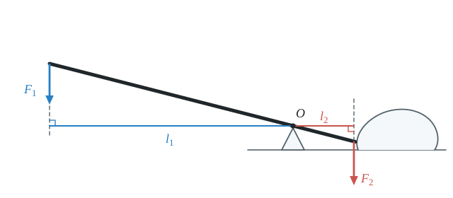
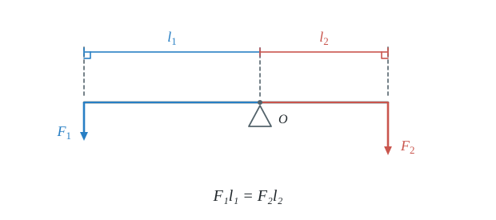
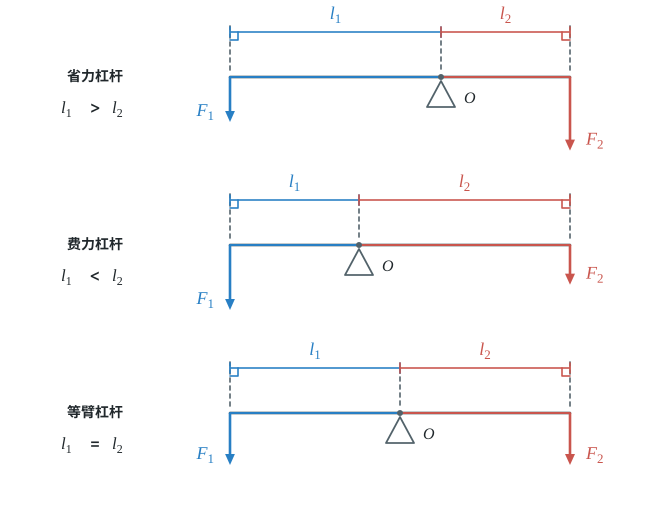
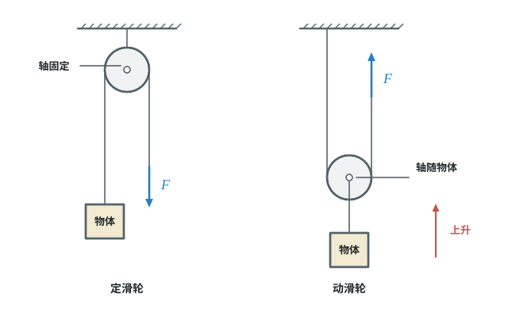
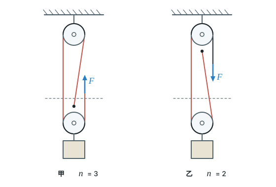
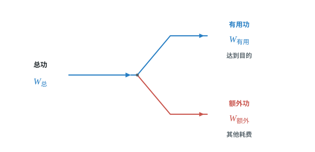

# 第十二章 简单机械

杠杆和滑轮可以改变力的大小或方向，但不能省功。本章先学会看支点、力臂和滑轮组，再分清有用功、额外功、总功与机械效率。

## 本章前置自查

下面几件事，哪一件没把握，先回看：

1. 能画出力的作用线，并从某一点向直线作垂线。（第七章第 1 节；数学中的垂线）
2. 能用二力平衡和比例关系求未知量。（第八章第 2 节；数学中的比例）
3. 会用 $W=Fs$ 计算功，知道距离要沿力的方向取。（第十一章第 1 节）

---

## 12.1a 杠杆五要素与力臂作图

```yaml
id: PHY-8B-12-1a
weight: 重点
weight_note: 6 次，作图题常客
textbook: 八下 12.1 杠杆，p.104–105
prerequisites:
  - id: PHY-8B-07-1b
    strength: hard
    reason: 要画力的作用线
  - id: MATH-角与垂线
    strength: hard
    reason: 力臂是支点到力的作用线的垂线段
evidence:
  - 能指出杠杆的支点、动力、阻力、动力臂和阻力臂
  - 能从支点向力的作用线作垂线，画出力臂
figure: 已完成 figures/crowbar-lever-arms.svg（撬棒的支点、两个力的作用线（含延长虚线）和垂直力臂）
sources: [TB8B-12.1]
```

### 本次只学

在杠杆图中找准支点、动力、阻力和两条力臂。

### 先认住

- 能绕固定点转动的硬棒叫杠杆。支点是杠杆绕着转动的点；使杠杆转动的力叫动力；阻碍杠杆转动的力叫阻力。
- 动力臂是从支点到动力作用线的距离；阻力臂是从支点到阻力作用线的距离。
- 画力臂时，从支点向力的作用线作垂线段；垂足到支点的距离就是力臂。

### 走一遍

课本中的撬棒：人用撬棒搬石头，判断杠杆的五个要素并画出力臂。

1. 撬棒绕着转动的固定点是支点 O。
2. 人施加的力是动力；石头对撬棒的阻碍作用是阻力。
3. 分别从 O 向动力和阻力的作用线作垂线段，得到动力臂 $l_1$ 和阻力臂 $l_2$。



### 容易错

- 力臂是支点到力的作用线的垂直距离，不是支点到力的作用点的距离。
- 垂足不在力的箭头上时，要把力的作用线反向延长（画虚线）再作垂线。
- 动力、阻力看它们对杠杆转动的作用；不按力的大小或箭头朝向命名。

### 练一练

- `Q-PHY-GZ2023-12-1a`

---

## 12.1b 杠杆平衡条件（实验与计算）

```yaml
id: PHY-8B-12-1b
weight: 重点
weight_note: 13 次，全科次数最多
textbook: 八下 12.1 杠杆，p.105–107
prerequisites:
  - id: PHY-8B-12-1a
    strength: hard
    reason: 要找准力臂
  - id: MATH-比例
    strength: soft
    reason: F₁l₁=F₂l₂ 是比例关系
evidence:
  - 能写出杠杆平衡条件
  - 能在杠杆平衡时根据三个量求第四个量
  - 能通过实验数据验证杠杆平衡时两侧力与力臂乘积的关系
figure: 已完成 figures/lever-equilibrium.svg（水平杠杆两侧的力、垂直力臂与平衡条件）
sources: [TB8B-12.1, GD2022-21, GZ2023-12(1)]
```

### 本次只学

杠杆平衡时，用动力、动力臂、阻力和阻力臂之间的关系求未知量。

### 先认住

- 杠杆在动力和阻力作用下静止时，处于平衡状态。
- 杠杆平衡条件：动力×动力臂=阻力×阻力臂，即 $F_1l_1=F_2l_2$。
- 实验中钩码拉力竖直，调整杠杆水平并静止，便于直接读出力臂。
- 实验中改变一侧的力或力臂，再测量另一侧对应的量，比较两侧力与力臂的乘积。



### 破题钥匙

```think
现象: 杠杆在水平位置静止
模型: 支点两侧，各有一个力和它的力臂
图: phy-lever
关系: $F_1l_1=F_2l_2$
招: 画图
结: 力臂长的一侧，需要的力小
```

### 走一遍

课本例题：利用杠杆估算大象的质量。测力计拉力 $F_1=200\ \mathrm{N}$，动力臂 $l_1=6\ \mathrm{m}$，阻力臂 $l_2=4\ \mathrm{cm}=0.04\ \mathrm{m}$；不计铁笼质量，$g$ 取 $10\ \mathrm{N/kg}$。

1. 槽钢水平静止，杠杆平衡：
   $F_1l_1=F_2l_2$
2. 大象对槽钢的拉力：
   $F_2=\dfrac{F_1l_1}{l_2}=\dfrac{\textcolor{#287fc4}{200}\ \mathrm{N}\times\textcolor{#287fc4}{6}\ \cancel{\mathrm{m}}}{\textcolor{#287fc4}{0.04}\ \cancel{\mathrm{m}}}=3\times10^4\ \mathrm{N}$
3. $F_2$ 等于大象的重力，质量为：
   $m=\dfrac{G}{g}=\dfrac{\textcolor{#287fc4}{3\times10^4}\ \cancel{\mathrm{N}}}{\textcolor{#287fc4}{10}\ \cancel{\mathrm{N}}/\mathrm{kg}}=\boxed{3\times10^3\ \mathrm{kg}=3\ \mathrm{t}}$

### 容易错

- 另一侧不变时，这一侧的力臂变长，所需的力变小。
- 要使某个力最小，就让它的力臂最长：力垂直于杠杆、作用点离支点最远。
- 力臂单位要一致，例如 $4\ \mathrm{cm}$ 先换成 $0.04\ \mathrm{m}$ 再计算。

### 练一练

- `Q-PHY-GD2022-21`
- `Q-PHY-GZ2023-12-1b`

---

## 12.1c 杠杆的分类

```yaml
id: PHY-8B-12-1c
weight: 一般
weight_note: 4 次，判断省力或费力
textbook: 八下 12.1 杠杆，p.108
prerequisites:
  - id: PHY-8B-12-1b
    strength: hard
    reason: 比较动力臂和阻力臂
evidence:
  - 能根据动力臂和阻力臂的长短判断杠杆类型
  - 能说出省力杠杆、费力杠杆在力和距离上的特点
figure: 已完成 figures/lever-type-comparisons.svg（三种杠杆的动力臂与阻力臂长短对照）
sources: [TB8B-12.1, SZ2023-05]
```

### 本次只学

比较动力臂和阻力臂，判断杠杆省力、费力还是不省力也不费力。

### 先认住

- 动力臂大于阻力臂是省力杠杆（省力但费距离）；动力臂小于阻力臂是费力杠杆（费力但省距离）。
- 动力臂等于阻力臂是等臂杠杆；不省力也不费力。
- **补充**（课本没有讲，做真题时常用）：轮轴由具有共同转动轴的大轮和小轮组成，通常把大轮叫作轮，把小轮叫作轴；轮带动轴时（方向盘、门把手、水龙头）动力臂较长，省力；轴带动轮时（雨刮器）动力臂较短，费力。



### 容易错

- “省力”不等于“省功”；省力杠杆要多移动一段距离。
- 先找动力臂和阻力臂，再比较长短，不能只凭物体外形判断。

### 练一练

- `Q-PHY-SZ2023-05`

---

## 12.3a 定滑轮和动滑轮

```yaml
id: PHY-8B-12-3a
weight: 一般
weight_note: 1 次
textbook: 八下 12.3 滑轮，p.113–115
prerequisites:
  - id: PHY-8B-12-1c
    strength: soft
    reason: 定滑轮是等臂杠杆，动滑轮是省力杠杆
evidence:
  - 能根据滑轮轴是否固定判断定滑轮和动滑轮
  - 能说出定滑轮、动滑轮对力的大小和方向的影响
figure: 已完成 figures/fixed-movable-pulleys.svg（定滑轮固定轴、动滑轮移动轴及与物体的位置关系）
sources: [TB8B-12.3]
```

### 本次只学

看滑轮的轴是否移动，判断它能否改变力的方向、是否省力。

### 先认住

- 轴固定不动的滑轮叫定滑轮。定滑轮不省力，但可以改变力的方向。
- 轴随物体一起移动的滑轮叫动滑轮。动滑轮可以省力，但不能改变力的方向，而且费距离。
- 忽略滑轮自重、绳重和摩擦时，动滑轮上有几段绳子承担物重，提起重物的拉力就是物重的几分之一。



### 练一练

- `Q-PHY-TB8B-12.3-1`
- `Q-PHY-GD2022-06`

---

## 12.3b 滑轮组

```yaml
id: PHY-8B-12-3b
weight: 一般
weight_note: 2 次；数承重绳段数是机械效率计算的前一步
textbook: 八下 12.3 滑轮，p.114–116
prerequisites:
  - id: PHY-8B-12-3a
    strength: hard
    reason: 滑轮组由定、动滑轮组成
evidence:
  - 能数出连接动滑轮的承重绳段数
  - 能在忽略滑轮重、绳重和摩擦时求拉力与自由端移动距离
  - 能用承重绳段数计算绳端移动速度
figure: 已完成 figures/pulley-rope-count.svg（甲 n=3（绳头系在动滑轮上）、乙 n=2（绳头系在定滑轮上），承重绳段标红）
sources: [TB8B-12.3, GZ2024-16(2)]
```

### 本次只学

先数有几段绳子承担物重，再求拉力、绳端距离或速度。

### 先认住

- 用滑轮组提升重物时，承担动滑轮和重物的绳段数记作 $n$。
- 忽略动滑轮自重、绳重和摩擦时，拉力 $F=G/n$。
- 绳端移动距离取决于承重绳段数：重物升高 $h$，绳端移动距离 $s=nh$。



### 容易错

- 数承重绳段时，数清直接承担动滑轮和重物的绳段；绳端固定在动滑轮上时，这一段也要计入。
- 绳端距离是物体上升高度的 $n$ 倍；不能把重物的高度当作绳端距离。

### 练一练

- `Q-PHY-GZ2024-16-2` 第（2）问

---

## 12.4a 有用功、额外功和总功

```yaml
id: PHY-8B-12-4a
weight: 一般
weight_note: 1 次
textbook: 八下 12.4 机械效率，p.117–118
prerequisites:
  - id: PHY-8B-11-1b
    strength: hard
    reason: 三种功都用 W=Fs 计算
evidence:
  - 能按工作目的区分有用功和额外功
  - 能在有用功、额外功、总功中由两个量求第三个
sources: [TB8B-12.4, SZ2023-14]
figure: 不需要
```

### 本次只学

根据使用机械时的工作目的，分清有用功、额外功和总功。

### 先认住

- 为达到工作目的、对物体做的功叫有用功；使用机械时，克服机械自重、摩擦等多做的功叫额外功。
- 动力对机械做的功是总功，$W_{\text{总}}=W_{\text{有用}}+W_{\text{额外}}$，也可写成 $W_{\text{有用}}=W_{\text{总}}-W_{\text{额外}}$。
- 使用机械不能省功；实际机械存在额外功，总功大于有用功。

### 练一练

- `Q-PHY-SZ2023-14`

---

## 12.4b 机械效率的计算

```yaml
id: PHY-8B-12-4b
weight: 重点
weight_note: 3 次计算（滑轮组、斜面）
textbook: 八下 12.4 机械效率，p.118–120
prerequisites:
  - id: PHY-8B-12-4a
    strength: hard
    reason: η=W有/W总
  - id: PHY-8B-12-3b
    strength: hard
    reason: 要算绳端移动距离 s=nh
evidence:
  - 能用有用功与总功之比求机械效率
  - 能用阻力和物体移动距离求有用功，用动力和动力作用点移动距离求总功
  - 能把机械效率换算成百分数，并检查实际机械的效率是否小于 100%
figure: 已完成 figures/work-energy-destinations.svg（总功输入分为有用功、额外功两种去向，不标比例）
sources: [TB8B-12.4, GZ2024-16(3)]
```

### 本次只学

先算有用功和总功，再求机械效率。

### 先认住

- 机械效率：有用功与总功的比值，$\eta=\dfrac{W_{\text{有用}}}{W_{\text{总}}}\times100\%$。
- 用滑轮组提升重物时，有用功 $W_{\text{有用}}=Gh$；总功是动力对绳端做的功，$W_{\text{总}}=Fs$，其中 $s$ 是动力作用点（绳端）移动的距离。
- 实际机械中，有用功小于总功，所以机械效率小于 $100\%$。



### 破题钥匙

```think
现象: 用滑轮组把重物匀速提升 $h$，手拉绳端移动 $s$
模型: 动滑轮上有 $n$ 段绳子承担物重（图中 $n=2$），绳端移动的距离是物体上升高度的 $n$ 倍
图: phy-b-pulley-eff
关系: $s=nh$，$\eta=\dfrac{Gh}{Fs}$
招: 画图
结: 先数绳子段数，再算有用功和总功
```

### 走一遍

课本例题：起重机将质量为 $0.5\ \mathrm{t}$ 的重物匀速提升 $3\ \mathrm{m}$，电动机做功 $3.4\times10^4\ \mathrm{J}$，$g$ 取 $10\ \mathrm{N/kg}$。求起重机的机械效率。

1. 匀速提升时，起重机的拉力等于重物的重力：
   $F=G=mg=\textcolor{#287fc4}{0.5\times10^3}\ \cancel{\mathrm{kg}}\times\textcolor{#287fc4}{10}\ \mathrm{N}/\cancel{\mathrm{kg}}=5\times10^3\ \mathrm{N}$
2. 起重机克服重物重力做的功是有用功：
   $W_{\text{有用}}=Fh=\textcolor{#287fc4}{5\times10^3}\ \mathrm{N}\times\textcolor{#287fc4}{3}\ \mathrm{m}=1.5\times10^4\ \mathrm{J}$
3. 电动机做的功是总功，机械效率为：
   $\eta=\dfrac{W_{\text{有用}}}{W_{\text{总}}}\times100\%=\dfrac{\textcolor{#287fc4}{1.5\times10^4}\ \cancel{\mathrm{J}}}{\textcolor{#287fc4}{3.4\times10^4}\ \cancel{\mathrm{J}}}\times100\%\approx\boxed{44\%}$

### 容易错

- 用滑轮组提升物体时，总功按动力乘绳端移动距离计算，不能误用物体上升高度。
- 不同机械的“有用功”由工作目的决定；先说明目的，再选有用功。
- 机械效率不是机械本身的功率，也不是节省的力的百分比。

### 练一练

- `Q-PHY-TB8B-12.4-2`
- `Q-PHY-GZ2024-16-3` 第（3）问
