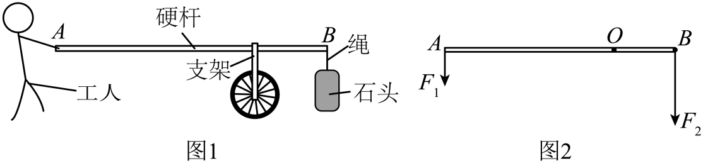
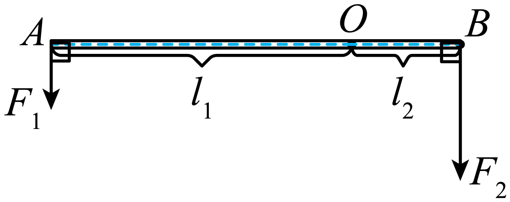
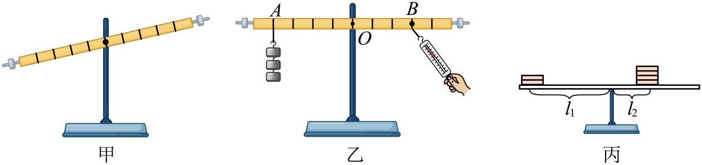
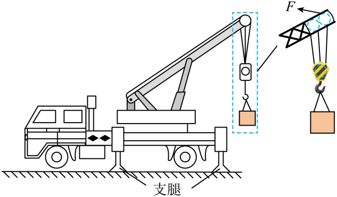
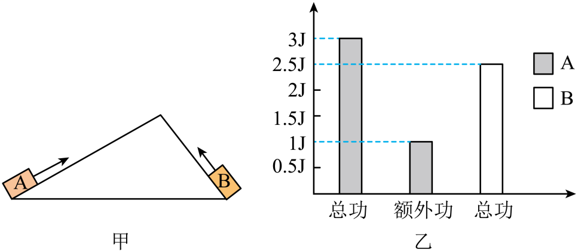
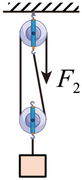
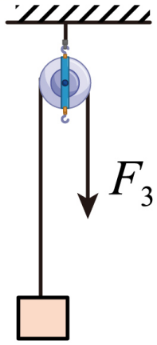
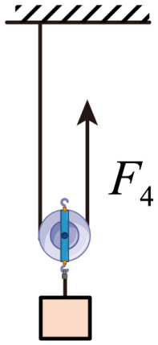

# 第十二章 简单机械 · 题目

讲义只用 lesson.md 里引用的题目，按知识点顺序排列。课本题答案和解析由本项目编写，待复核。

## 讲义用题（9 道）

### Q-PHY-GZ2023-12-1a

```yaml
id: Q-PHY-GZ2023-12-1a
category: 真题
source: 2023 年广州市初中学业水平考试物理第 12 题第（1）问①
source_quality: 原卷
kp: PHY-8B-12-1a
do: 本章只做第（1）问①
type: 作图
grading: 自评
answer_by: 原卷解析
review:
  概念: PHY-8B-12-1a
other_parts: （1）②力臂表达式 → PHY-8B-12-1b（Q-PHY-GZ2023-12-1b）；（2）改变支点位置，本章不用
```

**题干**

12. 图 1 中工人用工具搬运石头，该工具可简化成图 2 中杠杆 AB，移动支架，可使支点 O 在 AB 间移动。杆水平静止，忽略杆重；

（1）人对杆的压力为 $F_1$，绳对杆的拉力为 $F_2$，$F_1$、$F_2$ 竖直向下；①在图 2 中画出 $F_1$ 的力臂 $l_1$。



**答案**

见下图。



**解析**

1. 从支点 O 向 $F_1$ 的作用线作垂线，垂足到 O 的线段是动力臂 $l_1$。
2. 杆水平、力竖直，垂足就是 A 点本身，所以 $l_1=OA$。

---

### Q-PHY-GZ2023-12-1b

```yaml
id: Q-PHY-GZ2023-12-1b
category: 真题
source: 2023 年广州市初中学业水平考试物理第 12 题第（1）问②
source_quality: 原卷
kp: PHY-8B-12-1b
do: 本章只做第（1）问②
type: 填空
grading: 自评
answer_by: 本项目编写，待复核
review:
  公式: PHY-8B-12-1b
  前置: PHY-8B-12-1a
other_parts: （1）①画力臂 → PHY-8B-12-1a（Q-PHY-GZ2023-12-1a）；（2）改变支点位置，本章不用
```

**题干**

12. 图 1 中工人用工具搬运石头，该工具可简化成图 2 中杠杆 AB，移动支架，可使支点 O 在 AB 间移动。杆水平静止，忽略杆重；

（1）人对杆的压力为 $F_1$，绳对杆的拉力为 $F_2$，$F_1$、$F_2$ 竖直向下；②$F_2$ 的力臂 $l_2$___________（用 $F_1$、$F_2$、$l_1$ 表示）。


**答案**

$l_2=\dfrac{F_1l_1}{F_2}$

**解析**

1. 杠杆水平静止，满足杠杆平衡条件 $F_1l_1=F_2l_2$。
2. 解得 $\boxed{l_2=\dfrac{F_1l_1}{F_2}}$。

---

### Q-PHY-GD2022-21

```yaml
id: Q-PHY-GD2022-21
category: 真题
source: 2022 年广东省初中学业水平考试物理第 21 题
source_quality: 原卷
kp: PHY-8B-12-1b
type: 填空
grading: 自评
answer_by: 原卷解析
review:
  概念: PHY-8B-12-1b
  公式: PHY-8B-12-1b
  计算: PHY-8B-12-1b
parts:
  - part: （1）平衡螺母调节
    kp: PHY-8B-12-1b
    review:
      概念: PHY-8B-12-1b
  - part: （2）最小拉力及方向
    kp: PHY-8B-12-1b
    review:
      公式: PHY-8B-12-1b
      计算: PHY-8B-12-1b
  - part: （3）硬币杠杆力臂与平衡
    kp: PHY-8B-12-1b
    review:
      公式: PHY-8B-12-1b
      计算: PHY-8B-12-1b
widget: |
  type: lever
  f1: 1.5
  l1: 4
  l2: 3
  max: 4
widget_figure: figures/gd2022-21-lever.svg
```

**题干**

21. 在“探究杠杆的平衡条件”实验中：



（1）小明安装好杠杆后，发现其左端下沉，如图甲所示。为使杠杆在水平位置平衡，应将平衡螺母向___________调节；

（2）如图乙所示，杠杆调节平衡后，在A处悬挂3个钩码，每个钩码重0.5N。如果在B处施加一个拉力使杠杆在水平位置再次平衡，当方向为___________时，拉力最小，大小为___________N；

（3）课后，小明制作了一个简易杠杆，调节杠杆在水平位置平衡，然后在它两边恰当位置分别放上不同数量的同种硬币，使其在水平位置再次平衡，如图丙所示，则力臂 $l_1:l_2=$___________。若两边同时各取走一枚硬币，则杠杆的___________端将下沉。

**答案**

（1）右
（2）竖直向下；2
（3）2:1；右

**解析**

1. （1）杠杆左端下沉，应向$\boxed{\text{右}}$调节平衡螺母，使杠杆在水平位置平衡。
2. （2）在 B 处施加动力时，要使动力臂最大，动力方向应$\boxed{\text{竖直向下}}$。
3. 阻力和阻力臂不变时，动力臂最大，动力最小。设杠杆每个小格长为 $l$，杠杆在水平位置平衡时：
   $\textcolor{#287fc4}{3\times0.5}\ \mathrm{N}\times\textcolor{#287fc4}{4}\cancel{l} = F_1\times\textcolor{#287fc4}{3}\cancel{l}$
   解得最小拉力 $F_1=\boxed{2\ \mathrm{N}}$。
4. （3）设每个硬币的重力为 $G$。左边受力为 $2G$，右边受力为 $4G$。据杠杆的平衡条件有：
   $G_1 l_1 = G_2 l_2$
   $\textcolor{#287fc4}{2}\cancel{G}\times l_1 = \textcolor{#287fc4}{4}\cancel{G}\times l_2$
   解得力臂之比 $l_1:l_2=G_2:G_1=\boxed{2:1}$。
5. 两边同时各取走一枚硬币，则左边和右边力与力臂的乘积分别是：
   左边：$(\textcolor{#287fc4}{2}-1)G\times l_1 = G\times l_1 = G\times 2l_2 = 2Gl_2$
   右边：$(\textcolor{#287fc4}{4}-1)G\times l_2 = 3Gl_2$
   因为 $3Gl_2 > 2Gl_2$，所以杠杆的$\boxed{\text{右}}$端将下沉。

---

### Q-PHY-SZ2023-05

```yaml
id: Q-PHY-SZ2023-05
category: 真题
source: 2023 年深圳市初中学业水平考试物理第 5 题
source_quality: 原卷
kp: PHY-8B-12-1c
type: 选择
grading: 自动
answer_by: 原卷解析
review:
  概念: PHY-8B-12-1c
```

**题干**

5. 下列属于费力杠杆的是（　　）

A.  汽车方向盘

B.  门把手

C.  水龙头

D.  雨刮器

**答案**

D

**解析**

1. 汽车方向盘、门把手和水龙头属于轮轴，轮带动轴转动，动力臂较长，属于省力机械。
2. 雨刮器由轴带动刮片转动，阻力臂较长，相当于费力杠杆。
3. 所以选 D。

---

### Q-PHY-TB8B-12.3-1

```yaml
id: Q-PHY-TB8B-12.3-1
category: 课本习题
source: 八下 12.3 练习与应用第 1 题，p.116
source_quality: 课本原文
kp: PHY-8B-12-3a
type: 简答
grading: 自评
answer_by: 本项目编写，待复核
review:
  概念: PHY-8B-12-3a
```

**题干**

一个物体重 1 000 N，如果用一个定滑轮提起它，需要用多大的力？如果用一个动滑轮提起它，不计摩擦、滑轮的自重和绳重，又要用多大的力？

**答案**

用定滑轮提起时需要 $1\,000\ \mathrm{N}$；用动滑轮提起时需要 $500\ \mathrm{N}$。

**解析**

1. 忽略摩擦和绳重，定滑轮不省力，拉力等于物体重力：$F=G=\boxed{1\,000\ \mathrm{N}}$。
2. 题目已说明忽略摩擦、滑轮自重和绳重。一只动滑轮由两段绳子承担物重，所以 $F=G/2=\textcolor{#287fc4}{1\,000}\ \mathrm{N}/\textcolor{#287fc4}{2}=\boxed{500\ \mathrm{N}}$。

---

### Q-PHY-GZ2024-16-2

```yaml
id: Q-PHY-GZ2024-16-2
category: 真题
source: 2024 年广州市初中学业水平考试物理第 16 题第（2）问
source_quality: 原卷
kp: PHY-8B-12-3b
do: 本章只做第（2）问
type: 计算
grading: 自评
answer_by: 原卷解析（题图和数值已查看并重算）
review:
  公式: PHY-8B-12-3b
  计算: PHY-8B-12-3b
other_parts: 第（1）问减小压强，不在本章使用；第（3）问的机械效率见 Q-PHY-GZ2024-16-3
```

**题干**

16. 如图，吊车在建筑工地进行作业时，由支腿将吊车撑起并脱离地面，吊臂上的滑轮组在 1 s 内，将重为 $9\times10^3\ \mathrm{N}$ 的建筑材料沿竖直方向匀速提升 1 m，滑轮组上钢丝绳自由端受到的拉力 $F$ 为 $5\times10^3\ \mathrm{N}$；



（2）求钢丝绳自由端的移动速度；____

**答案**

$3\ \mathrm{m/s}$

**解析**

1. 图中有 3 段绳子承担物重，$n=3$。
2. 重物升高 $h=1\ \mathrm{m}$，绳端移动距离：
   $s=nh=\textcolor{#287fc4}{3}\times\textcolor{#287fc4}{1}\ \mathrm{m}=3\ \mathrm{m}$
3. 用时 $1\ \mathrm{s}$，绳端速度：
   $v=\dfrac{s}{t}=\dfrac{\textcolor{#287fc4}{3}\ \mathrm{m}}{\textcolor{#287fc4}{1}\ \mathrm{s}}=\boxed{3\ \mathrm{m/s}}$

---

### Q-PHY-SZ2023-14

```yaml
id: Q-PHY-SZ2023-14
category: 真题
source: 2023 年深圳市初中学业水平考试物理第 14 题
source_quality: 原卷
kp: PHY-8B-12-4a
type: 填空
grading: 自评
answer_by: 原卷解析（题图和数值已查看并重算）
review:
  公式: PHY-8B-12-4a
  计算: PHY-8B-12-4a
parts:
  - part: A 的有用功
    kp: PHY-8B-12-4a
    review:
      公式: PHY-8B-12-4a
      计算: PHY-8B-12-4a
  - part: B 的额外功
    kp: PHY-8B-12-4a
    review:
      公式: PHY-8B-12-4a
      计算: PHY-8B-12-4a
```

**题干**

14. 如图甲，A、B是两个完全相同的物体，琴琴同学分别将A、B两物体拉到斜面顶端，对物体做功情况如图乙所示，请问对物体A做的有用功是______J，对物体B做的额外功是______J。



**答案**

2；0.5

**解析**

1. 由图乙可知，对物体 A 做的总功为 $3\ \mathrm{J}$，额外功为 $1\ \mathrm{J}$，对物体 A 做的有用功：
   $W_{\text{有用}}=W_{\text{总}}-W_{\text{额外}}=\textcolor{#287fc4}{3}\ \mathrm{J}-\textcolor{#287fc4}{1}\ \mathrm{J}=\boxed{2\ \mathrm{J}}$
2. A、B 是两个完全相同的物体，都拉到斜面顶端，对物体 B 做的有用功与 A 相同；由图乙可知，对物体 B 做的总功为 $2.5\ \mathrm{J}$，对物体 B 做的额外功：
   $W_{\text{额外}}=\textcolor{#287fc4}{2.5}\ \mathrm{J}-\textcolor{#287fc4}{2}\ \mathrm{J}=\boxed{0.5\ \mathrm{J}}$

---

### Q-PHY-TB8B-12.4-2

```yaml
id: Q-PHY-TB8B-12.4-2
category: 课本习题
source: 八下 12.4 练习与应用第 2 题，p.121
source_quality: 课本原文
kp: PHY-8B-12-4b
type: 计算
grading: 自评
answer_by: 本项目编写，待复核
review:
  公式: PHY-8B-12-4b
  计算: PHY-8B-12-4b
parts:
  - part: 有用功
    kp: PHY-8B-12-4b
    review:
      公式: PHY-8B-12-4b
  - part: 总功
    kp: PHY-8B-12-4b
    review:
      公式: PHY-8B-12-4b
  - part: 机械效率
    kp: PHY-8B-12-4b
    review:
      公式: PHY-8B-12-4b
  - part: 额外功原因
    kp: PHY-8B-12-4b
    review:
      概念: PHY-8B-12-4b
```

**题干**

一台起重机将重 3 600 N 的货物匀速提高 4 m，起重机做的有用功是多少？如果额外功是 9 600 J，总功是多少？机械效率是多少？起重机所做的额外功是由哪些因素引起的？

**答案**

有用功为 $1.44\times10^4\ \mathrm{J}$；总功为 $2.4\times10^4\ \mathrm{J}$；机械效率为 $60\%$。额外功来自克服动滑轮、吊钩等随货物一起上升的部件的重力，以及摩擦等。

**解析**

1. 起重机克服货物重力做有用功：
   $W_{\text{有用}}=Gh=\textcolor{#287fc4}{3\,600}\ \mathrm{N}\times\textcolor{#287fc4}{4}\ \mathrm{m}=\boxed{1.44\times10^4\ \mathrm{J}}$
2. 总功等于有用功与额外功之和：
   $W_{\text{总}}=W_{\text{有用}}+W_{\text{额外}}=\textcolor{#287fc4}{1.44\times10^4}\ \mathrm{J}+\textcolor{#287fc4}{9\,600}\ \mathrm{J}=\boxed{2.4\times10^4\ \mathrm{J}}$
3. 机械效率：
   $\eta=\dfrac{W_{\text{有用}}}{W_{\text{总}}}\times100\%=\dfrac{\textcolor{#287fc4}{1.44\times10^4}\ \cancel{\mathrm{J}}}{\textcolor{#287fc4}{2.4\times10^4}\ \cancel{\mathrm{J}}}\times100\%=\boxed{60\%}$
4. 额外功来自克服动滑轮、吊钩等随货物一起上升的部件的重力，以及摩擦等。

---

### Q-PHY-GZ2024-16-3

```yaml
id: Q-PHY-GZ2024-16-3
category: 真题
source: 2024 年广州市初中学业水平考试物理第 16 题第（3）问
source_quality: 原卷
kp: PHY-8B-12-4b
do: 本章只做第（3）问
type: 计算
grading: 自评
answer_by: 原卷解析（题图和公式图片的数值已查看并重算）
review:
  公式: PHY-8B-12-4b
  计算: PHY-8B-12-4b
other_parts: 第（1）问减小压强，不在本章使用；第（2）问计算绳端速度见 Q-PHY-GZ2024-16-2
parts:
  - part: 拉力功率
    kp: PHY-8B-11-2a
    review:
      公式: PHY-8B-11-2a
  - part: 机械效率
    kp: PHY-8B-12-4b
    review:
      公式: PHY-8B-12-4b
```

**题干**

16. 如图，吊车在建筑工地进行作业时，由支腿将吊车撑起并脱离地面，吊臂上的滑轮组在 1 s 内，将重为 $9\times10^3\ \mathrm{N}$ 的建筑材料沿竖直方向匀速提升 1 m，滑轮组上钢丝绳自由端受到的拉力 $F$ 为 $5\times10^3\ \mathrm{N}$；


（3）求拉力 $F$ 的功率和滑轮组的机械效率。____

**答案**

$1.5\times10^4\ \mathrm{W}$；$60\%$

**解析**

1. 图中有 3 段绳子承担物重，重物提升 $1\ \mathrm{m}$ 时，绳端移动：
   $s=nh=\textcolor{#287fc4}{3}\times\textcolor{#287fc4}{1}\ \mathrm{m}=3\ \mathrm{m}$
2. 总功按动力乘绳端移动距离计算：
   $W_{\text{总}}=Fs=\textcolor{#287fc4}{5\times10^3}\ \mathrm{N}\times\textcolor{#287fc4}{3}\ \mathrm{m}=1.5\times10^4\ \mathrm{J}$
3. 拉力的功率：
   $P=\dfrac{W_{\text{总}}}{t}=\dfrac{\textcolor{#287fc4}{1.5\times10^4}\ \mathrm{J}}{\textcolor{#287fc4}{1}\ \mathrm{s}}=\boxed{1.5\times10^4\ \mathrm{W}}$
4. 有用功是克服建筑材料重力做的功：
   $W_{\text{有用}}=Gh=\textcolor{#287fc4}{9\times10^3}\ \mathrm{N}\times\textcolor{#287fc4}{1}\ \mathrm{m}=9\times10^3\ \mathrm{J}$
5. 机械效率：
   $\eta=\dfrac{W_{\text{有用}}}{W_{\text{总}}}\times100\%=\dfrac{\textcolor{#287fc4}{9\times10^3}\ \cancel{\mathrm{J}}}{\textcolor{#287fc4}{1.5\times10^4}\ \cancel{\mathrm{J}}}\times100\%=\boxed{60\%}$

### Q-PHY-GD2022-06

```yaml
category: 真题
source: 2022 年广东省中考物理试题第 6 题
source_quality: 原卷（精品解析整理版）
kp: PHY-8B-12-3a
type: 选择
grading: 自动
answer_by: 原卷解析
review:
  概念: PHY-8B-12-3a
```

**题干**

分别使用图中四种装置匀速提升同一重物，不计滑轮重、绳重和摩擦，最省力的是（　　）

A. 

B. 

C. 

D. 

**答案**

A

**解析**

1. 不计滑轮重、绳重和摩擦，用滑轮组时拉力 $F=\dfrac{G}{n}$，$n$ 是承担物重的绳子段数。
2. A：$n=3$，$F=\dfrac{G}{3}$。B：$n=2$，$F=\dfrac{G}{2}$。
3. C 是定滑轮，$F=G$。D 是动滑轮，$F=\dfrac{G}{2}$。
4. $\dfrac{G}{3}$ 最小，所以最省力的是 A。故选 A。

---

## 备选（不进入讲义，不再维护）

暂未收录。
