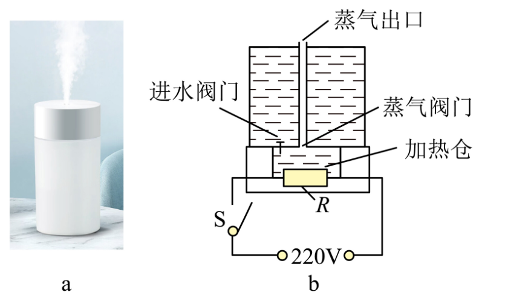
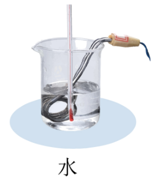
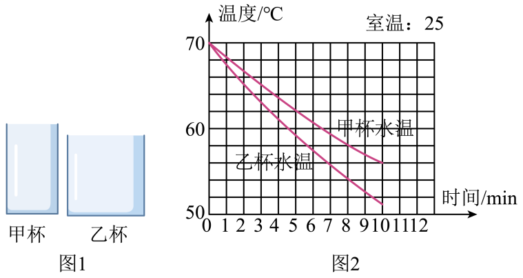
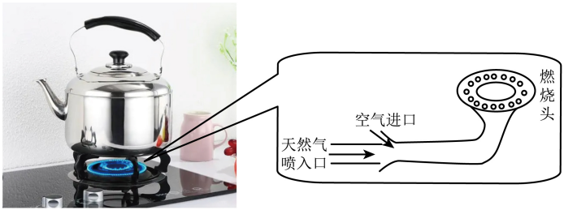
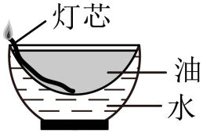

# 第十三章 内能 · 题目

讲义只用 `lesson.md` 里引用的题，按知识点顺序排在前面。课本习题原文已对照课本 PDF 原页核对；课本习题的答案和解析为本项目编写，**发布前需要复核**。

---

## 讲义用题（8 道）

### Q-PHY-TB9-13.1-2

```yaml
category: 课本习题
source: 九全 13.1 练习与应用 第 2 题，p.7
source_quality: 课本原文
kp: PHY-9-13-1a
type: 简答
grading: 自评
answer_by: 本项目编写，已复核
review:
  概念: PHY-9-13-1a
```

**题干**

有同学根据 $c=\dfrac{Q}{m(t-t_0)}$ 认为：比热容跟物体吸收或放出的热量有关，而且物体的质量越大，它的比热容越小。这种认识正确吗？说说你的看法。

**答案**

不正确。比热容是物质自身的性质，与物体吸收或放出的热量、物体的质量无关。

**解析**

1. 同一种物质，质量变为原来的 2 倍，升高相同温度时吸收的热量也变为 2 倍。
2. 热量与“质量×温度变化”的比值保持不变，所以比热容不变。
3. 这个公式只是计算比热容的方法，不表示比热容由热量和质量决定。

---

### Q-PHY-GZ2023-09

```yaml
category: 真题
source: 2023 年广州市初中学业水平考试 物理 第 9 题
source_quality: 原卷（精品解析整理版）
kp: PHY-9-13-1b
type: 选择
grading: 自动
answer_by: 原卷解析
review:
  概念: PHY-9-13-1b
  审题: PHY-9-13-1c
```

**题干**

以下过程不发生物态变化，初温相同的两块金属甲、乙吸收了相同热量，甲的末温比乙的低，那么初温相同的甲、乙放出相同热量（　　）

A. 甲的末温比乙的低，但无法判断甲、乙比热容哪一个大
B. 甲的末温比乙的高，但无法判断甲、乙比热容哪一个大
C. 甲的末温比乙的高，且可以判断甲、乙比热容哪一个大
D. 无法判断甲、乙的末温哪一个高，且无法判断甲、乙比热容哪一个大

**答案**

B

**解析**

1. 吸收相同热量，甲的末温比乙低，说明甲的温度变化比乙小。
2. 放出相同热量时，甲的温度同样降得比乙少，初温相同，所以甲的末温比乙高。
3. 题目没有说甲、乙质量相等。由 $Q=cm\Delta t$，温度变化小可能是比热容大，也可能是质量大，所以无法判断比热容谁大。

---

### Q-PHY-TB9-13.1-5

```yaml
category: 课本习题
source: 九全 13.1 练习与应用 第 5 题，p.7
source_quality: 课本原文
kp: PHY-9-13-1c
type: 计算
grading: 自评
answer_by: 本项目编写，已复核
review:
  公式: PHY-9-13-1c
  单位: PHY-8A-06-1a
  计算: MATH-科学记数法
```

**题干**

有一根烧红的铁钉，温度是 800 ℃，质量是 1.5 g。当温度降低到 20 ℃ 时，它放出了多少热量？

**答案**

约 538 J

**解析**

1. 查课本表 13.1-1：铁的比热容 $c=0.46\times10^{3}\ \mathrm{J/(kg\cdot{}^\circ C)}$
2. 质量换算：$m=\textcolor{#287fc4}{1.5}\ \mathrm{g}=1.5\times10^{-3}\ \mathrm{kg}$
3. 降低的温度：$t_0-t=\textcolor{#287fc4}{800}\ ^\circ\mathrm{C}-\textcolor{#287fc4}{20}\ ^\circ\mathrm{C}=780\ ^\circ\mathrm{C}$
4. $Q_{\text{放}}=cm(t_0-t)=\textcolor{#287fc4}{0.46\times10^{3}}\ \mathrm{J}/(\cancel{\mathrm{kg}}\cdot\cancel{^\circ\mathrm{C}})\times\textcolor{#287fc4}{1.5\times10^{-3}}\ \cancel{\mathrm{kg}}\times\textcolor{#287fc4}{780}\ \cancel{^\circ\mathrm{C}}\approx\boxed{538\ \mathrm{J}}$

---

### Q-PHY-GZ2025-16-3a

```yaml
category: 真题
source: 2025 年广州市初中学业水平考试 物理 第 16 题第（3）问①
source_quality: 原卷
kp: PHY-9-13-1c
type: 计算
grading: 自评
answer_by: 本项目编写，已复核（原卷解析中本小问数值为公式图片，已用第②小问官方答案 84% 反推核对一致）
review:
  公式: PHY-9-13-1c
  单位: PHY-8A-06-4a
  审题: PHY-8A-03-3a
other_parts: （1）汽化 → PHY-8A-03-4b；（2）电功率 → PHY-9-18-2a；（3）②加热效率 → PHY-9-14-3b。这些小问不在本章使用
```

**题干**

图 a 所示的电热加湿器，其内部结构及电路简图如图 b。通电后，发热电阻 R 使加热仓中的水沸腾变成水蒸气喷出，增加环境湿度。已知水的比热容为 $4.2\times10^{3}\ \mathrm{J/(kg\cdot{}^\circ C)}$、密度为 $1.0\times10^{3}\ \mathrm{kg/m^3}$，沸点为 100 ℃。

（3）若消耗电能 $1.2\times10^{4}$ J，可使加热仓内 $3.0\times10^{-5}\ \mathrm{m^3}$ 的水从 20 ℃ 加热至沸腾，求：① 加热仓内水吸收的热量。



**答案**

$1.008\times10^{4}$ J

**解析**

1. 题目给的是体积，先求质量：$m=\rho V=\textcolor{#287fc4}{1.0\times10^{3}}\ \mathrm{kg}/\cancel{\mathrm{m^3}}\times\textcolor{#287fc4}{3.0\times10^{-5}}\ \cancel{\mathrm{m^3}}=0.03\ \mathrm{kg}$
2. “加热至沸腾”，末温是沸点 100 ℃，升高的温度 $\Delta t=\textcolor{#287fc4}{100}\ ^\circ\mathrm{C}-\textcolor{#287fc4}{20}\ ^\circ\mathrm{C}=80\ ^\circ\mathrm{C}$
3. $Q_{\text{吸}}=cm\Delta t=\textcolor{#287fc4}{4.2\times10^{3}}\ \mathrm{J}/(\cancel{\mathrm{kg}}\cdot\cancel{^\circ\mathrm{C}})\times\textcolor{#287fc4}{0.03}\ \cancel{\mathrm{kg}}\times\textcolor{#287fc4}{80}\ \cancel{^\circ\mathrm{C}}=\boxed{1.008\times10^{4}\ \mathrm{J}}$

---

### Q-PHY-GD2023-02

```yaml
category: 真题
source: 2023 年广东省初中学业水平考试 物理 第 2 题
source_quality: 原卷（精品解析整理版）
kp: PHY-9-13-2a
type: 选择
grading: 自动
answer_by: 原卷解析
review:
  概念: PHY-9-13-2a
```

**题干**

端午节期间，小明在家里煮粽子，粽香四溢说明（　　）

A. 分子在不停地做无规则运动　B. 分子间存在引力
C. 分子间存在斥力　D. 分子可以再分

**答案**

A

**解析**

1. 粽香四溢，是粽子的香味分子不停地做无规则运动，进入空气中，属于扩散现象。
2. 这个现象和分子间的引力、斥力无关，也不能说明分子可以再分。

---

### Q-PHY-GZ2025-04

```yaml
category: 真题
source: 2025 年广州市初中学业水平考试 物理 第 4 题
source_quality: 原卷
kp: PHY-9-13-3b
also: [PHY-9-13-3c]
type: 选择
grading: 自动
answer_by: 原卷解析
review:
  概念: PHY-9-13-3b
  审题: PHY-9-13-3c
```

**题干**

如图，从热汤中取出的金属勺子，由烫手到不烫手的过程，其内能（　　）

A. 逐渐增加　B. 保持不变　C. 通过做功改变　D. 通过热传递改变


**答案**

D

**解析**

1. 勺子由烫手到不烫手，温度降低，向周围放出热量。
2. 放出热量，内能减少，所以 A、B 错。
3. 内能是通过热传递改变的，不是做功，所以 C 错、D 对。

---

### Q-PHY-SZ2023-04

```yaml
category: 真题
source: 2023 年深圳市初中学业水平考试 物理 第 4 题
source_quality: 原卷（精品解析整理版）
kp: PHY-9-13-3b
also: [PHY-9-13-2a]
type: 选择
grading: 自动
answer_by: 原卷解析
review:
  概念: PHY-9-13-3b
  前置: PHY-8A-03-3c
```

**题干**

端午节煮粽子是中华文化的传统习俗，下列说法正确的是（　　）

A. 燃料燃烧为内能转化为化学能　B. 打开锅盖上面的白雾是水蒸气
C. 加热粽子是利用做功增加内能　D. 闻到粽子的香味是因为扩散现象

**答案**

D

**解析**

1. A：燃料燃烧是化学能转化为内能，说反了，A 错。
2. B：白雾是水蒸气液化成的小水滴，不是水蒸气，B 错。
3. C：开水放热、粽子吸热，是热传递增加内能，不是做功，C 错。
4. D：闻到香味是香味分子不停地做无规则运动，是扩散现象，D 对。

---

### Q-PHY-GZ2023-08

```yaml
category: 真题
source: 2023 年广州市初中学业水平考试 物理 第 8 题
source_quality: 原卷（精品解析整理版）
kp: PHY-9-13-3c
type: 选择
grading: 自动
answer_by: 原卷解析
review:
  概念: PHY-9-13-3c
  前置: PHY-8A-03-2a
```

**题干**

小明将凝固点为 47 ℃ 的某液态合金放在室温为 25 ℃ 的实验室中。该合金从 70 ℃ 降至 47 ℃ 并保持 47 ℃ 一段时间再降至 35 ℃，合金在此过程（　　）

A. 对外放热，内能一直减少
B. 存在液化现象，内能一直增加
C. 温度保持 47 ℃ 时，不吸热也不放热
D. 存在凝固现象，内能先减少后不变再减少

**答案**

A

**解析**

1. 70 ℃ 降到 47 ℃：液态合金放热降温。
2. 保持 47 ℃ 的一段时间：合金在凝固，凝固放热，温度不变。
3. 47 ℃ 降到 35 ℃：固态合金继续放热降温。
4. 整个过程一直在放热，内能一直减少，所以 A 对。
5. 过程中是凝固不是液化，B 错；凝固时放热，C 错；温度不变时仍在放热，内能仍在减少，D 错。

---

### Q-PHY-GZ2019-04

```yaml
category: 真题
source: 2019 年广州市初中学业水平考试 物理 第 4 题
source_quality: 原卷（本地存档 Word 转 PDF 页，逐页核对）
kp: PHY-9-13-3a
type: 选择
grading: 自动
answer_by: 原卷解析
review:
  概念: PHY-9-13-3a
```

**题干**

下列说法正确的是

A．两物体温度相同，内能一定相同

B．两物体相比，分子动能越大的物体，其内能越大

C．甲物体传递了热量给乙物体，说明甲物体内能大

D．扩散现象中，分子可以从低温物体运动到高温物体

**答案**

D

**解析**

内能是分子动能和分子势能之和：分子动能与温度有关，分子势能与体积有关，所以 A、B 错；热传递的方向由温度高低决定，不是由内能大小决定，C 错；扩散现象中分子在不停地做无规则运动，可以从低温物体运动到高温物体，D 对。

---

### Q-PHY-TJ2025-20

```yaml
category: 外省真题
source: 2025 年天津市初中学业水平考试 物理 第 20 题
source_quality: 原卷（外省卷，Word 转 PDF 页，逐页核对）
kp: PHY-9-13-1a
type: 计算
grading: 自评
answer_by: 原卷解析
review:
  概念: PHY-9-13-1a
```

**题干**

在比较不同物质吸热情况的实验中，用额定功率为 300 W 的电加热器加热水，如图所示。在电加热器正常工作时，获得的数据如下表。

| 物质 | 质量/kg | 初温/℃ | 加热时间/s | 末温/℃ |
| --- | --- | --- | --- | --- |
| 水 | 0.3 | 20 | 120 | 40 |

已知 $c_{\text{水}}=4.2\times10^{3}\ \mathrm{J/(kg\cdot{}^\circ C)}$，求：

（1）水吸收的热量；

（2）电加热器的效率。



**答案**

（1）$\boxed{2.52\times10^{4}\ \mathrm{J}}$；（2）$\boxed{70\%}$

**解析**

1. 水吸收的热量：$Q_{\text{吸}}=c m(t-t_0)=4.2\times10^{3}\ \mathrm{J/(kg\cdot{}^\circ C)}\times0.3\ \mathrm{kg}\times(40-20)\ ^\circ\mathrm{C}=\boxed{2.52\times10^{4}\ \mathrm{J}}$
2. 加热器消耗的电能：$W=Pt=300\ \mathrm{W}\times120\ \mathrm{s}=3.6\times10^{4}\ \mathrm{J}$
3. 效率：$\eta=\dfrac{Q_{\text{吸}}}{W}=\dfrac{2.52\times10^{4}\ \mathrm{J}}{3.6\times10^{4}\ \mathrm{J}}\times100\%=\boxed{70\%}$

---

## 备选（不进入讲义，不再维护）

以下题目已录入并核对过，留作以后换题时挑选。不打印、不定期更新。

---

### Q-PHY-TB9-13.1-1

```yaml
category: 课本习题
source: 九全 13.1 练习与应用 第 1 题，p.7
source_quality: 课本原文
kp: PHY-9-13-1a
type: 简答
grading: 自评
answer_by: 本项目编写，待复核
review:
  概念: PHY-9-13-1a
  审题: PHY-9-13-1a
```

**题干**

在标准大气压下，水的沸点是 100 ℃，某种牛奶的沸点是 100.7 ℃。加热条件相同时，加热质量相等、初温相同的水和牛奶，牛奶比水先沸腾。请根据比热容的定义讨论，水和牛奶哪个的比热容大。

**答案**

水的比热容大。

**解析**

1. 加热条件相同，加热时间越短，吸收的热量越少。牛奶先沸腾，说明牛奶吸收的热量比水少。
2. 初温相同，牛奶要升到 100.7 ℃，水只要升到 100 ℃，牛奶升高的温度反而比水多。
3. 质量相等时，牛奶吸收的热量更少、升高的温度更多，所以牛奶的比热容比水小。

---

### Q-PHY-TB9-13.1-3

```yaml
category: 课本习题
source: 九全 13.1 练习与应用 第 3 题，p.7
source_quality: 课本原文
kp: PHY-9-13-1c
type: 计算
grading: 自评
answer_by: 本项目编写，待复核
review:
  公式: PHY-9-13-1c
  审题: PHY-8A-03-1b
  计算: MATH-科学记数法
```

**题干**

质量为 2 kg 的某种物质，当温度从 20 ℃ 升高到 40 ℃ 时，吸收的热量是 $1.88\times10^{4}$ J。该物质的比热容是多少？

**答案**

$0.47\times10^{3}\ \mathrm{J/(kg\cdot{}^\circ C)}$

**解析**

1. 升高的温度：$\Delta t=40\ ^\circ\mathrm{C}-20\ ^\circ\mathrm{C}=20\ ^\circ\mathrm{C}$
2. 由 $Q_{\text{吸}}=cm\Delta t$ 得 $c=\dfrac{Q_{\text{吸}}}{m\Delta t}$
3. $c=\dfrac{1.88\times10^{4}\ \mathrm{J}}{2\ \mathrm{kg}\times20\ ^\circ\mathrm{C}}=470\ \mathrm{J/(kg\cdot{}^\circ C)}=0.47\times10^{3}\ \mathrm{J/(kg\cdot{}^\circ C)}$

---

### Q-PHY-TB9-13.1-4

```yaml
category: 课本习题
source: 九全 13.1 练习与应用 第 4 题，p.7
source_quality: 课本原文
kp: PHY-9-13-1b
type: 简答
grading: 自评
answer_by: 本项目编写，待复核
review:
  概念: PHY-9-13-1b
  审题: PHY-9-13-1b
```

**题干**

质量相等的铝块和铜块，吸收了相同的热量，哪个的温度上升得较高？说说你的推断过程。

**答案**

铜块的温度上升得较高。

**解析**

1. 查课本表 13.1-1：铝的比热容是 $0.88\times10^{3}\ \mathrm{J/(kg\cdot{}^\circ C)}$，铜的比热容是 $0.39\times10^{3}\ \mathrm{J/(kg\cdot{}^\circ C)}$，铜的比热容小。
2. 由 $\Delta t=\dfrac{Q}{cm}$，$Q$ 和 $m$ 都相同时，$c$ 越小，$\Delta t$ 越大。
3. 所以铜块升高的温度较多。

---

### Q-PHY-TB9-13.1-6

```yaml
category: 课本习题
source: 九全 13.1 练习与应用 第 6 题，p.7
source_quality: 课本原文
kp: PHY-9-13-1b
type: 简答
grading: 自评
answer_by: 本项目编写，待复核
review:
  概念: PHY-9-13-1b
```

**题干**

“早穿皮袄午穿纱，守着火炉吃西瓜。”这句谚语生动描述了新疆一些地区一天中的温度变化。请从比热容的角度分析，与沿海地区相比，新疆这些地区昼夜温差大的原因是什么。

**答案**

新疆这些地区多砂石、泥土，水少；砂石的比热容比水小得多。

**解析**

1. 白天吸收相同的热量，砂石的比热容小，温度升高得多，中午很热。
2. 夜晚放出相同的热量，砂石温度降低得多，早晚很冷。
3. 沿海地区水多，水的比热容大，吸放热时温度变化小，所以昼夜温差小。

---

### Q-PHY-TB9-13.2-2

```yaml
category: 课本习题
source: 九全 13.2 练习与应用 第 2 题，p.12
source_quality: 课本原文
kp: PHY-9-13-2a
type: 简答
grading: 自评
answer_by: 本项目编写，待复核
review:
  概念: PHY-9-13-2a
```

**题干**

扩散现象跟人们的生活密切相关。它有时有用，如腌制鸭蛋就是通过扩散使盐进入蛋中的；它有时又有害，如人造木板黏结剂中的甲醛扩散到空气中造成环境污染。请你分别列举一个扩散现象有用和有害的实例。

**答案**（参考，言之有理即可）

- 有用：炒菜时放盐，菜很快变咸。
- 有害：长期堆煤的墙角，墙里面也变黑。

**解析**

1. 两个例子都是不同物质互相接触、彼此进入对方，属于扩散。
2. 炒菜温度高，分子运动剧烈，盐扩散得快，几分钟就入味。
3. 煤和墙长期接触，煤的分子进入墙内，所以刮掉表层后里面仍是黑的。

---

### Q-PHY-TB9-13.2-3

```yaml
category: 课本习题
source: 九全 13.2 练习与应用 第 3 题，p.12
source_quality: 课本原文
kp: PHY-9-13-2a
type: 简答
grading: 自评
answer_by: 本项目编写，待复核
review:
  概念: PHY-9-13-2a
  前置: PHY-8A-03-1a
```

**题干**

两个杯子中分别盛有质量相等的冷水和热水，向其中分别放入同样的糖块，经过相同的时间后（两个杯子中的糖块都还没有全部溶解），请推断哪杯水会更甜。为什么？

**答案**

热水更甜。

**解析**

1. 糖分子进入水中是扩散现象。
2. 热水温度高，分子热运动更剧烈，扩散更快。
3. 相同时间内进入热水的糖分子更多，所以热水更甜。

---

### Q-PHY-TB9-13.2-5

```yaml
category: 课本习题
source: 九全 13.2 练习与应用 第 5 题，p.12
source_quality: 课本原文
kp: PHY-9-13-2b
type: 简答
grading: 自评
answer_by: 本项目编写，待复核
review:
  概念: PHY-9-13-2b
```

**题干**

在图 13.2-10 甲中的注射器里封有空气，图 13.2-10 乙中的注射器里封有相同体积的水。用手推动活塞可以压缩空气，但很难压缩水，说说为什么。

（图：两支注射器，甲封有空气，乙封有水，用手推活塞。题意用文字已能读懂，配图可选。）

**答案**

空气分子间距离很大、作用力很小，容易被压缩；水分子间距离小，压缩时分子间表现为斥力，所以很难压缩。

**解析**

1. 气体分子相距很远，彼此之间几乎没有作用力，推活塞时分子容易靠近。
2. 液体分子之间的距离比气体小很多，再压缩时，分子间的作用力表现为斥力。
3. 斥力阻碍分子继续靠近，所以水很难被压缩。

---

### Q-PHY-TB9-13.2-6

```yaml
category: 课本习题
source: 九全 13.2 练习与应用 第 6 题，p.12
source_quality: 课本原文
kp: PHY-9-13-2b
type: 填空
grading: 自评
answer_by: 本项目编写，待复核
review:
  概念: PHY-9-13-2b
  前置: PHY-8A-03-2a
```

**题干**

下表归纳了物质固、液、气三态的微观特性和宏观特性，请完成这个表格。

| 物态 | 分子间距离 | 分子间作用力 | 有无固定形状 | 有无固定体积 |
| --- | --- | --- | --- | --- |
| 固态 |  | 很大 |  |  |
| 液态 | 较大 | 较大 |  |  |
| 气态 | 很大 |  |  |  |

**答案**

| 物态 | 分子间距离 | 分子间作用力 | 有无固定形状 | 有无固定体积 |
| --- | --- | --- | --- | --- |
| 固态 | **很小** | 很大 | **有** | **有** |
| 液态 | 较大 | 较大 | **无** | **有** |
| 气态 | 很大 | **很小（几乎没有）** | **无** | **无** |

**解析**

1. 固体分子距离小、作用力大，有一定的形状和体积。
2. 液体没有确定的形状，能流动，但较难被压缩，体积一定。
3. 气体分子距离很远，几乎没有作用力，形状和体积都不固定。

---

### Q-PHY-TB9-13.3-1

```yaml
category: 课本习题
source: 九全 13.3 练习与应用 第 1 题，p.17
source_quality: 课本原文
kp: PHY-9-13-3a
type: 简答
grading: 自评
answer_by: 本项目编写，待复核
review:
  概念: PHY-9-13-3a
  前置: PHY-8B-11-3a
```

**题干**

张老师在火车站乘电梯时随自动扶梯匀速上行，他所携带的背包的重力势能增大，背包的内能是否也增大？为什么？他在高速列车中将书放在小桌板上，列车启动后的一段时间内车速越来越大，书的动能增大，它的内能是否也增大？为什么？

**答案**

都不会因此增大。

**解析**

1. 背包被升高，增大的是重力势能，属于机械能。
2. 书的速度变大，增大的是动能，也属于机械能。
3. 内能取决于物体内部分子的热运动和分子间的相互作用，和整个物体的位置高低、速度快慢无关。
4. 背包和书的温度等没有变化，内能不会因为升高或加速而增大。

---

### Q-PHY-TB9-13.3-2

```yaml
category: 课本习题
source: 九全 13.3 练习与应用 第 2 题，p.17
source_quality: 课本原文
kp: PHY-9-13-3b
type: 简答
grading: 自评
answer_by: 本项目编写，待复核
review:
  概念: PHY-9-13-3b
  前置: PHY-8B-11-4a
```

**题干**

在以下过程中，小孩、火箭箭体和子弹的内能是在增大还是在减小？机械能是在增大还是在减小？

（1）小孩在滑梯上匀速滑下的过程中，臀部与滑梯摩擦后温度升高。
（2）火箭在从地面向上发射的过程中，火箭外壳和大气摩擦后温度越来越高。
（3）子弹击中一块木板，子弹温度升高。

**答案**

| 过程 | 内能 | 机械能 |
| --- | --- | --- |
| （1）小孩 | 增大 | 减小 |
| （2）火箭箭体 | 增大 | 增大 |
| （3）子弹 | 增大 | 减小 |

**解析**

1. 三个过程中，物体都通过摩擦做功，温度升高，内能增大。
2. （1）匀速下滑，速度不变，动能不变；高度降低，重力势能减小，机械能减小。
3. （2）火箭加速上升，速度和高度都增大，动能和重力势能都增大，机械能增大。增加的能量来自燃料燃烧。
4. （3）子弹击中木板后速度减小，动能减小，机械能减小。

---

### Q-PHY-TB9-13.3-3

```yaml
category: 课本习题
source: 九全 13.3 练习与应用 第 3 题，p.17
source_quality: 课本原文
kp: PHY-9-13-3b
type: 简答
grading: 自评
answer_by: 本项目编写，待复核
review:
  概念: PHY-9-13-3b
```

**题干**

请说明“烤火取暖”和“钻木取火”分别通过什么方式改变物体的内能。

**答案**

烤火取暖：热传递。钻木取火：做功。

**解析**

1. 烤火时，火的温度比人高，热量从火传给人，是热传递。
2. 钻木时，克服摩擦做功，机械能转化为内能，木头温度升高直到着火，是做功。

---

### Q-PHY-TB9-13R-2

```yaml
category: 课本习题
source: 九全 第十三章 复习与提高 第 2 题，p.18
source_quality: 课本原文
kp: PHY-9-13-2b
role: 进阶
type: 简答
grading: 自评
answer_by: 本项目编写，待复核
review:
  概念: PHY-9-13-2b
  前置: PHY-8B-09-3a
  计算: PHY-8B-09-1b
```

**题干**

在做图 13.2-5 所示的实验时，测得两个铅柱的接触面积为 1.5 cm²，当下方悬挂 20 kg 的重物时，铅柱仍然未被拉开。请根据实验数据说明，大气压的作用不是铅柱能悬吊重物的主要原因。

**答案**

大气压能提供的压力最多约 15 N，远小于重物约 196 N 的重力，所以主要原因不是大气压。

**解析**

1. 大气压约为 $1\times10^{5}$ Pa；接触面积 $S=1.5\ \mathrm{cm^2}=1.5\times10^{-4}\ \mathrm{m^2}$
2. 大气压产生的压力最多为 $F=pS=1\times10^{5}\ \mathrm{Pa}\times1.5\times10^{-4}\ \mathrm{m^2}=15\ \mathrm{N}$
3. 重物的重力 $G=mg=20\ \mathrm{kg}\times9.8\ \mathrm{N/kg}=196\ \mathrm{N}$
4. $15\ \mathrm{N}$ 远小于 $196\ \mathrm{N}$，大气压托不住重物，主要是分子间的引力使铅柱不被拉开。

---

### Q-PHY-TB9-13R-3

```yaml
category: 课本习题
source: 九全 第十三章 复习与提高 第 3 题，p.18
source_quality: 课本原文
kp: PHY-9-13-1c
type: 计算
grading: 自评
answer_by: 本项目编写，待复核
review:
  公式: PHY-9-13-1c
  概念: PHY-9-13-1a
```

**题干**

用相同的电加热器同时加热质量相等的水和另一种液体，二者初温均为 20 ℃。一段时间后，测得水的温度为 40 ℃，另一种液体的温度为 42.1 ℃。另一种液体的比热容是多少？

**答案**

约 $3.8\times10^{3}\ \mathrm{J/(kg\cdot{}^\circ C)}$

**解析**

1. 加热器相同、加热时间相同，两种液体吸收的热量相等：$Q_{\text{水}}=Q_{\text{液}}$
2. 水升高 $20\ ^\circ\mathrm{C}$，液体升高 $22.1\ ^\circ\mathrm{C}$
3. $c_{\text{水}}m\times20\ ^\circ\mathrm{C}=c_{\text{液}}m\times22.1\ ^\circ\mathrm{C}$，质量相等可以约去
4. $c_{\text{液}}=\dfrac{4.2\times10^{3}\ \mathrm{J/(kg\cdot{}^\circ C)}\times20\ ^\circ\mathrm{C}}{22.1\ ^\circ\mathrm{C}}\approx3.8\times10^{3}\ \mathrm{J/(kg\cdot{}^\circ C)}$

---

### Q-PHY-TB9-13R-4

```yaml
category: 课本习题
source: 九全 第十三章 复习与提高 第 4 题，p.18
source_quality: 课本原文
kp: PHY-9-13-1c
type: 计算
grading: 自评
answer_by: 本项目编写，待复核
review:
  公式: PHY-9-13-1c
  单位: PHY-8A-06-1a
```

**题干**

某同学做实验时所用的电加热器 1 s 内放出的热量为 700 J。加热 1 min 能使 200 g 的水温度升高多少？

**答案**

50 ℃（不计热量损失）

**解析**

1. 加热时间 1 min = 60 s，放出的热量 $Q=700\ \mathrm{J/s}\times60\ \mathrm{s}=4.2\times10^{4}\ \mathrm{J}$
2. 认为这些热量全部被水吸收；水的质量 $m=200\ \mathrm{g}=0.2\ \mathrm{kg}$
3. $\Delta t=\dfrac{Q}{cm}=\dfrac{4.2\times10^{4}\ \mathrm{J}}{4.2\times10^{3}\ \mathrm{J/(kg\cdot{}^\circ C)}\times0.2\ \mathrm{kg}}=50\ ^\circ\mathrm{C}$

---

### Q-PHY-TB9-13R-5

```yaml
category: 课本习题
source: 九全 第十三章 复习与提高 第 5 题，p.18
source_quality: 课本原文
kp: PHY-9-13-1c
type: 计算
grading: 自评
answer_by: 本项目编写，待复核
review:
  公式: PHY-9-13-1c
  计算: MATH-科学记数法
```

**题干**

地球上海水的总质量约为 $1.4\times10^{21}$ kg，比热容约为 $4.2\times10^{3}\ \mathrm{J/(kg\cdot{}^\circ C)}$。如果这些海水温度降低 1 ℃，放出的热量约是多少？这些热量约是全球年发电量的多少倍？已知全球年发电量约为 $1\times10^{20}$ J。

**答案**

约 $5.88\times10^{24}$ J；约是全球年发电量的 $5.88\times10^{4}$ 倍（约 5.9 万倍）。

**解析**

1. $Q_{\text{放}}=cm\Delta t=4.2\times10^{3}\ \mathrm{J/(kg\cdot{}^\circ C)}\times1.4\times10^{21}\ \mathrm{kg}\times1\ ^\circ\mathrm{C}=5.88\times10^{24}\ \mathrm{J}$
2. 倍数：$\dfrac{5.88\times10^{24}\ \mathrm{J}}{1\times10^{20}\ \mathrm{J}}=5.88\times10^{4}$

---


---

### Q-PHY-GD2025-moonsuit

```yaml
category: 真题
source: 2025 年广东省初中学业水平考试 物理，阅读题“登月服”第（1）问（原卷题号待核对）
source_quality: 平台导出件，待原卷核对
kp: PHY-9-13-1b
type: 填空
grading: 自动
accepted: [大, 较大]
answer_by: 平台导出件所附解析
review:
  概念: PHY-9-13-1b
```

**题干**

阅读短文，回答问题。

2025 年 2 月，我国望宇登月服进入初样研制阶段。望宇登月服主体由多层结构组成，包括内衣舒适层、保暖层、通风服和水冷服、气密限制层、隔热层和外保护层等。……

（1）通风服和水冷服可利用水吸收登月服内的热量，是利用了水的比热容______的特点。

**答案**

大

**解析**

1. 水的比热容大，质量相同时，吸收相同的热量，水的温度变化较小。
2. 所以水能吸收较多热量而自身温度不会升得太高，适合用来带走登月服内的热量。

---

### Q-PHY-GD2025-tiangong

```yaml
category: 真题
source: 2025 年广东省初中学业水平考试 物理，《天工开物》情境题（原卷题号待核对；平台导出件把两个空分在两处）
source_quality: 平台导出件，待原卷核对
type: 选填
grading: 自动
answer_by: 平台导出件所附解析
parts:
  - part: （1）
    kp: PHY-9-13-2a
    accepted: [扩散；剧烈]
    review:
      概念: PHY-9-13-2a
  - part: （2）
    kp: PHY-9-13-3b
    accepted: [热传递]
    review:
      概念: PHY-9-13-3b
```

**题干**

明代《天工开物》中记载“取诸麻、菜子入釜，文火慢炒，透出香气”。

（1）“透出香气”属于______现象；温度越高，分子热运动越______。

（2）用“文火”改变内能的方式属于______（选填“做功”或“热传递”）。

**答案**

（1）扩散；剧烈
（2）热传递

**解析**

1. 香气传到远处，是香味分子不停地做无规则运动、进入空气中，属于扩散现象。
2. 温度越高，分子的热运动越剧烈。
3. 火的热量传给锅，再传给麻和菜子，是热传递改变内能。

---

### Q-PHY-GZ2022-19

```yaml
category: 真题
source: 2022 年广州市初中学业水平考试 物理 第 19 题第（1）（2）问
source_quality: 原卷（精品解析整理版）
kp: PHY-9-13-1c
do: 本章做第（1）（2）问
type: 选填
grading: 自评
answer_by: 原卷解析
review:
  公式: PHY-9-13-1c
  审题: PHY-9-13-1a
other_parts: （3）设计实验探究降温快慢与杯口大小的关系，需要图 3 的器材，本章不收
```

**题干**

小明想了解热水在图 1 的哪个杯子中降温更快，他往两杯子中倒入等质量热水同时开始计时，测得水温随时间变化的图象如图 2。



（1）由图 2 可推测杯______（选填“甲”“乙”）中的热水先降温至 40 ℃；

（2）______杯（选填“甲”“乙”）中的水在 0~10 min 放出的热量较多，依据是______。

（第（3）问略）

**答案**

（1）乙
（2）乙；甲、乙都是水，质量相等，0~10 min 内乙杯水降低的温度更多，由 $Q=cm\Delta t$ 可知乙杯水放出的热量较多。

**解析**

1. 从图 2 看，两杯水初温都是 70 ℃，相同时间内乙杯水温下降得更快，所以乙杯先降到 40 ℃。
2. 0~10 min 内，甲杯水温大约降到 56 ℃，乙杯大约降到 51 ℃，乙杯的温度变化 $\Delta t$ 更大。
3. 两杯都是水，比热容 $c$ 相同，质量 $m$ 相等，由 $Q=cm\Delta t$ 可知，$\Delta t$ 大的放出热量多。

---

### Q-PHY-GD2022-12

```yaml
category: 真题
source: 2022 年广东省初中学业水平考试 物理 第 12 题第 2 空
source_quality: 原卷（精品解析整理版）
kp: PHY-9-13-1c
do: 本章只做第 2 空（水吸收的热量）
type: 填空
grading: 自评
answer_by: 原卷解析
review:
  公式: PHY-9-13-1c
  审题: PHY-8A-03-1b
  计算: MATH-科学记数法
other_parts: 第 1 空（并联）属于第十九章；第 3 空（消耗的电能大于水吸收的热量）属于第十八章
```

**题干**

家庭电路中，电热水壶应与其他家用电器______联。若用电热水壶加热 0.8 kg 的水，使其温度从 30 ℃ 升高到 80 ℃，则水吸收的热量是______J。此过程中，电热水壶实际消耗的电能______（选填“大于”“等于”或“小于”）水吸收的热量。[$c_{\text{水}}=4.2\times10^{3}\ \mathrm{J/(kg\cdot{}^\circ C)}$]

**答案**

第 2 空：$1.68\times10^{5}$

**解析**

1. 升高的温度：$\Delta t=80\ ^\circ\mathrm{C}-30\ ^\circ\mathrm{C}=50\ ^\circ\mathrm{C}$
2. $Q_{\text{吸}}=cm\Delta t=4.2\times10^{3}\ \mathrm{J/(kg\cdot{}^\circ C)}\times0.8\ \mathrm{kg}\times50\ ^\circ\mathrm{C}=1.68\times10^{5}\ \mathrm{J}$

---

### Q-PHY-GZ2024-14

```yaml
category: 真题
source: 2024 年广州市初中学业水平考试 物理 第 14 题
source_quality: 原卷（精品解析整理版）
do: 本章做第（1）问，以及第（3）问的最后一空
type: 选填
grading: 自评
answer_by: 原卷解析（第（3）问数值为公式图片，已逐个解读并重新计算核对）
parts:
  - part: （1）
    kp: PHY-9-13-2a
    accepted: [分子做无规则运动]
    review:
      概念: PHY-9-13-2a
  - part: （3）最后一空
    kp: PHY-9-13-1c
    review:
      公式: PHY-9-13-1c
      计算: MATH-科学记数法
other_parts: （2）流速与压强属于八下第九章；（3）前两空用到密度和热值，热值属于第十四章
```

**题干**

如图是燃气灶烧水的情境和该燃气灶灶头的示意图。



（1）天然气本身无色无味，为了安全和警示，通常会向天然气中加入臭味剂。拧动点火装置，若燃气未点燃，会闻到臭味，表明______（选填“分子间有引力”“分子间有斥力”或“分子做无规则运动”）；

（2）拧动点火装置，天然气和空气在进口处混合流向燃烧头被点燃，天然气不会从进口处外泄，原因是：天然气的喷入导致进口处的天然气流速______（选填“大”“小”），压强______（选填“大于”“小于”或“等于”）大气压强；

（3）壶中装有密度为 $1.0\times10^{3}\ \mathrm{kg/m^3}$、质量为 2 kg 的水，则壶中水的体积为______$\mathrm{m^3}$。根据 $Q=qV$，若天然气的热值 $q=4.2\times10^{7}\ \mathrm{J/m^3}$，完全燃烧 $V=1.0\times10^{-2}\ \mathrm{m^3}$ 的天然气放出热量为______J，其中 $1.68\times10^{5}$ J 的热量被水吸收，已知水未沸腾，比热容为 $4.2\times10^{3}\ \mathrm{J/(kg\cdot{}^\circ C)}$，则水的温度升高了______℃。

**答案**

（1）分子做无规则运动
（3）最后一空：20

**解析**

1. （1）闻到臭味，是臭味剂的分子不停地做无规则运动，扩散到空气中，进入鼻子。
2. （3）水吸收的热量 $Q_{\text{吸}}=1.68\times10^{5}$ J，水的质量 $m=2$ kg。
3. 由 $Q_{\text{吸}}=cm\Delta t$ 得 $\Delta t=\dfrac{Q_{\text{吸}}}{cm}=\dfrac{1.68\times10^{5}\ \mathrm{J}}{4.2\times10^{3}\ \mathrm{J/(kg\cdot{}^\circ C)}\times2\ \mathrm{kg}}=20\ ^\circ\mathrm{C}$
4. 题目问的是“升高了”多少，答 20 ℃，不用再加初温。

---

### Q-PHY-SZ2024-11

```yaml
category: 真题
source: 2024 年深圳市初中学业水平考试 物理 第 11 题第（2）问
source_quality: 原卷（精品解析整理版）
kp: PHY-9-13-2a
do: 本章只做第（2）问
type: 填空
grading: 自动
accepted: [温度]
answer_by: 原卷解析
review:
  概念: PHY-9-13-2a
other_parts: （1）插头接地线属于第十九章；（3）白气是液化放热，属于八上第三章
```

**题干**

结合生活，回答下列问题：

（2）思考乐视枧同学煮粽子时闻到粽子的香味，说明分子热运动与______有关；

（第（1）（3）问略）

**答案**

温度

**解析**

1. 煮粽子时温度高，分子热运动剧烈，香味扩散得快，所以闻到香味。
2. 说明分子热运动与温度有关：温度越高，分子热运动越剧烈。

---

### Q-PHY-GD2022-08

```yaml
category: 真题
source: 2022 年广东省初中学业水平考试 物理 第 8 题第 1、2 空
source_quality: 原卷（精品解析整理版）
do: 本章做前两空
type: 选填
grading: 自动
answer_by: 原卷解析
parts:
  - part: 第 1 空
    kp: PHY-9-13-3b
    accepted: [热传递]
    review:
      概念: PHY-9-13-3b
  - part: 第 2 空
    kp: PHY-9-13-2a
    accepted: [扩散]
    review:
      概念: PHY-9-13-2a
other_parts: 第 3 空（剩余煤气的热值不变）属于第十四章
```

**题干**

班级厨艺展示活动中，用煤气炉烹饪食物主要是通过______（选填“做功”或“热传递”）的方式增大食物的内能；现场香气四溢属于______现象，表明分子在不停地做无规则的运动。活动结束，剩余煤气的热值______（选填“变大”“变小”或“不变”）。

**答案**

第 1 空：热传递
第 2 空：扩散

**解析**

1. 煤气燃烧放出的热量通过锅传给食物，是热传递增大了食物的内能。
2. 香气四溢是香味分子不停地做无规则运动，属于扩散现象。

---

### Q-PHY-GD2024-10

```yaml
category: 真题
source: 2024 年广东省初中学业水平考试 物理 第 10 题第 1 空
source_quality: 原卷（精品解析整理版）
kp: PHY-9-13-3b
do: 本章只做第 1 空
type: 选填
grading: 自动
accepted: [做功]
answer_by: 原卷解析
review:
  概念: PHY-9-13-3b
other_parts: 后两空（摩擦带电、吸引轻小物体）属于第十五章
```

**题干**

《本草纲目》记载：“琥珀如血色，以布拭热，吸得芥子者真也”。“拭”指摩擦，“以布拭热”是通过______（选填“做功”或“热传递”）的方式改变琥珀的内能。“吸得芥子”是由于琥珀因摩擦带______而______轻小的芥子。

**答案**

第 1 空：做功

**解析**

1. “以布拭热”是用布摩擦琥珀，克服摩擦做功，机械能转化为内能，琥珀变热。
2. 所以是通过做功改变了琥珀的内能。

---

### Q-PHY-GD2024-06

```yaml
category: 真题
source: 2024 年广东省初中学业水平考试 物理 第 6 题
source_quality: 原卷（精品解析整理版）
kp: PHY-9-13-3c
also: [PHY-9-13-3b]
type: 选择
grading: 自动
answer_by: 原卷解析
review:
  概念: PHY-9-13-3c
```

**题干**

如图是古代省油灯的示意图。它下层盛水，能减慢上层油的消耗。点灯后，水在升温的过程中（　　）



A. 吸热，内能增加　B. 吸热，内能减少　C. 放热，内能增加　D. 放热，内能减少

**答案**

A

**解析**

1. 点灯后，水的温度升高，是从灯和油那里吸收了热量。
2. 水吸收热量，内能增加，是通过热传递改变了水的内能。

---


---

### Q-PHY-MG34-E1

```yaml
category: 导引例题
source: 初中物理思想方法导引（上）第 34 节“比热容计算法”例 1
source_quality: 导引原文
kp: PHY-9-13-1c
role: 进阶
type: 选择
grading: 自动
answer_by: 导引原解
review:
  公式: PHY-9-13-1c
  计算: PHY-9-13-1c
```

**题干**

甲、乙两容器中装有质量相等的水，水温分别为 25 ℃ 和 75 ℃。现将一温度为 65 ℃ 的金属球放入甲容器中，热平衡后水温升高到 45 ℃；然后迅速取出金属球并放入乙容器中，热平衡后乙容器中水温为（不计热量散失和水的质量的变化）（　　）

A. 65 ℃　B. 60 ℃　C. 55 ℃　D. 50 ℃

**答案**

B

**解析**

1. 设金属球的比热容为 $c_0$、质量为 $M$；每个容器中水的质量为 $m$，比热容为 $c$。
2. 放入甲容器：球从 65 ℃ 降到 45 ℃ 放热，水从 25 ℃ 升到 45 ℃ 吸热，$c_0M(65-45)=cm(45-25)$，得 $c_0M=cm$。
3. 放入乙容器：设最后水温为 $T$，球从 45 ℃ 升到 $T$ 吸热，水从 75 ℃ 降到 $T$ 放热，$c_0M(T-45)=cm(75-T)$。
4. 把 $c_0M=cm$ 代入：$T-45=75-T$，解得 $T=60$ ℃。

导引的提醒：未知量多时，让两个方程形式对称，相除就能消去未知量。

---

### Q-PHY-MG36-E1

```yaml
category: 导引例题
source: 初中物理思想方法导引（上）第 36 节“分子运动与内能思想”例 1
source_quality: 导引原文
kp: PHY-9-13-3a
also: [PHY-9-13-2a]
role: 进阶
type: 填空
grading: 自评
answer_by: 导引原解
review:
  概念: PHY-9-13-2a
  审题: PHY-9-13-3a
```

**题干**

两个相同的烧杯中分别盛有等量的 10 ℃ 冷水和 90 ℃ 热水，室温为 20 ℃。把少许等量红墨水分别同时滴入其中，静置 3 min，结果热水整杯先变红。请用科学原理解释该实验现象：______，3 min 后这杯热水的内能会______。

（原题有“开始时”“3 min 后”两幅对比图，结果已写入题干。）

**答案**

热水温度高，分子无规则运动剧烈，红墨水扩散更快；减少。

**解析**

1. 热水温度高，分子热运动剧烈，红墨水在热水中扩散得更快，整杯水先全部变红。
2. 90 ℃ 的热水在 20 ℃ 的室温中向外放热，同时水分蒸发使热水质量减少。
3. 所以 3 min 后这杯热水的内能减少。

导引的提醒：分析内能变化时，除了温度，还要关注物体质量的变化。

---

### Q-PHY-MG36-E2

```yaml
category: 导引例题
source: 初中物理思想方法导引（上）第 36 节“分子运动与内能思想”例 2
source_quality: 导引原文
kp: PHY-9-13-3b
role: 进阶
type: 选择
grading: 自动
answer_by: 导引原解
review:
  概念: PHY-9-13-3b
```

**题干**

对于下列各图描述的物理过程，分析正确的是（　　）

A. 图甲：厚玻璃筒内的气体被压缩时，气体的温度升高，内能不变
B. 图乙：瓶子内的气体推动塞子做功后，瓶子内气体的温度会升高
C. 图丙：试管内的水蒸气在推动塞子冲出时，机械能转化为内能
D. 图丁：来回拉动绳子，做功使筒的内能增大，热传递使乙醚内能增大

（原题有甲、乙、丙、丁四幅装置图；每个选项已描述了对应过程，配图可选。）

**答案**

D

**解析**

1. A：压缩气体做功，机械能转化为内能，气体内能增加，A 错。
2. B：气体对外做功，内能减少，温度降低，B 错。
3. C：水蒸气推动塞子冲出，是气体对外做功，内能转化为机械能，C 错。
4. D：来回拉绳子，克服摩擦做功使筒的温度升高；筒和筒内乙醚有温度差，热量从筒传给乙醚，乙醚内能增大，D 对。
