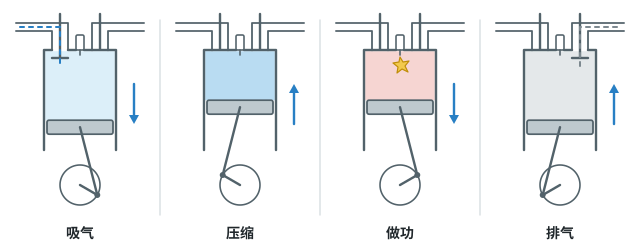
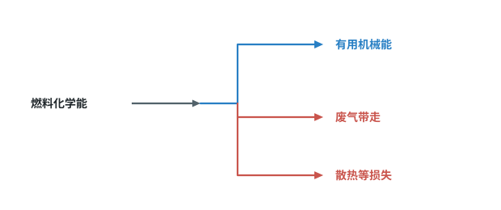

# 第十四章 内能的利用

上一章学了内能、热量和比热容。这一章看内能怎么被“用起来”：燃料烧掉放出热，热机再把内能变成推动汽车的机械能。烧掉的燃料里，真正被用上的只有一部分，这就是效率。

标着**重点**的两个知识点（热值、效率）常在计算题里出现，要花最多时间；标着**一般**的，会判断就行。

## 本章前置自查

下面三件事，哪一件没把握，先回看：

1. 用 $Q_{\text{吸}}=cm\Delta t$ 算水吸收的热量；用 $m=\rho V$ 由体积求质量。（第十三章第 1 节；八上 第六章第 4 节）
2. 说出做功、热传递怎样改变物体的内能。（第十三章第 3 节）
3. 说出动能、势能怎样相互转化。（八下 第十一章第 4 节）

---

## 14.1a 能量的转化和守恒

```yaml
id: PHY-9-14-1a
weight: 一般
weight_note: 6 次，但都是“什么能转化为什么能”的一步判断
textbook: 九全 14.1 能量的转化与守恒，p.20–22
prerequisites:
  - id: PHY-9-13-3b
    strength: soft
    reason: 做功改变内能就是能量转化
  - id: PHY-8B-11-4a
    strength: soft
    reason: 机械能转化是最早学的例子
evidence:
  - 能说出一个过程里能量从什么形式转化为什么形式，如太阳能电池把太阳能转化为电能
  - 能用能量守恒定律说明永动机不可能造成
figure: 不需要
sources: [TB9-14.1, GD2022-09]
```

### 本次只学

说出一个过程里能量怎样转化，知道能量的总量不变。

### 先认住

- 在一定条件下，各种形式的能量可以相互转化：摩擦生热，机械能转化为内能；发电机发电，机械能转化为电能；燃料燃烧，化学能转化为内能。
- **能量守恒定律**：能量既不会凭空消灭，也不会凭空产生，它只会从一种形式转化为其他形式，或者从一个物体转移到其他物体，而在转化和转移的过程中，能量的总量保持不变。
- 所以永动机不可能造成：机器只能把能量从一种形式转化为其他形式，不能无中生有地制造能量。

### 容易错

- 燃油汽车里，燃料的化学能只有一部分转化为机械能，其余转化为发动机和周围环境的内能，能量的总量并没有减少。
- 能量的转化有方向：汽车尾气带走的内能，不会自动变回燃料的化学能。

### 练一练

- `Q-PHY-GZ2023-03`

---

## 14.2a 汽油机的四个冲程

```yaml
id: PHY-9-14-2a
weight: 一般
weight_note: 3 次，判断冲程及其能量转化
textbook: 九全 14.2 热机，p.25–29
prerequisites:
  - id: PHY-9-13-3b
    strength: hard
    reason: 压缩、做功冲程靠做功改变内能
  - id: PHY-9-14-1a
    strength: hard
    reason: 要说出能量怎样转化
evidence:
  - 能根据气门开闭和活塞运动方向，判断是哪个冲程
  - 能说出压缩冲程、做功冲程各发生怎样的能量转化
figure: 已完成 figures/four-strokes.svg（四格：气门开闭、活塞方向、做功时的火花）
sources: [TB9-14.2]
```

### 本次只学

看气门和活塞，判断汽油机处在哪个冲程，说出能量怎样转化。

### 先认住

四冲程汽油机一个工作循环有四个冲程：

| 冲程 | 进气门 | 排气门 | 活塞 | 发生了什么 |
| --- | --- | --- | --- | --- |
| 吸气 | 开 | 关 | 向下 | 汽油和空气的混合物进入气缸 |
| 压缩 | 关 | 关 | 向上 | 混合物被压缩，**机械能转化为内能** |
| 做功 | 关 | 关 | 向下 | 火花塞点火，燃料猛烈燃烧产生高温高压气体，推动活塞，**内能转化为机械能** |
| 排气 | 关 | 开 | 向上 | 废气被排出气缸 |



### 容易错

- 两个气门都关的有两个冲程：活塞向上是压缩，活塞向下是做功。
- 使汽车获得动力的只有做功冲程。

### 练一练

- `Q-PHY-GD2023-05`

---

## 14.3a 燃料的热值与 Q=mq

```yaml
id: PHY-9-14-3a
weight: 重点
weight_note: 4 次，常与比热容计算组合
textbook: 九全 14.3 热机的效率，p.30–31
prerequisites:
  - id: PHY-9-13-1c
    strength: soft
    reason: 常与 Q吸=cmΔt 连用
evidence:
  - 能说出热值的含义和单位
  - 能用 $Q_{\text{放}}=mq$ 或 $Q_{\text{放}}=qV$ 算燃料完全燃烧放出的热量
  - 能说出热值只与燃料种类有关，燃料用掉一部分，剩下的热值不变
figure: 不需要
sources: [TB9-14.3, GD2022-08]
```

### 本次只学

用热值比较燃料放热的本领，算出燃料完全燃烧放出的热量。

### 先认住

- **热值** $q$：某种燃料完全燃烧放出的热量与其质量之比。单位是 $\mathrm{J/kg}$；气体燃料常用 $\mathrm{J/m^3}$。
- 燃料完全燃烧放出的热量：$Q_{\text{放}}=mq$（气体：$Q_{\text{放}}=qV$）。
- 课本表中的几个热值：干木柴约 $1.2\times10^{7}\ \mathrm{J/kg}$，无烟煤约 $3.4\times10^{7}\ \mathrm{J/kg}$，汽油 $4.6\times10^{7}\ \mathrm{J/kg}$，氢气 $1.4\times10^{8}\ \mathrm{J/kg}$。

### 走一遍

课本例子：给汽车加 30 kg 汽油，完全燃烧放出多少热量？

1. 查表：汽油的热值 $q=4.6\times10^{7}\ \mathrm{J/kg}$。
2. $Q_{\text{放}}=mq=\textcolor{#287fc4}{30}\ \cancel{\mathrm{kg}}\times\textcolor{#287fc4}{4.6\times10^{7}}\ \mathrm{J}/\cancel{\mathrm{kg}}=\boxed{1.38\times10^{9}\ \mathrm{J}}$
3. 这是“完全燃烧”时的数值。燃料很难完全燃烧，实际放出的热量往往更少。

### 容易错

- 热值大，放出的热量不一定多：放热多少还要看燃料的质量，以及是否完全燃烧。
- 热值是燃料的一种特性，只与燃料种类有关。煤气用掉一部分，剩下煤气的热值不变。

### 练一练

- `Q-PHY-GZ2024-14-3`
- `Q-PHY-TB9-14.3-1`

---

## 14.3b 热机效率与能量利用效率

```yaml
id: PHY-9-14-3b
weight: 重点
weight_note: 6 次，含电热器、燃气灶的加热效率
textbook: 九全 14.3 热机的效率，p.31–33
prerequisites:
  - id: PHY-9-14-3a
    strength: hard
    reason: 燃料放热 Q放=mq
  - id: PHY-9-13-1c
    strength: hard
    reason: 有用的热量 Q吸=cmΔt
  - id: PHY-9-14-1a
    strength: soft
    reason: 效率反映能量有多少被利用
evidence:
  - 能说出效率是“有效利用的能量 ÷ 总共提供的能量”，并分清热机和烧水两种情况各自的分子、分母
  - 能用效率公式求效率，或由效率反求燃料用量
figure: 已完成 figures/heat-engine-energy-flow.svg（燃料化学能分流：有用机械能、废气带走、散热等损失；不表示比例）
sources: [TB9-14.3, GZ2025-16]
```

### 本次只学

算出效率：提供的能量里，有多少真正被用上了。

### 先认住

- **热机的效率**：用来做有用功的那部分能量，与燃料完全燃烧放出的热量之比，$\eta=\dfrac{W_{\text{有用}}}{Q_{\text{放}}}\times100\%$。
- 课本数据：蒸汽机 6%~15%，汽油机 20%~40%，柴油机 30%~45%。热机的能量损失中，废气带走的能量最多。
- **烧水、加热的效率**：$\eta=\dfrac{Q_{\text{吸}}}{\text{总共提供的能量}}\times100\%$。用燃气烧水，分母是燃气完全燃烧放出的热量 $Q_{\text{放}}$；用电加热，分母是消耗的电能 $W_{\text{电}}$。



### 走一遍

课本复习与提高第 7 题：“鲲龙”飞机有四台相同的发动机，每台输出功率 3 120 kW，效率 60%。飞行 1 h 消耗燃油多少吨？燃油的热值为 $4.3\times10^{7}\ \mathrm{J/kg}$。

1. 有用功：$W=Pt=\textcolor{#287fc4}{4}\times\textcolor{#287fc4}{3.12\times10^{6}}\ \mathrm{W}\times\textcolor{#287fc4}{3600}\ \mathrm{s}\approx4.49\times10^{10}\ \mathrm{J}$
2. 由 $\eta=\dfrac{W}{Q_{\text{放}}}$，燃油放出的热量：$Q_{\text{放}}=\dfrac{W}{\eta}=\dfrac{\textcolor{#287fc4}{4.49\times10^{10}}\ \mathrm{J}}{\textcolor{#287fc4}{60\%}}\approx7.49\times10^{10}\ \mathrm{J}$
3. 由 $Q_{\text{放}}=mq$：$m=\dfrac{Q_{\text{放}}}{q}=\dfrac{\textcolor{#287fc4}{7.49\times10^{10}}\ \cancel{\mathrm{J}}}{\textcolor{#287fc4}{4.3\times10^{7}}\ \cancel{\mathrm{J}}/\mathrm{kg}}\approx1.74\times10^{3}\ \mathrm{kg}=\boxed{1.74\ \mathrm{t}}$

### 容易错

- 先分清分子、分母：分子是“有用的”（有用功、水吸收的热量），分母是“总共提供的”（燃料完全燃烧放出的热量、消耗的电能）。
- 效率总小于 100%，算出大于 100% 一定是分子、分母放反了。
- 由效率反求总能量时要除以效率：$Q_{\text{放}}=\dfrac{Q_{\text{吸}}}{\eta}$，不是乘。

### 练一练

- `Q-PHY-GZ2025-16-3b`
- `Q-PHY-TB9-14R-8`
