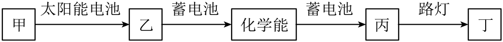
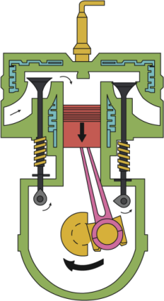

# 第十四章 内能的利用 · 题目

讲义只用 `lesson.md` 里引用的题，按知识点顺序排在前面。真题按“精品解析”原卷录入，公式图片已读出文字并逐个重算核对；课本习题原文已对照课本 PDF 原页，答案和解析为本项目编写，**发布前需要复核**。

---

## 讲义用题（6 道）

### Q-PHY-GZ2023-03

```yaml
category: 真题
source: 2023 年广州市初中学业水平考试 物理 第 3 题
source_quality: 原卷（精品解析整理版）
kp: PHY-9-14-1a
type: 选择
grading: 自动
answer_by: 原卷解析
review:
  概念: PHY-9-14-1a
```

**题干**

某路灯照明系统的太阳能电池白天将太阳能转化为电能，对蓄电池充电，晚上蓄电池对路灯供电，对下图方框中能量形式判断正确的是（　　）



A. 甲是“电能”
B. 乙是“太阳能”
C. 丙是“电能”
D. 丁是“机械能”

**答案**

C

**解析**

1. 白天：太阳能电池把太阳能转化为电能，所以甲是太阳能，乙是电能；蓄电池充电时把电能转化为化学能储存起来。
2. 晚上：蓄电池放电，把化学能转化为电能，所以丙是电能。
3. 路灯工作时把电能转化为光能，所以丁是光能。只有 C 正确。

---

### Q-PHY-GD2023-05

```yaml
category: 真题
source: 2023 年广东省初中学业水平考试 物理 第 5 题
source_quality: 原卷（精品解析整理版）
kp: PHY-9-14-2a
type: 选择
grading: 自动
answer_by: 原卷解析
review:
  概念: PHY-9-14-2a
```

**题干**

如图为四冲程汽油机工作过程中的某冲程示意图，该冲程为（　　）



A. 吸气冲程
B. 压缩冲程
C. 做功冲程
D. 排气冲程

**答案**

A

**解析**

1. 看气门：进气门打开，排气门关闭。
2. 看活塞：由上向下运动，汽油和空气的混合物从进气门吸入气缸。
3. 所以是吸气冲程。

---

### Q-PHY-GZ2024-14-3

```yaml
category: 真题
source: 2024 年广州市初中学业水平考试 物理 第 14 题第（3）问
source_quality: 原卷（精品解析整理版）
kp: PHY-9-14-3a
do: 本章只做第（3）问
type: 填空
grading: 自评
answer_by: 原卷解析（数值为公式图片，已读出并重算核对）
review:
  公式: PHY-9-14-3a
  单位: PHY-8A-06-4a
  计算: PHY-9-13-1c
other_parts: （1）闻到臭味 → PHY-9-13-2a；（2）天然气不外泄 → PHY-8B-09-5a。这些小问不在本章使用
```

**题干**

用燃气灶烧水。

（3）壶中装有密度为 $1.0\times10^{3}\ \mathrm{kg/m^3}$、质量为 2 kg 的水，则壶中水的体积为______$\mathrm{m^3}$。根据 $Q=qV$，若天然气的热值 $q=4.2\times10^{7}\ \mathrm{J/m^3}$，完全燃烧 $V=1.0\times10^{-2}\ \mathrm{m^3}$ 的天然气放出热量为______J，其中 $1.68\times10^{5}$ J 的热量被水吸收，已知水未沸腾，比热容为 $4.2\times10^{3}\ \mathrm{J/(kg\cdot{}^\circ C)}$，则水的温度升高了______℃。

**答案**

$2\times10^{-3}$；$4.2\times10^{5}$；20

**解析**

1. 水的体积：$V_{\text{水}}=\dfrac{m}{\rho}=\dfrac{\textcolor{#287fc4}{2}\ \cancel{\mathrm{kg}}}{\textcolor{#287fc4}{1.0\times10^{3}}\ \cancel{\mathrm{kg}}/\mathrm{m^3}}=\boxed{2\times10^{-3}\ \mathrm{m^3}}$
2. 天然气放出的热量：$Q_{\text{放}}=qV=\textcolor{#287fc4}{4.2\times10^{7}}\ \mathrm{J}/\cancel{\mathrm{m^3}}\times\textcolor{#287fc4}{1.0\times10^{-2}}\ \cancel{\mathrm{m^3}}=\boxed{4.2\times10^{5}\ \mathrm{J}}$
3. 水升高的温度：$\Delta t=\dfrac{Q_{\text{吸}}}{cm}=\dfrac{\textcolor{#287fc4}{1.68\times10^{5}}\ \cancel{\mathrm{J}}}{\textcolor{#287fc4}{4.2\times10^{3}}\ \cancel{\mathrm{J}}/(\cancel{\mathrm{kg}}\cdot{}^\circ\mathrm{C})\times\textcolor{#287fc4}{2}\ \cancel{\mathrm{kg}}}=\boxed{20\ ^\circ\mathrm{C}}$

---

### Q-PHY-TB9-14.3-1

```yaml
category: 课本习题
source: 九全 14.3 练习与应用 第 1 题，p.34
source_quality: 课本原文
kp: PHY-9-14-3a
type: 简答
grading: 自评
answer_by: 本项目编写，已复核
review:
  概念: PHY-9-14-3a
```

**题干**

有人认为，无烟煤的热值比干木柴大，完全燃烧时无烟煤放出的热量比干木柴多。你认为呢？说说理由。

**答案**

不对。燃料完全燃烧放出的热量 $Q_{\text{放}}=mq$，不只与热值有关，还与燃料的质量有关。只有质量相等时，无烟煤完全燃烧放出的热量才比干木柴多。

**解析**

1. 由 $Q_{\text{放}}=mq$，放热多少由热值和质量共同决定。
2. 举例：0.2 kg 无烟煤完全燃烧放热 $\textcolor{#287fc4}{0.2}\ \cancel{\mathrm{kg}}\times\textcolor{#287fc4}{3.4\times10^{7}}\ \mathrm{J}/\cancel{\mathrm{kg}}=6.8\times10^{6}\ \mathrm{J}$；1 kg 干木柴完全燃烧放热 $\textcolor{#287fc4}{1}\ \cancel{\mathrm{kg}}\times\textcolor{#287fc4}{1.2\times10^{7}}\ \mathrm{J}/\cancel{\mathrm{kg}}=1.2\times10^{7}\ \mathrm{J}$，反而比无烟煤多。
3. 所以必须说明“质量相等”，才能由热值大小比较放热多少。

---

### Q-PHY-GZ2025-16-3b

```yaml
category: 真题
source: 2025 年广州市初中学业水平考试 物理 第 16 题第（3）问②
source_quality: 原卷
kp: PHY-9-14-3b
do: 本章只做第（3）问②
type: 计算
grading: 自评
answer_by: 原卷解析（数值为公式图片，已读出并重算核对）
review:
  公式: PHY-9-14-3b
  审题: PHY-9-13-1c
other_parts: （1）汽化 → PHY-8A-03-4b；（2）电功率 → PHY-9-18-2a；（3）①水吸收的热量 → 第十三章 Q-PHY-GZ2025-16-3a。这些小问不在本章使用
```

**题干**

图 a 所示的电热加湿器，其内部结构及电路简图如图 b。通电后，发热电阻 R 使加热仓中的水沸腾变成水蒸气喷出，增加环境湿度。已知水的比热容为 $4.2\times10^{3}\ \mathrm{J/(kg\cdot{}^\circ C)}$、密度为 $1.0\times10^{3}\ \mathrm{kg/m^3}$，沸点为 100 ℃。

（3）若消耗电能 $1.2\times10^{4}$ J，可使加热仓内 $3.0\times10^{-5}\ \mathrm{m^3}$ 的水从 20 ℃ 加热至沸腾，求：② 电热加湿器的加热效率。（第①问已求出：加热仓内水吸收的热量为 $1.008\times10^{4}$ J）


**答案**

84%

**解析**

1. 有用的能量是水吸收的热量 $Q_{\text{吸}}=1.008\times10^{4}\ \mathrm{J}$；总共提供的能量是消耗的电能 $W=1.2\times10^{4}\ \mathrm{J}$。
2. $\eta=\dfrac{Q_{\text{吸}}}{W}\times100\%=\dfrac{\textcolor{#287fc4}{1.008\times10^{4}}\ \cancel{\mathrm{J}}}{\textcolor{#287fc4}{1.2\times10^{4}}\ \cancel{\mathrm{J}}}\times100\%=\boxed{84\%}$

---

### Q-PHY-TB9-14R-8

```yaml
category: 课本习题
source: 九全 第十四章 复习与提高 第 8 题，p.38
source_quality: 课本原文
kp: PHY-9-14-3b
type: 计算
grading: 自评
answer_by: 本项目编写，已复核
review:
  公式: PHY-9-14-3b
  单位: PHY-8A-06-4a
  计算: PHY-9-13-1c
```

**题干**

某同学家自来水的温度为 15 ℃，他洗澡时把燃气热水器的温度设定为 40 ℃，已知他洗澡用了 $0.02\ \mathrm{m^3}$ 的热水。如果燃气热水器的效率是 95%，他这次洗澡消耗了多少天然气？天然气的热值取 $4.0\times10^{7}\ \mathrm{J/m^3}$。

**答案**

约 $5.5\times10^{-2}\ \mathrm{m^3}$（0.055 m³）

**解析**

1. 热水的质量：$m=\rho V=\textcolor{#287fc4}{1.0\times10^{3}}\ \mathrm{kg}/\cancel{\mathrm{m^3}}\times\textcolor{#287fc4}{0.02}\ \cancel{\mathrm{m^3}}=20\ \mathrm{kg}$
2. 水吸收的热量：$Q_{\text{吸}}=cm\Delta t=\textcolor{#287fc4}{4.2\times10^{3}}\ \mathrm{J}/(\cancel{\mathrm{kg}}\cdot\cancel{^\circ\mathrm{C}})\times\textcolor{#287fc4}{20}\ \cancel{\mathrm{kg}}\times(\textcolor{#287fc4}{40}-\textcolor{#287fc4}{15})\ \cancel{^\circ\mathrm{C}}=2.1\times10^{6}\ \mathrm{J}$
3. 天然气完全燃烧放出的热量：$Q_{\text{放}}=\dfrac{Q_{\text{吸}}}{\eta}=\dfrac{\textcolor{#287fc4}{2.1\times10^{6}}\ \mathrm{J}}{\textcolor{#287fc4}{95\%}}\approx2.21\times10^{6}\ \mathrm{J}$
4. 消耗天然气的体积：$V_{\text{气}}=\dfrac{Q_{\text{放}}}{q}=\dfrac{\textcolor{#287fc4}{2.21\times10^{6}}\ \cancel{\mathrm{J}}}{\textcolor{#287fc4}{4.0\times10^{7}}\ \cancel{\mathrm{J}}/\mathrm{m^3}}\approx\boxed{5.5\times10^{-2}\ \mathrm{m^3}}$

---

## 备选（不进入讲义，不再维护）

暂未收录。
