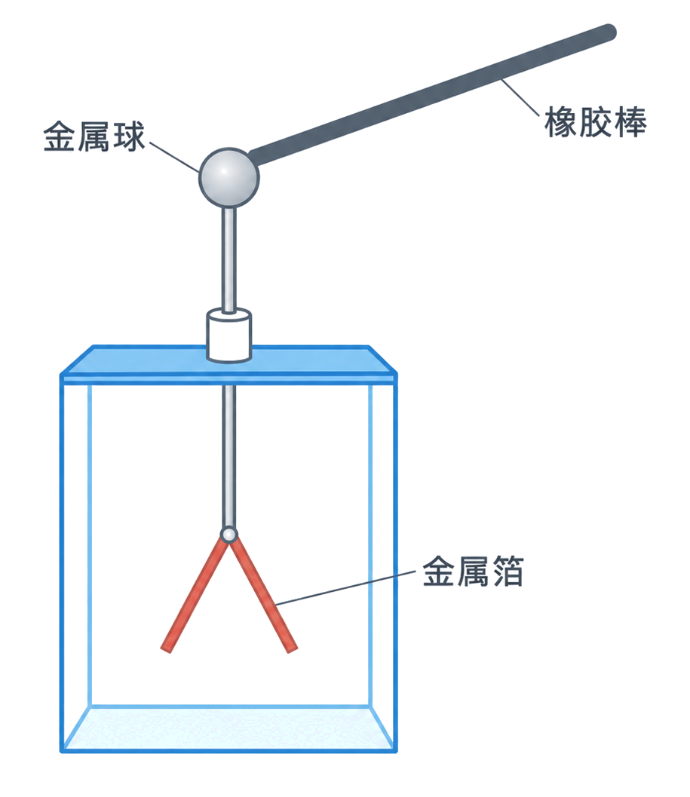
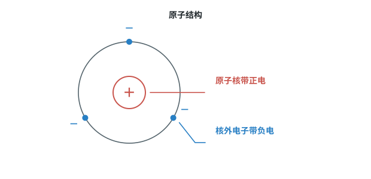
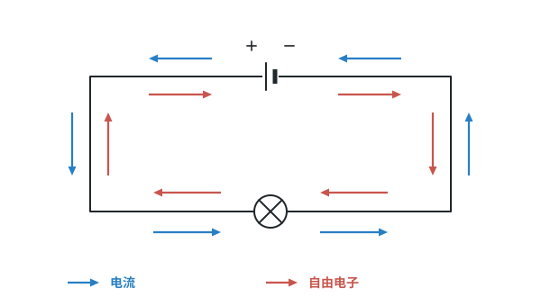
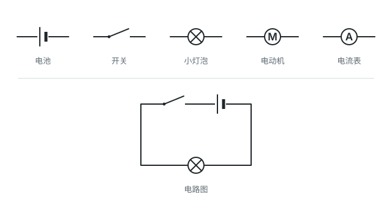
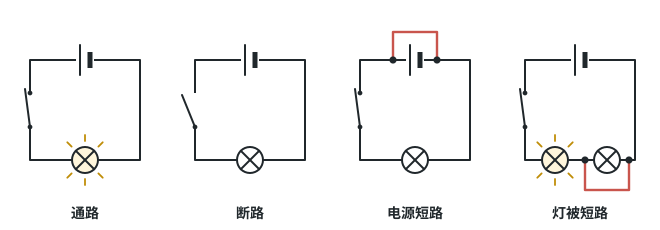
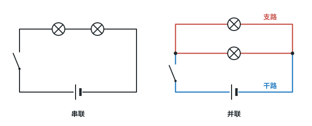
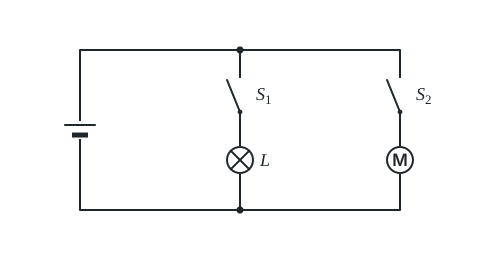
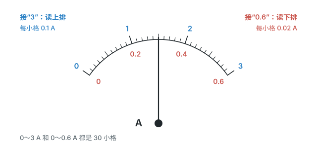
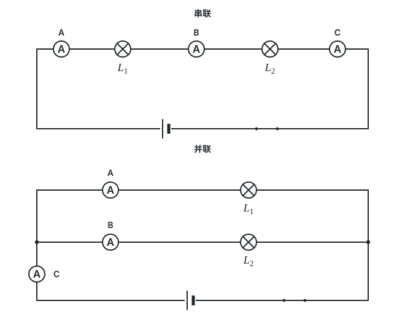

# 第十五章 电流和电路

这一章先弄清物体怎么带电、电流怎么形成，再学用电源、用电器、开关和导线组成电路，分清串联和并联，会用电流表测电流，并掌握串、并联电路的电流规律。

标着**重点**的三个知识点（原子结构和摩擦起电、按要求设计电路、电流表的使用和读数）中考常考，要花最多时间；标着**一般**的，会判断、会读就行。

## 本章前置自查

下面两件事，哪一件没把握，先回看：

1. 说出原子由原子核和电子构成。（九年级化学上册 第三单元）
2. 用有刻度的仪器读数：先看量程，再看分度值，再数格。（八上 第一章第 1 节 长度和时间的测量）

---

## 15.1a 两种电荷及其相互作用

```yaml
id: PHY-9-15-1a
weight: 一般
weight_note: 4 次
textbook: 九全 15.1 两种电荷，p.40–41
prerequisites: []
evidence:
  - 能说出两种电荷是怎样规定的，以及同种、异种电荷之间的相互作用
  - 能说出验电器的两片金属箔为什么张开
figure: 已完成 figures/electroscope-rod-contact.png（橡胶棒接触金属球与金属箔张开的装置；gpt-image-2 生成，已人工核对）
sources: [TB9-15.1, GD2022-19]
```

### 本次只学

知道自然界有两种电荷，说出它们怎样相互作用，会解释验电器。

### 先认住

- 自然界只有两种电荷：把用丝绸摩擦过的玻璃棒带的电荷叫作**正电荷**，把用毛皮摩擦过的橡胶棒带的电荷叫作**负电荷**。
- 同种电荷互相排斥，异种电荷互相吸引。
- **验电器**用来检验物体是否带电：用带电体接触验电器的金属球，就有一部分电荷转移到两片金属箔上，这两片金属箔带同种电荷，由于互相排斥而张开。



### 容易错

- 金属箔张开，只能说明物体带了电，看不出带的是正电还是负电。
- 带电体能吸引轻小物体，所以“被吸引”不能说明那个物体带电，可能它不带电；只有“互相排斥”才能肯定两个物体带同种电荷。

### 练一练

- `Q-PHY-GD2022-19`

---

## 15.1b 原子结构和摩擦起电的实质

```yaml
id: PHY-9-15-1b
weight: 重点
weight_note: 7 次，广州 2023–2025 每年都考；“创造电荷”“正电荷转移”是常见错误
textbook: 九全 15.1 两种电荷，p.41–42
prerequisites:
  - id: PHY-9-15-1a
    strength: hard
    reason: 带电后才谈得上相互作用
  - id: CHEM-9A-U3
    strength: soft
    reason: 化学课里学过原子由原子核和电子构成
evidence:
  - 能说出原子的结构，以及通常情况下物体对外不显电性的原因
  - 能说出摩擦起电时是什么在转移，哪个物体带正电、哪个物体带负电
  - 能指出“摩擦创造了电荷”“正电荷发生转移”这类说法错在哪里
figure: 已完成 figures/atom-structure.svg（通用原子结构，标出原子核与核外电子的电性，不对应具体元素或电子数量）
sources: [TB9-15.1, GZ2023-02, GZ2025-02]
```

### 本次只学

说出原子的结构，用“电子转移”解释摩擦起电。

### 先认住

- 原子的中心是原子核，核外有一定数目的电子在原子核外运动。原子核带正电；**电子**是带有最小负电荷的粒子，所带电荷量为 $1.6\times10^{-19}\ \mathrm{C}$。
- 通常情况下，原子核所带的正电荷与核外所有电子所带的负电荷在数量上相等，原子整体不显电性，物体对外也不显电性。例如氢原子核带 1 个正电荷，核外有 1 个电子；氦原子核带 2 个正电荷，核外有 2 个电子。
- 两个物体摩擦时，哪个物体的原子核束缚电子的本领弱，它的一些电子就会转移到另一个物体上。失去电子的物体因为缺少电子而带正电，得到电子的物体因为有了多余的电子而带等量的负电。
- 摩擦起电并不是创造了电荷，只是电荷从一个物体转移到另一个物体，使正、负电荷分开。



### 走一遍

课本演示：用毛皮摩擦橡胶棒。

1. 摩擦后，橡胶棒带负电（课本规定：用毛皮摩擦过的橡胶棒带的电荷叫作负电荷）。
2. 带负电，是因为橡胶棒有了多余的电子。所以摩擦时，电子从毛皮转移到橡胶棒。
3. 毛皮因为失去电子、缺少电子而带正电，所带电荷量与橡胶棒的相等。

### 容易错

- 转移的只是电子，不是正电荷。物体带正电是因为缺少电子，不是因为得到了正电荷。
- 氦原子核外有 2 个电子，不是 4 个：图中“+2”表示原子核带 2 个正电荷，核外电子数要和它相等，原子整体不带电。

### 练一练

- `Q-PHY-GZ2023-02`
- `Q-PHY-GZ2025-02`

---

## 15.2a 电流的形成和方向

```yaml
id: PHY-9-15-2a
weight: 一般
weight_note: 2 次（负电荷移动方向与电流方向相反）
textbook: 九全 15.2 电流和电路，p.44–46
prerequisites:
  - id: PHY-9-15-1b
    strength: hard
    reason: 电流是电荷的定向移动
evidence:
  - 能说出电流是怎样形成的，电流的方向是怎样规定的
  - 能判断金属中自由电子的移动方向与电流方向的关系
figure: 已完成 figures/current-electron-directions.svg（闭合小灯泡电路；蓝色表示电流方向，珊瑚红表示自由电子移动方向）
sources: [TB9-15.2, GZ2024-07]
```

### 本次只学

知道电流怎样形成，判断电流的方向。

### 先认住

- 电荷的定向移动形成电流。
- 把正电荷定向移动的方向规定为电流的方向。按这个规定，在电池外部，电流的方向是从电池正极经过小灯泡流向负极。
- 金属导电靠的是自由电子，电子带负电，所以金属导线中电流的方向与自由电子定向移动的方向相反。



### 容易错

- 看到“电荷从甲移动到乙”，先问是正电荷还是负电荷：负电荷移动的方向，与电流的方向相反。
- 电流的方向是规定出来的，不是电子实际移动的方向；在电池外部，电子是从负极流向正极的。

### 练一练

- `Q-PHY-GZ2024-07`

---

## 15.2b 导体和绝缘体

```yaml
id: PHY-9-15-2b
weight: 一般
weight_note: 1 次
textbook: 九全 15.2 电流和电路，p.46
prerequisites:
  - id: PHY-9-15-1b
    strength: soft
    reason: 导体内有能自由移动的电荷
evidence:
  - 能各举出几个常见的导体和绝缘体
  - 能说出金属为什么能导电
figure: 不需要
sources: [TB9-15.2]
```

### 本次只学

区分导体和绝缘体，知道金属为什么能导电。

### 先认住

- **导体**：容易导电的物体，如金属、人体、大地、石墨、食盐水溶液等。
- **绝缘体**：不容易导电的物体，如橡胶、玻璃、塑料等。
- 在金属中，部分电子可以脱离原子核的束缚而自由移动，这种电子叫作自由电子。金属之所以能导电，靠的就是自由电子。接上电池之后，自由电子做定向移动。

### 容易错

- 绝缘体不容易导电，但摩擦后照样能带电：橡胶棒、玻璃棒都是绝缘体。

### 练一练

- `Q-PHY-HN2023-7`

---

## 15.2c 电路的组成和电路图

```yaml
id: PHY-9-15-2c
weight: 一般
weight_note: 2 次（实物图与电路图互画、蓄电池充电时是用电器）
textbook: 九全 15.2 电流和电路，p.46–47
prerequisites:
  - id: PHY-9-15-2a
    strength: hard
    reason: 电路是电流的路径
evidence:
  - 能说出电路由哪几部分组成，各部分的作用
  - 能判断一个元件在电路中是电源还是用电器
figure: 已完成 figures/circuit-symbols.svg（常用元件符号一排 + 一个简单电路图（实物图不画））
sources: [TB9-15.2, SZ2024-18]
```

### 本次只学

说出电路的组成，认识电路图里的元件符号。

### 先认住

- **电源**：电池这类提供电能的装置，发电机也是电源。**用电器**：灯泡、电动机、蜂鸣器等消耗电能的装置。
- 电源、用电器，再加上导线，往往还有开关，组成了电流可以流过的路径，叫作**电路**。
- 用符号表示电路连接的图，叫作**电路图**。元件符号以课本图 15.2-6 为准。



### 容易错

- 判断是电源还是用电器，看它是提供电能还是消耗电能：蓄电池给别的设备供电时是电源，被充电时消耗电能，是用电器。

### 练一练

- `Q-PHY-SZ2024-18-2a`

---

## 15.2d 通路、断路和短路

```yaml
id: PHY-9-15-2d
weight: 一般
weight_note: 未单独考；是电路设计、故障判断的基础
textbook: 九全 15.2 电流和电路，p.46、p.48
prerequisites:
  - id: PHY-9-15-2c
    strength: hard
    reason: 要会看电路图
evidence:
  - 能说出通路、断路、短路各是什么情况，哪种情况下电路中有电流
  - 能说出电源被短路的危险，以及用电器被短路时会怎样
figure: 已完成 figures/open-short-circuits.svg（四个小电路图：通路、断路、电源短路、灯被短路）
sources: [TB9-15.2]
```

### 本次只学

区分通路、断路、短路，知道短路的危害。

### 先认住

- **通路**：正常接通的电路，即用电器能够工作的电路。只有电路闭合时，电路中才有电流。
- **断路**：电路中如果某处被切断，电路中就不会有电流通过。
- **短路**：直接用导线将电源的正、负极连接起来，电源被短路，电路中会有很大的电流，可能把电源烧坏，这是不允许的！



### 容易错

- 用电器被短路：电路是接通的，但这个用电器两端被导线直接连通，电流通过这根导线绕过了它，它不能工作。如图 15.2-8，把导线接在一个小灯泡两端，这个灯熄灭，另一个灯还发光。
- 断路是电流的路径被切断，这条路径上没有电流；短路是电流走了“近路”，被短路的那部分没有电流，而电源被短路时电流会很大。

---

## 15.3a 识别串联和并联

```yaml
id: PHY-9-15-3a
weight: 一般
weight_note: 未单独考；所有电路题第一步都要判断连接方式
textbook: 九全 15.3 串联电路和并联电路，p.50–52
prerequisites:
  - id: PHY-9-15-2c
    strength: hard
    reason: 要会看电路图
  - id: PHY-9-15-2d
    strength: hard
    reason: 并联支路互不影响要靠通、断判断
evidence:
  - 能根据电路图判断用电器是串联还是并联，并指出并联电路的干路和支路
  - 能说出串联、并联电路中开关的控制作用有什么不同
figure: 已完成 figures/series-parallel.svg（串联、并联电路图并排，并联图标出干路和支路）
sources: [TB9-15.3, TB9-15R]
```

### 本次只学

判断电路里的用电器是串联还是并联。

### 先认住

- **串联**：将两个小灯泡依次相连，然后接到电路中。**并联**：将两个小灯泡的两端分别连在一起，然后接到电路中。并联电路中两个用电器共用的那部分电路叫**干路**，单独使用的那部分电路叫**支路**。
- 在串联电路中，开关可以控制所有用电器；在并联电路中，干路开关可以控制所有用电器，支路开关只能控制其所在支路的用电器。
- 串联时，一处断开，整个电路都不工作；并联时，各支路互不影响，一条支路断开，其他支路照常工作。



### 容易错

- 两个灯同时亮、同时灭，不能说明是串联：并联电路里的干路开关同样能同时控制两个灯。

### 练一练

- `Q-PHY-TB9-15R-3`
- `Q-PHY-TJ2024-9`

---

## 15.3b 按要求设计电路

```yaml
id: PHY-9-15-3b
weight: 重点
weight_note: 2 次（广州 2022、2025），开关位置、短路是常见陷阱
textbook: 九全 15.3 串联电路和并联电路，p.51–54；复习与提高 p.64
prerequisites:
  - id: PHY-9-15-3a
    strength: hard
    reason: 先能识别串、并联
  - id: PHY-9-15-2d
    strength: hard
    reason: 不能设计出短路
evidence:
  - 能按“互不影响”“同时才工作”“各管各的”等要求，决定用电器、开关怎样连接
  - 能检查设计好的电路在开关闭合、断开时会不会出现短路
figure: 已完成 figures/lamp-motor-circuit.svg（走一遍的电路图：L 与 S1、M 与 S2 各成一条支路，并联接电源）
sources: [TB9-15.3, TB9-15R, GZ2025-06]
```

### 本次只学

根据要求，决定用电器和开关怎样连接，画出不短路的电路。

### 先认住

- 先定用电器的连接：要求互不影响，用并联；要求一起工作、一处断开全部停，用串联。
- 开关与它要控制的用电器串联：只控制某一个用电器的开关，放在这个用电器所在的支路上；要控制全部用电器的开关，放在干路上。
- 要求“几个条件同时满足才工作”，开关串联；要求“满足任何一个条件就工作”，开关并联。
- 画完要检查：开关闭合、断开各是什么状态，电源两端或某个用电器两端有没有被导线直接连通（短路）。

### 走一遍

课本复习与提高第 5 题：某款吸尘器上有两个开关，其中一个只控制照明用的灯泡，另一个只控制吸尘用的电动机。请画出符合上述设计要求的电路图。

1. 灯泡和电动机各由自己的开关控制，互不影响，所以用并联。
2. 控制灯泡的开关 $S_1$ 与灯泡串联，放在灯泡所在的支路上；控制电动机的开关 $S_2$ 与电动机串联，放在电动机所在的支路上。
3. 两条支路并联，再接到电源两端。
4. 检查：只闭合 $S_1$，只有灯亮；只闭合 $S_2$，只有电动机转；两个都闭合，灯亮、电动机转；任何状态下电源两端都没有被导线直接连通，没有短路。



### 容易错

- 并联的用电器，不能再用一根没有用电器的导线（或闭合后的开关）把电源两端直接连通，否则电源被短路。
- 开关能接“1”或“2”时，要分别检查接“1”、接“2”时各是哪些灯亮、哪些灯不亮，不能只看一边。

### 练一练

- `Q-PHY-GZ2025-06`
- `Q-PHY-TB9-15R-4`

---

## 15.4a 电流表的使用和读数

```yaml
id: PHY-9-15-4a
weight: 重点
weight_note: 3 次读数，且是 2026 广州实验操作考试内容
lab_exam: 试题一至四都要连接电流表或电压表，先试触
textbook: 九全 15.4 电流的测量，p.55–57
prerequisites:
  - id: PHY-9-15-3a
    strength: hard
    reason: 电流表要串联在被测电路中
evidence:
  - 能把电流表正确串联进电路：正进负出、选对量程、先试触
  - 能说出两个量程各自的分度值，并读出示数
  - 能把毫安和安互相换算
figure: 已完成 figures/ammeter-dial.svg（表盘上下两排刻度，标出两个量程的分度值（不写读数））
sources: [TB9-15.4, SZ2022-16]
```

### 本次只学

把电流表正确接进电路，读出电流的大小。

### 先认住

- 电流用字母 $I$ 表示，单位是安培（A），简称安。$1\ \mathrm{mA}=10^{-3}\ \mathrm{A}$，$1\ \mu\mathrm{A}=10^{-6}\ \mathrm{A}$。
- 连接电流表有四条：第一，必须将电流表和被测的用电器串联；第二，必须让电流从红色（“＋”号）接线柱流进，再从黑色（“－”号）接线柱流出；第三，必须正确选择电流表的测量范围；第四，不允许把电流表直接连到电源的两极。
- 读数：第一，明确所选的测量范围（0～0.6 A 或 0～3 A）；第二，确定分度值，即表盘一个小格代表的电流；第三，看指针向右总共偏转了多少个小格。0～0.6 A 按表盘下排读，0～3 A 按表盘上排读。
- 在不能事先估计电流的情况下，可以先闭合开关，然后迅速断开，这叫作“试触”。看看指针偏转所到的位置是否在测量范围之内。

### 走一遍

课本实验：用电流表测量电流。

1. 先估计电流。估计不了，就用大量程试触：闭合开关后迅速断开，看指针是否超出测量范围；超出了，要改用更大的测量范围。
2. 把电流表与被测用电器串联，电流从“＋”接线柱进、“－”接线柱出。
3. 确定量程和分度值：0～3 A，表盘从 0 到最右端共有 30 个小格，每个小格代表 $\textcolor{#287fc4}{3}\ \mathrm{A}\div\textcolor{#287fc4}{30}=\boxed{0.1\ \mathrm{A}}$；0～0.6 A，同样 30 个小格，每个小格代表 $\textcolor{#287fc4}{0.6}\ \mathrm{A}\div\textcolor{#287fc4}{30}=\boxed{0.02\ \mathrm{A}}$。
4. 读数：示数 = 指针偏转的小格数 × 分度值。同一个指针位置，按 0～3 A 读是按 0～0.6 A 读的 5 倍。
5. 读取示数后要尽快断开电路，以减少电池损耗。



### 容易错

- 先看接的是哪两个接线柱，再决定读哪一排：接“0.6”读下排，接“3”读上排。读错排，结果会差 5 倍。
- 指针向左反向偏转，说明“＋”“－”接线柱接反了；指针偏转角度很小，说明量程选大了。
- 毫安和安要换算：$1\ \mathrm{mA}=10^{-3}\ \mathrm{A}$，如 $120\ \mathrm{mA}=0.12\ \mathrm{A}$。

### 练一练

- `Q-PHY-SZ2022-16-3`

---

## 15.5a 串、并联电路的电流规律

```yaml
id: PHY-9-15-5a
weight: 一般
weight_note: 2 次实验题；2026 广州实验操作考试要测并联干路和支路电流，操作要点已在 15.4a
lab_exam: 试题三：测量并联电路干路与支路的电流
textbook: 九全 15.5 串、并联电路中电流的规律，p.60–62
prerequisites:
  - id: PHY-9-15-4a
    strength: hard
    reason: 要会测电流
  - id: PHY-9-15-3a
    strength: hard
    reason: 先判断串、并联
evidence:
  - 能写出串联、并联电路中电流的规律
  - 能用规律由已知的电流求出未知的电流
figure: 已完成 figures/current-measuring-points.svg（串联三处及并联两条支路、干路的电流测量位置）
sources: [TB9-15.5, GD2023-14]
```

### 本次只学

知道串联、并联电路中电流各有什么规律，并用来求电流。

### 先认住

- 在串联电路中，电流处处相等：$I_A=I_B=I_C$。
- 在并联电路中，干路中的电流等于各支路中的电流之和：$I=I_1+I_2$。
- 探究时要换上规格不同的小灯泡，再测一次，看结论是否仍然成立。



### 破题钥匙

```think
现象: 电流从电源出来，走到并联的两条支路
模型: 干路的电流，分成两股流过两条支路
图: phy-parallel
关系: $I=I_1+I_2$
结: 串联电流处处相等；并联干路电流等于各支路电流之和
```

### 容易错

- 串联电路中电流处处相等，与灯泡的规格、亮暗无关；两个灯泡一亮一暗，通过它们的电流也相等。
- 并联时干路电流等于各支路电流之和，所以干路电流比其中任何一条支路的电流都大。

### 练一练

- `Q-PHY-GD2023-14`
