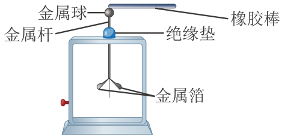
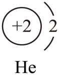
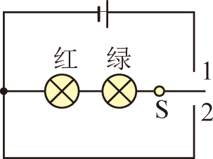
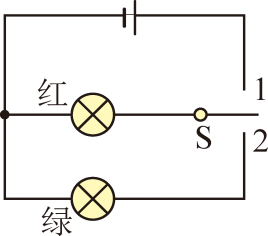
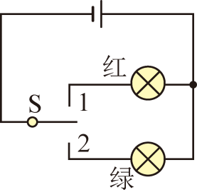
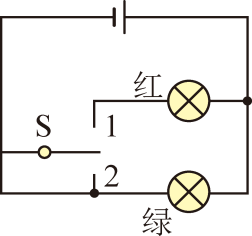
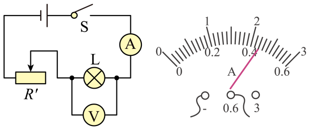
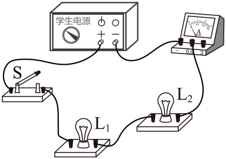
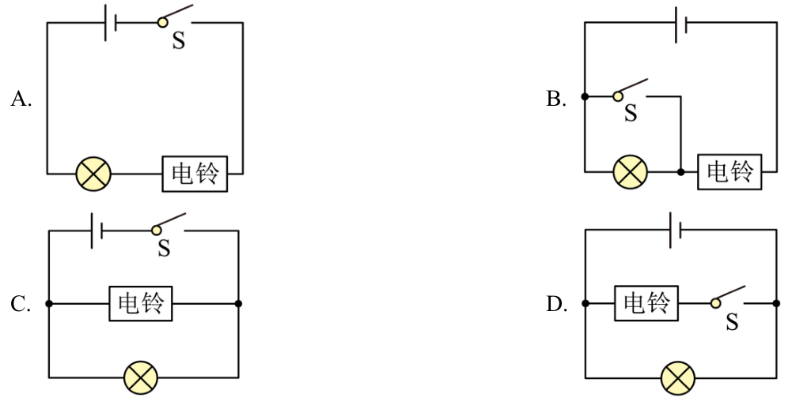

# 第十五章 电流和电路 · 题目

讲义只用 `lesson.md` 里引用的题，按知识点顺序排在前面。真题按“精品解析”原卷录入，公式图片已读出文字并核对；课本习题原文已对照课本，答案和解析为本项目编写，**发布前需要复核**。

---

## 讲义用题（10 道）

### Q-PHY-GD2022-19

```yaml
category: 真题
source: 2022 年广东省初中学业水平考试 物理 第 19 题
source_quality: 原卷（精品解析整理版）
kp: PHY-9-15-1a
type: 填空
grading: 自评
answer_by: 原卷解析
review:
  概念: PHY-9-15-1a
```

**题干**

与毛皮摩擦过的橡胶棒因得到电子而带______电。用带电的橡胶棒接触验电器的金属球，金属箔张开，如图所示。这两片金属箔带______种电荷。



**答案**

负；同

**解析**

1. 摩擦起电的实质是电子的转移。与毛皮摩擦过的橡胶棒得到电子而带负电，毛皮失去电子而带正电。
2. 用带电的橡胶棒接触金属球，两片金属箔带上同种电荷。
3. 同种电荷互相排斥，所以金属箔张开。

---

### Q-PHY-GZ2023-02

```yaml
category: 真题
source: 2023 年广州市初中学业水平考试 物理 第 2 题
source_quality: 原卷（精品解析整理版）
kp: PHY-9-15-1b
type: 选择
grading: 自动
answer_by: 原卷解析
review:
  概念: PHY-9-15-1b
  前置: PHY-9-15-1a
```

**题干**

手与硅胶管 M 均不带电，用手摩擦 M 后，M 与带负电的塑料管互相排斥，则（　　）

A. M 带正电
B. M 不带电
C. 手摩擦 M 时，正电荷从手转移到 M
D. 手摩擦 M 时，电子从手转移到 M

**答案**

D

**解析**

1. M 与带负电的塑料管互相排斥，同种电荷互相排斥，所以 M 带负电。A、B 错。
2. 得到电子的物体带负电，失去电子的物体带正电。M 带负电，说明 M 得到了电子。
3. 所以摩擦时是电子从手转移到 M；转移的是电子，不是正电荷。C 错，D 对。

---

### Q-PHY-GZ2025-02

```yaml
category: 真题
source: 2025 年广州市初中学业水平考试 物理 第 2 题
source_quality: 原卷
kp: PHY-9-15-1b
type: 选择
grading: 自动
answer_by: 原卷解析
review:
  概念: PHY-9-15-1b
  前置: CHEM-9A-U3
```

**题干**

如图是氦原子的结构示意图，则氦原子（　　）



A. 核外有 2 个电子
B. 整体有 4 个电子
C. 核外有 2 个正电荷
D. 整体有 4 个正电荷

**答案**

A

**解析**

1. 圆圈内的“+2”表示氦原子核带 2 个正电荷。
2. 原子整体不显电性，原子核的正电荷与核外电子的负电荷在数量上相等，所以核外有 2 个电子。
3. 核外的电子带负电荷，整个原子不带电。只有 A 正确。

---

### Q-PHY-GZ2024-07

```yaml
category: 真题
source: 2024 年广州市初中学业水平考试 物理 第 7 题
source_quality: 原卷（精品解析整理版）
kp: PHY-9-15-2a
type: 选择
grading: 自动
answer_by: 原卷解析
review:
  概念: PHY-9-15-2a
  前置: PHY-9-15-1b
```

**题干**

带负电的云层靠近建筑物上的避雷针时，向避雷针剧烈放电形成雷电，下列说法正确的是（　　）

A. 云层带负电是由于失去了大量正电荷
B. 云层带负电是由于摩擦创造了负电荷
C. 放电时电荷从避雷针向云层方向移动
D. 放电时电流方向是从避雷针流向云层

**答案**

D

**解析**

1. 云层与空气摩擦，得到电子而带负电。摩擦起电的实质是电子从一个物体转移到另一个物体，并没有创造电荷。A、B 错。
2. 放电时，负电荷从云层流向避雷针。C 错。
3. 规定正电荷定向移动的方向为电流方向，负电荷定向移动的方向与电流的方向相反，所以电流方向是从避雷针流向云层。D 对。

---

### Q-PHY-SZ2024-18-2a

```yaml
category: 真题
source: 2024 年深圳市初中学业水平考试 物理 第 18 题第（2）问第一空
source_quality: 原卷（精品解析整理版）
kp: PHY-9-15-2c
do: 本章只做第（2）问第一空
type: 选填
grading: 自动
accepted: [用电器]
answer_by: 原卷解析
review:
  概念: PHY-9-15-2c
other_parts: （1）飞行汽车匀速上升时的机械能 → PHY-8B-11-4a；（2）第二空，与电动机原理相同的图 → PHY-9-20-4a；（4）内燃机冲程 → PHY-9-14-2a；（5）（6）电能计算 → PHY-9-18-1a；（3）开放题不收。这些小问不在本章使用
```

**题干**

已知某品牌混动飞行汽车电池容量 20 kW·h。

当用电柱给飞行汽车充电时，蓄电池作为______（选填“开关”“用电器”或“电源”）。

**答案**

用电器

**解析**

1. 给蓄电池充电时，蓄电池消耗电能，把电能储存起来。
2. 消耗电能的装置是用电器，所以充电时蓄电池作为用电器。

---

### Q-PHY-TB9-15R-3

```yaml
category: 课本习题
source: 九全 第十五章 复习与提高 第 3 题，p.64
source_quality: 课本原文
kp: PHY-9-15-3a
type: 简答
grading: 自评
answer_by: 本项目编写，已复核
review:
  概念: PHY-9-15-3a
  审题: PHY-9-15-2d
```

**题干**

汽车在转弯前，司机拨动转向横杆，汽车同侧的前、后两个转向灯就会同时闪亮，如果一个灯损坏，另一个灯仍能正常工作。这两个转向灯是串联还是并联的？转向横杆相当于电路中的什么元件？

**答案**

并联；转向横杆相当于开关。

**解析**

1. 一个灯损坏（断路）后，另一个灯仍能正常工作，说明两个灯互不影响。串联电路中一处断开，整个电路都不工作，所以它们是并联的。
2. 拨动转向横杆，同侧的两个灯同时闪亮，说明横杆控制这条电路的接通和断开，作用是开关。

---

### Q-PHY-GZ2025-06

```yaml
category: 真题
source: 2025 年广州市初中学业水平考试 物理 第 6 题
source_quality: 原卷
kp: PHY-9-15-3b
type: 选择
grading: 自动
answer_by: 原卷解析
review:
  概念: PHY-9-15-3b
  审题: PHY-9-15-2d
```

**题干**

出租车驾驶室内设计了控制电路来显示是否载有乘客，车顶指示灯显示红色时载有乘客，显示绿色时未载乘客。下列电路图中，通过开关 S 接“1”或“2”可以符合上述设计要求的是（　　）

A. 
B. 
C. 
D. 

**答案**

C

**解析**

1. 要求：开关接“1”和接“2”时，各有一盏灯亮、另一盏不亮，红灯和绿灯不能同时亮，也不能都不亮。
2. A：接“1”，红灯和绿灯同时亮；接“2”，电路断路，两灯都不亮。不符合。
3. B：接“1”，红灯亮；接“2”，电路断路，两灯都不亮。不符合。
4. C：接“1”，红灯亮；接“2”，绿灯亮。符合。
5. D：接“1”，红灯和绿灯并联，同时亮；接“2”，绿灯亮。不符合。

---

### Q-PHY-TB9-15R-4

```yaml
category: 课本习题
source: 九全 第十五章 复习与提高 第 4 题，p.64
source_quality: 课本原文
kp: PHY-9-15-3b
type: 作图
grading: 自评
answer_by: 本项目编写，已复核
review:
  概念: PHY-9-15-3b
  前置: PHY-9-15-3a
```

**题干**

某同学想为学校储藏室的电动门设计一个控制电路，只有当两名管理员同时启用各自的钥匙时才能接通电源，使电动机工作把门打开。如果启用钥匙相当于闭合开关，请帮助他画出电路图。

**答案**

两个开关 $S_1$、$S_2$ 串联后，再与电动机 M、电源串联，组成一个回路。

电路图（文字说明）：从电源正极出发，依次经过开关 $S_1$、开关 $S_2$、电动机 M，回到电源负极；一个回路，没有分叉。

**解析**

1. “只有两名管理员同时启用钥匙，电动机才工作”：两个条件必须同时满足，所以两个开关要串联。
2. 若把两个开关并联，只要一把钥匙就能开门，不符合要求。
3. 检查：$S_1$、$S_2$ 都闭合，电路是通路，电动机工作；其中任何一个断开，电路断路，电动机不工作；电路中没有短路。

---

### Q-PHY-SZ2022-16-3

```yaml
category: 真题
source: 2022 年深圳市初中学业水平考试 物理 第 16 题第（3）问
source_quality: 原卷（精品解析整理版）
kp: PHY-9-15-4a
do: 本章只做第（3）问
type: 填空
grading: 自评
answer_by: 原卷解析
review:
  概念: PHY-9-15-4a
  单位: PHY-9-15-4a
other_parts: （1）灯泡不亮时的故障判断 → PHY-9-17-4c；（2）滑动变阻器向哪边滑动 → PHY-9-16-4a；（4）正常发光时的电阻 → PHY-9-17-3a；（5）额定功率、铭牌是否合格 → PHY-9-18-2b。这些小问不在本章使用
```

**题干**

小明需要测量小灯泡的额定功率，灯泡铭牌是“3.8 V，1.15 W”。

（3）如图乙所示，当电压表示数为 4.5 V 时，电流表示数为______A。



**答案**

0.44

**解析**

1. 图乙中电流表接的是“－”和“0.6”接线柱，量程是 0～0.6 A，按表盘下排读数。
2. 这个量程一大格是 0.2 A，一小格是 0.02 A。
3. 指针指在 0.4 A 之后的第 2 个小格，读数为 $\textcolor{#287fc4}{0.4}\ \mathrm{A}+2\times\textcolor{#287fc4}{0.02}\ \mathrm{A}=\boxed{0.44\ \mathrm{A}}$。

---

### Q-PHY-GD2023-14

```yaml
category: 真题
source: 2023 年广东省初中学业水平考试 物理 第 14 题
source_quality: 原卷（精品解析整理版）
kp: PHY-9-15-5a
type: 填空
grading: 自评
answer_by: 原卷解析
review:
  概念: PHY-9-15-5a
  审题: PHY-9-15-3a
widget: |
  type: series-lamps
  l1v: 2.5
  l1a: 0.3
  l2v: 6
  l2a: 0.15
  max: 8
  step: 0.25
widget_figure: figures/gd2023-14-series.svg
```

**题干**

如题图所示，标有“2.5 V 0.3 A”的灯泡 $L_1$ 和标有“6 V 0.15 A”的灯泡 $L_2$ 连接成______联电路，电源电压可调节；闭合开关 S，使电源电压从 0 V 逐渐增加，先正常发光的灯泡是______，此时通过另一灯泡的电流是______A。



**答案**

串；$L_2$；0.15

**解析**

1. 图中电流只有一条路径，两个灯泡依次相连，所以是串联。
2. 灯泡正常发光时，通过它的电流等于它上面标出的电流：$L_1$ 是 0.3 A，$L_2$ 是 0.15 A。
3. 串联电路中电流处处相等。电源电压从 0 逐渐增加，电路中的电流也逐渐增大，先达到 0.15 A 的是 $L_2$，所以先正常发光的是 $L_2$。
4. 此时电路中的电流是 0.15 A，通过另一灯泡 $L_1$ 的电流也是 0.15 A。

---

### Q-PHY-HN2023-7

```yaml
category: 外省真题
source: 2023 年河南省初中学业水平考试 物理 第 7 题
source_quality: 原卷（外省卷，Word 转 PDF 页，逐页核对）
kp: PHY-9-15-2b
type: 选择
grading: 自动
answer_by: 原卷解析
review:
  概念: PHY-9-15-2b
```

**题干**

为避免引发安全事故，运输汽油的油罐车尾部需挂一条拖在地上的链子，下列最适合用来制作这种链子的材料是（　　）

A. 橡胶
B. 塑料
C. 硅
D. 铁

**答案**

D

**解析**

油罐车行驶时会因摩擦带电，链子的作用是把静电导入大地，所以材料必须是导体。橡胶、塑料是绝缘体，硅是半导体，铁是导体，选 D。

---

### Q-PHY-TJ2024-9

```yaml
category: 外省真题
source: 2024 年天津市初中学业水平考试 物理 第 9 题
source_quality: 原卷（外省卷，Word 转 PDF 页，逐页核对）
kp: PHY-9-15-3a
type: 选择
grading: 自动
answer_by: 原卷解析
review:
  概念: PHY-9-15-3a
```

**题干**

某兴趣小组要为居家老人设计一个“应急呼叫器”电路，要求：开关断开时，电灯和电铃均不工作；开关闭合时，灯亮铃响，即使电灯因断路不亮，电铃仍可工作。如图所示的电路中，符合设计要求的是（　　）

A. 图 A 电路
B. 图 B 电路
C. 图 C 电路
D. 图 D 电路



**答案**

C

**解析**

开关断开时灯和铃都不工作，说明开关在干路上，控制所有用电器；灯断路时铃仍能工作，说明灯和铃互不影响，是并联。符合的是 C。

---

## 备选（不进入讲义，不再维护）

暂未收录。
