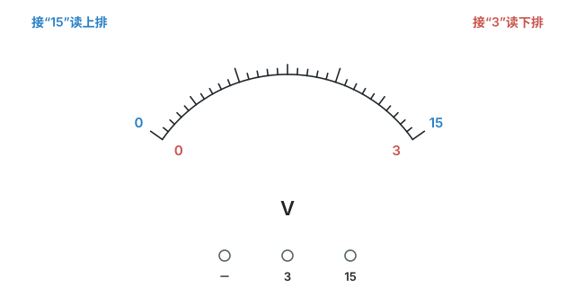
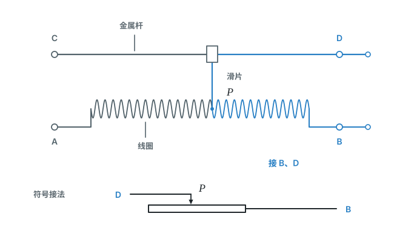

# 第十六章 电压 电阻

这章我们将认识电路中推动电荷流动的“动力”——电压，以及导体对电流的阻碍作用——电阻。这是分析和计算电路的基础。

## 本章前置自查

- **要会读电流表**：知道怎么看量程、分度值和读数。如果忘了，去复习（第十五章第 4 节）。
- **要会判断串、并联**：能看出电路是串联还是并联，元件是和谁串联、和谁并联。如果忘了，去复习（第十五章第 3 节）。

## 16.1a 电压与电压表的使用

```yaml
id: PHY-9-16-1a
weight: 重点
weight_note: 3 次读数，且是 2026 广州实验操作考试内容
textbook: 九全 16.1 电压，p.67–69
prerequisites:
  - id: PHY-9-15-4a
    strength: soft
    reason: 使用规则和电流表对照学
  - id: PHY-9-15-3a
    strength: hard
    reason: 电压表要并联在被测电路两端
evidence:
  - 能记住家庭电路、一节干电池的电压
  - 能把电压表正确并联在电路中，不接反正负接线柱
  - 能根据接线柱正确读出电压表的示数
figure: 已完成 figures/voltmeter-dial.svg（两排刻度、量程端点和接线柱；不画指针，不给读数）
sources:
  - TB9-16.1
  - GD2023-19
```

### 本次只学

认识电压，并学会用电压表测量电路两端的电压。

### 先认住

- 电源的作用是给用电器两端提供电压，电压使电荷定向移动，从而形成电流。
- 电压用字母 $U$ 表示，单位是伏特，简称伏（$\mathrm{V}$）。一节普通干电池的电压是 $1.5\ \mathrm{V}$，我国家庭电路的电压是 $220\ \mathrm{V}$。
- 电压表应该与被测用电器并联，标有“-”号的接线柱靠近电源负极，另一个接线柱靠近电源正极。
- 被测电压要小于所选量程的最大值；预先不知道大小、又判定不会超过 15 V 时，先用 15 V 量程，示数不超过 3 V 就改用 3 V 量程。



### 走一遍

**读出电压表的示数**

以课本 p.69 图 16.1-4 所示的电压表为例：
1. **看接线柱定量程**：图中导线接在“-”和“3”上，量程是 $0\sim3\ \mathrm{V}$。
2. **定分度值**：此时看下排刻度，每一小格代表 $0.1\ \mathrm{V}$。
3. **看指针读数**：指针正对 $2\ \mathrm{V}$ 刻度线，读数 $\boxed{2.0\ \mathrm{V}}$。

### 容易错

- 不能把电压表串联在被测用电器的电路上，必须并联。
- 读数时没看清接的是哪个量程就直接读数字。

### 练一练

- `Q-PHY-GD2023-19-1`
  第（1）空

## 16.2a 串、并联电路的电压规律

```yaml
id: PHY-9-16-2a
weight: 一般
weight_note: 1 次直接考；欧姆定律计算都要用
textbook: 九全 16.2 串、并联电路中电压的规律，p.72–74
prerequisites:
  - id: PHY-9-16-1a
    strength: hard
    reason: 要会测电压
  - id: PHY-9-15-3a
    strength: hard
    reason: 先判断串、并联
evidence:
  - 知道串联电路总电压等于各部分电压之和
  - 知道并联电路各支路电压与电源电压相等
figure: 不需要
sources:
  - TB9-16.2
  - GD2024-22
```

### 本次只学

认识并记住串联、并联电路中电压的规律。

### 先认住

- 在串联电路中，电源两端的电压等于各用电器两端的电压之和（$U = U_1 + U_2$）。
- 在并联电路中，各支路用电器两端的电压与电源两端的电压相等（$U = U_1 = U_2$）。

### 破题钥匙

```think
现象: 两个电阻串联在电源两端
模型: 电源的电压，分给两个电阻
图: phy-series
关系: $U=U_1+U_2$
结: 串联分电压；并联各支路的电压都等于电源电压
```

### 容易错

- 测量时，电压表没有并联在被测的那一段电路两端。
- 探究规律时，只测一次就得出结论（应该换用不同规格的灯泡，或更换电压不同的电源多次实验）。

### 练一练

- `Q-PHY-GD2024-22-3`

## 16.3a 电阻及其影响因素

```yaml
id: PHY-9-16-3a
weight: 一般
weight_note: 2 次
textbook: 九全 16.3 电阻，p.77–79
prerequisites:
  - id: PHY-9-15-2b
    strength: hard
    reason: 电阻表示导体对电流的阻碍作用
evidence:
  - 知道电阻是导体本身的一种性质
  - 知道电阻大小取决于导体的材料、长度和横截面积
figure: 不需要
sources:
  - TB9-16.3
```

### 本次只学

认识电阻，并知道哪些因素会影响导体电阻的大小。

### 先认住

- 导体对电流有一定的阻碍作用。物理学中用电阻来表示导体对电流阻碍作用的大小，用字母 $R$ 表示，单位是欧姆（$\Omega$）。
- 导体的电阻是导体本身的一种性质，它的大小取决于导体的材料、长度和横截面积等因素。
- 同种材料的导体，长度越长、横截面积越小（越细），电阻越大。

### 容易错

- 误以为没有通电时，导体的电阻就是 0（电阻是导体本身的性质，不管通不通电都在那里）。

### 练一练

- `Q-PHY-TB9-16.3-4`
- `Q-PHY-TJ2024-4`

## 16.4a 滑动变阻器的使用

```yaml
id: PHY-9-16-4a
weight: 重点
weight_note: 5 次，2026 广州实验操作考试 4 套题都要用滑动变阻器
textbook: 九全 16.4 变阻器，p.82–84
prerequisites:
  - id: PHY-9-16-3a
    strength: hard
    reason: 靠改变接入电阻丝的长度改变电阻
  - id: PHY-9-15-3a
    strength: hard
    reason: 变阻器要和被控制的用电器串联
evidence:
  - 能在实物图中把滑动变阻器正确连入电路（一上一下）
  - 闭合开关前，能把滑片移到阻值最大处
  - 能判断滑片移动时，接入电路的阻值是变大还是变小
figure: 已完成 figures/rheostat-structure-wiring.svg（结构与一上一下接法；B 到 P 的电阻丝和 P 经金属杆到 D 的连接标蓝）
sources:
  - TB9-16.4
  - GD2023-19
  - SZ2023-15
```

### 本次只学

认识滑动变阻器，学会把它连入电路，并判断滑片移动对电阻的影响。

### 先认住

- 滑动变阻器通过改变接入电阻丝的长度来改变电阻，必须与被控制的用电器串联。
- 接线必须“一上一下”：选择上面一个接线柱和下面一个接线柱接入电路。
- 变阻器滑片离接入电路的下接线柱越远，连入电路的电阻丝越长，阻值越大。
- 为了保护电路，闭合开关前应将滑片放到阻值最大的位置（离所接下接线柱最远的位置）。



### 走一遍

**将滑动变阻器连入电路**

以课本 p.82 图 16.4-2 为例：
1. 接 A、C 两个接线柱时，电流从 A 经电阻丝到滑片 P，再经金属杆到 C，接入电路的是 A 到 P 这一段电阻丝。
2. 当滑片 P 向 A 端移动时，A 到 P 这一段电阻丝变短，电阻变小。
3. 当滑片 P 向 B 端移动时，A 到 P 这一段电阻丝变长，电阻变大。

### 容易错

- 接了下面两个接线柱（变成定值大电阻，滑片失去作用）。
- 接了上面两个接线柱（电阻几乎为 0，相当于一根导线，不起保护和变阻作用）。

### 练一练

- `Q-PHY-SZ2023-15`
- `Q-PHY-GD2023-19-2`
  第（2）空
