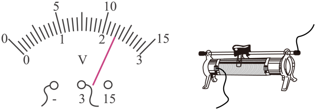
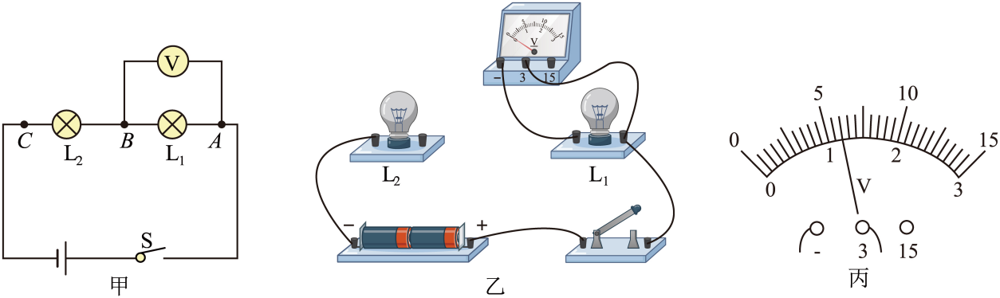
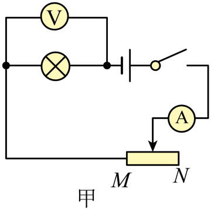
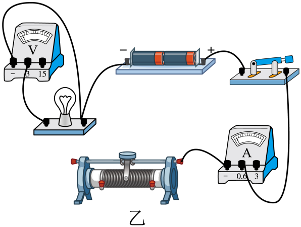
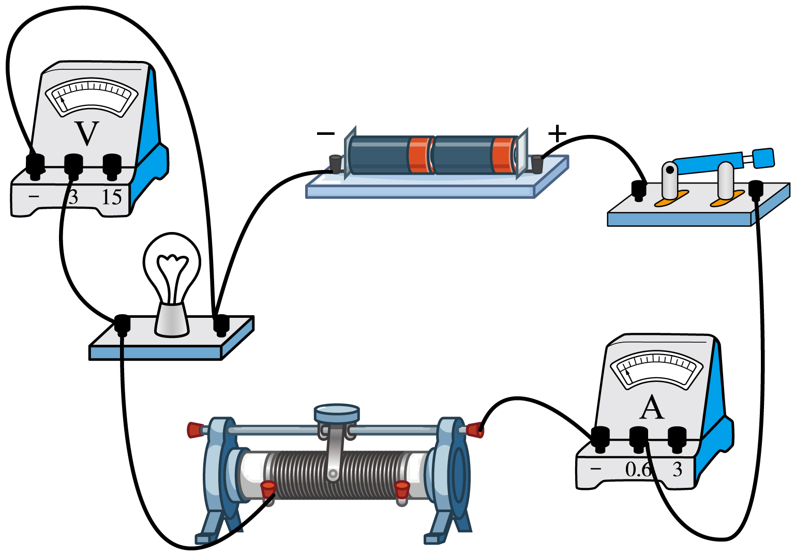
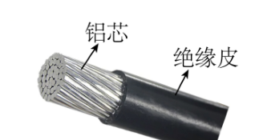
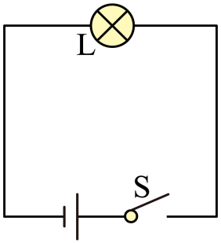
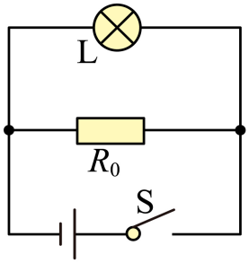
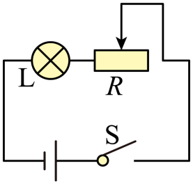
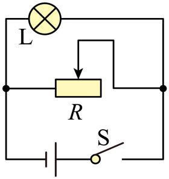

# 第十六章 电压 电阻 · 题目

讲义只用 `lesson.md` 里引用的题，按知识点顺序排在前面。真题按“精品解析”原卷录入，公式图片已读出文字并逐个重算核对；课本习题原文已对照课本 PDF 原页，答案和解析为本项目编写，**发布前需要复核**。

---

## 讲义用题（5 道）

### Q-PHY-GD2023-19-1

```yaml
category: 真题
source: 2023 年广东省初中学业水平考试 物理 第 19 题
source_quality: 原卷（精品解析整理版）
kp: PHY-9-16-1a
do: 本章只做第（1）空
type: 填空
grading: 自评
answer_by: 原卷解析
review:
  概念: PHY-9-16-1a
other_parts: 第（2）空判断电阻变大变小 → Q-PHY-GD2023-19-2
```

**题干**

如题图所示，电压表的读数为___________V；



**答案**

2.3

**解析**

1. 由图可知，电压表量程为 $0\sim3\ \mathrm{V}$，分度值为 $0.1\ \mathrm{V}$。
2. 此时指针指在 2 后 3 个小格，故电压表的示数为 $\textcolor{#287fc4}{2}\ \mathrm{V}+\textcolor{#287fc4}{3}\times\textcolor{#287fc4}{0.1}\ \mathrm{V}=\boxed{2.3\ \mathrm{V}}$。

---

### Q-PHY-GD2024-22-3

```yaml
category: 真题
source: 2024 年广东省初中学业水平考试 物理 第 22 题第（3）问
source_quality: 原卷（精品解析整理版）
kp: PHY-9-16-2a
do: 本章只做第（3）问
type: 填空
grading: 自评
answer_by: 原卷解析
review:
  前置: PHY-9-16-1a
  概念: PHY-9-16-2a
other_parts: （1）连接电路 → PHY-9-15-3a、（2）断路判断 → PHY-9-15-2d
```

**题干**

探究串联电路中电压的规律；



（3）用电压表分别测出电压 $U_{AB}$、$U_{BC}$ 和 $U_{AC}$。其中测 $U_{AB}$ 时，电压表的示数如图丙所示，示数为___________V。接着更换不同规格的灯泡并多次实验，数据记录见表；

| 实验次序 | 电压 $U_{AB}$/V | 电压 $U_{BC}$/V | 电压 $U_{AC}$/V |
| --- | --- | --- | --- |
| 1 | ______（读图丙） | 1.7 | 2.9 |
| 2 | 1.3 | 1.6 | 2.9 |
| 3 | 1.1 | 1.8 | 2.9 |

① 分析表中数据，得到初步结论：串联电路两端的总电压等于各部分电路两端电压___________；
② 为使结论更具普遍性，小明将灯泡换成其他类型用电器并多次实验。此外，还可以___________。

**答案**

（3）1.20；1.20；①之和；②更换电压不同的电源多次实验

**解析**

1. 电压表的示数看图丙，选择小量程 $0\sim3\ \mathrm{V}$，分度值为 $0.1\ \mathrm{V}$，指针过了 $1\ \mathrm{V}$ 后 2 个小格，故读数为 $\textcolor{#287fc4}{1}\ \mathrm{V}+\textcolor{#287fc4}{2}\times\textcolor{#287fc4}{0.1}\ \mathrm{V}=\boxed{1.20\ \mathrm{V}}$（写 $1.2\ \mathrm{V}$ 也对），第一张表中的空同理。
2. 分析表格中的数据可知：$\textcolor{#287fc4}{1.2}\ \mathrm{V} + \textcolor{#287fc4}{1.7}\ \mathrm{V} = 2.9\ \mathrm{V}$；$\textcolor{#287fc4}{1.3}\ \mathrm{V} + \textcolor{#287fc4}{1.6}\ \mathrm{V} = 2.9\ \mathrm{V}$；$\textcolor{#287fc4}{1.1}\ \mathrm{V} + \textcolor{#287fc4}{1.8}\ \mathrm{V} = 2.9\ \mathrm{V}$。故结论为串联电路两端总电压等于各部分电路两端电压之和。
3. 为使结论更具普遍性，除了更换不同用电器，还可以更换电压不同的电源多次实验，避免偶然性。

---

### Q-PHY-TB9-16.3-4

```yaml
category: 课本习题
source: 九全 16.3 练习与应用 第 4 题，p.81
source_quality: 课本原文
kp: PHY-9-16-3a
type: 简答
grading: 自评
answer_by: 本项目编写，已复核
review:
  概念: PHY-9-16-3a
```

**题干**

A、B 是两根完全相同的导线，长度都是 1 m。把 A 剪去一半，剩下的一半跟 B 相比，哪个的电阻大？把 A 剩下的一半再拉长到 1 m，跟 B 相比，哪个的电阻大？

**答案**

第一次比较，B 的电阻大；第二次比较，拉长后的 A 的电阻大。

**解析**

1. A、B 材料、粗细、长度相同，原本电阻一样。
2. 剪去一半后，A 的长度变短，横截面积不变。根据影响导体电阻大小的因素，长度越短，电阻越小。因此剩下的一半 A 的电阻比 B 小。
3. 把剩下的一半 A 拉长到 1 m，A 的长度恢复到和 B 一样，但由于体积不变，拉长会使它变细，即横截面积变小。长度相同、材料相同，横截面积越小，电阻越大。所以拉长后的 A 电阻比 B 大。

---

### Q-PHY-SZ2023-15

```yaml
category: 真题
source: 2023 年深圳市初中学业水平考试 物理 第 15 题第（1）（2）问
source_quality: 原卷（精品解析整理版）
kp: PHY-9-16-4a
do: 本章只做第（1）（2）问
type: 作图
grading: 自评
answer_by: 原卷解析
review:
  前置: PHY-9-16-1a
  概念: PHY-9-16-4a
other_parts: （3）判断故障等 → PHY-9-17 等
```

**题干**

已知：电源电压为 3V，小灯泡额定电压为 2.5V，滑动变阻器（30Ω，1.2A）。

（1）请帮助思考乐亮亮根据电路图，连接实物图；（要求：滑片在最右端时，电阻最大。）




（2）在闭合开关前，滑动变阻器滑片需要调到端______（选填“M”或“N”）；

**答案**

（1）
（2）N

**解析**

1. 滑动变阻器滑片在最右端（N 端）时阻值最大，说明接入的电阻丝最长。滑片离所接的下接线柱越远电阻越大，因此滑动变阻器应接左下接线柱（M 接线柱）。
2. 图乙中上接线柱已经与电流表相连，只需将 M 接线柱和灯泡相连即可，如图所示。
3. 在闭合开关前，为了保护电路，滑动变阻器滑片需要调到阻值最大处，即 N 端。

---

### Q-PHY-GD2023-19-2

```yaml
category: 真题
source: 2023 年广东省初中学业水平考试 物理 第 19 题
source_quality: 原卷（精品解析整理版）
kp: PHY-9-16-4a
do: 本章只做第（2）空
type: 填空
grading: 自评
answer_by: 原卷解析
review:
  概念: PHY-9-16-4a
other_parts: 第（1）空读数 → Q-PHY-GD2023-19-1
```

**题干**

滑动变阻器以图所示方式接入电路，当滑片向左滑动时，滑动变阻器连入电路的电阻___________（选填“变大”“变小”或“不变”）。


**答案**

变小

**解析**

1. 由图可知，变阻器接入了左下的接线柱。
2. 当滑片向左滑动时，滑片离左下接线柱的距离变短，接入电路中的电阻丝变短。
3. 因此滑动变阻器连入电路的电阻变小。

---

### Q-PHY-TJ2024-4

```yaml
category: 外省真题
source: 2024 年天津市初中学业水平考试 物理 第 4 题
source_quality: 原卷（外省卷，Word 转 PDF 页，逐页核对）
kp: PHY-9-16-3a
type: 选择
grading: 自动
answer_by: 原卷解析
review:
  概念: PHY-9-16-3a
```

**题干**

如图所示的铝芯电缆是一种输电导线。在某村输电线路改造工程中，更换的铝芯电缆比旧铝芯电缆电阻更小，主要是因为新电缆的（　　）

A. 铝芯更细
B. 铝芯更粗
C. 绝缘皮更薄
D. 绝缘皮更厚



**答案**

B

**解析**

导体的电阻与材料、长度、横截面积有关。新旧电缆材料都是铝、长度相同，电阻变小，说明横截面积变大，即铝芯更粗。选 B。

---

## 备选（不进入讲义，不再维护）

### Q-PHY-GD2024-07

```yaml
category: 真题
source: 2024 年广东省初中学业水平考试 物理 第 7 题
source_quality: 原卷（精品解析整理版）
kp: PHY-9-16-4a
type: 选择
grading: 自动
answer_by: 原卷解析
review:
  概念: PHY-9-16-4a
```

**题干**

小明设计了一盏能调节亮度的台灯。下列符合要求的电路图是（　　）

A. 
B. 
C. 
D. 

**答案**

C

**解析**

1. 由 A 图可知，这只是有台灯一个用电器的简单电路，不能调节亮度，故 A 不符合。
2. 由 B 图可知，台灯与定值电阻并联在电路中，并联电路中各支路互不影响，不能调节亮度，故 B 不符合。
3. 由 C 图可知，台灯与滑动变阻器串联。调节滑动变阻器，可以改变电路的总电阻，从而改变电流和台灯的亮度，故 C 符合题意。
4. 由 D 图可知，台灯与滑动变阻器并联。并联电路中各支路互不影响，调节滑动变阻器只能改变变阻器所在支路的电流，不能改变台灯的亮度，故 D 不符合。
5. 故选 C。
