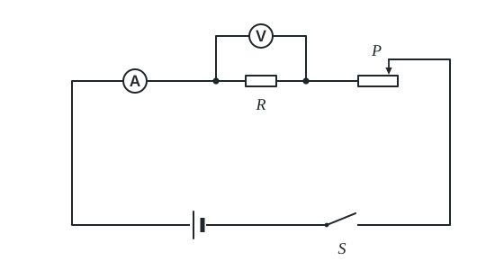
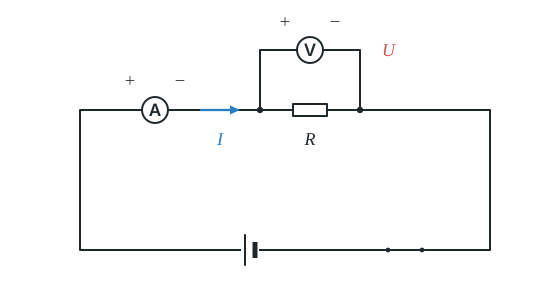
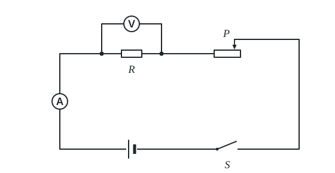
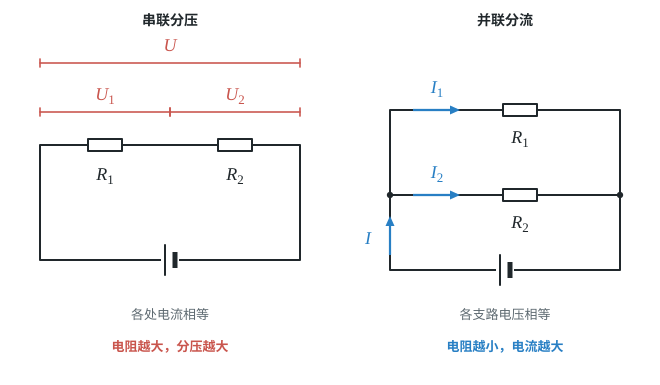
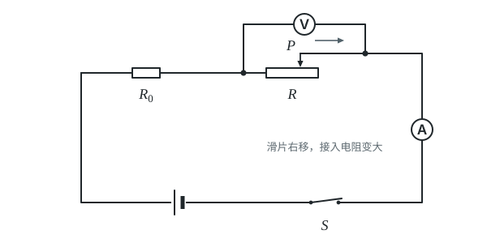
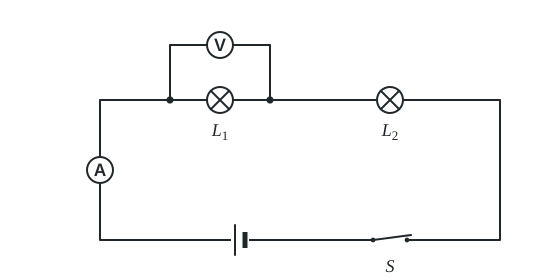

# 第十七章 欧姆定律

这一章把电流、电压、电阻联系起来：先用实验找出三者的关系，得到欧姆定律；再用伏安法测电阻；最后用欧姆定律分析串联、并联电路的计算、动态变化和故障。

本章 6 个知识点全部是**重点**，公式计算、实验探究、动态电路和故障分析都常考，要扎实掌握。

## 本章前置自查

下面几件事，哪一件没把握，先回看：

1. 会使用滑动变阻器改变电路中的电阻，知道闭合开关前滑片应置于阻值最大处。（第十六章第 4 节）
2. 会使用电流表和电压表，能正确选择量程并读数。（第十五章第 4 节、第十六章第 1 节）
3. 知道串联电路中电流处处相等、总电压等于各部分电压之和；并联电路中干路电流等于各支路电流之和、各支路两端电压相等。（第十五章第 5 节、第十六章第 2 节）
4. 知道通路、断路和短路的区别。（第十五章第 2 节）

---

## 17.1a 探究电流与电压、电阻的关系

```yaml
id: PHY-9-17-1a
weight: 重点
weight_note: 3 次（深圳 2024 实验题），控制变量和数据分析常考
textbook: 九全 17.1 电流与电压和电阻的关系，p.93–97
prerequisites:
  - id: PHY-9-16-4a
    strength: hard
    reason: 靠变阻器控制定值电阻两端电压
  - id: PHY-9-15-4a
    strength: hard
    reason: 要读电流表
  - id: PHY-9-16-1a
    strength: hard
    reason: 要读电压表
  - id: MATH-比例
    strength: soft
    reason: 结论是正比、反比关系
evidence:
  - 能说出探究电流与电压关系时滑动变阻器的作用（改变定值电阻两端电压）
  - 能说出探究电流与电阻关系时滑动变阻器的作用（保持定值电阻两端电压不变）
  - 能通过表格数据分析得出电流与电压成正比、电流与电阻成反比的结论
figure: 已完成 figures/current-voltage-resistance-circuit.svg（探究实验电路图，电压表并联在定值电阻两端）
sources: [TB9-17.1, TB9-17R, SZ2024-13]
```

### 本次只学

学会用控制变量法探究电流与电压、电阻的定量关系，能分析实验数据得出结论。

### 先认住

- 探究方法：采用**控制变量法**。电压和电阻都会引起电流的变化。探究时先保持导体的电阻不变，研究电流与导体两端电压的关系；再保持导体两端的电压不变，研究电流与导体电阻的关系。
- 电阻一定时：通过导体的电流与导体两端的电压**成正比**。滑动变阻器的作用是**改变定值电阻两端的电压和通过的电流**。
- 电压一定时：通过导体的电流与导体的电阻**成反比**。滑动变阻器的作用是**保持定值电阻两端的电压不变**。



### 破题钥匙

```think
现象: 电阻不变，电压增大，电流跟着增大
模型: 电压作横轴、电流作纵轴，描点连线得到一条过原点的直线
图: phy-b-iu-line
关系: $\dfrac{U}{I}=R$ 不变，电压加倍，电流也加倍
招: 控制变量
结: 过原点的直线，就是电流与电压成正比
```

### 走一遍

探究实验分为两步：

1. 保持电阻不变（文字推理）：
   保持定值电阻阻值不变，闭合开关，移动滑动变阻器滑片，改变定值电阻两端的电压。当电压成倍增大时，通过定值电阻的电流也成相同倍数增大，电压与电流的比值 $\frac{U}{I}$ 保持不变。
   结论：电阻一定时，通过导体的电流与导体两端的电压成正比。
2. 保持电压不变，课本复习与提高第 3 题乙同学的实验记录：
   保持定值电阻两端电压 $U = 2\ \mathrm{V}$ 不变，换用 $5\ \Omega$、$10\ \Omega$、$20\ \Omega$ 的定值电阻接入电路。每次换上阻值更大的电阻后，定值电阻分得的电压会变大，必须**调节滑动变阻器滑片使变阻器连入电路的电阻变大**，从而使定值电阻两端的电压表读数恢复到 $2\ \mathrm{V}$。
   记录对应的电流分别为 $0.40\ \mathrm{A}$、$0.20\ \mathrm{A}$、$0.10\ \mathrm{A}$（表中其余几组略）。
   分析三组电流与电阻的乘积：
   $\textcolor{#287fc4}{0.40}\ \mathrm{A} \times \textcolor{#287fc4}{5}\ \Omega = 2\ \mathrm{V}$；
   $\textcolor{#287fc4}{0.20}\ \mathrm{A} \times \textcolor{#287fc4}{10}\ \Omega = 2\ \mathrm{V}$；
   $\textcolor{#287fc4}{0.10}\ \mathrm{A} \times \textcolor{#287fc4}{20}\ \Omega = 2\ \mathrm{V}$。
   电流与电阻的乘积 $I \times R = \boxed{2\ \mathrm{V}}$ 保持为定值，电阻增大为原来的几倍，通过的电流减小为原来的几分之一。
   结论：电压一定时，通过导体的电流与导体的电阻成反比。

### 容易错

- 不能说“电压与电流成正比”：电压是产生电流的原因，只能说“电流与电压成正比”。
- 探究电流与电阻关系时，换用大电阻后忘记调节变阻器：换大电阻后其两端电压变大，必须增大滑动变阻器阻值，把定值电阻两端电压拉回设定值。

### 练一练

- `Q-PHY-TB9-17.1-1`
- `Q-PHY-SZ2024-13-2`

---

## 17.2a 欧姆定律及简单计算

```yaml
id: PHY-9-17-2a
weight: 重点
weight_note: 7 次计算
textbook: 九全 17.2 欧姆定律，p.98–100
prerequisites:
  - id: PHY-9-17-1a
    strength: hard
    reason: 欧姆定律是实验结论
  - id: MATH-方程变形
    strength: soft
    reason: I=U/R 要会变形
evidence:
  - 能写出欧姆定律公式 I=U/R 及其变形公式 U=IR、R=U/I，并标明各物理量的单位
  - 能根据已知其中两个物理量，规范计算出第三个量
  - 能理解电阻是导体本身的性质，不随电压和电流的变化而改变
figure: 已完成 figures/ohms-law-simple-circuit.svg（电源、开关、定值电阻与电表；I、U、R 对应同一个导体）
sources: [TB9-17.2, GZ2022-17]
```

### 本次只学

熟记欧姆定律内容及公式，能用 $I=\frac{U}{R}$、$U=IR$、$R=\frac{U}{I}$ 进行规范计算。

### 先认住

- 内容：导体中的电流，跟导体两端的电压成正比，跟导体的电阻成反比。
- 公式：$I = \frac{U}{R}$。其中电流 $I$ 的单位是安培（$\mathrm{A}$），电压 $U$ 的单位是伏特（$\mathrm{V}$），电阻 $R$ 的单位是欧姆（$\Omega$）。
- 变形公式：$U = IR$（求电压）、$R = \frac{U}{I}$（求电阻）。
- 同一性与同时性：公式中的 $I$、$U$、$R$ 必须对应**同一个导体（或同一段电路）**在**同一个时刻（状态）**的物理量。



### 破题钥匙

```think
现象: 电源给一个电阻供电，电路中有电流
模型: 电压 $U$ 推着电流 $I$ 通过电阻 $R$
图: phy-ohm
关系: $I=\dfrac{U}{R}$
结: $I$、$U$、$R$ 要对应同一个导体、同一时刻
```

### 走一遍

课本 p.99 例题：
闭合开关后，电阻为 $R$ 的电阻器两端电压为 $6\ \mathrm{V}$，通过电阻器的电流为 $0.3\ \mathrm{A}$。

1. 计算电阻器的电阻 $R$：
   已知 $U = 6\ \mathrm{V}$，$I = 0.3\ \mathrm{A}$。
   由欧姆定律变形可得：
   $R = \frac{U}{I} = \frac{\textcolor{#287fc4}{6}\ \mathrm{V}}{\textcolor{#287fc4}{0.3}\ \mathrm{A}} = \boxed{20\ \Omega}$。
2. 若调节电源电压，使电阻器两端电压变为原来的 2 倍（即变为 $12\ \mathrm{V}$），通过电阻器的电流变为原来的几倍？
   因为电阻是导体本身的性质，电压改变时电阻 $R = 20\ \Omega$ 不变。
   由 $I' = \frac{U'}{R} = \frac{\textcolor{#287fc4}{12}\ \mathrm{V}}{\textcolor{#287fc4}{20}\ \Omega} = 0.6\ \mathrm{A}$，电流变为原来的 $\boxed{2\ \text{倍}}$。

### 容易错

- 不能认为“导体的电阻跟它两端的电压成正比，跟电流成反比”：$R=\frac{U}{I}$ 只是计算电阻的数学表达式，电阻是由导体本身的材料、长度、横截面积和温度决定的，不随电压和电流改变。
- 单位必须统一成国际单位制（$\mathrm{A}$、$\mathrm{V}$、$\Omega$）后再代入计算；若题目给出 $\mathrm{mA}$ 或 $\mathrm{k}\Omega$，必须先换算。

### 练一练

- `Q-PHY-GZ2022-17-2a`
  第（2）问①
- `Q-PHY-TB9-17.2-2`

---

## 17.3a 伏安法测电阻

```yaml
id: PHY-9-17-3a
weight: 重点
weight_note: 5 次实验题，含“小灯泡电阻随温度变化”
textbook: 九全 17.3 电阻的测量，p.101–104
prerequisites:
  - id: PHY-9-17-2a
    strength: hard
    reason: 原理是 R=U/I
  - id: PHY-9-16-4a
    strength: hard
    reason: 要用变阻器改变电压、多次测量
evidence:
  - 能画出伏安法测电阻的电路图，并说出滑动变阻器的保护和分压作用
  - 能根据电压表和电流表示数计算电阻值，并说明多次测量求平均值可以减小误差
  - 能说明小灯泡电阻随温度升高而增大，因此小灯泡电阻不能求平均值
figure: 已完成 figures/voltammeter-method-circuit.svg（伏安法电路图，照课本图 17.3-2）
sources: [TB9-17.3, GD2022-22]
```

### 本次只学

掌握用电压表和电流表测量电阻的原理与电路，知道测定值电阻与测小灯泡电阻的区别。

### 先认住

- 原理：欧姆定律的变形公式 $R = \frac{U}{I}$。用电压表测出导体两端的电压，用电流表测出通过导体的电流，即可算出电阻。
- 滑动变阻器的两个作用：① **保护电路**（闭合开关前滑片置于阻值最大处）；② **改变待测电阻两端的电压和电流**，实现多次测量。
- 小灯泡正常发光时两端的电压，叫作额定电压。
- 测定值电阻与测小灯泡电阻的区别：
  - 测定值电阻：多次测量**求平均值**以减小测量误差；
  - 测小灯泡电阻：小灯泡的灯丝电阻随温度升高而**增大**，不同电压下灯丝温度不同，电阻实际值不同，**不能求平均值**。



### 走一遍

课本 p.101–102“用电流表和电压表测量电阻”操作与数据处理流程：

1. 连接电路：按照电路图将待测电阻器、电流表、滑动变阻器、开关、电源串联，电压表并联在待测电阻两端。滑动变阻器滑片移到阻值最大处（使电路中的电流在开始测量时最小）。
2. 测量与计算：闭合开关，移动滑动变阻器滑片，改变待测电阻两端的电压和通过的电流，记录多组对应的电压值 $U$ 和电流值 $I$。根据欧姆定律变形公式分别计算出各次测量对应的电阻值：
   $R_1 = \frac{U_1}{I_1}$，$R_2 = \frac{U_2}{I_2}$，$R_3 = \frac{U_3}{I_3}$。
3. 求平均值减小误差：
   定值电阻的阻值不随电压和电流改变，计算各次测量的平均值作为待测电阻器的电阻值：
   $R = \frac{R_1 + R_2 + R_3}{3}$。

### 容易错

- 算小灯泡电阻时习惯性去求平均值：小灯泡的电阻随温度变化而变化，求平均值在物理上没有意义。
- 电流表与电压表接反（电压表串联、电流表并联）：若误将电压表串联在电路中，由于电压表电阻极大，电路几乎没有电流，电流表无示数，电压表示数接近电源电压；若把电流表并联在待测电阻两端，会造成待测电阻被短路。

### 练一练

- `Q-PHY-GD2022-22`

---

## 17.4a 串、并联电路中的欧姆定律计算

```yaml
id: PHY-9-17-4a
weight: 重点
weight_note: 5 次计算
textbook: 九全 17.4 欧姆定律在串、并联电路中的应用，p.105–109
prerequisites:
  - id: PHY-9-17-2a
    strength: hard
    reason: 对每个电阻用 I=U/R
  - id: PHY-9-15-5a
    strength: hard
    reason: 串联电流相等、并联电流相加
  - id: PHY-9-16-2a
    strength: hard
    reason: 串联电压相加、并联电压相等
evidence:
  - 能结合串联电路电流相等、总电压等于各部分电压之和，用欧姆定律计算各部分电压、电流和电阻
  - 能结合并联电路各支路电压相等、总电流等于各支路电流之和，用欧姆定律计算各支路电流和电阻
  - 在计算时能做到“同一性”和“同时性”
figure: 已完成 figures/series-voltage-parallel-current.svg（串联分压、并联分流对比；标注对应的电压和电流）
sources: [TB9-17.4, SZ2022-18]
```

### 本次只学

结合串联、并联电路的电流和电压规律，用欧姆定律求解未知电阻、电压和电流。

### 先认住

- 串联电路计算思路：先利用串联电路“各处电流相等”或“总电压等于各部分电压之和”，锁定某一段电路或某个电阻，再用欧姆定律求解。在串联电路中，各电阻两端电压与它们的电阻成正比：$\frac{U_1}{U_2} = \frac{R_1}{R_2}$（串联分压，电阻越大分得的电压越大）。
- 并联电路计算思路：先利用并联电路“各支路两端电压相等”或“干路电流等于各支路电流之和”，由已知支路的电流或电阻求出电压（即电源电压），再用欧姆定律求解。在并联电路中，通过各导体的电流与它们的电阻成反比：$\frac{I_1}{I_2} = \frac{R_2}{R_1}$（并联分流，电阻越小通过的电流越大）。
- 解题原则：“明确研究对象，先看连接（串还是并），再用规律（电流、电压），列欧姆定律”。
- **补充**（课本没有讲，做真题时常用）：串联电路的总电阻等于各电阻之和，$R=R_1+R_2$。串联的电阻越多、越大，总电阻越大，电路中的电流越小。



### 走一遍

课本 p.106 例题 2（并联电路）：
电路结构说明（见课本图 17.4-3）：电阻器 $R_1$ 与 $R_2$ 并联，开关 $S_1$ 与电流表接在干路上，$S_2$ 接在支路 $R_2$ 上单独控制该支路。
已知电阻器的电阻 $R_1 = 10\ \Omega$。开关 $S_1$ 闭合、$S_2$ 断开时，电路中只有 $R_1$ 接入，电流表示数为 $1.2\ \mathrm{A}$；再把 $S_2$ 闭合后，$R_1$ 与 $R_2$ 并联，电流表测量干路总电流，示数变为 $1.5\ \mathrm{A}$。

1. 求 $S_1$ 闭合、$S_2$ 断开时 $R_1$ 两端的电压：
   此时只有 $R_1$ 接入电路，通过它的电流 $I_1 = 1.2\ \mathrm{A}$。
   由欧姆定律可得：
   $U_1 = I_1 R_1 = \textcolor{#287fc4}{1.2}\ \mathrm{A} \times \textcolor{#287fc4}{10}\ \Omega = \boxed{12\ \mathrm{V}}$。
2. 求另一个电阻器的电阻 $R_2$：
   $S_2$ 闭合后，两电阻并联，电源电压等于各支路两端电压，即 $U_2 = U = 12\ \mathrm{V}$。
   干路总电流 $I = 1.5\ \mathrm{A}$。由并联电路电流规律可得，通过 $R_2$ 的电流为：
   $I_2 = I - I_1 = \textcolor{#287fc4}{1.5}\ \mathrm{A} - \textcolor{#287fc4}{1.2}\ \mathrm{A} = 0.3\ \mathrm{A}$。
   由欧姆定律可得 $R_2$ 的阻值为：
   $R_2 = \frac{U_2}{I_2} = \frac{\textcolor{#287fc4}{12}\ \mathrm{V}}{\textcolor{#287fc4}{0.3}\ \mathrm{A}} = \boxed{40\ \Omega}$。

### 容易错

- 混淆不同电阻上的物理量：不能把 $R_1$ 的电流和 $R_2$ 的电压代入同一个公式中计算（必须遵循“同一性”，$I$、$U$、$R$ 必须对应同一个导体或同一段电路）。

### 练一练

- `Q-PHY-SZ2022-18-1`
  第（1）问
- `Q-PHY-TB9-17.4-2`

---

## 17.4b 动态电路分析

```yaml
id: PHY-9-17-4b
weight: 重点
weight_note: 2 次（GZ2024-09 地磅、SZ2022-05 油量表），均为选择题；判断各电表怎样变化要一步步推，容易出错
textbook: 九全 17.4 欧姆定律在串、并联电路中的应用，p.105–109
prerequisites:
  - id: PHY-9-17-4a
    strength: hard
    reason: 要列出电阻变化后电流、电压怎么变
  - id: PHY-9-16-4a
    strength: hard
    reason: 要判断滑片移动后接入电阻怎么变
evidence:
  - 能根据滑片移动或开关通断，判断电路各元件连接方式及接入阻值的变化
  - 能根据欧姆定律分析变阻器接入电阻改变时电路中电流的变化
  - 能分析定值电阻两端电压和变阻器两端电压的变化规律（串联分压规律）
figure: 已完成 figures/dynamic-series-rheostat.svg（走一遍的串联动态电路，滑片右移接入电阻变大）
sources: [GZ2024-09, SZ2022-05]
```

### 本次只学

分析滑动变阻器滑片移动或开关通断引起的各电表示数及电路状态变化。

### 先认住

- 动态分析四步法：
  1. **认电路**：去掉电压表（视为开路）、电流表（视为导线），判断是用电器串联还是并联；
  2. **看电表**：明确电流表测哪段电流，电压表测哪个用电器两端电压；
  3. **看变化**：判断滑片移动时，接入电路的阻值是变大还是变小；
  4. **下结论**：
     - 若是串联：变阻器连入电路的电阻变大 $\implies$ 电路中的电流变小（电流表示数变小） $\implies$ 定值电阻分得的电压变小 $\implies$ 变阻器两端电压变大（“串联分压，大阻分大压”）；
     - 若是并联：各支路两端电压等于电源电压保持不变；滑片所在支路电阻变大导致该支路电流变小，定值电阻支路电流不变，干路总电流变小。

### 走一遍

典型串联滑动变阻器分压电路分析：
电路中定值电阻 $R_0$ 与滑动变阻器 $R$ 串联，电压表测变阻器 $R$ 两端电压，电流表测电路电流。当滑片向右移动使变阻器接入电阻变大时：

1. 判断电路电流：电源电压 $U$ 不变，变阻器连入电路的电阻 $R$ 变大，电路对电流的阻碍作用变大，电路中的电流 $I$ 变小（电流表示数变小）。
2. 判断定值电阻电压：由 $U_0 = I R_0$ 知，$R_0$ 阻值不变，电流 $I$ 变小，故定值电阻两端电压 $U_0$ 变小。
3. 判断变阻器电压：由串联电路总电压 $U = U_0 + U_R$ 知，电源电压不变，$U_0$ 变小，故变阻器两端电压 $U_R$ 变大（电压表示数变大）；也可由串联分压比 $\frac{U_0}{U_R} = \frac{R_0}{R}$ 判断，$R$ 变大则变阻器分得的电压变大。



### 容易错

- 误以为变阻器两端电压随电流变小而变小：变阻器的电阻和电流都在变，不能直接用 $U_R = IR$ 判断，要用总电压减去定值电阻电压（$U_R = U - U_0$）来判断。
- 注意变阻器是否全阻接入：若滑片移动不改变接入电路的电阻（如电压表测量滑片一段的分压），则电路中的电流保持不变。

### 练一练

- `Q-PHY-GZ2024-09`

---

## 17.4c 判断电路故障

```yaml
id: PHY-9-17-4c
weight: 重点
weight_note: 5 次，实验题常见（广州 2023、2025 都考）
textbook: 九全 17.4 欧姆定律在串、并联电路中的应用，p.105–109
prerequisites:
  - id: PHY-9-15-2d
    strength: hard
    reason: 故障就是某处断路或短路
  - id: PHY-9-16-1a
    strength: hard
    reason: 用电压表有无示数判断
  - id: PHY-9-15-4a
    strength: hard
    reason: 用电流表有无示数判断
evidence:
  - 能根据电流表有无示数、灯泡是否发光，初步判断电路是短路还是断路
  - 能根据电压表是否有示数（有示数接近电源电压或为零），准确定位断路或短路的位置
  - 能根据并联电路中电表示数异常分析支路故障（如支路断路导致干路与另一支路电流相等）
figure: 已完成 figures/fault-voltmeter-check.svg（两灯串联，电压表接在 L1 两端）
sources: [GZ2023-15, GD2024-22]
```

### 本次只学

掌握根据电流表、电压表及用电器工作状态排查电路断路和短路的方法。

### 先认住

- 故障类型只有两种：**断路**（某处断开，这条路径上没有电流）和**短路**（某元件被导线并联，电阻几乎为零，该元件不工作）。
- 串联电路两灯故障判断口诀：
  - **两灯都不亮**（电流表无示数）：必有**断路**。电压表并联在哪盏灯两端有示数（且接近电源电压），那盏灯就断路；若电压表无示数，说明断路在别处。
  - **一灯亮、一灯不亮**（电流表有示数）：常见原因是不亮的灯被短路（此时用电压表接在其两端示数为 0）；也可能是通过它的电流太小。
- 并联电路故障特征：
  - 一支路断路：该支路不工作，另一支路仍正常工作；干路电流减小，等于正常工作的支路电流。
  - 一支路短路：整个电源被短路，所有用电器都不工作，甚至烧坏电源或导线。

### 走一遍

串联电路断路排查流程（以两灯 $L_1$、$L_2$ 串联为例）：
闭合开关后，两灯均不发光，电流表指针不偏转。

1. 判断故障类型：两灯不发光且电流表无示数，说明电路没有闭合回路，故障是**断路**。
2. 用电压表逐段排查：将电压表并联在 $L_1$ 两端。
   - 若电压表示数接近电源电压：说明从电源正极经导线到电压表，再从电压表经 $L_2$ 和开关到电源负极的路径是通的。电流之所以无法正常通过，是因为 $L_1$ 内部断开了。结论：$\boxed{L_1\ \text{断路}}$。
   - 若电压表示数为零：说明断路发生在电压表所测范围之外（如 $L_2$ 断路或开关接触不良）。



### 容易错

- 看到“电压表有示数”就以为所测元件完好：在串联断路故障中，电压表有示数恰恰说明所测元件自身断路（因为电压表内阻极大，相当于把电源电压全部分在电压表两端）。
- 混淆短路与断路对电流表的影响：串联电路中某处断路，电流表无示数；并联电路只有一条支路断路时，干路电流表仍有示数。串联电路中，某个用电器被短路时，电流表示数反而变大。

### 练一练

- `Q-PHY-GZ2023-15`
