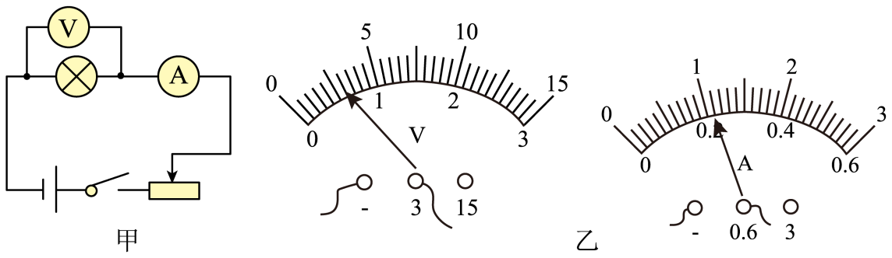
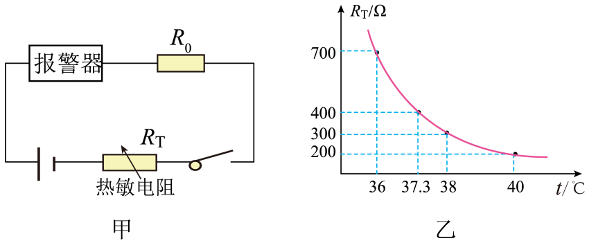
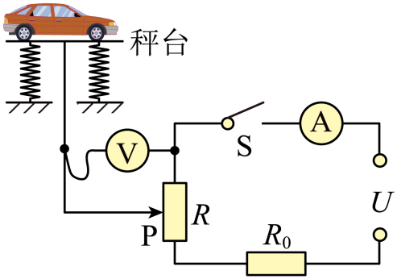
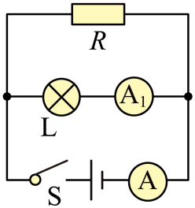
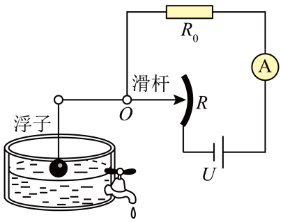

# 第十七章 欧姆定律 · 题目

讲义只用 `lesson.md` 里引用的题，按知识点顺序排在前面。真题按“精品解析”原卷录入，公式图片已读出文字并逐个重算核对；课本习题原文已对照课本 PDF 原页，答案和解析为本项目编写，**发布前需要复核**。

---

## 讲义用题（9 道）

### Q-PHY-TB9-17.1-1

```yaml
category: 课本习题
source: 九全 17.1 练习与应用 第 1 题，p.96
source_quality: 课本原文
kp: PHY-9-17-1a
type: 简答
grading: 自评
answer_by: 本项目编写，已复核
review:
  概念: PHY-9-17-1a
```

**题干**

在“探究电阻一定时电流与电压的关系”的实验中，可以分别用 1 节、2 节、3 节……干电池作为电源来改变定值电阻两端的电压，也可以用滑动变阻器来改变电压。与改变电池数量的方法相比，使用滑动变阻器的优点是什么？

**答案**

使用滑动变阻器可以连续、平滑地改变定值电阻两端的电压，且操作简便。

**解析**

1. 改变干电池节数只能成倍数、不连续地改变电压，操作繁琐且电压调节范围受限。
2. 使用滑动变阻器通过移动滑片，可以连续、平滑地调节定值电阻两端的电压，操作简便，便于多次测量寻找普遍规律。

---

### Q-PHY-SZ2024-13-2

```yaml
category: 真题
source: 2024 年深圳市初中学业水平考试 物理 第 13 题第（2）（3）问
source_quality: 原卷（精品解析整理版）
kp: PHY-9-17-1a
do: 本章只做第（2）（3）问
type: 填空
grading: 自评
answer_by: 原卷解析
review:
  概念: PHY-9-17-1a
other_parts: （1）改错连线 → PHY-9-15-3a、（4）求定值电阻消耗电能 → PHY-9-18-1b
```

**题干**

在探究电流与电阻的实验中：

纠正错误后，保持定值电阻两端电压为 2 V 不变，得到实验数据如下表所示。

| 数据序号 | 1 | 2 | 3 | 4 | 5 | 6 |
| --- | --- | --- | --- | --- | --- | --- |
| 电阻 $R/\Omega$ | 30 | 25 | 20 | 15 | 10 | 5 |
| 电流 $I/\mathrm{A}$ | 0.07 | 0.08 | 0.10 | 0.70 | 0.20 | 0.40 |

（2）其中有一组数据是错误的，发现错误数据的序号是_________；

（3）整理表中数据可得结论：导体两端电压一定时，导体中的电流与导体电阻成反比，请写出成反比的依据是什么？_________

**答案**

（2）4；（3）电流和电阻的乘积不变，为 2 V（或电压一定时电流与电阻乘积为定值）

**解析**

1. 由表中数据可知，第 4 次数据电压表的示数对应为 $\textcolor{#287fc4}{0.70}\ \mathrm{A} \times \textcolor{#287fc4}{15}\ \Omega = 10.5\ \mathrm{V}$，而其他各组数据乘积都约为 $2\ \mathrm{V}$（如第 1 组 $\textcolor{#287fc4}{0.07}\ \mathrm{A} \times \textcolor{#287fc4}{30}\ \Omega = 2.1\ \mathrm{V}$，第 2 组 $\textcolor{#287fc4}{0.08}\ \mathrm{A} \times \textcolor{#287fc4}{25}\ \Omega = 2\ \mathrm{V}$），故错误数据的序号是 $\boxed{4}$。
2. 由表中正确数据可知，在误差允许范围内，电流与电阻的乘积始终保持为定值 $2\ \mathrm{V}$（即 $IR = 2\ \mathrm{V}$ 不变），因此在电压一定时，导体中的电流与导体电阻成反比。

---

### Q-PHY-GZ2022-17-2a

```yaml
category: 真题
source: 2022 年广州市初中学业水平考试 物理 第 17 题第（2）问①
source_quality: 原卷（精品解析整理版）
kp: PHY-9-17-2a
do: 本章只做第（2）问①
type: 计算
grading: 自评
answer_by: 原卷解析
review:
  公式: PHY-9-17-2a
  审题: PHY-9-15-5a
other_parts: （1）求电功率 → PHY-9-18-2a、（2）②求产生的热量 → PHY-9-18-4a、（3）连接电路 → PHY-9-20-3a
```

**题干**

汽车启动时，蓄电池向启动电动机 M 供电。M 仅通过导线 a、b 接入电路，如图 2 所示，导线 a 的电阻为 $0.001\ \Omega$，若通过 M 的电流为 200 A。持续 0.5 s，求此过程：

① 导线 a 两端电压；


**答案**

0.2 V

**解析**

1. 导线 a 与电动机 M 串联，由串联电路中电流处处相等可知，通过导线 a 的电流与通过电动机的电流相等，即 $I_a = 200\ \mathrm{A}$。
2. 由欧姆定律公式变形可得，导线 a 两端的电压为：
   $U_a = I_a R_a = \textcolor{#287fc4}{200}\ \mathrm{A} \times \textcolor{#287fc4}{0.001}\ \Omega = \boxed{0.2\ \mathrm{V}}$。

---

### Q-PHY-TB9-17.2-2

```yaml
category: 课本习题
source: 九全 17.2 练习与应用 第 2 题，p.100
source_quality: 课本原文
kp: PHY-9-17-2a
type: 计算
grading: 自评
answer_by: 本项目编写，已复核
review:
  公式: PHY-9-17-2a
```

**题干**

一个定值电阻的电阻是 $10\ \Omega$，使用时通过的电流是 200 mA，加在这个定值电阻两端的电压是多大？

**答案**

2 V

**解析**

1. 电流单位换算：$I = 200\ \mathrm{mA} = \textcolor{#287fc4}{0.2}\ \mathrm{A}$。
2. 由欧姆定律公式变形可得，加在定值电阻两端的电压为：
   $U = IR = \textcolor{#287fc4}{0.2}\ \mathrm{A} \times \textcolor{#287fc4}{10}\ \Omega = \boxed{2\ \mathrm{V}}$。

---

### Q-PHY-GD2022-22

```yaml
category: 真题
source: 2022 年广东省初中学业水平考试 物理 第 22 题第（1）（2）问
source_quality: 原卷（精品解析整理版）
kp: PHY-9-17-3a
do: 本章只做第（1）（2）问
parts:
  - part: '1'
    kp: PHY-9-17-3a
    answer: '连接电路时，开关没有断开'
    review: {概念: PHY-9-17-3a}
  - part: '2'
    kp: PHY-9-17-3a
    answer: '① 0.6；0.22；② 5；③ 错误；若灯丝断了，电压表串联在电路中，示数接近电源电压，电流表示数接近 0，与表格数据不符'
    review: {前置: PHY-9-15-4a, 公式: PHY-9-17-2a, 概念: PHY-9-17-3a}
type: 填空
grading: 自评
answer_by: 原卷解析
review:
  概念: PHY-9-17-3a
  公式: PHY-9-17-2a
  前置: PHY-9-15-4a
```

**题干**

图甲是测量小灯泡在不同电压下电阻的实验电路图（小灯泡额定电压为 1.5 V）。



（1）小明按电路图连接实物，刚接上最后一根导线，看到电流表指针立刻有偏转。若电路连线正确，造成这种异常现象的原因是___________。

（2）实验中，调节滑动变阻器，分别记录电压表和电流表的示数如下：

| 测量次序 | 1 | 2 | 3 | 4 | 5 |
| --- | --- | --- | --- | --- | --- |
| 电压 $U/\mathrm{V}$ | 1.8 | 1.5 | 1.0 | ___________ | 0.3 |
| 电流 $I/\mathrm{A}$ | 0.32 | 0.30 | 0.26 | ___________ | 0.18 |

① 第 4 次测量对应的电压表和电流表示数如图乙所示，此时小灯泡两端的电压是___________V，通过它的电流是___________A。
② 小灯泡正常发光时的电阻是___________$\Omega$。
③ 第 5 次测量中，小灯泡不发光。小明断定是灯丝断了。这个判断是___________（选填“正确”或“错误”）的，理由是___________。

**答案**

（1）连接电路时，开关没有断开；（2）① 0.6；0.22；② 5；③ 错误；若灯丝断了，电压表串联在电路中，示数接近电源电压，电流表示数接近 0，与表格数据不符

**解析**

1. （1）刚接上最后一根导线电路立刻接通、电流表指针偏转，说明连接电路时开关没有断开。
2. （2）① 电压表量程为 $0\sim3\ \mathrm{V}$，分度值为 $0.1\ \mathrm{V}$，指针指在第 6 小格，读数为 $\textcolor{#287fc4}{6}\times\textcolor{#287fc4}{0.1}\ \mathrm{V} = \boxed{0.6\ \mathrm{V}}$；电流表量程为 $0\sim0.6\ \mathrm{A}$，分度值为 $0.02\ \mathrm{A}$，指针指在 0.2 过 1 小格，读数为 $\textcolor{#287fc4}{0.2}\ \mathrm{A}+\textcolor{#287fc4}{1}\times\textcolor{#287fc4}{0.02}\ \mathrm{A} = \boxed{0.22\ \mathrm{A}}$。
3. ② 小灯泡额定电压为 $1.5\ \mathrm{V}$，正常发光对应表格中第 2 次测量，此时电流 $I = 0.30\ \mathrm{A}$。根据欧姆定律，正常发光时的电阻为：
   $R = \frac{U}{I} = \frac{\textcolor{#287fc4}{1.5}\ \mathrm{V}}{\textcolor{#287fc4}{0.30}\ \mathrm{A}} = \boxed{5\ \Omega}$。
4. ③ 小明的判断是错误的。若灯丝断了，电压表串联在电路中，示数接近电源电压，电流表示数接近 0，与表格数据不符，因此灯丝没有断。

---

### Q-PHY-SZ2022-18-1

```yaml
category: 真题
source: 2022 年深圳市初中学业水平考试 物理 第 18 题第（1）问
source_quality: 原卷（精品解析整理版）
kp: PHY-9-17-4a
do: 本章只做第（1）问
type: 计算
grading: 自评
answer_by: 原卷解析
review:
  计算: PHY-9-17-4a
  公式: PHY-9-17-2a
other_parts: （2）求 38℃ 时电流 → 备选、（3）求最大总功率 → PHY-9-18-2a
```

**题干**

小明设计了如图甲的模拟智能测温报警电路：电源电压调为 12 V，报警器（电阻不计）通过的电流超过 10 mA 时就会报警，热敏电阻 $R_T$ 其阻值随温度 T 的变化关系如图乙所示。要求：当所测温度达到或超过 37.3 ℃ 时，系统报警。

（1）计算定值电阻 $R_0$ 的阻值；



**答案**

800 $\Omega$

**解析**

1. 由图甲可知，定值电阻 $R_0$ 与热敏电阻 $R_T$ 串联。当温度达到 $37.3\ ^\circ\mathrm{C}$ 时系统开始报警，此时电路中的报警电流 $I = 10\ \mathrm{mA} = 0.01\ \mathrm{A}$。
2. 由图乙可知，温度为 $37.3\ ^\circ\mathrm{C}$ 时，热敏电阻的阻值 $R_T = 400\ \Omega$。
3. 热敏电阻两端的电压为：
   $U_T = I R_T = \textcolor{#287fc4}{0.01}\ \mathrm{A} \times \textcolor{#287fc4}{400}\ \Omega = 4\ \mathrm{V}$。
4. 由串联电路电压规律可知，定值电阻 $R_0$ 两端的电压为：
   $U_0 = U - U_T = \textcolor{#287fc4}{12}\ \mathrm{V} - \textcolor{#287fc4}{4}\ \mathrm{V} = 8\ \mathrm{V}$。
5. 定值电阻 $R_0$ 的阻值为：
   $R_0 = \frac{U_0}{I} = \frac{\textcolor{#287fc4}{8}\ \mathrm{V}}{\textcolor{#287fc4}{0.01}\ \mathrm{A}} = \boxed{800\ \Omega}$。

---

### Q-PHY-TB9-17.4-2

```yaml
category: 课本习题
source: 九全 17.4 练习与应用 第 2 题，p.107
source_quality: 课本原文
kp: PHY-9-17-4a
type: 计算
grading: 自评
answer_by: 本项目编写，已复核
review:
  计算: PHY-9-17-4a
  前置: PHY-9-15-5a
```

**题干**

把电阻分别为 $R_1$ 与 $R_2$ 的两个电阻器并联后接入电路，两端所加的电压为 24 V。如果 $R_1$ 为 $80\ \Omega$，通过电阻为 $R_2$ 的电阻器的电流为 0.2 A，电路中的总电流是多少？电阻 $R_2$ 是多少？

**答案**

总电流是 0.5 A；电阻 $R_2$ 是 120 $\Omega$。

**解析**

1. 两电阻器并联，各支路两端电压均等于总电压，即 $U_1 = U_2 = U = 24\ \mathrm{V}$。
2. 根据欧姆定律，通过电阻 $R_1$ 的电流为：
   $I_1 = \frac{U}{R_1} = \frac{\textcolor{#287fc4}{24}\ \mathrm{V}}{\textcolor{#287fc4}{80}\ \Omega} = 0.3\ \mathrm{A}$。
3. 根据并联电路干路电流等于各支路电流之和，电路中的总电流为：
   $I = I_1 + I_2 = \textcolor{#287fc4}{0.3}\ \mathrm{A} + \textcolor{#287fc4}{0.2}\ \mathrm{A} = \boxed{0.5\ \mathrm{A}}$。
4. 根据欧姆定律，电阻 $R_2$ 的阻值为：
   $R_2 = \frac{U}{I_2} = \frac{\textcolor{#287fc4}{24}\ \mathrm{V}}{\textcolor{#287fc4}{0.2}\ \mathrm{A}} = \boxed{120\ \Omega}$。

---

### Q-PHY-GZ2024-09

```yaml
category: 真题
source: 2024 年广州市初中学业水平考试 物理 第 9 题
source_quality: 原卷（精品解析整理版）
kp: PHY-9-17-4b
type: 选择
grading: 自动
answer_by: 原卷解析
review:
  概念: PHY-9-17-4b
  前置: PHY-9-16-4a
widget: |
  type: weighbridge
  U: 6
  R0: 10
  R: 20
  p: 40
widget_figure: figures/gz2024-09-weighbridge.svg
```

**题干**

如图是地磅工作原理示意图，秤台连在竖直弹簧上，电路与恒压电源连接。未称量时，滑动变阻器 R 的滑片 P 在最上端，称量时，滑片 P 向下滑动。闭合开关 S，车辆总质量越大时（　　）



A. 电压表的示数越大  
B. 电压表的示数越小  
C. 电流表的示数越大  
D. 电流表的示数越小  

**答案**

A

**解析**

1. 分析电路连接可知，电阻 $R_0$ 与滑动变阻器 R 的全部阻值串联在电源两端，电流表测电路中的电流，电压表测滑动变阻器滑片 P 上部分电阻两端的电压。
2. 车辆总质量越大时，秤台下沉使滑片 P 向下滑动，但滑动变阻器连入电路的总电阻并没有改变，电路的总电阻保持不变。
3. 电源电压恒定，由欧姆定律 $I = \frac{U}{R_{\text{总}}}$ 可知，电路中的电流大小保持不变，即电流表示数不变，故 C、D 错误。
4. 电压表测量滑片 P 上部分电阻两端的电压。滑片 P 向下滑动时，跟电压表并联的那部分电阻变大；由于电路电流不变，由 $U_{\text{并}} = I R_{\text{并}}$ 可知，这部分电阻两端的电压变大，即电压表示数变大，故 A 正确，B 错误。
5. 综上所述，答案选 $\boxed{\text{A}}$。

---

### Q-PHY-GZ2023-15

```yaml
category: 真题
source: 2023 年广州市初中学业水平考试 物理 第 15 题
source_quality: 原卷（精品解析整理版）
kp: PHY-9-17-4c
type: 简答
grading: 自评
answer_by: 原卷解析
review:
  概念: PHY-9-17-4c
  前置: PHY-9-15-2d
```

**题干**

小明按图示电路图正确连接电路，电阻 R 标有“5Ω”，灯 L 标有“3.8V 0.3A”。闭合开关 S，L 发光，电流表 A 和 $A_1$ 正常工作，示数均为 0.24 A。小明认为出现上述现象的原因是 R 被短路。该说法是否正确？___________；若正确，写出理由；若不正确，分析出现该实验现象的原因并写出分析过程。___________。



**答案**

不正确；见解析

**解析**

1. 该说法不正确。
2. 若电阻 R 被短路，由于电阻 R 与灯泡 L 并联，灯泡 L 也会被同时短路，导致整个电源短路，此时灯泡 L 不会发光，且支路电流表 $A_1$ 不会有示数，这与题中“L 发光、电表正常工作”相矛盾，因此小明的说法不正确。
3. 题中两个电流表均正常工作且示数相同（均为 0.24 A）。由电路图可知，电流表 $A_1$ 测量通过灯泡 L 的支路电流，电流表 A 测量干路总电流。
4. 干路电流等于通过各支路的电流之和，即 $I = I_L + I_R$。两表示数相同说明通过电阻 R 的电流为 0，即电阻 R 所在支路发生了断路。

---

## 备选题目（不进入讲义）

### Q-PHY-GD2024-25-1

```yaml
category: 真题
source: 2024 年广东省初中学业水平考试 物理 第 25 题第（1）问
source_quality: 原卷（精品解析整理版）
kp: PHY-9-17-2a
do: 本章只做第（1）问
type: 计算
grading: 自评
answer_by: 原卷解析
review:
  公式: PHY-9-17-2a
  前置: PHY-9-16-2a
other_parts: （2）求 R 的电功率 → PHY-9-18-2a、（3）求消耗的电能 → PHY-9-18-1b
```

**题干**

某消毒柜具有高温消毒和紫外线杀菌功能，其简化电路如图所示。发热电阻 $R = 110\ \Omega$，紫外灯 L 规格为“220V 50W”。闭合开关 $S_1$ 和 $S_2$，消毒柜正常工作，求：

（1）通过发热电阻 R 的电流；


**答案**

2 A

**解析**

1. 闭合开关 $S_1$ 和 $S_2$，发热电阻 R 与紫外灯 L 并联在 $220\ \mathrm{V}$ 的电源两端，则电阻 R 两端的电压 $U_R = U = 220\ \mathrm{V}$。
2. 根据欧姆定律，通过发热电阻 R 的电流为：
   $I_R = \frac{U_R}{R} = \frac{\textcolor{#287fc4}{220}\ \mathrm{V}}{\textcolor{#287fc4}{110}\ \Omega} = \boxed{2\ \mathrm{A}}$。

---

### Q-PHY-SZ2022-05

```yaml
category: 真题
source: 2022 年深圳市初中学业水平考试 物理 第 5 题
source_quality: 原卷（精品解析整理版）
kp: PHY-9-17-4b
type: 选择
grading: 自动
answer_by: 原卷解析
review:
  概念: PHY-9-17-4b
  前置: PHY-9-16-4a
```

**题干**

如图所示为油量表示意图，当油量减少时，下列说法正确的是（　　）



A. R 不断减小  
B. $R_{\text{总}}$ 不断减小  
C. $I_{\text{总}}$ 不断减小  
D. R 两端电压不断减小  

**答案**

C

**解析**

1. 由电路图可知，定值电阻 $R_0$ 与滑动变阻器 R 串联，电流表测量电路中的电流。
2. 当油量减少时，浮子下降，滑杆绕支点 O 转动使右端向上滑动，滑动变阻器 R 接入电路的电阻增大，故 A 错误。
3. 串联电路中总电阻等于各电阻之和，因此电路中总电阻 $R_{\text{总}}$ 增大，故 B 错误。
4. 电源电压恒定，总电阻变大，根据欧姆定律 $I = \frac{U}{R_{\text{总}}}$ 可知，电路中的总电流 $I_{\text{总}}$ 减小，故 C 正确。
5. 电流减小，定值电阻 $R_0$ 两端的电压 $U_0 = I R_0$ 减小；由串联分压 $U_R = U - U_0$ 可知，R 两端电压不断增大，故 D 错误。
6. 综上所述，答案选 $\boxed{\text{C}}$。

---

### Q-PHY-GD2024-22-2

```yaml
category: 真题
source: 2024 年广东省初中学业水平考试 物理 第 22 题第（2）问
source_quality: 原卷（精品解析整理版）
kp: PHY-9-17-4c
do: 本章只做第（2）问
type: 填空
grading: 自评
answer_by: 原卷解析
review:
  概念: PHY-9-17-4c
  前置: PHY-9-15-2d
other_parts: （1）连接电路 → PHY-9-15-3a、（3）串联电路电压规律 → PHY-9-16-2a
```

**题干**

探究串联电路中电压的规律：

连接电路时，开关应处于___________状态，正确连接电路后，闭合开关，若灯 $L_2$ 断路，则 $L_1$ 两端___________（选填“有”或“无”）电压；

**答案**

断开；无

**解析**

1. 连接电路时，为了保护电路，开关应处于断开状态。
2. 灯 $L_1$ 与 $L_2$ 串联在电路中，若灯 $L_2$ 断路，则整个电路处于断路状态，电路中没有电流通过；根据欧姆定律 $U_1 = I R_1 = 0$，灯 $L_1$ 两端无电压。

---

### Q-PHY-GD2024-14

```yaml
category: 真题
source: 2024 年广东省初中学业水平考试 物理 第 14 题
source_quality: 原卷（精品解析整理版）
kp: PHY-9-17-3a
type: 填空
grading: 自评
answer_by: 原卷解析
review:
  概念: PHY-9-17-3a
  前置: PHY-9-16-4a
other_parts: 第三空电流的热效应 → PHY-9-18-4a
```

**题干**

闭合开关，导线夹 M 在铅笔芯上向右移动，电流表的示数变___________。若要测量铅笔芯的电阻，需补充的仪表是___________。实验时铅笔芯发烫的现象，属于电流的___________效应。

**答案**

小；电压表；热

**解析**

1. 导线夹 M 向右移动，铅笔芯接入电路的长度变长，电阻变大；电源电压不变，由欧姆定律可知电路中的电流变小，即电流表示数变小。
2. 若要测量铅笔芯的电阻，已有电流表测电流，需用电压表测出铅笔芯两端的电压，再根据 $R = \frac{U}{I}$ 计算出电阻，故需补充的仪表是电压表。
3. 实验时铅笔芯发烫，是由于电流通过导体时产生热量，属于电流的热效应。
