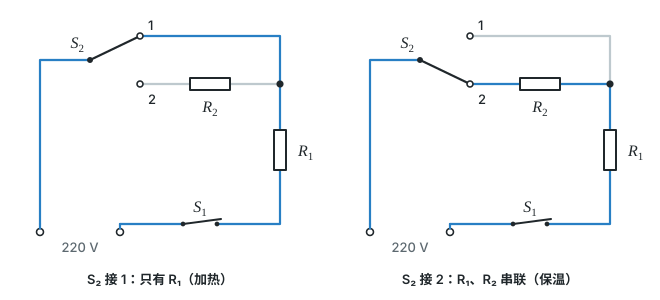

# 第十八章 电功率

这一章从“度”说起，先学电能和电功，再学表示耗电快慢的电功率（含额定功率和实际功率），最后学电流的热效应和焦耳定律。

标着**重点**的四个知识点（电功的计算、电功率及计算、焦耳定律及计算、多挡位用电器的分析与计算）是中考计算大题的常客，几乎每卷必考，要花最多时间；标着**一般**的，会判断、会读数、知道基本概念即可。

## 本章前置自查

下面几件事，哪一件没把握，先回看：

1. 熟练运用欧姆定律 $I=\frac{U}{R}$ 求电流、电压或电阻。（第十七章第 2 节）
2. 识别串联和并联电路，知道串联电路中电流处处相等，并联电路中各支路两端电压相等。（第十五章第 3、5 节，第十六章第 2 节）
3. 知道串联电路的总电阻等于各分电阻之和：$R=R_1+R_2$。（第十七章补充）

---

## 18.1a 电能和电能表

```yaml
id: PHY-9-18-1a
weight: 一般
weight_note: 5 次，读数和 kW·h 计算都较简单
textbook: 九全 18.1 电能 电功，p.111–112
prerequisites:
  - id: PHY-9-14-1a
    strength: soft
    reason: 用电器把电能转化为其他形式的能
evidence:
  - 能说出电能的单位及换算关系
  - 能读出电能表的示数，并计算一段时间内消耗的电能
figure: 不需要
sources: [TB9-18.1, SZ2022-13]
```

### 本次只学

认识电能的单位，会读电能表。

### 先认住

- 物理学中，常用的能量单位是焦耳。生活中的“度”是电能的单位，学名叫作千瓦时，符号是 $\mathrm{kW\cdot h}$。它们之间的关系是 $1\ \mathrm{kW\cdot h}=3.6\times10^6\ \mathrm{J}$。
- 供电单位通过电能表来计量每家消耗的电能。电能表可以显示从表开始计数到读数时为止用户消耗的电能。
- 为了计量一段时间内消耗的电能，要记录这段时间起始和结束时电能表的示数，两次示数之差就是这段时间内的用电量。

### 容易错

- 电能表读数时，最后一位常常是小数，要注意表盘上的特殊标记（通常是红框）。

### 练一练

- `Q-PHY-SZ2022-13-3`

---

## 18.1b 电功的计算 W=UIt

```yaml
id: PHY-9-18-1b
weight: 重点
weight_note: 4 次计算
textbook: 九全 18.1 电能 电功，p.112
prerequisites:
  - id: PHY-9-18-1a
    strength: hard
    reason: 电功就是消耗的电能
  - id: PHY-9-17-2a
    strength: hard
    reason: 常要先用欧姆定律求电流
evidence:
  - 能说出电功的含义和计算公式
  - 能用 $W=UIt$ 计算电流做的功或消耗的电能
figure: 不需要
sources: [TB9-18.1, SZ2024-13]
```

### 本次只学

记住电功的公式，并用来计算消耗的电能。

### 先认住

- 电能转化为其他形式的能的过程也可以说是电流做功的过程，有多少电能发生了转化就说电流做了多少功，即电功是多少。可以说消耗了多少电能，也可以说此过程中电流做了多少功。
- 电流做功的多少跟电流的大小和电压的高低有关，也与通电时间有关。当电路两端的电压为 $U$，电路中的电流为 $I$，通电时间为 $t$ 时，电功 $W$（或者说消耗的电能）为 $W=UIt$。

### 走一遍

课本练习与应用第 2 题：在一个小灯泡的两端加 $2.5\ \mathrm{V}$ 电压时电流是 $0.3\ \mathrm{A}$，它在这种情况下通电 $2\ \mathrm{min}$，消耗的电能是多少？

1. 小灯泡两端的电压 $U=2.5\ \mathrm{V}$，通过的电流 $I=0.3\ \mathrm{A}$。
2. 通电时间 $t=2\ \mathrm{min}=120\ \mathrm{s}$。
3. 根据公式 $W=UIt$，消耗的电能 $W=\textcolor{#287fc4}{2.5}\ \mathrm{V}\times\textcolor{#287fc4}{0.3}\ \mathrm{A}\times\textcolor{#287fc4}{120}\ \mathrm{s}=\boxed{90\ \mathrm{J}}$。

### 容易错

- 代入公式前，时间必须换算成秒（$\mathrm{s}$），不能直接用分钟（$\mathrm{min}$）计算。

### 练一练

- `Q-PHY-SZ2024-13-4`

---

## 18.2a 电功率及计算

```yaml
id: PHY-9-18-2a
weight: 重点
weight_note: 16 次，全科第二多，计算题几乎每卷都有
textbook: 九全 18.2 电功率，p.114–115
prerequisites:
  - id: PHY-9-18-1b
    strength: hard
    reason: P=W/t
  - id: PHY-9-17-2a
    strength: hard
    reason: P=UI 常要和欧姆定律联用
  - id: PHY-9-17-4a
    strength: soft
    reason: 串、并联电路中求总功率
evidence:
  - 能说出电功率的物理意义、单位及计算公式
  - 能用 $P=\frac{W}{t}$ 和 $P=UI$ 计算电功率
figure: 不需要
sources: [TB9-18.2, GZ2025-11, GD2024-25]
```

### 本次只学

理解电功率表示电流做功的快慢，并掌握它的计算方法。

### 先认住

- 物理学中用**电功率**表示电流做功的快慢。电功率等于电功与完成这些电功所用的时间之比。
- 电功率的单位是瓦特，符号是 $\mathrm{W}$。更大的单位是千瓦（$\mathrm{kW}$），$1\ \mathrm{kW}=10^3\ \mathrm{W}$。
- 如果电功用 $W$ 表示，完成这些电功所用的时间用 $t$ 表示，电功率用 $P$ 表示，则 $P=\frac{W}{t}$。
- 将公式 $P=\frac{W}{t}$ 变形得到 $W=Pt$；把 $W=UIt$ 代入 $P=\frac{W}{t}$，可得 $P=UI$。结合欧姆定律 $I=\frac{U}{R}$，还可以推导出 $P=\frac{U^2}{R}$ 以及 $P=I^2R$。

### 走一遍

课本练习与应用第 3 题：一个电热水壶的铭牌上标着“$220\ \mathrm{V}\ \ 1\ 000\ \mathrm{W}$”的字样，它正常工作时，电流是多少？

1. 电热水壶正常工作时的电功率 $P=1000\ \mathrm{W}$，电压 $U=220\ \mathrm{V}$。
2. 根据 $P=UI$ 可得，正常工作时的电流 $I=\frac{P}{U}=\frac{\textcolor{#287fc4}{1000}\ \mathrm{W}}{\textcolor{#287fc4}{220}\ \mathrm{V}}\approx\boxed{4.5\ \mathrm{A}}$。

### 容易错

- 使用 $W=Pt$ 计算时，单位要配套：要么都用国际单位（$W$ 用焦耳，$\mathrm{J}$；$P$ 用瓦特，$\mathrm{W}$；$t$ 用秒，$\mathrm{s}$），要么用常用单位（$W$ 用千瓦时，$\mathrm{kW\cdot h}$；$P$ 用千瓦，$\mathrm{kW}$；$t$ 用小时，$\mathrm{h}$）。

### 练一练

- `Q-PHY-GZ2025-11-2`
- `Q-PHY-GD2024-25-3`

---

## 18.2b 额定功率和实际功率

```yaml
id: PHY-9-18-2b
weight: 一般
weight_note: 3 次；“灯泡亮度由实际功率决定”
textbook: 九全 18.2 电功率，p.115–116
prerequisites:
  - id: PHY-9-18-2a
    strength: hard
    reason: 先会算电功率
evidence:
  - 能区分额定电压、额定功率与实际电压、实际功率
  - 能根据灯泡两端的实际电压判断它的实际功率和发光情况
figure: 不需要
sources: [TB9-18.2, SZ2022-16]
```

### 本次只学

区分额定值和实际值，知道实际功率决定了用电器的实际表现。

### 先认住

- 同一个用电器在不同的电压下工作，它的电功率是不一样的。用电器正常工作时的电压叫作**额定电压**，用电器在额定电压下工作时的电功率叫作**额定功率**。
- 通常用电器的铭牌上标有额定电压和额定功率。例如“$220\ \mathrm{V}\ \ 500\ \mathrm{W}$”，表示额定电压是 $220\ \mathrm{V}$，额定功率是 $500\ \mathrm{W}$。灯泡上标的电流，就是它正常发光时的电流（额定电流）。
- 实际电压偏低，用电器的实际电功率就低，不能正常工作；实际电压偏高，实际电功率过高，有可能损坏用电器。对于小灯泡，其亮度由实际功率决定。

### 容易错

- 铭牌上的功率是额定功率，只有在电压等于额定电压时，实际功率才等于额定功率。小灯泡的灯丝电阻会随温度升高而增大；只有题目明确说明电阻不变时，才可以先用额定值求出 $R=\frac{U^2}{P}$，再求实际电压下的实际功率。

### 练一练

- `Q-PHY-SZ2022-16-5`

---

## 18.2c 测量小灯泡的电功率

```yaml
id: PHY-9-18-2c
weight: 一般
weight_note: 1 次（深圳 2022 实验题）
textbook: 九全 18.2 电功率，p.117
prerequisites:
  - id: PHY-9-18-2b
    strength: hard
    reason: 要测的是额定功率和实际功率
  - id: PHY-9-17-3a
    strength: hard
    reason: 电路和伏安法测电阻相同
evidence:
  - 能说出测量小灯泡电功率的原理
  - 能根据实验数据计算小灯泡的实际功率，判断其是否正常工作
figure: 不需要
sources: [TB9-18.2, SZ2022-16]
```

### 本次只学

知道如何利用电压表和电流表测量小灯泡的电功率，并进行计算。

### 先认住

- 电功率可以通过测量用电器两端的电压和通过用电器的电流，由电功率公式 $P=UI$ 计算得出。这种方法与用伏安法测电阻的电路是相同的。
- 实验中通过调节滑动变阻器改变小灯泡两端的电压，从而测出不同电压下的电流，计算出不同情况下的实际功率。

### 练一练

- `Q-PHY-SZ2022-16-2`

---

## 18.4a 电流的热效应（探究电热与哪些因素有关）

```yaml
id: PHY-9-18-4a
weight: 一般
weight_note: 1 次
textbook: 九全 18.4 焦耳定律，p.120–121
prerequisites:
  - id: PHY-9-16-3a
    strength: soft
    reason: 电热与电阻有关
  - id: PHY-9-15-5a
    strength: soft
    reason: 串联保证电流相同
evidence:
  - 能说出什么是电流的热效应
  - 能说出电热多少与哪些因素有关
figure: 不需要
sources: [TB9-18.4]
```

### 本次只学

认识电流的热效应，知道它跟电流和电阻的关系。

### 先认住

- 电流通过导体时电能转化成内能，这种现象叫作**电流的热效应**。
- 实验表明：在电流相同、通电时间相同的情况下，一段电阻丝的电阻越大，这段电阻丝产生的热量越多。
- 实验表明：在电阻相同、通电时间相同的情况下，通过一段电阻丝的电流越大，这段电阻丝产生的热量越多。

### 容易错

- 探究电热与电阻的关系时，把两个阻值不同的电阻串联，是为了保证通过它们的电流相同；通电时间相同是另外要控制的条件（同时通电、同时断开）。

### 练一练

- `Q-PHY-TB9-18.4-7`
- `Q-PHY-GD2021-13`

---

## 18.4b 焦耳定律及计算

```yaml
id: PHY-9-18-4b
weight: 重点
weight_note: 4 次计算
textbook: 九全 18.4 焦耳定律，p.121–122
prerequisites:
  - id: PHY-9-18-4a
    strength: hard
    reason: Q=I²Rt 是实验结论
  - id: PHY-9-17-2a
    strength: hard
    reason: 常要先求电流
evidence:
  - 能写出焦耳定律的公式
  - 能用 $Q=I^2Rt$ 计算电流产生的热量
figure: 不需要
sources: [TB9-18.4, GZ2022-17]
```

### 本次只学

记住焦耳定律公式，会计算电热。

### 先认住

- **焦耳定律**：电流通过导体产生的热量跟电流的二次方成正比，跟导体的电阻成正比，跟通电时间成正比。
- 公式表达：$Q=I^2Rt$。（其中热量 $Q$ 的单位是焦耳 $\mathrm{J}$，电流 $I$ 的单位是安培 $\mathrm{A}$，电阻 $R$ 的单位是欧姆 $\mathrm{\Omega}$，时间 $t$ 的单位是秒 $\mathrm{s}$）
- 电流通过导体时，如果电能全部转化为内能（如电炉、电热取暖器），那么电流产生的热量 $Q$ 就等于消耗的电能 $W$，即 $Q=W=UIt$。再结合欧姆定律 $U=IR$，也可推导出 $Q=I^2Rt$。

### 破题钥匙

```think
现象: 电炉丝热得发红，和它串联的导线却几乎不热
模型: 导线与电炉丝串联，电流相等，导线电阻很小、电炉丝电阻大
图: phy-b-joule-series
关系: $Q=I^2Rt$，电流和时间相同时，$R$ 越大 $Q$ 越多
招: 控制变量
结: 电流相同，电阻大的产生的热量多
```

### 走一遍

课本练习与应用第 1 题：通过某电阻丝的电流为 $2\ \mathrm{A}$ 时，测得它的电阻是 $2\ \Omega$，该电阻丝 $1\ \mathrm{min}$ 产生多少热量？

1. 通过电阻丝的电流 $I=2\ \mathrm{A}$，电阻 $R=2\ \Omega$。
2. 通电时间 $t=1\ \mathrm{min}=60\ \mathrm{s}$。
3. 根据焦耳定律公式 $Q=I^2Rt$，产生的热量 $Q=(\textcolor{#287fc4}{2}\ \mathrm{A})^2\times\textcolor{#287fc4}{2}\ \Omega\times\textcolor{#287fc4}{60}\ \mathrm{s}=\boxed{480\ \mathrm{J}}$。

### 容易错

- 导线和电炉丝串联，电流相等。根据 $Q=I^2Rt$，因为电炉丝的电阻远大于导线的电阻，所以电炉丝产生的热量比导线多得多，导致电炉丝热得发红而导线却几乎不发热。
- 如果电能没有全部用来产生热量（例如电动机转动），消耗的电能 $W$ 大于产生的热量 $Q$，此时计算电热只能用 $Q=I^2Rt$。

### 练一练

- `Q-PHY-GZ2022-17-2b`

---

## 18.4c 多挡位用电器的分析与计算

```yaml
id: PHY-9-18-4c
weight: 重点
weight_note: 5 次，广东、深圳计算题常考，广州 2024 第 15 题
textbook: 九全 18.4 焦耳定律，p.126
prerequisites:
  - id: PHY-9-18-2a
    strength: hard
    reason: 由 P=U²/R 判断电阻小时功率大
  - id: PHY-9-17-4a
    strength: hard
    reason: 开关切换后电阻串联或并联
  - id: PHY-9-15-3a
    strength: hard
    reason: 要识别每个挡位的连接方式
evidence:
  - 能根据电路图判断不同开关状态下的连接方式（串联、单独工作、并联）
  - 能判断哪种状态对应高温挡（大功率）、低温挡（小功率）
  - 能计算不同挡位下的电功率、电流和消耗的电能
figure: 已完成 figures/kettle-two-settings.svg（照课本图 18-3，左右两格分别画 S₂ 接 1、接 2，蓝色标出有电流的路径）
sources: [TB9-18R, GZ2024-15]
```

### 本次只学

分析多挡位电热器（如电热敷腰带、电烤箱）在不同挡位时的电路状态，并进行计算。

### 先认住

- 很多电热器有“高温挡”和“低温挡”。由 $P=UI$ 和 $I=\frac{U}{R}$ 可得 $P=\frac{U^2}{R}$。在电源电压 $U$ 不变的情况下，电路总电阻越小，电功率越大，对应高温挡；总电阻越大，电功率越小，对应低温挡。
- 分析电路时，先看不同开关状态下是哪几个电阻接入电路，它们是串联、单独工作还是并联。
- 比较各挡的总功率：两个电阻串联时总电阻最大，总功率最小；并联时总功率等于各支路功率之和，比其中任一个电阻单独工作时大。

### 破题钥匙

```think
现象: 电热水壶有加热、保温两挡，靠开关切换
模型: 开关把 $R_2$ 短接或断开，接入电路的总电阻就不同
图: phy-b-gears
关系: $P=\dfrac{U^2}{R}$，$U$ 不变时 $R$ 越小 $P$ 越大
招: 等效
结: 先画出每个挡位的等效电路，再比较总电阻
```

### 走一遍

课本复习与提高第 6 题：图 18-3 是一种电热水壶工作电路的示意图，其中电阻为 $R_1$ 和 $R_2$ 的电阻器都是用来加热的，$S_1$ 是总开关，$S_2$ 是挡位开关。当 $S_2$ 接 1 时，电热水壶处于加热状态，电功率为 $1\ 100\ \mathrm{W}$。当 $S_2$ 接 2 时，电热水壶处于保温状态，此时电阻为 $R_1$ 的电阻器的电功率为 $2.75\ \mathrm{W}$。求：（1）电阻 $R_1$ 是多少？（2）开关 $S_2$ 接 2 时，电路中的电流是多少？（3）电热水壶处于保温状态时的电功率是多少？

（图 18-3 中，电源电压为 $220\ \mathrm{V}$；$S_2$ 接 1 时，导线把 $R_2$ 绕过去，只有 $R_1$ 接入电路；$S_2$ 接 2 时，$R_2$ 与 $R_1$ 串联。）



1. $S_2$ 接 1 时，电路中只有 $R_1$ 接入电路，处于加热状态，$P_1=1100\ \mathrm{W}$。由 $P=\frac{U^2}{R}$ 可得：
   $R_1=\frac{U^2}{P_1}=\frac{(\textcolor{#287fc4}{220}\ \mathrm{V})^2}{\textcolor{#287fc4}{1100}\ \mathrm{W}}=\boxed{44\ \Omega}$。
2. $S_2$ 接 2 时，$R_1$ 与 $R_2$ 串联，处于保温状态。此时通过 $R_1$ 的电流就是电路的总电流，$R_1$ 的功率 $P_1'=2.75\ \mathrm{W}$。由 $P=I^2R$ 可得：
   $I=\sqrt{\frac{P_1'}{R_1}}=\sqrt{\frac{\textcolor{#287fc4}{2.75}\ \mathrm{W}}{\textcolor{#287fc4}{44}\ \Omega}}=\boxed{0.25\ \mathrm{A}}$。
3. 保温状态时，电路总电压 $U=220\ \mathrm{V}$，总电流 $I=0.25\ \mathrm{A}$，保温电功率：
   $P_{\text{保}}=UI=\textcolor{#287fc4}{220}\ \mathrm{V}\times\textcolor{#287fc4}{0.25}\ \mathrm{A}=\boxed{55\ \mathrm{W}}$。

### 容易错

- 不要以为“单独一个电阻工作”一定是某个固定挡位：在电热水壶这类两挡电路里，单独一个电阻工作是加热挡，两个电阻串联是保温挡；有并联挡位的电路里，并联时总功率 $P=P_1+P_2$，比单独一个电阻工作时大。
- 判断挡位时，不要只看接入的电阻个数，要看总功率的大小：串联时总电阻大、总功率小（低温挡）；并联时各支路功率相加、总功率大（高温挡）。

### 练一练

- `Q-PHY-GZ2024-15`
