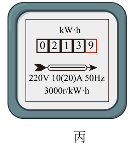
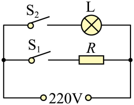
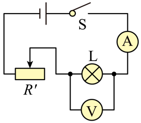
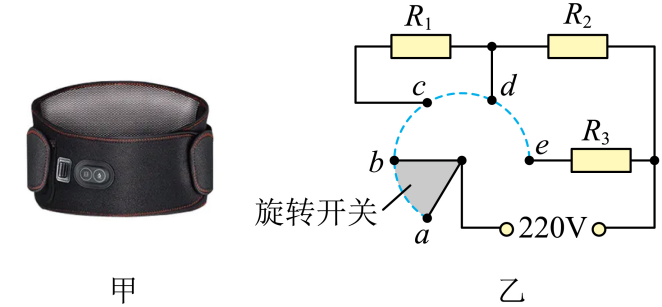
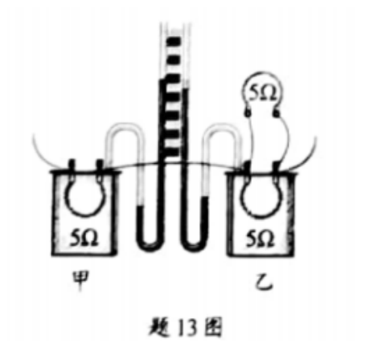

# 第十八章 电功率 · 题目

讲义只用 `lesson.md` 里引用的题，按知识点顺序排在前面。真题按“精品解析”原卷录入，公式图片已读出文字并核对；课本习题原文已对照课本，答案和解析为本项目编写，**发布前需要复核**。

---

## 讲义用题（9 道）

### Q-PHY-SZ2022-13-3

```yaml
category: 真题
source: 2022 年深圳市初中学业水平考试 物理 第 13 题第（3）问
source_quality: 原卷
kp: PHY-9-18-1a
do: 本章只做第（3）问
type: 填空
grading: 自评
answer_by: 原卷解析
review:
  概念: PHY-9-18-1a
other_parts: （1）长度测量 → PHY-8A-01-1a；（2）温度计读数 → PHY-8A-03-1a。这些小问不在本章使用。
```

**题干**

如图丙，电能表示数为___________。



**答案**

$213.9\ \mathrm{kW\cdot h}$

**解析**

1. 电能表的示数由几位整数和一位小数组成，红框内的最后一位是小数。
2. 读数为 $213.9\ \mathrm{kW\cdot h}$。

---

### Q-PHY-SZ2024-13-4

```yaml
category: 真题
source: 2024 年深圳市初中学业水平考试 物理 第 13 题第（4）问
source_quality: 原卷
kp: PHY-9-18-1b
do: 本章只做第（4）问
type: 填空
grading: 自评
answer_by: 原卷解析（改写为着色步骤）
review:
  计算: PHY-9-18-1b
other_parts: （1）纠正连线错误；（2）发现错误数据；（3）探究电流与电阻成反比的依据。这些小问不在本章使用。
```

**题干**

在探究导体中电流与电阻关系的实验中，保持定值电阻两端电压为 $2\ \mathrm{V}$ 不变，得到实验数据如下表所示：

| 数据序号 | 1 | 2 | 3 | 4 | 5 | 6 |
| --- | --- | --- | --- | --- | --- | --- |
| 电阻 $R/\Omega$ | 30 | 25 | 20 | 15 | 10 | 5 |
| 电流 $I/\mathrm{A}$ | 0.07 | 0.08 | 0.10 | 0.70 | 0.20 | 0.40 |

在做第五次实验时，调节滑动变阻器使电压表示数为 $2\ \mathrm{V}$，用时 $8\ \mathrm{s}$ 完成电流表读数，这 $8\ \mathrm{s}$ 内，定值电阻 $R$ 消耗的电能是___________$\mathrm{J}$。

**答案**

$3.2$

**解析**

1. 由表中第 5 次实验数据可知，定值电阻两端的电压 $U=2\ \mathrm{V}$，通过的电流 $I=0.20\ \mathrm{A}$，通电时间 $t=8\ \mathrm{s}$。
2. 定值电阻 $R$ 消耗的电能：
$W=UIt=\textcolor{#287fc4}{2}\ \mathrm{V}\times\textcolor{#287fc4}{0.20}\ \mathrm{A}\times\textcolor{#287fc4}{8}\ \mathrm{s}=\boxed{3.2\ \mathrm{J}}$

---

### Q-PHY-GZ2025-11-2

```yaml
category: 真题
source: 2025 年广州市初中学业水平考试 物理 第 11 题第（2）问
source_quality: 原卷
kp: PHY-9-18-2a
do: 本章只做第（2）问
type: 填空
grading: 自评
answer_by: 原卷解析（改写为着色步骤）
review:
  计算: PHY-9-18-2a
other_parts: （1）能源种类判断不在本章使用。
```

**题干**

如图所示的“风光互补”路灯，其太阳能电池板和风力发电机产生的电能，输送至蓄电池储存起来，供路灯照明使用。蓄电池储存的电能为 $4.8\ \mathrm{kW\cdot h}$，若全部用于路灯供电，可供额定功率为 $80\ \mathrm{W}$ 的路灯正常发光___________$\mathrm{h}$。

**答案**

$60$

**解析**

1. 路灯额定功率 $P=80\ \mathrm{W}=0.08\ \mathrm{kW}$。
2. 根据 $P=\frac{W}{t}$ 可得，正常发光的时间：
$t=\frac{W}{P}=\frac{\textcolor{#287fc4}{4.8}\ \cancel{\mathrm{kW}}\cdot\mathrm{h}}{\textcolor{#287fc4}{0.08}\ \cancel{\mathrm{kW}}}=\boxed{60\ \mathrm{h}}$

---

### Q-PHY-GD2024-25-3

```yaml
category: 真题
source: 2024 年广东省初中学业水平考试 物理 第 25 题第（3）问
source_quality: 原卷
kp: PHY-9-18-2a
do: 本章只做第（3）问
type: 计算
grading: 自评
answer_by: 原卷解析（改写为着色步骤）
review:
  计算: PHY-9-18-2a
other_parts: （1）（2）通过 R 的电流和 R 的电功率计算不在本章使用。
```

**题干**

某消毒柜具有高温消毒和紫外线杀菌功能，其简化电路如图所示。发热电阻 $R=110\ \Omega$，紫外灯 L 规格为“$220\ \mathrm{V}\ \ 50\ \mathrm{W}$”。闭合开关 $S_1$ 和 $S_2$，消毒柜正常工作，求 L 工作 $100\ \mathrm{s}$ 消耗的电能。



**答案**

$5000\ \mathrm{J}$

**解析**

1. L 与 R 并联在电源两端，L 两端的电压等于电源电压 $220\ \mathrm{V}$，正好是额定电压，电功率 $P=50\ \mathrm{W}$。
2. 工作 $100\ \mathrm{s}$ 消耗的电能：
$W=Pt=\textcolor{#287fc4}{50}\ \mathrm{W}\times\textcolor{#287fc4}{100}\ \mathrm{s}=\boxed{5000\ \mathrm{J}}$

---

### Q-PHY-SZ2022-16-5

```yaml
category: 真题
source: 2022 年深圳市初中学业水平考试 物理 第 16 题第（5）问
source_quality: 原卷
kp: PHY-9-18-2b
do: 本章只做第（5）问
type: 填空
grading: 自评
answer_by: 原卷解析（改写为着色步骤）
review:
  概念: PHY-9-18-2b
other_parts: （1）电路故障判断；（2）滑动变阻器滑片调节；（3）电流表读数；（4）正常发光时的电阻计算。这些小问不在本题使用。
```

**题干**

小明需要测量小灯泡的额定功率，灯泡铭牌是“$3.8\ \mathrm{V}\text{，}1.15\ \mathrm{W}$”。实验数据如下表：

| 电压表示数 | $3.0\ \mathrm{V}$ | $3.8\ \mathrm{V}$ |
| --- | --- | --- |
| 电流表示数 | $0.32\ \mathrm{A}$ | $0.4\ \mathrm{A}$ |

通过计算，判断出这只小灯泡铭牌上的参数___________（选填“合格”或“不合格”）；在这个实验中，可能会观察到小灯泡出现的现象是___________（一点即可）。

**答案**

不合格；小灯泡发光较亮，灯丝烧断

**解析**

1. 当小灯泡两端电压为额定电压 $U=3.8\ \mathrm{V}$ 时，电流 $I=0.4\ \mathrm{A}$。
2. 按额定电压 $3.8\ \mathrm{V}$ 测得的功率：
$P=UI=\textcolor{#287fc4}{3.8}\ \mathrm{V}\times\textcolor{#287fc4}{0.4}\ \mathrm{A}=1.52\ \mathrm{W}$
3. 因为 $1.52\ \mathrm{W} > 1.15\ \mathrm{W}$，所以小灯泡铭牌上的参数 $\boxed{\text{不合格}}$。
4. 由于实际测得的电功率大于铭牌标注的额定功率，故在这个实验中，可能会观察到小灯泡发光较亮，甚至灯丝烧断。

---

### Q-PHY-SZ2022-16-2

```yaml
category: 真题
source: 2022 年深圳市初中学业水平考试 物理 第 16 题第（2）问
source_quality: 原卷
kp: PHY-9-18-2c
do: 本章只做第（2）问
type: 填空
grading: 自评
answer_by: 原卷解析
review:
  概念: PHY-9-18-2c
other_parts: （1）电路故障判断；（3）电流表读数；（4）正常发光时的电阻计算；（5）额定功率判断。这些小问不在本题使用。
```

**题干**

小明需要测量小灯泡的额定功率，灯泡铭牌是“$3.8\ \mathrm{V}\text{，}1.15\ \mathrm{W}$”。连接电路如图所示：



实验过程中，小明发现小灯泡较暗，如果要让小灯泡正常发光，他应将滑动变阻器向___________（选填“左”或“右”）滑动。

**答案**

左

**解析**

1. 小灯泡较暗，说明小灯泡两端的实际电压过小，低于额定电压 $3.8\ \mathrm{V}$。
2. 根据串联电路的分压原理，要让小灯泡正常发光，需要增大灯泡两端的电压，因此应减小滑动变阻器两端的电压，即减小滑动变阻器连入电路的电阻。
3. 由电路图可知，滑动变阻器滑片向左移动时连入电路的电阻减小，因此应将滑动变阻器向左滑动。

---

### Q-PHY-TB9-18.4-7

```yaml
category: 课本习题
source: 人教版九年级全一册物理 第十八章第 4 节 练习与应用 第 7 题
source_quality: 课本原文
kp: PHY-9-18-4a
type: 简答
grading: 自评
answer_by: 本项目编写，已复核
review:
  概念: PHY-9-18-4a
```

**题干**

在家庭电路中，有时导线长度不够，需要把两根导线连接起来。有人把导线简单地拧在一起，这样会使得连接处电阻增大，导致连接处比别处容易发热，甚至引起火灾。这是为什么？

**答案**

连接处与导线串联，电流和通电时间相同；连接处电阻比别处大，根据实验结论，电流和通电时间相同时，电阻越大产生的热量越多，所以连接处更容易发热。

**解析**

1. 导线连接处与导线的其余部分是串联的，通过连接处和其余导线的电流相等，通电时间也相同。
2. 将两根导线简单拧在一起，连接处的电阻比别处的导线电阻明显增大。
3. 根据实验结论，在电流和通电时间相同的条件下，电阻越大，产生的热量越多。
4. 因此连接处比别处产生的热量多，容易发热甚至引起火灾。

---

### Q-PHY-GZ2022-17-2b

```yaml
category: 真题
source: 2022 年广州市初中学业水平考试 物理 第 17 题第（2）问②
source_quality: 原卷
kp: PHY-9-18-4b
do: 本章只做第（2）问②
type: 计算
grading: 自评
answer_by: 原卷解析（改写为着色步骤）
review:
  计算: PHY-9-18-4b
other_parts: （1）求 t1 时 M 的电功率；（2）①求 a 两端电压；（3）用笔画线连接电磁继电器电路。这些小问不在本章使用。
```

**题干**

汽车启动时，启动电动机 M 仅通过导线 a、b 接入电路，a 的电阻为 $0.001\ \mathrm{\Omega}$，若通过 M 的电流为 $200\ \mathrm{A}$，持续 $0.5\ \mathrm{s}$，求此过程导线 a 产生的热量。

**答案**

$20\ \mathrm{J}$

**解析**

1. 导线 a 与电动机 M 串联，由串联电路中电流处处相等可得，通过导线 a 的电流与电动机的电流相等，即 $I_a=I_M=200\ \mathrm{A}$。
2. 已知导线 a 的电阻 $R_a=0.001\ \mathrm{\Omega}$，通电时间 $t=0.5\ \mathrm{s}$。
3. 导线 a 产生的热量：
$Q_a=I_a^2R_at=(\textcolor{#287fc4}{200}\ \mathrm{A})^2\times\textcolor{#287fc4}{0.001}\ \mathrm{\Omega}\times\textcolor{#287fc4}{0.5}\ \mathrm{s}=\boxed{20\ \mathrm{J}}$

---

### Q-PHY-GZ2024-15

```yaml
category: 真题
source: 2024 年广州市初中学业水平考试 物理 第 15 题
source_quality: 原卷
kp: PHY-9-18-4c
type: 计算
grading: 自评
answer_by: 原卷解析（改写为着色步骤）
review:
  概念: PHY-9-18-4c
```

**题干**

某电热敷腰带如图甲所示，有高温、中温和低温三个挡位，图乙是内部简化电路图，$R_1$、$R_2$、$R_3$ 为加热电阻，其中 $R_1$、$R_2$ 的阻值均为 $1100\ \mathrm{\Omega}$，通过旋转开关可以实现挡位切换。把电热敷腰带接入 $220\ \mathrm{V}$ 的家庭电路中。



（1）旋转开关转至______（选填“ab”、“bc”、“cd”或“de”）时，电热敷腰带处于高温挡工作，理由是：______；
（2）电热敷腰带在高温挡工作时的总电流为 $0.25\ \mathrm{A}$，求通电 $10\ \mathrm{min}$ 消耗的电能；
（3）旋转开关转至 bc 时，电热敷腰带的功率为 $22\ \mathrm{W}$，求电路的总电流；
（4）旋转开关转至 cd 时，求电热敷腰带的功率。

**答案**

（1）de；旋转开关转至 de 时，电路电阻最小，电功率最大
（2）$3.3\times10^4\ \mathrm{J}$
（3）$0.1\ \mathrm{A}$
（4）$44\ \mathrm{W}$

**解析**

（1）由图乙可知，旋转开关转至 bc 时，$R_1$、$R_2$ 串联，此时电路总电阻最大，根据公式 $P=\frac{U^2}{R}$ 可知电功率最小，为低温挡；旋转开关转至 cd 时，只有 $R_2$ 接入电路，为中温挡；旋转开关转至 de 时，$R_2$ 与 $R_3$ 并联，电路电阻最小，功率最大，为高温挡。（也可以这样想：并联时总功率 $P=P_2+P_3$，比只有 $R_2$ 时大。）
（2）电热敷腰带在高温挡工作时的总电流为 $0.25\ \mathrm{A}$，通电 $10\ \mathrm{min}=600\ \mathrm{s}$，消耗的电能为：
$W=UIt=\textcolor{#287fc4}{220}\ \mathrm{V}\times\textcolor{#287fc4}{0.25}\ \mathrm{A}\times\textcolor{#287fc4}{600}\ \mathrm{s}=\boxed{3.3\times10^4\ \mathrm{J}}$
（3）旋转开关转至 bc 时，电热敷腰带的功率为 $22\ \mathrm{W}$，电路的总电流为：
$I=\frac{P}{U}=\frac{\textcolor{#287fc4}{22}\ \mathrm{W}}{\textcolor{#287fc4}{220}\ \mathrm{V}}=\boxed{0.1\ \mathrm{A}}$
（4）旋转开关转至 cd 时，只有 $R_2$ 工作，为中温挡，电热敷腰带的功率为：
$P=\frac{U^2}{R_2}=\frac{(\textcolor{#287fc4}{220}\ \mathrm{V})^2}{\textcolor{#287fc4}{1100}\ \mathrm{\Omega}}=\boxed{44\ \mathrm{W}}$

### Q-PHY-GD2021-13

```yaml
category: 真题
source: 2021 年广东省初中学业水平考试 物理 第 13 题
source_quality: 原卷（本地存档 Word 转 PDF 页，逐页核对）
kp: PHY-9-18-4a
type: 填空
grading: 自评
answer_by: 原卷解析
review:
  概念: PHY-9-18-4a
```

**题干**

题 13 图是探究电流通过导体产生的热量与＿＿＿＿关系的实验装置，实验中用 U 形管内液面的＿＿＿＿反映导体产生热量的多少。通电一段时间后，容器＿＿＿＿（选填“甲”或“乙”）内电阻丝产生的热量较多。



**答案**

电流；高度差；甲

**解析**

图中乙容器外并联了一个 $5\,\Omega$ 的电阻，使通过乙容器内电阻丝的电流小于通过甲容器内电阻丝的电流，而两容器内电阻丝阻值相等、通电时间相同，所以探究的是电热与电流的关系。用 U 形管液面高度差反映产生热量的多少（转换法）。电流大的甲容器内电阻丝产生的热量较多。

