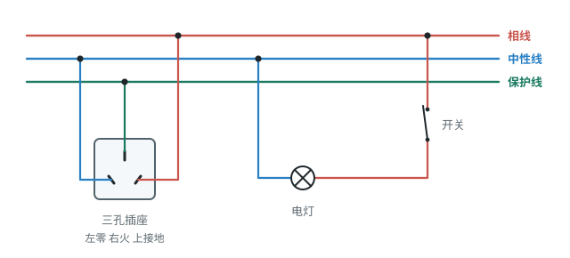

# 第十九章 生活用电

这一章我们将学习家庭电路的基本知识。从发电厂输送来的电能，如何安全地分配给家里的各个用电器？为了防范触电和火灾，家庭电路中又设计了哪些保护措施？

本章重点是**家庭电路的组成与连接**，这是中考作图题常考的内容；其余三个知识点是**一般**，多在选择题或填空题中考查安全用电常识。

## 本章前置自查

下面三件事，哪一件没把握，先回看：

1. 知道并联电路中各支路互不影响。（第十五章第 3 节）
2. 说出什么是短路，以及短路时电流非常大。（第十五章第 2 节）
3. 会用 $P=UI$ 算电流。（第十八章第 2 节）

---

## 19.1a 家庭电路中电流过大的原因

```yaml
id: PHY-9-19-1a
weight: 一般
weight_note: 2 次
textbook: 九全 19.1 安全用电，p.128–129
prerequisites:
  - id: PHY-9-18-2a
    strength: hard
    reason: 总功率过大导致电流过大
  - id: PHY-9-15-2d
    strength: hard
    reason: 短路导致电流过大
evidence:
  - 能说出家庭电路中电流过大的两个原因：总功率过大和短路
  - 能用 $I = \frac{P}{U}$ 估计用电器的电流，判断是否超过安全值
figure: 不需要
sources: [SZ2022-19]
```

### 本次只学

知道导致家庭电路中电流过大的两个常见原因。

### 先认住

- 进户的两条输电线中，一条叫**相线**（用 L 表示），俗称火线；另一条叫**中性线**（用 N 表示），俗称零线。相线与中性线之间的电压是 $220\ \mathrm{V}$。
- **用电器的总功率过大**：家庭电路中用电器是并联的，总功率 $P$ 越大，总电流 $I$ 就越大（$I = \frac{P}{U}$）。用电器总功率过大时，电路中的电流可能超过安全值，引发火灾；电流过大时，空气开关会自动“跳闸”（或保险丝熔断）切断电路。
- **短路**：相线和中性线直接连通。如电线绝缘皮破损老化、用电器进水等。短路时电路电阻极小，电流非常大，会产生大量热，容易引发火灾。

### 容易错

- 以为同时用的电器多了，电压会变大。其实家庭电路电压不变（$220\ \mathrm{V}$），是总功率变大，干路电流才变大。

### 练一练

- `Q-PHY-SZ2022-19-1`

---

## 19.1b 触电与安全用电

```yaml
id: PHY-9-19-1b
weight: 一般
weight_note: 1 次
textbook: 九全 19.1 安全用电，p.129–133
prerequisites:
  - id: PHY-9-15-2b
    strength: hard
    reason: 人体是导体，接触火线就会有电流通过
  - id: PHY-9-15-2d
    strength: soft
    reason: 触电就是人体成了电流的通路
evidence:
  - 能说出触电是电流通过人体造成的
  - 能分辨低压触电和高压触电的常见情况，说出安全用电的原则
figure: 不需要
sources: [SZ2023-03]
```

### 本次只学

识别常见的触电危险，记住安全用电的原则。

### 先认住

- 人体是导体。当人体成为闭合电路的一部分时，如果有大电流通过就会发生触电事故。
- **常见触电类型**：低压触电（一手接触相线、一手接触中性线；或一手接触相线，人站在地上）；高压触电（即使不直接接触也有危险，如高压电弧触电、跨步电压触电）。
- **安全用电原则**：不接触低压带电体，不靠近高压带电体；更换灯泡、搬动用电器前应断开电源；不弄湿用电器，不损坏绝缘层。

### 容易错

- 发生触电事故时，千万不能用手去拉触电的人，而是要**立即安全地切断电源**。
- 电器起火时，千万不能用水灭火，因为水是导体，容易引发触电。

### 练一练

- `Q-PHY-SZ2023-03`

---

## 19.2a 家庭电路的组成与连接（作图）

```yaml
id: PHY-9-19-2a
weight: 重点
weight_note: 3 次，广东每年作图题都可能考（开关接火线、三孔插座）
textbook: 九全 19.2 家庭电路的基本组成，p.136–138
prerequisites:
  - id: PHY-9-15-3a
    strength: hard
    reason: 家用电器是并联的
  - id: PHY-9-15-2c
    strength: hard
    reason: 要会画电路
evidence:
  - 能说出家庭电路的基本组成部分和先后顺序
  - 能画出控制电灯的开关和电灯的正确接法
  - 能画出三孔插座的正确接法
figure: 已完成 figures/home-wiring.svg（家庭电路接线图：电灯、开关、三孔插座）
sources: [GD2023-17, GD2024-17]
```

### 本次只学

认清家庭电路的各个组成部分，能正确地把开关、电灯和插座连入电路。

### 先认住

- **基本组成部分**（按进户后的顺序）：进户线 $\rightarrow$ 电能表 $\rightarrow$ 总开关（含保险装置，如断路器） $\rightarrow$ 插座、用电器。电能表用来计量所消耗的电能；修理电路时必须断开总开关。各用电器之间是**并联**的。
- **开关和电灯的连接**：控制电灯的开关必须连接在**相线**和电灯之间，电灯另一端接在中性线上。这样断开开关后，电灯就与相线断开，避免更换灯泡时触电。
- **三孔插座的连接**：遵循“左零右火上接地”的原则。面对插座，左孔接中性线，右孔接相线，上孔接保护线（地线）。（2024 年广东卷的解析写作“左零右火中接地”，“中”指上方中间的那个孔）

### 走一遍

课本 19.2 练习第 4 题：将电灯、开关和三孔插座接入家庭电路（相线、中性线、保护线）。

1. **接开关与电灯**：开关接在相线上，再与电灯串联，电灯另一端接在中性线上。这样断开开关时电灯与相线断开，更换灯泡更安全。
2. **接三孔插座**：面对插座，左孔接中性线，右孔接相线，上孔接保护线。
3. **检查**：电灯支路与插座并联，各自独立工作；开关断开时电灯不带电；三孔插座上孔接保护线，能保证用电器金属外壳接地。



### 容易错

- 控制电灯的开关如果接在中性线和电灯之间，虽然也能控制电灯发光，但断开开关时电灯依然与相线连通，人接触电灯容易触电。

### 练一练

- `Q-PHY-GD2023-17`
- `Q-PHY-GD2024-17`

---

## 19.2b 试电笔、保护装置和三孔插座

```yaml
id: PHY-9-19-2b
weight: 一般
weight_note: 2 次（广州 2024 用试电笔判断故障偏难）
textbook: 九全 19.2 家庭电路的基本组成，p.134–137
prerequisites:
  - id: PHY-9-19-2a
    strength: hard
    reason: 先知道火线、零线、地线
evidence:
  - 能说出保险装置（保险丝、空气开关）的作用
  - 能说出测电笔的作用和使用方法
  - 能说出三脚插头和漏电保护器的作用
figure: 不需要
sources: [SZ2024-11]
```

### 本次只学

认识家庭电路里的安全防线：试电笔、保险丝、漏电保护器和三孔插座。

### 先认住

- **测电笔（真题里也叫试电笔）**：用来辨别相线和中性线。使用时，手要按住金属笔卡（螺丝刀式则抵住金属帽），笔尖接触导线。若接触的是相线，氖管会发光；接触中性线时氖管不发光。
- **保险装置**：熔断器（保险丝）由电阻较大、熔点较低的铅锑合金制成，电流过大时熔断。现代住宅常采用低压断路器（空气开关），当电流过大时会自动“跳闸”。
- **三脚插头与漏电保护器**：三脚插头中较长的那个脚（课本图 19.2-7 中的①脚）与用电器的金属外壳相连，插入时最先接地，拔出时最后分离。万一外壳带电，电流会从保护线流走，一般情况下不会造成伤害；但外壳接地并不能保证电路被及时断开，因此还要安装漏电保护器，在漏电或有人触电时迅速切断电路。

### 容易错

- 使用测电笔时，手千万不能碰到**笔尖**的金属部分，否则会触电；手要按住金属笔卡（螺丝刀式则抵住金属帽），这样才能与大地形成闭合回路让氖管发光（笔内有高阻值电阻，通过人体的电流极小，对人体安全）。
- 空气开关主要防电流过大（总功率过大或短路时跳闸）；漏电保护器主要防漏电（电流流入大地或人体触电时切断电路）。两者作用不同。

### 练一练

- `Q-PHY-SZ2024-11-1`
