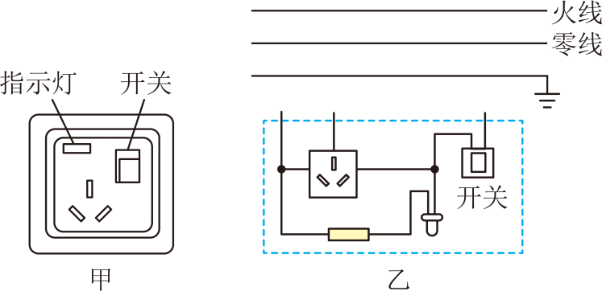
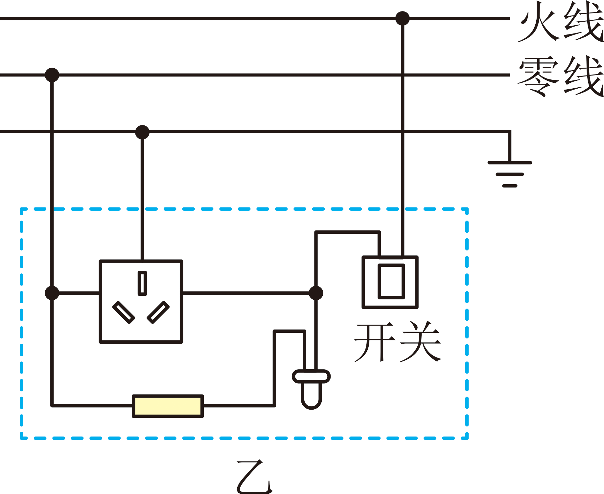
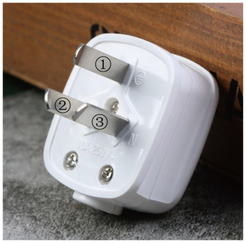
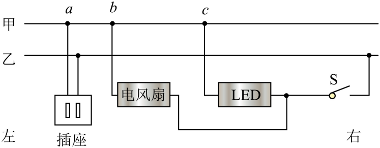

# 第十九章 生活用电 · 题目

讲义只用 `lesson.md` 里引用的题，按知识点顺序排在前面。真题按“精品解析”原卷录入，公式图片已重算核对；备选中的课本习题已对照课本 PDF 原页，答案和解析为本项目编写，**发布前需要复核**。

---

## 讲义用题（5 道）

### Q-PHY-SZ2022-19-1

```yaml
category: 真题
source: 2022 年广东省深圳市中考物理试题 第 19 题
source_quality: 原卷（精品解析整理版）
kp: PHY-9-19-1a
do: 本章只做第（1）问和第（3）问
type: 简答
grading: 自评
answer_by: 原卷解析（已重算核对）
review:
  概念: PHY-9-19-1a
other_parts: （2）电阻与焦耳定律 → PHY-9-16-3a、PHY-9-18-4b；（4）（5）水吸热与加热效率 → PHY-9-13-1c、PHY-9-14-3b。这些小问不在本章使用
```

**题干**

19. （1）小明检测到家庭最大电流为 5 A，要买一个电热水壶，一个为“220 V，1000 W”，一个为“220 V，1500 W”，小明选了 1000 W 的，请根据计算说出为什么不选 1500 W 的？___________
（3）小明把一个电热水壶插进插座，打开开关，突然家里的用电器都不工作了，请写出可能的两个原因：①___________；②___________。

**答案**

（1）“220 V，1500 W”的电热水壶额定电流约为 6.8 A，超过了家庭最大电流 5 A，而 1000 W 的额定电流约为 4.5 A，不超过 5 A，因此不选 1500 W 的；（3）① 电热水壶内部电路短路；② 电热水壶功率过大。

**解析**

1. 第（1）问：“220 V，1000 W”的电热水壶的额定电流为
   $I_1=\dfrac{P_1}{U}=\dfrac{\textcolor{#287fc4}{1000}\ \mathrm{W}}{\textcolor{#287fc4}{220}\ \mathrm{V}}\approx 4.5\ \mathrm{A}<5\ \mathrm{A}$
2. “220 V，1500 W”的电热水壶的额定电流为
   $I_2=\dfrac{P_2}{U}=\dfrac{\textcolor{#287fc4}{1500}\ \mathrm{W}}{\textcolor{#287fc4}{220}\ \mathrm{V}}\approx\boxed{6.8\ \mathrm{A}}>5\ \mathrm{A}$
3. 因为家庭最大电流为 5 A，$I_1<5\ \mathrm{A}$，$I_2>5\ \mathrm{A}$，故不选择 1500 W 的电热水壶。
4. 第（3）问：导致家里的用电器都不工作的原因有两个，分别是用电器内部电路短路或用电器功率过大，使得家庭电路中总电流过大导致空气开关跳闸或保险丝烧断。

---

### Q-PHY-SZ2023-03

```yaml
category: 真题
source: 2023 年广东省深圳市中考物理试题 第 3 题
source_quality: 原卷（精品解析整理版）
kp: PHY-9-19-1b
type: 选择
grading: 自动
answer_by: 原卷解析
review:
  概念: PHY-9-19-1b
```

**题干**

3. 下列符合安全用电常识的是（　　）
A. 用专用充电桩给电动车充电
B. 思考乐亮亮同学更换灯泡无需断开开关
C. 电器起火可以用水灭火
D. 导线绝缘层破损只要不触碰就可以继续使用

**答案**

A

**解析**

1. A：用专用充电桩给电动车充电，防止电流过大引起火灾，符合题意；
2. B：更换灯泡必须断开开关，防止发生触电事故，不符合题意；
3. C：水是导体，电器起火不能用水灭火，防止触电，不符合题意；
4. D：导线绝缘层破损，会造成短路，不能继续使用，不符合题意。

---

### Q-PHY-GD2023-17

```yaml
category: 真题
source: 2023 年广东省初中学业水平考试 物理 第 17 题
source_quality: 原卷（精品解析整理版）
kp: PHY-9-19-2a
type: 作图
grading: 自评
answer_by: 原卷解析
review:
  概念: PHY-9-19-2a
```

**题干**

17. 如图所示，用笔画线代替导线将电灯和开关接到电路中。


**答案**


**解析**

开关控制灯泡时和灯泡是串联的，为了保证用电安全，开关应接到火线上，灯泡的另一端接在零线上。这样在更换灯泡时更安全。

---

### Q-PHY-GD2024-17

```yaml
category: 真题
source: 2024 年广东省初中学业水平考试 物理 第 17 题
source_quality: 原卷（精品解析整理版）
kp: PHY-9-19-2a
type: 作图
grading: 自评
answer_by: 原卷解析
review:
  概念: PHY-9-19-2a
```

**题干**

17. 图甲为某款三孔插座。在符合安全用电原则下，请在图乙中用笔画线代替导线将该插座接入家庭电路中。



**答案**



**解析**

开关在干路上，指示灯与三孔插座并联，为了保护电路，开关需要接在火线上，三孔插座遵循左零右火中接地的原则连接。要连的是：开关上端→火线，左边竖线上端→零线，插座上孔→地线。

---

### Q-PHY-SZ2024-11-1

```yaml
category: 真题
source: 2024 年广东省深圳市中考物理试题 第 11 题第（1）问
source_quality: 原卷（精品解析整理版）
kp: PHY-9-19-2b
do: 本章只做第（1）问
type: 填空
grading: 自评
answer_by: 原卷解析
review:
  概念: PHY-9-19-2b
other_parts: （2）分子热运动 → PHY-9-13-1a；（3）液化放热 → PHY-8A-03-3a。这些小问不在本章使用
```

**题干**

11. 结合生活，回答下列问题：



（1）细心的思考乐视枧同学发现插头上的①比较长，应该连接家庭电路_________线。

**答案**

地

**解析**

插头上的①比较长，是为了保证在插电源插头时最先接触地线，在拔电源插头时最后分离地线，从而更好起到地线保护作用。

---

## 备选（不进入讲义，不再维护）

### Q-PHY-GZ2024-08

```yaml
category: 真题
source: 2024 年广州市初中学业水平考试 物理 第 8 题
source_quality: 原卷（精品解析整理版）
kp: PHY-9-19-2b
type: 选择
grading: 自动
answer_by: 原卷解析
review:
  概念: PHY-9-19-2b
```

**题干**

8. 如图，某家庭电路的输电线甲、乙从右端进户。闭合开关S，LED灯发光、电风扇正常工作，用试电笔检测插座，只有检测右孔时氖管发光。由于出现故障，电风扇停止工作，LED灯仍发光，用试电笔检测插座两孔，氖管均发光。该故障是（　　）



A. 电风扇短路
B. 插座两孔短路
C. 输电线甲a、b两点之间断路
D. 输电线甲b、c两点之间断路

**答案**

D

**解析**

1. 闭合开关S时，只有检测右孔时氖管发光，说明输电线乙是火线，输电线甲是零线。
2. 若电风扇短路（A）或插座两孔短路（B），电路处于短路状态，空气开关跳闸，LED灯不能工作，不符合题意。
3. 若输电线甲a、b两点之间断路（C），电风扇和LED灯均能正常工作，且插座左孔断开，检测左孔氖管不发光，不符合题意。
4. 若输电线甲b、c两点之间断路（D），则LED灯能通过零线c点回到电源，能正常工作；电风扇的零线被断开，停止工作。此时插座的左孔通过a、b点，经电风扇线圈连接到了火线乙上，因此用试电笔检测插座两孔，氖管均发光，符合题意。

---

### Q-PHY-TB9-19.2-4

```yaml
category: 课本习题
source: 人教版九年级全一册 第十九章第 2 节练习与应用第 4 题（p.140）
source_quality: 课本 PDF 原页对照
kp: PHY-9-19-2a
type: 作图
grading: 自评
answer_by: 本项目编写，待复核
review:
  概念: PHY-9-19-2a
```

**题干**

4. 请用笔画线表示导线，将电灯、开关和三孔插座接入家庭电路中（电路包含相线、中性线和保护线）。

**答案**

开关接相线，再与电灯串联，电灯另一端接中性线；三孔插座左孔接中性线，右孔接相线，上孔接保护线。

**解析**

1. 开关接在相线与电灯之间，断开开关时电灯不带电，更换灯泡更安全；电灯另一端接中性线。
2. 三孔插座遵循“左零右火上接地”原则：面对插座，左孔接中性线，右孔接相线，上孔接保护线。
3. 电灯支路与三孔插座并联，互不影响。
