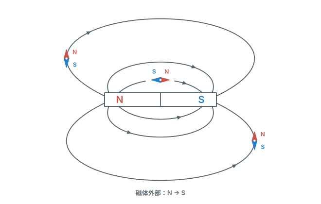
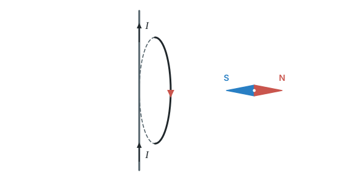
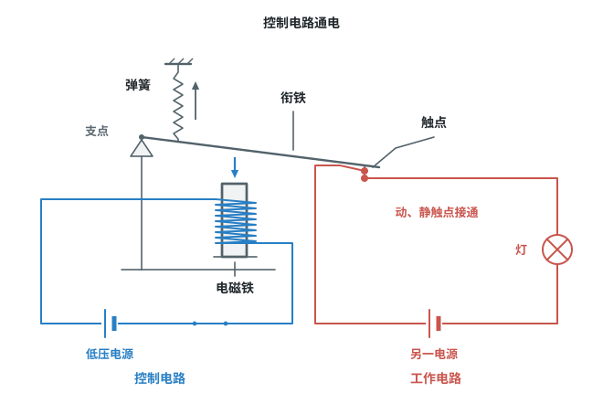

# 第二十章 电与磁

这一章学磁和电的关系：先认识磁体、磁场和地磁场；再学“电生磁”（安培定则、电磁铁、电磁继电器）；最后学磁场对通电导线的作用（电动机）和“磁生电”（发电机）。

标着**重点**的两个知识点（安培定则、电磁感应）是考试核心，常结合实物图和实验出现，必须熟练掌握。

## 本章前置自查

下面两件事，哪一件没把握，先回看：

1. 识别电路图，判断电流方向（电源外部从正极流向负极）。（第十五章第 2 节）
2. 电压不变时，电阻变大，电流变小。（第十七章第 2 节）

---

## 20.1a 磁体和磁极间的相互作用

```yaml
id: PHY-9-20-1a
weight: 一般
weight_note: 未单独考；是电磁铁、电动机题的基础
textbook: 九全 20.1 磁现象 磁场，p.147–148
prerequisites: []
evidence:
  - 会背同名磁极相排斥、异名磁极相吸引
  - 能知道磁体两端磁极最强
figure: 不需要
sources: [TB9-20.1]
```

### 本次只学

知道什么是磁极，以及磁极之间的相互作用规律。

### 先认住

- 磁体能够吸引铁、钴、镍等物质。它的吸引能力最强的两个部位叫作**磁极**。
- 能够自由转动的磁体，静止时指南的磁极叫作南极（S极），指北的磁极叫作北极（N极）。
- **磁极间相互作用的规律**：同名磁极相互排斥，异名磁极相互吸引。

### 练一练

- `Q-PHY-TB9-20.1-6`

---

## 20.1b 磁场和磁感线

```yaml
id: PHY-9-20-1b
weight: 一般
weight_note: 1 次
textbook: 九全 20.1 磁现象 磁场，p.148–149
prerequisites:
  - {id: PHY-9-20-1a, strength: hard, reason: 磁场方向用小磁针 N 极指向规定}
evidence:
  - 记住磁场方向的规定
  - 知道磁感线在磁体外部从 N 极指向 S 极
figure: 已完成 figures/bar-magnet-field-compasses.svg（磁体外部六条磁感线及三枚小磁针；N 端沿磁感线方向）
sources: [TB9-20.1, GZ2022-04]
```

### 本次只学

知道磁场是什么，能说出磁场方向的规定和磁感线的画法。

### 先认住

- 磁体周围存在着**磁场**。磁体间的相互作用就是通过磁场发生的。
- **磁场方向的规定**：物理学中，把小磁针静止时北极（N极）所指的方向规定为该点磁场的方向。
- **磁感线**：为了形象地描述磁场，用带箭头的曲线画出来。在磁体的外部，磁感线都是从磁体的N极出发，回到S极。磁感线上箭头所指的方向，就是该点的磁场方向，也就是小磁针静止时N极所指的方向。



### 练一练

- `Q-PHY-GZ2022-04`

---

## 20.1c 地磁场

```yaml
id: PHY-9-20-1c
weight: 一般
weight_note: 3 次
textbook: 九全 20.1 磁现象 磁场，p.149–150
prerequisites:
  - {id: PHY-9-20-1b, strength: hard, reason: 地球周围有磁场}
evidence:
  - 知道地球周围有磁场
  - 知道地磁南极在地理北极附近
figure: 不需要
sources: [TB9-20.1, GD2023-13, SZ2023-07]
```

### 本次只学

知道地球周围存在磁场，以及地磁场的南北极。

### 先认住

- 地球本身是一个巨大的磁体，地球周围存在的磁场叫作**地磁场**。
- 指南针能指南北，就是因为受到地磁场的作用。
- 地磁的北极在地理的南极附近，地磁的南极在地理的北极附近。

### 练一练

- `Q-PHY-SZ2023-07`

---

## 20.2a 电流的磁效应与安培定则

```yaml
id: PHY-9-20-2a
weight: 重点
weight_note: 4 次，作图题和电磁铁题都要用安培定则
textbook: 九全 20.2 电生磁，p.152-155
prerequisites:
  - {id: PHY-9-20-1b, strength: hard, reason: 要画磁感线方向}
  - {id: PHY-9-15-2a, strength: hard, reason: 要判断电流方向}
evidence:
  - 知道通电导线周围存在磁场
  - 会用安培定则判断通电螺线管的极性和电流方向
figure: 已完成 figures/ring-current-compass.svg（照课本图 20-4，画出右侧小磁针静止时 N 极指向右）
sources: [TB9-20.2, GD2023-13, GZ2025-08]
```

### 本次只学

知道通电导线周围有磁场，掌握安培定则。

### 先认住

- **电流的磁效应**：通电导线周围存在与电流方向有关的磁场（奥斯特实验）。导线在小磁针上方并且两者平行，当导线通电时，小磁针发生偏转；切断电流时，小磁针又回到原位。
- 通电螺线管外部的磁场与条形磁体的磁场相似。
- **安培定则**：用右手握住螺线管，让四指指向螺线管中电流的方向，则大拇指所指的那端就是螺线管的N极。

### 破题钥匙

```think
现象: 通电螺线管，像一块条形磁体
模型: 四指顺着电流绕，大拇指指向 N 极
图: phy-solenoid
关系: 右手四指顺电流 → 拇指指 N 极
结: 电流方向反过来，N、S 极也反过来
```

### 走一遍

**例：** 课本复习与提高第 4 题：图 20-4 是一环形电流，可以看成通电螺线管的一圈，圆环跟纸面垂直，其中的电流方向如图中箭头所示。请标出环形电流右侧小磁针静止时 N 极的位置。（图 20-4 中，圆环跟纸面垂直，环上朝向我们的这一半，电流方向向下；小磁针放在圆环的右侧。）

1. 使用安培定则：用**右手**握住这个环形导线。
2. 环朝向我们的这一半，电流向下，所以让右手的**四指**顺着电流方向向下握住导线。
3. 此时**大拇指**指向纸面的右侧，说明这个通电环形导线的**右端是N极**，左端是S极。
4. 根据磁极间的相互作用，同名磁极相排斥，异名磁极相吸引。在它的右侧放一个小磁针，小磁针的S极会被吸引而指向左边，所以小磁针的**N极会指向右边**。



### 容易错

- 使用安培定则时，必须用右手，不能误用左手。
- 四指弯曲的方向必须顺着螺线管（或环形导线）中的电流方向，不能反着握。

### 练一练

- `Q-PHY-GD2023-13`
- `Q-PHY-GZ2025-08`

---

## 20.3a 电磁铁及其磁性强弱

```yaml
id: PHY-9-20-3a
weight: 一般
weight_note: 1 次（广州 2024 实验题）
textbook: 九全 20.3 电磁铁 电磁继电器，p.157-158
prerequisites:
  - {id: PHY-9-20-2a, strength: hard, reason: 电磁铁是带铁芯的通电螺线管}
evidence:
  - 知道什么是电磁铁
  - 知道电磁铁磁性强弱与电流大小、线圈匝数有关
figure: 不需要
sources: [TB9-20.3]
```

### 本次只学

知道电磁铁的构造，以及影响它磁性强弱的因素。

### 先认住

- 内部带有铁芯的通电螺线管叫作**电磁铁**。
- 匝数一定时，通入的电流越大，电磁铁的磁性越强；电流一定时，外形相同的螺线管，匝数越多，电磁铁的磁性越强。

### 练一练

- `Q-PHY-GZ2024-17-2`

---

## 20.3b 电磁继电器

```yaml
id: PHY-9-20-3b
weight: 一般
weight_note: 3 次，但只来自 2 道题（广州 2022、广东 2024 连线题）
textbook: 九全 20.3 电磁铁 电磁继电器，p.159-160
prerequisites:
  - {id: PHY-9-20-3a, strength: hard, reason: 靠电磁铁吸引衔铁}
  - {id: PHY-9-17-2a, strength: soft, reason: 控制电路电流变化要用欧姆定律}
evidence:
  - 知道电磁继电器是利用电磁铁控制工作电路的开关
  - 会分析含电磁继电器的简单控制逻辑
figure: 已完成 figures/relay-structure.svg（电磁铁、衔铁、弹簧、触点及互相独立的控制电路和工作电路，画通电接通状态）
sources: [TB9-20.3, GD2024-27]
```

### 本次只学

知道电磁继电器的原理，能分析控制电路的动作过程。

### 先认住

- **电磁继电器**实际上就是利用电磁铁来控制工作电路的一种开关。
- 工作原理：控制电路接通，电磁铁有了磁性，吸下衔铁，使触点接通，工作电路开始工作；电磁铁没有磁性（或磁性变弱）时，弹簧把衔铁拉回原位，触点也回到原来的位置。



### 练一练

- `Q-PHY-GD2024-27`

---

## 20.4a 磁场对通电导线的作用与电动机

```yaml
id: PHY-9-20-4a
weight: 一般
weight_note: 4 次，多为“哪个是电动机原理”的辨认，和 20.6a 对比学即可
textbook: 九全 20.4 电动机，p.161-164
prerequisites:
  - {id: PHY-9-20-1b, strength: hard, reason: 导线放在磁场中}
  - {id: PHY-9-15-2a, strength: hard, reason: 受力方向与电流方向有关}
evidence:
  - 知道磁场对通电导线有力的作用
  - 知道电动机的工作原理
figure: 不需要
sources: [TB9-20.4, GD2024-13]
```

### 本次只学

知道磁场对通电导线的作用，以及电动机的工作原理。

### 先认住

- 通电导线在磁场中要受到力的作用。力的方向跟**电流的方向**、**磁场的方向**都有关系，当电流的方向或者磁场的方向变得相反时，通电导线受力的方向也变得相反。
- **电动机的工作原理**就是通电线圈在磁场中受力转动。它把电能转化为机械能。

### 练一练

- `Q-PHY-GD2024-13`

---

## 20.6a 电磁感应与发电机

```yaml
id: PHY-9-20-6a
weight: 重点
weight_note: 5 次，判断能否产生感应电流、与电动机区分
textbook: 九全 20.6 磁生电，p.167-171
prerequisites:
  - {id: PHY-9-20-1b, strength: hard, reason: 要判断是否切割磁感线}
  - {id: PHY-9-20-4a, strength: soft, reason: 和电动机对比：一个有电源，一个没有}
evidence:
  - 知道产生感应电流的条件是“切割磁感线”
  - 知道发电机的工作原理
figure: 不需要
sources: [TB9-20.6, GD2022-07]
```

### 本次只学

知道电磁感应现象，能判断是否产生感应电流，知道发电机的原理。

### 先认住

- **电磁感应**：闭合电路的一部分导体在磁场中做切割磁感线运动时，导体中就产生电流。这种现象叫作电磁感应，产生的电流叫作感应电流。
- **发电机的工作原理**就是电磁感应现象。它把机械能转化为电能。
- 区分提示：电动机的电路里有电源，通电后线圈转动；发电机的电路里没有外接电源，靠外力使线圈转动而产生电流，发电机自己就是电源。

### 走一遍

**例：** 如何判断导体运动时是否“切割磁感线”？

如果把磁感线想象成一根根实实在在的线，把导线想象成一把刀：刀顺着线的方向运动，切不断线；垂直或斜着运动，才能切断线。

假设导线垂直于纸面，是闭合电路的一部分，在纸面内向上运动：
1. **磁感线斜向右下或斜向右上**：导线向上运动的方向与磁感线倾斜相交，就像刀斜着切向细线，会切断磁感线，属于切割磁感线，能产生感应电流。
2. **磁感线水平向右**：导线向上运动的方向与磁感线垂直相交，就像刀垂直切向细线，会切断磁感线，属于切割磁感线，能产生感应电流。
3. **磁感线竖直向上**：导线运动的方向与磁感线平行，导线顺着磁感线的方向运动，就像刀顺着细线的方向移动，不会切断磁感线，不属于切割磁感线，不会产生感应电流。

### 容易错

- 导体和磁场之间没有相对运动，或者导体顺着磁感线运动（运动方向与磁感线平行），都不切割磁感线，不会产生感应电流。
- 产生感应电流的条件必须同时满足两点：一是电路必须是闭合电路；二是必须是一部分导体在磁场中做切割磁感线运动。电路不闭合，不会有感应电流。

### 练一练

- `Q-PHY-GD2022-07`
