### Q-PHY-TB9-20.1-6

```yaml
id: Q-PHY-TB9-20.1-6
category: 课本习题
source: 九年级课本第 151 页练习与应用第 6 题
source_quality: 课本原文
kp: PHY-9-20-1a
type: 简答
grading: 自评
answer_by: 本项目编写，已复核
review:
  概念: PHY-9-20-1a
```

**题干**

请找两根缝衣针、一个按扣、一根大头针和一块橡皮泥，做一个指南针。用橡皮泥和大头针制作指南针的底座。使缝衣针磁化后，穿过按扣的小孔，放在底座的针尖上，这就是一个小指南针。如果做好的指南针静止下来后，针尖指北，那么针尖是N极还是S极？为什么？

**答案**

针尖是 N 极。因为能够自由转动的磁体，静止时指南的磁极叫作南极（S极），指北的磁极叫作北极（N极）。

**解析**

这是一道概念应用题。指南针实质上是一个小磁体，能够自由转动，静止时指示南北方向。根据磁极的定义，指南的叫 S 极，指北的叫 N 极。既然针尖指北，那它就是 N 极。

### Q-PHY-GZ2022-04

```yaml
id: Q-PHY-GZ2022-04
category: 真题
source: 2022 广州卷第 4 题
source_quality: 原卷（精品解析整理版）
kp: PHY-9-20-1b
type: 选择
grading: 自动
answer_by: 原卷解析
review:
  概念: PHY-9-20-1b
```

**题干**

放在条形磁体周围的小磁针静止时如图所示，三个小磁针的N极和一个小磁针的S极被涂黑，则S极被涂黑的小磁针是（　　）

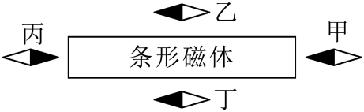

A. 甲
B. 乙
C. 丙
D. 丁

**答案**

A

**解析**

由于磁场方向的规定，小磁针静止时N极所指向的方向为磁感线的方向。
假设条形磁体左侧是N极，则磁感线由左端出发指向右侧，由图知道，甲丙的左侧是N极，乙丁的右侧是N极，由图知道，假设不符合题意；
假设条形磁体右侧是N极，则磁感线由右端出发指向左侧，由图知道，甲丙的右侧是N极，乙丁的左侧是N极，由图知道，假设符合题意，且被涂黑S极的小磁针是甲，故A符合题意。
故选A。

### Q-PHY-SZ2023-07

```yaml
id: Q-PHY-SZ2023-07
category: 真题
source: 2023 深圳卷第 7 题
source_quality: 原卷（精品解析整理版）
kp: PHY-9-20-1c
type: 选择
grading: 自动
answer_by: 原卷解析
review:
  概念: PHY-9-20-1c
```

**题干**

下列现象中可以证明地磁场客观存在的是（　　）

A. 两个绑着磁铁的小车他们相对的两面分别是N极和S极他们相互吸引
B. “司南之杓，投之于地，其柢指南”
C. 通电螺线管吸引铁钉
D. 思考乐的小白同学制作的手摇发电机

**答案**

B

**解析**

两个绑着磁铁的小车他们相对的两面分别是 N 极和 S 极他们相互吸引，证明异名磁极相吸引，故 A 不符合题意；
“司南之杓，投之于地，其柢指南”，杓的柄始终指南是受到地磁场的作用，证明地磁场客观存在，故 B 符合题意；
通电螺线管吸引铁钉，证明电流具有磁效应，故 C 不符合题意；
手摇发电机利用电磁感应现象，证明导体切割磁感线，能产生感应电流，故 D 不符合题意。
故选 B。

### Q-PHY-GD2023-13

```yaml
id: Q-PHY-GD2023-13
category: 真题
source: 2023 广东卷第 13 题
source_quality: 原卷（精品解析整理版）
kp: PHY-9-20-2a
type: 填空
grading: 自评
answer_by: 原卷解析
review:
  概念: PHY-9-20-2a
  前置: PHY-9-20-1c
```

**题干**

如题图所示，桌面上有一枚转动灵活的小磁针，静止时，小磁针___________极指南；当导线与电池触接时，小磁针发生偏转，说明通电导线周围存在___________；断开电路，小磁针___________（选填“会”或“不会”）回到原来位置。

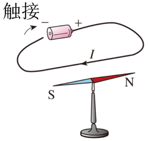

**答案**

S；磁场；会

**解析**

地球本身是个磁体，地球周围存在磁场，地磁北极在地理南极附近，根据异名磁极相互吸引的特性，静止时，在地磁场的作用下，小磁针的南极指向地磁北极，即地理南极。
当导线与电池接触时，形成闭合回路，导线中有电流通过，此时，小磁针发生偏转，即小磁针受到磁场力的作用，说明通电导线周围存在磁场。
断开电路，电路中没有电流通过，小磁针在地磁场的作用下会回到原来的位置。

### Q-PHY-GZ2025-08

```yaml
id: Q-PHY-GZ2025-08
category: 真题
source: 2025 广州卷第 8 题
source_quality: 原卷（精品解析整理版）
kp: PHY-9-20-2a
type: 选择
grading: 自动
answer_by: 原卷解析
review:
  概念: PHY-9-20-2a
```

**题干**

医学上用“人工心脏泵”替代心脏推动血液循环，如图是其工作原理的简图，活塞在电磁铁的带动下左右移动，代表心脏的舒张和收缩。“人工心脏泵”正常工作过程中，电磁铁的电流从a流向b时，则（　　）

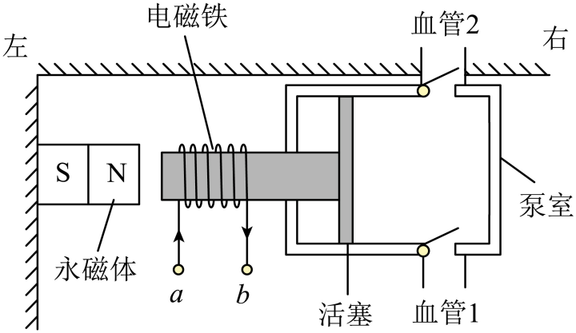

A. 电磁铁左端为S极，活塞向右移动
B. 电磁铁左端为S极，活塞向左移动
C. 电磁铁左端为N极，活塞向右移动
D. 电磁铁左端为N极，活塞向左移动

**答案**

B

**解析**

当电磁铁的电流从 a 流向 b 时，根据安培定则可知，电磁铁的左端为 S 极，右端为 N 极。
由磁极间的相互作用可知，永磁体对电磁体产生吸引力，活塞向左运动。
故 B 符合题意，ACD 不符合题意。
故选 B。

### Q-PHY-GD2024-27

```yaml
id: Q-PHY-GD2024-27
category: 真题
source: 2024 广东卷第 27 题
source_quality: 原卷（精品解析整理版）
kp: PHY-9-20-3b
do: 本章只做第（3）问
other_parts: （1）液体压强 → PHY-8B-09-2a；（2）能量转化 → PHY-9-14-1a；（4）求电流 → PHY-9-17-2a；（5）连线 → PHY-9-20-3b（要连线，不收）
type: 填空
grading: 自评
answer_by: 原卷解析
review:
  概念: PHY-9-20-3b
  前置: PHY-9-17-2a
```

**题干**

我国载人潜水器“奋斗者”号突破万米深潜，潜水器内氧气浓度过低会影响内部人员的生命安全。氧气可通过电解水的方式来制备。某科创小组设计了氧气浓度报警装置，其简化电路（未连接完整）如图甲所示。气敏箱可等效为一个电阻，其阻值 $R$ 与氧气浓度 $c$ 的关系如图乙所示。闭合开关，当氧气浓度 $c > 0.28\ \mathrm{kg/m^3}$ 时，绿灯正常发光；当 $c \le 0.28\ \mathrm{kg/m^3}$ 时，红灯正常发光。已知电源电压及两灯的额定电压均为 4.8V，电磁铁线圈的电阻忽略不计。

（3）图甲中的A灯为___________（选填“红”或“绿”）灯；

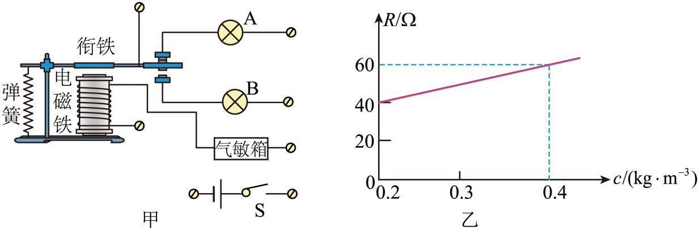

**答案**

绿

**解析**

如图乙所示，可知，当氧气的浓度升高时，气敏电阻的阻值变大。
电磁铁线圈的电阻忽略不计，控制电路的电源电压不变，故电路中的电流变小。
磁性变弱，衔铁弹上去，则 A 灯接通，此时绿灯发光，故 A 灯为绿灯。

### Q-PHY-GD2024-13

```yaml
id: Q-PHY-GD2024-13
category: 真题
source: 2024 广东卷第 13 题
source_quality: 原卷（精品解析整理版）
kp: PHY-9-20-4a
type: 填空
grading: 自评
answer_by: 原卷解析
review:
  概念: PHY-9-20-4a
```

**题干**

将自制的电动机接入电路，如图所示，其中支架A是___________（选填“导体”或“绝缘体”）。闭合开关，线圈开始转动，磁场对线圈___________（选填“有”或“无”）作用力。仅调换磁体的磁极，线圈转动方向与原转动方向___________。

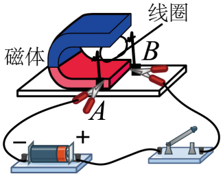

**答案**

导体；有；相反

**解析**

支架A是铜或者铁这些金属制成的，容易导电，是导体。
闭合开关，线圈开始转动，说明磁场对线圈有力的作用，使线圈运动状态发生改变。
当仅仅调换磁体的磁极时，磁场方向改变，使线圈受力方向改变，所以线圈转动方向与原转动方向相反。

### Q-PHY-GD2022-07

```yaml
id: Q-PHY-GD2022-07
category: 真题
source: 2022 广东卷第 7 题
source_quality: 原卷（精品解析整理版）
kp: PHY-9-20-6a
type: 选择
grading: 自动
answer_by: 原卷解析
review:
  概念: PHY-9-20-6a
```

**题干**

图中的a表示垂直于纸面的一段导线，它是闭合电路的一部分。当a在下列磁场中沿图中所示方向运动时，不会产生感应电流的是（　　）

A. 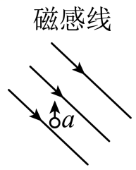
B. 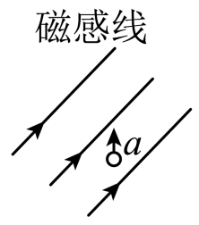
C. 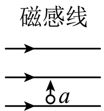
D. 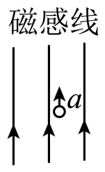

**答案**

D

**解析**

当闭合电路的一部分导体切割磁感线时，会产生感应电流。
而 ABC 导体都在切割磁感线，而只有 D 顺着磁感线运动，不会切割磁感线。
故 ABC 不符合题意，D 符合题意。
故选 D。

### Q-PHY-GZ2024-17-2

```yaml
category: 真题
source: 2024 年广州市中考物理试题第 17 题第（2）问
source_quality: 原卷（精品解析整理版）
kp: PHY-9-20-3a
type: 作图
grading: 自评
do: 本章只做第（2）问
other_parts:
  - 第（1）问（指南针指北、地磁场）→ 地磁场，本章不使用
answer_by: 原卷解析
review:
  概念: PHY-9-20-3a
```

**题干**

某小组研究电磁铁磁性强弱与电流大小的关系，请完成下列实验内容：

① 如图乙，漆包线绕在铁钉上构成一个电磁铁，将它平行指南针放置在木板上；

② 请用笔画线表示接线，按要求将图乙中的电源、开关、电流表、滑动变阻器和电磁铁连成串联电路（有部分导线已连接）。要求如下：

Ⅰ. 合上开关 K，指南针在电磁铁的作用下，静止时 $a$ 端仍然指向北方；

Ⅱ. 滑动变阻器滑片 $P$ 由 $C$ 端向 $D$ 端移动时，电流表的示数减小；

③ 电磁铁磁性强弱可以通过电磁铁吸引大头针的数目来判断。为研究线圈匝数一定时，电磁铁磁性强弱与电流大小的关系，请设计记录实验数据的表格；

④ 某次实验，电流表示数如图丙，此时电流为 \_\_\_\_\_\_ $\mathrm{A}$。

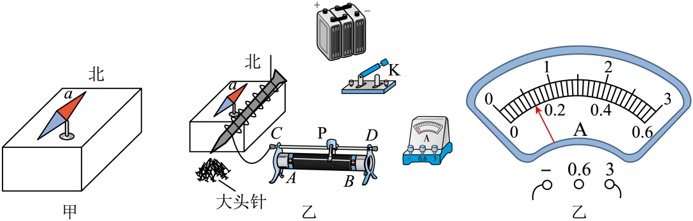

**答案**

② 见答案图

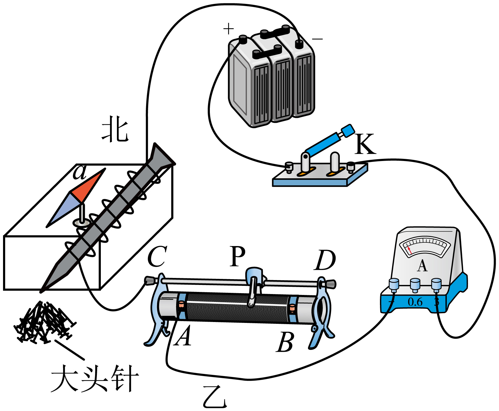

③ 见解析表格

| 次数 | 电流大小 $I$ / $\mathrm{A}$ | 吸引大头针数目 |
| --- | --- | --- |
| 1 | | |
| 2 | | |
| 3 | | |

④ $0.6$

**解析**

1. 第（1）问已知 $a$ 端是指南针的 N 极。合上开关后 $a$ 端仍指向北方，说明电磁铁吸引大头针的那一端是 N 极；用安培定则判断，电流应从吸引大头针的那一端流入、另一端流出。
2. 滑片 $P$ 由 $C$ 端向 $D$ 端移动时电流表示数减小，说明总电阻变大、变阻器接入的电阻变大；变阻器按“一上一下”接线，所以接 $A$ 接线柱。电流表选大量程。
3. 研究线圈匝数一定时磁性强弱与电流大小的关系，要控制匝数不变、改变电流，多次记录电流和吸引大头针的数目，表格如答案。
4. 电流表分度值 $0.1\ \mathrm{A}$，示数为 $0.6\ \mathrm{A}$。
