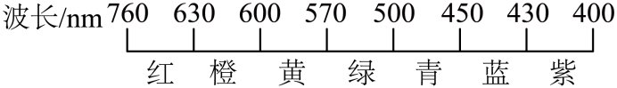
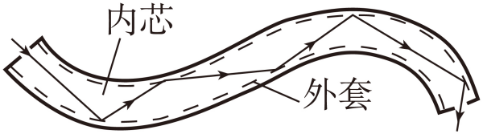

# 第二十一章 电磁波及其应用 · 题目

讲义只用 `lesson.md` 里引用的题，按知识点顺序排在前面。真题按“精品解析”原卷录入，题干、答案、解析已与原卷逐字比对。

---

## 讲义用题（2 道）

### Q-PHY-GZ2023-04

```yaml
category: 真题
source: 2023 年广州市初中学业水平考试 物理 第 4 题
source_quality: 原卷（精品解析整理版）
kp: PHY-9-21-1a
type: 选择
grading: 自动
answer_by: 原卷解析
review:
  概念: PHY-9-21-1a
```

**题干**

各色光在真空中的波长如图所示，植物中叶绿素 a 会吸收波长在 430 nm～662 nm 之间的光。真空中，波长 650 nm 的光（　　）



A. 是紫光
B. 不是电磁波
C. 波长比蓝光的长
D. 比波长 500 nm 的光传播速度大

**答案**

C

**解析**

1. 由图可知波长 650 nm 的光是红光，故 A 不符合题意。
2. 红光也属于电磁波，故 B 不符合题意。
3. 该光的波长是 650 nm，蓝光的波长是 430 nm～450 nm，故该光的波长比蓝光的波长长，故 C 符合题意。
4. 该光和波长为 500 nm 的光都是电磁波，在真空中的传播速度一样，故 D 不符合题意。

---

### Q-PHY-GD2024-08

```yaml
category: 真题
source: 2024 年广东省中考物理试题 第 8 题
source_quality: 原卷（精品解析整理版）
kp: PHY-9-21-2a
type: 填空
grading: 自评
answer_by: 原卷解析
review:
  前置: PHY-8B-11-3b
  概念: PHY-9-21-2a
other_parts: 第 1 空（力的作用是相互的）属 PHY-8B-07-1c，第 2 空（重力势能）属 PHY-8B-11-3b，都是八下已学；第 3 空是本章内容。
```

**题干**

【科技改善生活】广东生产的无人驾驶电动垂直起降航空器首飞成功，彰显了我国科技在城市空中交通领域的领先地位。航空器可用于高空摄影、旅游观光等，航空器通过旋转旋翼对空气施加向下的力，从而获得升力，这说明了力的作用是______的。航空器升空过程中，重力势能______（选填“增大”“减小”或“不变”）。航空器靠______（选填“超声波”或“电磁波”）与控制中心联系。

**答案**

相互的；增大；电磁波

**解析**

1. 航空器通过旋转旋翼对空气施加向下的力，空气对航空器施加向上的力，从而获得升力，这说明了力的作用是相互的。
2. 航空器升空过程中，质量不变，高度增大，所以重力势能增大。
3. 电磁波可以在真空中传播，且传播速度最快，这使得它成为航天和航空通信的理想选择，航空器与控制中心是通过电磁波联系的。

---

### Q-PHY-GZ2024-01

```yaml
category: 真题
source: 2024 年广州市中考物理试题第 1 题
source_quality: 原卷（精品解析整理版）
kp: PHY-9-21-3a
type: 选择
grading: 自动
answer_by: 原卷解析
review:
  概念: PHY-9-21-3a
```

**题干**

如图，光导纤维在传递信息时，光从内芯的一端传输到另一端，其原理应用了光的（　　）



A. 折射
B. 反射
C. 色散
D. 直线传播

**答案**

B

**解析**

如图，光在光导纤维内不断地被纤维壁反射，一直向前传播，所以光的传输利用了光的反射。故选 B。

---

## 备选（0 道）
