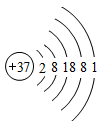
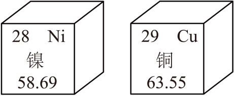
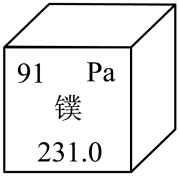
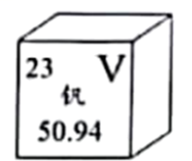
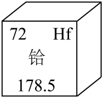
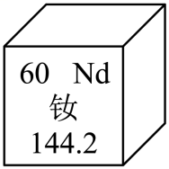

# 第三单元 物质构成的奥秘 · 题目

讲义只用 `lesson.md` 里引用的题，按知识点顺序排在前面。真题题干和选项已对照原卷 PDF 渲染页逐字录入；选项中的化学式已按原卷图像重新识读。

---

## 讲义用题（6 道）

### Q-CHEM-GZ2024-08

```yaml
category: 真题
source: 2024 年广州市初中学业水平考试 化学 第 8 题
source_quality: 原卷
kp: CHEM-9A-03-1a
type: 选择
grading: 自动
answer_by: 原卷解析
review:
  概念: CHEM-9A-03-1a
  审题: CHEM-9A-03-1a
```

**题干**

对下列宏观事实的微观解释合理的是（　　）

A. 酒香不怕巷子深：分子在不断运动
B. 气体的热胀冷缩：气体分子的大小发生改变
C. 硫酸铜溶液显蓝色：溶液中含有硫酸根离子
D. 金刚石和石墨的物理性质差异较大：原子种类不同

**答案**

A

**解析**

1. A 项：酒精分子在不断运动，向四周扩散，使人闻到酒香，解释合理。
2. B 项：气体的热胀冷缩主要是气体分子之间的间隔随温度改变而改变，分子本身的大小不变，解释不合理。
3. C 项：硫酸铜溶液显蓝色是因为溶液中含有铜离子（$\ce{Cu^{2+}}$），不是硫酸根离子，解释不合理。（离子的颜色以后会学，这里先选出明显合理的 A。）
4. D 项：金刚石和石墨都是由碳原子构成的单质，物理性质差异较大是因为碳原子的排列方式不同，原子种类相同，解释不合理。（碳单质的结构第六单元再学，这里先看明白“原子种类不同”不对。）

---

### Q-CHEM-TB9A-3.2-1

```yaml
category: 课本习题
source: 九上 3.2 练习与应用 第 1 题，p.70
source_quality: 课本原文
kp: CHEM-9A-03-2a
type: 选择
grading: 自动
answer_by: 本项目编写，待复核
review:
  概念: CHEM-9A-03-2a
```

**题干**

下列各组微观粒子中，可以构成原子核的是（　　）。

A. 质子和电子
B. 质子和中子
C. 电子和中子
D. 质子、中子和电子

**答案**

B

**解析**

1. 原子由位于中心的原子核和核外电子构成，电子在核外运动，不属于原子核的构成粒子。
2. 原子核一般由质子和中子构成（普通氢原子的原子核只有 1 个质子，没有中子）。
3. 因此可以构成原子核的是质子和中子，选 B。

---

### Q-CHEM-GZ2022-04

```yaml
category: 真题
source: 2022 年广州市初中学业水平考试 化学 第 4 题
source_quality: 原卷
kp: CHEM-9A-03-2b
type: 选择
grading: 自动
answer_by: 原卷解析
review:
  概念: CHEM-9A-03-2b
  审题: CHEM-9A-03-2a
```

**题干**

铷（$\ce{Rb}$）原子钟被称作北斗卫星的“心脏”、下图为铷原子的结构示意图，下列说法不正确的是（　　）



A. 铷原子核内的质子数为 37
B. 铷原子在化学变化中容易失去 1 个电子
C. 铷原子的核外电子分 5 层排布
D. 氯化铷的化学式为 $\ce{RbCl2}$

**答案**

D

**解析**

1. A 项：在原子结构示意图中，圆圈内的正数表示原子核内的质子数，铷原子核内的质子数为 37，说法正确。
2. B 项：铷原子的最外层电子数为 1，小于 4，在化学变化中容易失去 1 个电子达到相对稳定结构，说法正确。
3. C 项：圆圈外的弧线表示电子层，图中有 5 条弧线，说明铷原子的核外电子分 5 层排布，说法正确。
4. D 项：铷原子的最外层电子数为 1，易失去 1 个电子形成带 1 个单位正电荷的铷离子（$\ce{Rb+}$）；氯原子的最外层电子数为 7，易得到 1 个电子形成带 1 个单位负电荷的氯离子（$\ce{Cl-}$），二者结合形成的氯化铷化学式为 $\ce{RbCl}$，说法错误。（化学式怎么写第四单元才系统学，这里只需知道 1 个 $\ce{Rb+}$ 和 1 个 $\ce{Cl-}$ 所带电荷互相抵消，粒子个数比是 $1:1$。）

---

### Q-CHEM-GZ2024-16-1

```yaml
category: 真题
source: 2024 年广州市初中学业水平考试 化学 第 16 题第（1）问
source_quality: 原卷
kp: CHEM-9A-03-2c
also: [CHEM-9A-03-2a]
do: 本章只做第（1）问
other_parts: 第（2）问属于九下物质分类（碱），第（3）问属于九下合金物理性质（熔点），第（4）问属于九下金属活动性实验方案设计，本章不收
parts:
  - part: 第（1）问第1空
    kp: CHEM-9A-03-2a
    review:
      概念: CHEM-9A-03-2a
  - part: 第（1）问第2空
    kp: CHEM-9A-03-2c
    review:
      计算: CHEM-9A-03-2c
type: 填空
grading: 自评
answer_by: 原卷解析
review:
  概念: CHEM-9A-03-2a
  计算: CHEM-9A-03-2c
```

**题干**

东晋《华阳国志》（卷四）中已有关于白铜的记载，云南镍白铜（铜镍合金）闻名中外，曾用于造币和制作仿银饰品，西方直到 19 世纪才仿制出白铜。镍的金属活动性与铁相似，元素周期表中元素镍和铜的相关信息如图所示。



（1）$\ce{Ni}$ 的核电荷数为________，$\ce{Cu^{2+}}$ 的核外电子数为________。

**答案**

① 28　② 27

**解析**

1. 元素周期表单元格左上角的数字表示原子序数。中性原子中，原子序数 $=$ 核电荷数 $=$ 质子数，所以 $\ce{Ni}$ 的核电荷数为 28。
2. 铜的原子序数为 29，中性铜原子的质子数和核外电子数均为 29。
3. $\ce{Cu^{2+}}$ 是铜原子失去 2 个电子后形成的带 2 个单位正电荷的阳离子，其核外电子数为 $29 - 2 = \boxed{27}$。

---

### Q-CHEM-GD2022-16-3

```yaml
category: 真题
source: 2022 年广东省初中学业水平考试 化学 第 16 题第（3）问
source_quality: 原卷
kp: CHEM-9A-03-3a
do: 本章只做第（3）问
other_parts: 第（1）问属于九下化学与生活（人体健康微量元素），第（2）（4）问属于第四单元 CHEM-9A-04-3c 基于化学式的定量计算，本章不收
type: 选填
grading: 自动
accepted: [b]
answer_by: 原卷解析
review:
  概念: CHEM-9A-03-3a
```

**题干**

炉甘石始载于《外丹本草》，主要成分为碳酸锌（$\ce{ZnCO3}$）和碱式碳酸锌，炮制后主要成分为氧化锌（$\ce{ZnO}$），可作为外用药使用。

（3）氧化锌、碳酸锌、碱式碳酸锌都有一定的抑菌活性，说明起抑菌作用的有效成分可能是________（填字母）。

a. 锌分子　　b. 锌元素　　c. 锌单质

**答案**

b

**解析**

1. 宏观上物质由元素组成。氧化锌、碳酸锌和碱式碳酸锌是不同的物质，但它们的组成中都含有锌元素。
2. 锌是金属，由锌原子直接构成，不存在“锌分子”；且这些化合物中不存在金属锌单质。
3. 因此三者共有的有效成分是锌元素，选 b。

---

### Q-CHEM-GD2025-06

```yaml
category: 真题
source: 2025 年广东省初中学业水平考试 化学 第 6 题
source_quality: 原卷
kp: CHEM-9A-03-3b
type: 选择
grading: 自动
answer_by: 原卷解析
review:
  概念: CHEM-9A-03-3b
  审题: CHEM-9A-03-3a
```

**题干**

元素镤（pú）在提高核燃料利用率方面扮演重要角色，其在元素周期表中的信息如图。下列说法正确的是（　　）



A. 镤属于非金属元素
B. 镤的元素符号为 $\ce{pa}$
C. 镤原子的核外电子数为 91
D. 镤的相对原子质量为 231.0 g

**答案**

C

**解析**

1. A 项：“镤”带有“钅”字旁，属于金属元素，说法错误。
2. B 项：元素符号第一个字母必须大写，第二个字母必须小写，镤的元素符号为 $\ce{Pa}$，说法错误。
3. C 项：元素周期表单元格左上角的数字表示原子序数，镤的原子序数为 91；在原子中，原子序数 $=$ 质子数 $=$ 核外电子数，因此镤原子的核外电子数为 91，说法正确。
4. D 项：下方数字表示相对原子质量，相对原子质量是比值，单位为“1”，通常省略不写，不能加“g”，说法错误。

---

## 备选

### Q-CHEM-GZ2023-06

```yaml
category: 真题
source: 2023 年广州市初中学业水平考试 化学 第 6 题
source_quality: 原卷
kp: CHEM-9A-03-1a
type: 选择
grading: 自动
answer_by: 原卷解析
review:
  概念: CHEM-9A-03-1a
```

**题干**

对下列宏观事实的微观解释，合理的是（　　）

A. 空气湿度增大：单位体积空气中水分子数目增多
B. 石墨一定条件下转变成金刚石：原子种类发生改变
C. $\ce{CO2}$ 气体制成干冰：二氧化碳分子由运动变为静止
D. 稀硫酸能使紫色石蕊溶液变红：溶液中含硫酸根离子

**答案**

A

**解析**

1. A 项：空气湿度增大，说明单位体积空气中含有的水蒸气增多，即水分子数目增多，合理。
2. B 项：石墨转变成金刚石是碳原子的排列方式发生改变，原子的种类没有改变，不合理。
3. C 项：分子在任何状态下都在不停运动，二氧化碳分子间间隔变小，分子不会变为静止，不合理。
4. D 项：酸能使石蕊变红是因为溶液中解离出氢离子（$\ce{H+}$），不是硫酸根离子，不合理。

---

### Q-CHEM-GD2022-08

```yaml
category: 真题
source: 2022 年广东省初中学业水平考试 化学 第 8 题
source_quality: 原卷
kp: CHEM-9A-03-3b
type: 选择
grading: 自动
answer_by: 原卷解析
review:
  概念: CHEM-9A-03-3b
```

**题干**

我国科学家开发了一种基于二氧化钒的“冷热双吸”材料，有望助力实现“双碳”目标。钒元素在周期表中的信息如图所示。下列说法错误的是（　　）



A. 钒为金属元素
B. 钒原子核外电子数为 23
C. 钒的相对原子质量为 50.94 g
D. 二氧化钒的化学式为 $\ce{VO2}$

**答案**

C

**解析**

1. A 项：“钒”带“钅”字旁，属于金属元素，正确。
2. B 项：左上角原子序数为 23，在原子中，原子序数 $=$ 核外电子数 $= 23$，正确。
3. C 项：下方数字表示相对原子质量，相对原子质量是比值，单位为“1”，不能带“g”，错误。
4. D 项：二氧化钒的化学式为 $\ce{VO2}$，其中钒原子与氧原子的个数比为 $1:2$，说法正确。

---

### Q-CHEM-GD2023-10

```yaml
category: 真题
source: 2023 年广东省初中学业水平考试 化学 第 10 题
source_quality: 原卷
kp: CHEM-9A-03-3b
type: 选择
grading: 自动
answer_by: 原卷解析
review:
  概念: CHEM-9A-03-3b
```

**题干**

铪可用作航天材料，在元素周期表中的信息如图所示。下列有关给元素的说法正确的是（　　）



A. 核电荷数为 72
B. 属于非金属元素
C. 相对原子质量为 178.5 g
D. 二氧化铪的化学式为 $\ce{O2Hf}$

**答案**

A

**解析**

1. A 项：左上角原子序数是 72，原子中核电荷数 $=$ 原子序数 $= 72$，正确。
2. B 项：“铪”带“钅”字旁，属于金属元素，错误。
3. C 项：相对原子质量为 178.5，单位为“1”，通常省略，不能写成 178.5 g，错误。
4. D 项：氧化物书写时氧元素写在右边，二氧化铪的化学式应为 $\ce{HfO2}$，错误。

---

### Q-CHEM-GZ2023-07

```yaml
category: 真题
source: 2023 年广州市初中学业水平考试 化学 第 7 题
source_quality: 原卷
kp: CHEM-9A-03-3b
type: 选择
grading: 自动
answer_by: 原卷解析
review:
  概念: CHEM-9A-03-3b
  计算: CHEM-9A-03-2c
```

**题干**

钕（$\ce{Nd}$）等稀土元素是一类有重要用途的资源。下列说法正确的是（　　）



A. 钕属于非金属元素
B. 一个钕原子的质量为 144.2 g
C. $\ce{Nd^{3+}}$ 的核外电子数为 60
D. 一个钕原子含 60 个质子

**答案**

D

**解析**

1. A 项：“钕”带“钅”字旁，属于金属元素，说法错误。
2. B 项：下方数字 144.2 是相对原子质量，不是一个原子的实际质量，说法错误。
3. C 项：钕的原子序数为 60，中性原子核外有 60 个电子；$\ce{Nd^{3+}}$ 由钕原子失去 3 个电子形成，核外电子数为 $60 - 3 = 57$，说法错误。
4. D 项：在原子中，质子数 $=$ 原子序数 $= 60$，所以一个钕原子含 60 个质子，说法正确。

---

### Q-CHEM-TB9A-3.1-1

```yaml
category: 课本习题
source: 九上 3.1 练习与应用 第 1 题，p.63
source_quality: 课本原文
kp: CHEM-9A-03-1a
type: 选择
grading: 自动
answer_by: 本项目编写，待复核
review:
  概念: CHEM-9A-03-1a
```

**题干**

下列关于空气及其成分的说法中，正确的是（　　）。

A. 空气是由空气分子构成的
B. 空气里氮气、氧气等分子均匀地混合在一起
C. 氮气和氧气混合后，其化学性质都发生改变
D. 空气经过液化、汽化等过程得到氮气和氧气，发生了化学变化

**答案**

B

**解析**

1. A 项：空气是混合物，由氮分子、氧分子、稀有气体粒子、二氧化碳分子等多种粒子构成，不存在“空气分子”，说法错误。
2. B 项：空气属于均匀的混合物，氮气、氧气等分子均匀地混合在一起，说法正确。
3. C 项：混合属于物理变化，氮气和氧气保持各自的化学性质不变，说法错误。
4. D 项：工业利用液态空气各组分沸点不同分离得到氮气和氧气，属于物理变化，说法错误。

---

### Q-CHEM-TB9A-3.2-2

```yaml
category: 课本习题
source: 九上 3.2 练习与应用 第 2 题，p.71
source_quality: 课本原文
kp: CHEM-9A-03-2a
type: 选择
grading: 自动
answer_by: 本项目编写，待复核
review:
  概念: CHEM-9A-03-2a
```

**题干**

原子的质子数等于（　　）。

A. 中子数
B. 核外电子数
C. 中子数和核外电子数之和
D. 中子数和核外电子数之差

**答案**

B

**解析**

1. 原子核由质子和中子构成，质子数与中子数不一定相等。
2. 中性原子不显电性，核内质子所带的正电荷数（核电荷数）等于核外电子所带的负电荷数。
3. 因此原子的质子数一定等于核外电子数，选 B。

---

### Q-CHEM-TB9A-3.2-4

```yaml
category: 课本习题
source: 九上 3.2 练习与应用 第 4 题，p.71
source_quality: 课本原文
kp: CHEM-9A-03-2a
type: 选择
grading: 自动
answer_by: 本项目编写，待复核
review:
  概念: CHEM-9A-03-2a
```

**题干**

碳的相对原子质量是（　　）。

A. 12 g
B. 12
C. $1.6605 \times 10^{-27}\ \text{kg}$
D. $\dfrac{1}{12}\ \text{g}$

**答案**

B

**解析**

1. 相对原子质量是以碳-12 原子质量的 $\dfrac{1}{12}$ 为标准，其他原子的质量与它相比较所得的比值。
2. 相对原子质量是一个比值，单位为“1”，通常省略不写，不带质量单位。
3. 碳的相对原子质量约为 12，选 B。

---

### Q-CHEM-TB9A-3.3-3

```yaml
category: 课本习题
source: 九上 3.3 练习与应用 第 3 题，p.77
source_quality: 课本原文
kp: CHEM-9A-03-3a
type: 选择
grading: 自动
answer_by: 本项目编写，待复核
review:
  概念: CHEM-9A-03-3a
```

**题干**

不同种元素的本质区别是（　　）。

A. 原子的质子数不同
B. 原子的中子数不同
C. 相对原子质量不同
D. 原子的核外电子数不同

**答案**

A

**解析**

1. 元素是质子数（即核电荷数）相同的一类原子的总称。
2. 决定元素种类的是原子核内的质子数。
3. 因此不同种元素的本质区别是原子的质子数不同，选 A。
