# 第二十九章 圆

圆里的长度问题，常能落到一个直角三角形上；角度问题，先找它们对着哪条弧。
这一章从“到圆心等距”出发，把图上的线段、角和面积写成式子。
标着**重点**的几个知识点，中考几乎每年都考，要花最多时间；标着**了解**的，读懂就行。

## 本章前置自查

- 会认三角形的内角、外角，会用内角和求角。（八上 第十三章 三角形）
- 会用线段垂直平分线、等腰三角形的性质。（八上 第十五章 轴对称）
- 会用勾股定理求边长；知道直角三角形斜边中点到三个顶点等距。（八下 第二十章 勾股定理、第二十一章第3节 特殊的平行四边形）
- 会展开平方、解简单方程。（八上 第十六章 整式的乘法；九上 第二十五章 一元二次方程）
- 会读坐标，知道向右平移时横坐标怎样变化。（七下 第九章 平面直角坐标系）

## 29.1a 圆的概念、弦与弧、点与圆的位置

```yaml
id: MATH-9A-29-1a
weight: 一般
weight_note: 1 次（广州 2024，比较 $d$ 与 $r$）；是一步判断的题，但后面都要用到半径、弦、弧这些词
prerequisites:
- id: MATH-8B-20-1a
  strength: soft
  reason: 比较 $d$ 与 $r$ 前常要用勾股求距离
textbook: 九上29.1，p.114–116
evidence:
- 能根据半径是否相等，判断两圆是否为等圆。
- 能区分等圆、等弧和等弦，不把它们互相替代。
figure: 已完成 figures/circle-parts-29-1a.svg（直径、蓝色弦、绿色弧与点在圆内、圆上、圆外的比较）
sources:
- TB9A-29.1
```

### 本次只学

分清圆里的线段和弧，用距离判断点的位置。

### 先认住

- 在一个平面内，线段 $OP$ 绕它固定的一个端点 $O$ 旋转一周，另一个端点 $P$ 所形成的图形叫作圆。其固定的端点 $O$ 叫作圆心，线段 $OP$ 叫作半径。以点 $O$ 为圆心的圆，记作 $\odot O$。
- 连接圆上任意两点的线段叫作弦，经过圆心的弦叫作直径。圆上任意两点间的部分叫作圆弧，简称弧。大于半圆的弧叫作优弧，小于半圆的弧叫作劣弧。能够重合的两个圆叫作等圆；半径相等的两个圆是等圆。在同圆或等圆中，能够互相重合的弧叫作等弧。
- 设半径为 $r$，$OP=d$：点 $P$ 在圆外 $\Longleftrightarrow d>r$；点 $P$ 在圆上 $\Longleftrightarrow d=r$；点 $P$ 在圆内 $\Longleftrightarrow d<r$。线段 $OP$ 的长短，直接对应点在图上的位置。

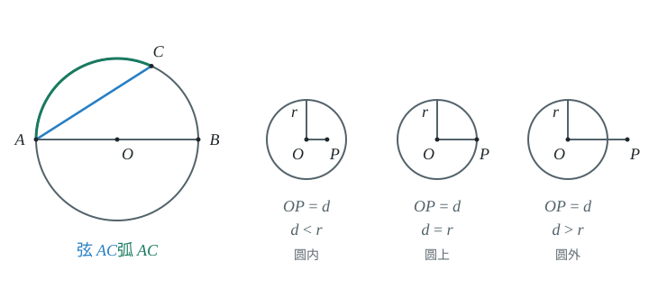

### 容易错

- $AB$ 是直线段，$\widehat{AB}$ 是圆周上的弧，不能混用。
- “圆上”只指圆周，不包括圆内部。

### 练一练

- `Q-MATH-TB9A-29.1-1`

## 29.1b 过三点的圆：三角形的外接圆与外心

```yaml
id: MATH-9A-29-1b
weight: 一般
weight_note: 1 次（广州 2023 压轴题的一问）；外心是三边垂直平分线的交点
prerequisites:
- id: MATH-9A-29-1a
  strength: hard
  reason: 要认得圆心、半径
- id: MATH-8A-15-1b
  strength: hard
  reason: 垂直平分线上的点到两端距离相等
textbook: 九上29.1，p.117–118
evidence:
- 能取公共斜边的中点，利用直角三角形中线的性质找到等长线段。
- 能从到多个顶点等距，判断这些点在同一个圆上。
figure: 已完成 figures/circumcircle-29-1b.svg（三步作垂直平分线、找外心并连接三条蓝色等长半径）
sources:
- TB9A-29.1
- MG5-E5
method:
- MG5 化归
```

### 本次只学

用“到三个顶点等距”找到外接圆的圆心。

### 先认住

- 不在同一条直线上的三个点确定一个圆。
- 经过三角形的三个顶点可以作一个圆，这个圆叫作三角形的外接圆。外接圆的圆心是三角形三条边的垂直平分线的交点，叫作这个三角形的外心，这个三角形叫作圆的内接三角形。
- 作两边的垂直平分线，交点 $O$ 满足 $OA=OB=OC$。图上的三段等长线段，就是同一个圆的半径；以 $O$ 为圆心、$OA$ 为半径作圆即可。

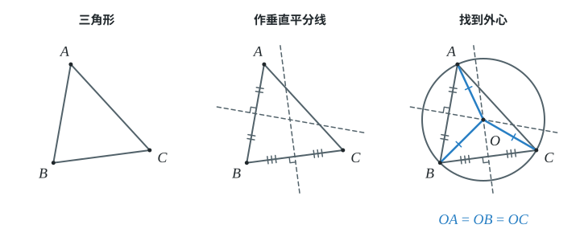

### 容易错

- 外心不是角平分线的交点，要找边的垂直平分线。
- 不能只说“看起来共圆”，要找一个到各点距离相等的点。

### 练一练

- `Q-MATH-MG5-E5`

## 29.1c 反证法

```yaml
id: MATH-9A-29-1c
weight: 了解
weight_note: 11 套卷未直接考；只在课本 29.1 作为证明方法出现
prerequisites:
- id: MATH-7B-07-3a
  strength: soft
  reason: 要分清命题的条件和结论
textbook: 九上29.1，p.118–119
evidence:
- 能说出反证法先假设什么、最后用什么否定假设。
figure: 可选；几何图。共线A、B、C及AB、BC两条平行垂直平分线，蓝色标两处直角；不画一个实际不存在的交点。
sources:
- TB9A-29.1
- MG13
method:
- MG13 反证法
```

### 先认住

- 先提出与结论相反的假设，再推出和定义、基本事实、定理或题设等相矛盾的结果，然后由矛盾断定所作假设不正确，从而得到原命题成立。这种方法叫作反证法。
- 证明“同一直线上的三个点不能作圆”时，先假设能作圆。圆心就要同时落在两条不同的、都垂直于原直线的垂直平分线上；这与“过一点有且只有一条直线与已知直线垂直”矛盾。
- 最后否定的是开头的假设，不是原题给出的条件。

## 29.2a 垂径定理及推论

```yaml
id: MATH-9A-29-2a
weight: 一般
weight_note: 0 次单独考，但每次用到都是借它算半径、弦长（见 b）
prerequisites:
- id: MATH-9A-29-1a
  strength: hard
  reason: 要认得弦、弧
- id: MATH-8A-15-1a
  strength: hard
  reason: 圆是轴对称图形，依据是轴对称
textbook: 九上29.2，p.123–124
evidence:
- 能由经过圆心且垂直于弦，得到平分弦和两条弧。
- 能说明推论为什么要排除直径。
figure: 已完成 figures/chord-bisector-29-2a.svg（垂径平分非直径弦，与两条不垂直直径的反例对照）
sources:
- TB9A-29.2
- ZY-circle
```

### 本次只学

看清“经过圆心”和“垂直于弦”，再判断平分关系。

### 先认住

- 垂直于弦的直径平分弦，并且平分弦所对的两条弧。
- 平分弦（不是直径）的直径垂直于弦，并且平分弦所对的两条弧。
- 若直径 $CD$ 与弦 $AB$ 垂直相交于 $E$，则 $AE=BE$。连接 $OA$，图中出现以半径 $OA$ 为斜边的直角三角形。

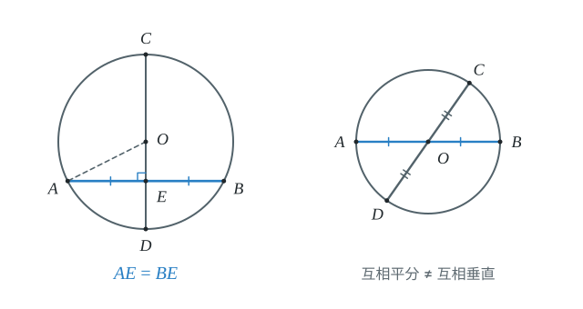

### 容易错

- 仅仅“垂直于弦”，却没有经过圆心，不能断定平分弦。
- 推论不能漏掉“不是直径”。两条直径互相平分，却不一定垂直。

### 练一练

- `Q-MATH-TB9A-29.2-7`

## 29.2b 用垂径定理求半径、弦长、弦心距

```yaml
id: MATH-9A-29-2b
weight: 重点
weight_note: 2 次（广州 2024 选择、深圳 2024 解答题），都靠“半径、半弦、弦心距”构成直角三角形列勾股方程
prerequisites:
- id: MATH-9A-29-2a
  strength: hard
  reason: 先得到平分弦的结论
- id: MATH-8B-20-1a
  strength: hard
  reason: 勾股定理
- id: MATH-9A-25-2d
  strength: soft
  reason: 半径未知时要列方程
textbook: 九上29.2，p.124
evidence:
- 能在半径、半弦、弦心距构成的直角三角形中列勾股方程。
- 能区分两条平行弦在圆心同侧或两侧。
figure: 已完成 figures/bridge-radius-29-2b.svg（三步把桥拱转为直角三角形，方程与边同色；附平行弦同侧、两侧图）
sources:
- TB9A-29.2
- MG3
- MG5
- ZY-circle
method:
- MG3 分类
- MG5 化归
```

### 本次只学

把弦和半径的问题，放进直角三角形里计算。

### 先认住

- 过圆心 $O$ 作弦 $AB$ 的垂线，垂足为 $D$，则 $AD=\dfrac12AB$（垂径定理）。$OD$ 是圆心到弦的距离（做题时常叫弦心距）。
- 在 $\mathrm{Rt}\triangle OAD$ 中，$OA^2=AD^2+OD^2$（勾股定理）。式子的三项分别对应半径、半弦和弦心距，不能把整条弦代入。
- 两条平行弦在圆心同侧时，间距是两段弦心距之差；在圆心两侧时，间距是两段弦心距之和。

### 走一遍

课本 $29.2$ 节例 $1$：赵州桥是我国隋代建造的石拱桥，距今已有 $1400$ 余年的历史，是我国古代人民勤劳与智慧的结晶。它的主桥拱是圆弧形，跨度（弧所对的弦的长）为 $37\ \mathrm m$，拱高（弧的中点到弦的距离）为 $7.23\ \mathrm m$，求赵州桥主桥拱的半径长（结果保留小数点后一位）。

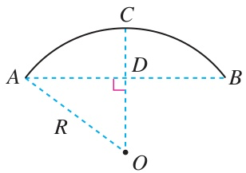

把拱高和半条跨度放进同一个直角三角形，圆的半径就能用方程求出来。

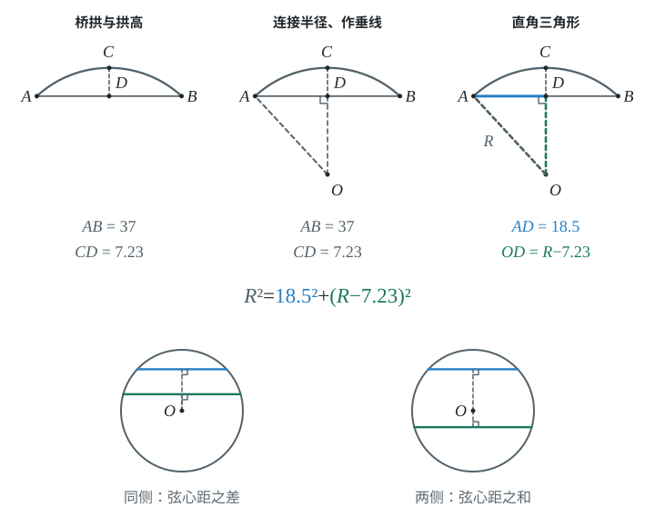

1. 设圆心为 $O$、半径为 $R\ \mathrm m$，作 $OD\perp AB$，垂线交桥拱于 $C$，连接 $OA$（将桥拱抽象为圆弧）。
2. $AD=\dfrac12\times\textcolor{#287fc4}{37}=18.5$，$OD=R-7.23$（垂径定理，$OC-CD=OD$）。
3. $R^2=\textcolor{#287fc4}{18.5}^2+(R-\textcolor{#287fc4}{7.23})^2$（勾股定理）。
4. $R^2=342.25+R^2-14.46R+52.2729$（展开平方）。
5. $14.46R=394.5229$，$R\approx27.3$（移项并解方程）。
6. 主桥拱的半径长约为 $\boxed{27.3\ \mathrm m}$（按要求保留一位小数）。

### 容易错

- 把弦长 $37$ 当成直角边；直角边是半弦长 $18.5$。
- 拱高不是弦心距，图中 $OD=R-7.23$。
- 平行弦的位置没给定时，不要只算圆心同侧的一种情况。

### 练一练

- `Q-MATH-TB9A-29.2-6`

## 29.2c 圆心角、弧、弦的关系

```yaml
id: MATH-9A-29-2c
weight: 一般
weight_note: 1 次（广州 2025，由弧的比求圆心角）；是圆周角的基础
prerequisites:
- id: MATH-9A-29-1a
  strength: hard
  reason: 要认得弧、弦
- id: MATH-8A-14-2a
  strength: soft
  reason: 证明依据是三角形全等
textbook: 九上29.2，p.125–126
evidence:
- 能把同圆中的等弧转为等弦、等圆心角。
- 能说明同圆或等圆是定理的前提。
figure: 已完成 figures/equal-arcs-29-2c.svg（同圆中的等圆心角、等弧为蓝色，等弦为绿色）
sources:
- TB9A-29.2
- MG7
method:
- MG7 平移和旋转
```

### 本次只学

在同圆或等圆中，把角、弧、弦的相等关系互相转换。

### 先认住

- 顶点在圆心的角叫作圆心角。在同圆或等圆中，相等的圆心角所对的弧相等，所对的弦也相等。
- 在同圆或等圆中，如果两条弧相等，那么它们所对的圆心角相等，所对的弦相等；如果两条弦相等，那么它们所对的圆心角相等，所对的优弧和劣弧分别相等。
- 旋转一组半径，使它与另一组重合，角、弧和弦就能一起对应。读式子时，要沿图找到每个角对着的弧，再找到弧两端连成的弦。

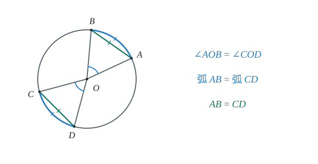

### 容易错

- 不同大小的圆中，圆心角相等不保证弦长相等。
- 等弦对应优弧与优弧、劣弧与劣弧，不能交叉对应。

### 练一练

- `Q-MATH-TB9A-29.2-2`

## 29.2d 圆周角定理及推论

```yaml
id: MATH-9A-29-2d
weight: 重点
weight_note: 10 次，几乎每套卷都有（直径所对的圆周角是直角、同弧所对圆周角相等、圆周角等于圆心角的一半）
prerequisites:
- id: MATH-9A-29-2c
  strength: hard
  reason: 圆周角和圆心角对着同一条弧
- id: MATH-8A-13-3a
  strength: hard
  reason: 三角形的内角和、外角
- id: MATH-8A-15-3a
  strength: soft
  reason: $OA=OB$ 得等腰三角形
textbook: 九上29.2，p.127–129
evidence:
- 能找到同一条弧所对的圆心角与圆周角。
- 能由直径得到直角，并结合等角求弦长。
figure: 已完成 widget circle-angle + figures/inscribed-angle-29-2d.svg（初始状态：B极角100°、C极角230°，蓝色圆心角100°与绿色圆周角50°）
sources:
- TB9A-29.2
- MG16
method:
- MG16 数形结合
```

### 本次只学

找准所对的弧，用圆周角得到等角和直角。

### 先认住

- 顶点在圆上，并且两边都与圆相交的角叫作圆周角。
- 一条弧所对的圆周角等于它所对的圆心角的一半。图上先圈出那条弧，再找顶点在圆上的角和顶点在圆心的角。
- 同弧或等弧所对的圆周角相等。
- 半圆（或直径）所对的圆周角是直角，$90^\circ$ 的圆周角所对的弦是直径。

```widget
type: circle-angle
center: [0, 0]
radius: 1
A: {angle: 0, draggable: false}
B: {angle: 100, draggable: true, min: 0, max: 180, minExclusive: true}
C: {angle: 230, draggable: true, arc: opposite, excludeEndpoints: true}
```
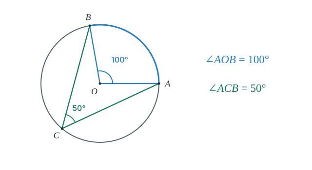

### 数形结合

```bridge
mode: cards
式: 圆周角 $=\frac{1}{2}$ 圆心角
图: inscribed
形: 圈出一条弧，同一条弧所对的圆周角是它所对圆心角的一半
色: blue
---
式: 圆周角 $=90^\circ$
形: 它所对的弦是直径
色: green
```

### 走一遍

课本 $29.2$ 节例 $3$：如图 $29.2$-$8$，$\odot O$ 的直径 $AB$ 的长为 $10$，弦 $AC$ 的长为 $6$，$\angle ACB$ 的平分线交 $\odot O$ 于点 $D$，求 $BC,AD,BD$ 的长。

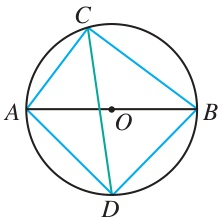

看到直径，先把它所对的圆周角标成直角。

1. 连接 $OD$，$\angle ACB=\angle ADB=90^\circ$（直径所对的圆周角是直角）。
2. $BC=\sqrt{\textcolor{#287fc4}{10}^2-\textcolor{#287fc4}{6}^2}=\boxed{8}$（在 $\mathrm{Rt}\triangle ABC$ 中用勾股定理）。
3. $\angle ACD=\angle BCD$（$CD$ 平分 $\angle ACB$）。
4. $\angle AOD=2\angle ACD$，$\angle BOD=2\angle BCD$，故 $\angle AOD=\angle BOD$（圆周角定理）。
5. $AD=BD$（相等的圆心角所对的弦相等）。
6. $AD^2+BD^2=AB^2=100$，所以 $2AD^2=100$（在 $\mathrm{Rt}\triangle ABD$ 中用勾股定理）。
7. $\boxed{AD=BD=5\sqrt2}$（长度为正，开平方）。

### 容易错

- 两个角必须对着同一条弧，才能直接用一半关系。
- 同一条弦两侧的圆周角，不一定相等；要看各自所对的弧。
- 圆内接直角三角形的斜边是直径，不是半径。

### 练一练

- `Q-MATH-GD2023-09`

## 29.2e 圆内接四边形的性质

```yaml
id: MATH-9A-29-2e
weight: 一般
weight_note: 1 次（广东 2024 压轴题的一问，“对角互补”）
prerequisites:
- id: MATH-9A-29-2d
  strength: hard
  reason: 证明用圆周角定理
- id: MATH-8B-21-1a
  strength: soft
  reason: 四边形内角和是 $360^\circ$
textbook: 九上29.2，p.130
evidence:
- 能认出圆内接四边形的一组对角。
- 能将对角互补用于证明矩形。
figure: 已完成 figures/cyclic-quadrilateral-29-2e.svg（A与C对角蓝色、B与D对角绿色，两组角和均为180°）
sources:
- TB9A-29.2
```

### 本次只学

用圆内接四边形的对角互补求角或证明。

### 先认住

- 如果一个多边形的所有顶点都在同一个圆上，这个多边形叫作圆的内接多边形，这个圆叫作这个多边形的外接圆。
- 圆内接四边形的对角互补。
- 若 $A,B,C,D$ 按顺序在圆上，则 $\angle A+\angle C=180^\circ$，$\angle B+\angle D=180^\circ$。一组对角所对的两条弧合起来是整圆，对应的角度和就是周角的一半。

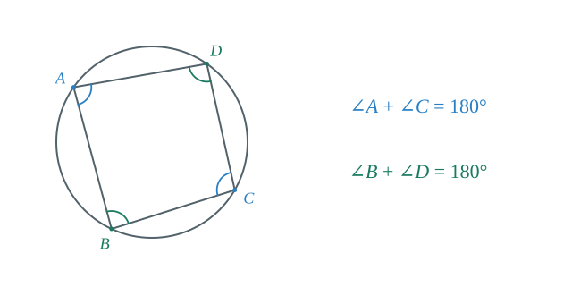

### 容易错

- 对角不是相邻的两个角。
- 只有四个顶点在同一圆上，才能直接使用这条性质。

### 练一练

- `Q-MATH-TB9A-29.2-5`

## 29.3a 弧长公式 $l=\frac{n\pi R}{180}$

```yaml
id: MATH-9A-29-3a
weight: 重点
weight_note: 2 次（广州 2023、深圳 2022），多是解答题的一步；扇形、圆锥都要用到
prerequisites:
- id: MATH-9A-29-1a
  strength: hard
  reason: 要认得圆、半径
- id: MATH-9A-29-2c
  strength: soft
  reason: $n$ 是圆心角的度数
textbook: 九上29.3，p.134
evidence:
- 能把弧长写成圆周长的相应份额。
- 能区分边界中的弧与线段，计算周长。
figure: 已完成 figures/arc-length-29-3a.svg（三步从整圆取扇形，再按角度份额求弧长；弧蓝色、半径绿色）
sources:
- TB9A-29.3
- MG16
- MG7
method:
- MG16 数形结合
- MG7 平移和旋转
```

### 本次只学

把弧长看成圆周长的一部分，再拼出所求边界。

### 先认住

- 在半径为 $R$ 的圆中，$n^\circ$ 的圆心角所对的弧长为 $l=\dfrac{n\pi R}{180}$。
- 一整圈对应 $360^\circ$，弧占圆周的 $\dfrac n{360}$，所以 $l=\dfrac n{360}\times2\pi R$；$n$ 填圆心角的度数。
- 求封闭图形周长时，沿边界逐段读：弧用弧长公式，直线段用线段长度；扇形周长还包含两条半径。

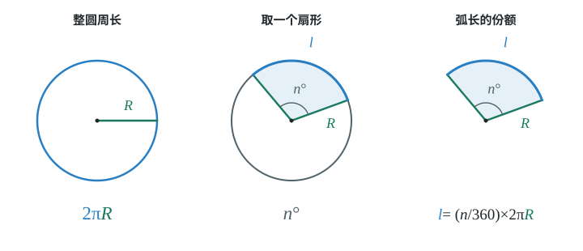

### 走一遍

课本 $29.3$ 节例 $1$：制造弯形管道时，经常要先按中心线计算“展直长度”，再下料。计算图 $29.3$-$1$ 所示管道的展直长度 $L$（结果取整数）。

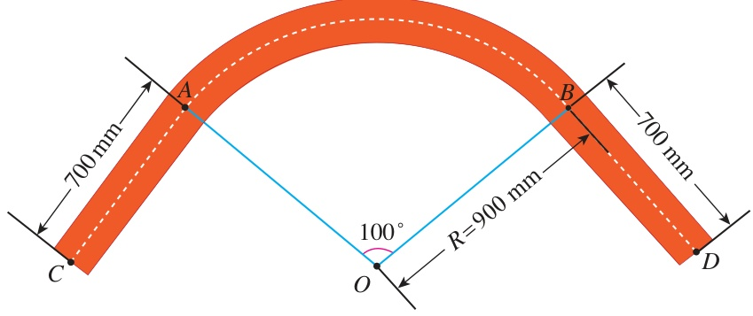

把弯管沿中心线分成两段直线和一段弧，三段长度分别计算。

1. 从图中读出 $CA=BD=700\ \mathrm{mm}$，$R=900\ \mathrm{mm}$，圆心角为 $100^\circ$（图示已知）。
2. $l=\dfrac{\textcolor{#287fc4}{100}\times\textcolor{#287fc4}{900}\times\pi}{180}=500\pi\approx1570\ \mathrm{mm}$（弧长公式，$\pi$ 取 $3.14$）。
3. $L\approx2\times\textcolor{#287fc4}{700}+\textcolor{#287fc4}{1570}=\boxed{2970\ \mathrm{mm}}$（两段直线加一段弧）。

### 容易错

- 把圆周角直接当作公式里的 $n$；公式要的是圆心角度数。
- 把弧 $\widehat{AB}$ 当成弦 $AB$。一个沿圆周走，一个走直线。
- 题目要求保留 $\pi$ 时，不要提前取近似值。

### 练一练

- `Q-MATH-GZ2023-19-3` 第（3）问

## 29.3b 扇形面积公式

```yaml
id: MATH-9A-29-3b
weight: 重点
weight_note: 3 次（广东 2022 填空、深圳 2024 填空、广东 2025），几乎每年一道送分题
prerequisites:
- id: MATH-9A-29-3a
  strength: hard
  reason: 弧长和面积公式同源，常用 $S=\frac12 lR$ 互换
textbook: 九上29.3，p.135–136
evidence:
- 能用圆心角和半径求扇形面积。
- 能把弦和弧围成的部分的面积分解为扇形面积减三角形面积。
figure: 已完成 figures/drainage-area-29-3b.svg（三步补出半径与垂线，将扇形分成淡蓝水域和淡绿三角形，以同色面积差求水域）
sources:
- TB9A-29.3
- MG5
- MG16
method:
- MG5 化归
- MG16 数形结合
```

### 本次只学

计算扇形面积，并把不规则的部分拆成已会计算的图形。

### 先认住

- 由组成圆心角的两条半径和圆心角所对的弧围成的图形叫作扇形。
- 半径为 $R$、圆心角为 $n^\circ$ 的扇形面积为 $S_{\text{扇形}}=\dfrac{n\pi R^2}{360}$。它占整圆面积的 $\dfrac n{360}$，与图上所占的角度份额一致。
- 也可以用弧长表示扇形面积：$S_{\text{扇形}}=\dfrac12lR$，其中 $l$ 为扇形的弧长，$R$ 为半径。

### 走一遍

课本 $29.3$ 节例 $2$：如图 $29.3$-$3$，水平放置的圆柱形排水管道的截面半径是 $0.6\ \mathrm m$，其中水面高 $0.3\ \mathrm m$。求截面上有水部分的面积（结果保留小数点后两位）。

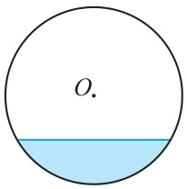

水域不是扇形；把它补成扇形，再减去多出的三角形。

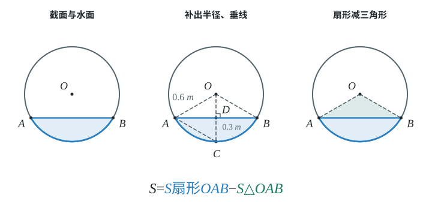

1. 水面两端记为 $A,B$，连接 $OA,OB$；作 $OD\perp AB$，延长 $OD$ 交下方弧于 $C$，连接 $AC$（作辅助线）。
2. $OD=OC-DC=0.6-0.3=0.3$，所以 $OD=DC$（半径减水深）。
3. $AD$ 是 $OC$ 的垂直平分线，$AC=AO=OC$（垂直平分线的性质、同圆半径相等）。
4. $\triangle AOC$ 是等边三角形，$\angle AOD=60^\circ$，$\angle AOB=120^\circ$（等边三角形、垂径定理的对称关系）。
5. $AD=\sqrt{\textcolor{#287fc4}{0.6}^2-\textcolor{#287fc4}{0.3}^2}=0.3\sqrt3$，$AB=0.6\sqrt3$（勾股定理、垂径定理）。
6. $S=S_{\text{扇形}OAB}-S_{\triangle OAB}=\dfrac{120\pi}{360}\times0.6^2-\dfrac12\times0.6\sqrt3\times0.3=0.12\pi-0.09\sqrt3$（面积相减）。
7. 有水部分面积约为 $\boxed{0.22\ \mathrm{m}^2}$（$\pi$ 取 $3.14$，保留两位小数）。

### 容易错

- 面积公式的分母是 $360$，半径要平方；不要套成弧长公式。
- 弦与弧围成的区域不是扇形，不能直接代扇形面积公式。
- 面积单位用平方单位，不是长度单位。

### 练一练

- `Q-MATH-GD2022-15`

## 29.3c 圆锥的侧面展开图和侧面积

```yaml
id: MATH-9A-29-3c
weight: 重点
weight_note: 3 次（广东 2024 综合与实践 9 分、广州 2024 选择）；关键是“底面周长 = 展开扇形的弧长”。圆锥体积公式课本九上没有，题里要用
prerequisites:
- id: MATH-9A-29-3a
  strength: hard
  reason: 展开扇形的弧长
- id: MATH-9A-29-3b
  strength: hard
  reason: 侧面积就是扇形面积
- id: MATH-8B-20-1a
  strength: hard
  reason: 母线、高、底面半径构成直角三角形
textbook: 九上29.3，p.136–139
evidence:
- 能指出展开扇形的半径等于母线长、弧长等于底面周长。
- 能用展开扇形面积计算圆锥侧面积。
figure: 已完成 figures/cone-net-29-3c.svg（三步剪开并展开圆锥，母线与扇形半径蓝色、底面圆周与扇形弧绿色）
sources:
- TB9A-29.3
- MG5
method:
- MG5 化归
```

### 本次只学

将圆锥侧面展开，认准展开前后对应的两种长度。

### 先认住

- 连接圆锥顶点和底面圆周上任意一点的线段叫作圆锥的母线。
- 沿一条母线将圆锥的侧面剪开并展平，得到的圆锥的侧面展开图是一个扇形。设母线长为 $l$，底面圆半径为 $r$，那么这个扇形的半径为 $l$，扇形的弧长为底面圆的周长 $2\pi r$。
- 圆锥的侧面积为 $\pi rl$，圆锥的全面积为 $\pi r(r+l)$。侧面积对应展开扇形，全面积还要加底面圆的面积。
- 圆锥的高、底面半径和母线组成直角三角形。已知高与底面半径时，先用勾股定理求母线，不要把高当作扇形半径。

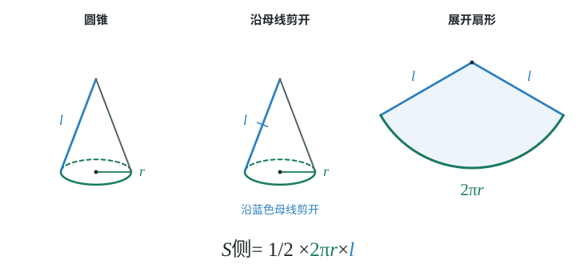

### 走一遍

课本习题 $29.3$ 第 $7$ 题：如图，粮仓的顶部是圆锥形，这个圆锥的底面圆的周长为 $32\ \mathrm m$，母线长 $7\ \mathrm m$。为了防雨，需要在它的顶部铺上油毡，所需油毡的面积至少是多少？

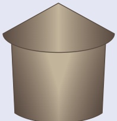

油毡只盖顶部，展开后就是一个扇形，不必先求底面半径。

1. 展开扇形的弧长为 $32\ \mathrm m$，半径为 $7\ \mathrm m$（底面周长与母线的对应关系）。
2. $S_{\text{侧}}=\dfrac12\times\textcolor{#287fc4}{32}\times\textcolor{#287fc4}{7}=\boxed{112\ \mathrm{m}^2}$（扇形面积等于弧长乘半径的一半）。
3. 所需油毡的面积至少是 $112\ \mathrm{m}^2$（不另加粮仓顶部的底面圆面积）。

### 容易错

- 圆锥底面半径 $r$ 不是展开扇形的半径，母线 $l$ 才是。
- 本小节 $l$ 表示母线；前面弧长公式中的 $l$ 表示弧长，要先读清含义。
- 只求侧面积时，不要加底面面积。

### 练一练

- `Q-MATH-GD2024-21-1` 第（1）问

## 29.3d 圆中的综合：外接圆、动点与最值

```yaml
id: MATH-9A-29-3d
weight: 一般
weight_note: 2 次（广州 2024、2025 压轴题的一问）；用圆周角定理把“动点”变成“在圆上”，难度大
prerequisites:
- id: MATH-9A-29-2d
  strength: hard
  reason: 圆周角定理
- id: MATH-9A-29-1b
  strength: hard
  reason: 外接圆
- id: MATH-9A-29-2b
  strength: soft
  reason: 弦、半径的计算
textbook: 九上29.3，p.115–118、128
evidence:
- 能从固定斜边所对直角找到动点所在圆。
- 能区分满足圆的条件与满足原题全部限制。
figure: 可选；几何图。固定A、B，直角顶点P在以AB为直径的圆上，直角和AB蓝色；O为中点，OP=OA=OB标绿。仅高亮允许运动的圆弧，不画无题源数值最值。
sources:
- TB9A-29.1
- TB9A-29.2
- MG16
method:
- MG16 数形结合
```

### 本次只学

先认出动点所在的圆，再检查原题限制。

### 先认住

- 若固定点 $A,B$ 与动点 $P$ 满足 $\angle APB=90^\circ$，则 $AB$ 是 $\triangle APB$ 外接圆的直径。图上的直角条件，对应“点 $P$ 在以 $AB$ 为直径的圆上”，且 $P$ 不能与 $A,B$ 重合。
- 取 $AB$ 的中点 $O$，则 $OP=OA=OB=\dfrac12AB$。固定的线段 $AB$ 决定了圆心与半径，动点改变位置时，这段半径不变。
- 圆只给出可能的位置；还要保留题目指定的线段、区域或角度限制。讨论最远或最近的位置前，先检查那个位置是否允许取到。

### 容易错

- 动点在一段圆弧上，不等于它可以跑遍整圆。
- 猜到一个特殊位置后，还没有说明其他位置都不会更好，不能直接宣布最值。

