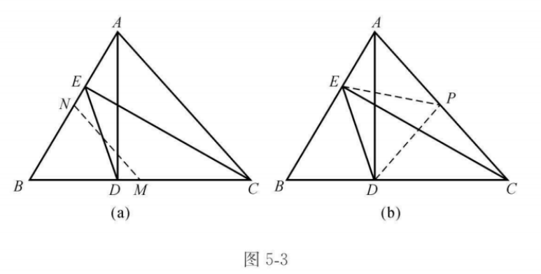
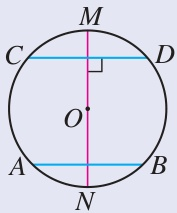
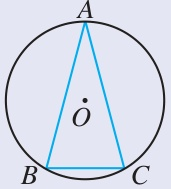
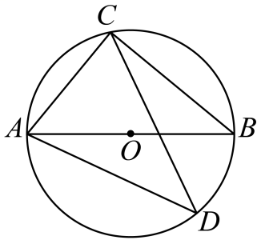
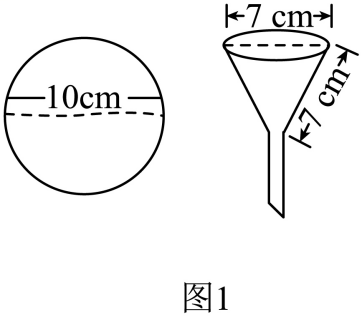
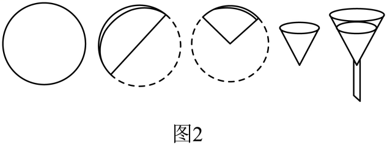

# 第二十九章 圆 · 题目

## 讲义用题

### Q-MATH-TB9A-29.1-1

```yaml
id: Q-MATH-TB9A-29.1-1
category: 课本习题
source: 人教版数学九上（修订版）p.119，习题29.1第1题
source_quality: 课本原文
kp: MATH-9A-29-1a
type: 解答
grading: 自评
answer_by: 本项目编写，待复核
review:
  概念: MATH-9A-29-1a
```

**题干**

已知点 $A,B$ 在 $\odot O_1$ 上，点 $C,D$ 在 $\odot O_2$ 上，判断下列说法是否正确：

（1）若 $AB=CD$，则 $\odot O_1$ 与 $\odot O_2$ 是等圆；

（2）若 $O_1A=O_2C$，则 $\odot O_1$ 与 $\odot O_2$ 是等圆；

（3）若 $AB=CD$，则 $\widehat{AB}$ 与 $\widehat{CD}$ 是等弧；

（4）若 $O_1B=O_2D$，则 $\widehat{AB}$ 与 $\widehat{CD}$ 是等弧。

**答案**

（1）不正确；（2）正确；（3）不正确；（4）不正确。

**解析**

1. 弦长相等不能确定两圆半径相等，所以（1）不正确（等圆需要半径相等）。
2. $O_1A,O_2C$ 分别是两圆的半径，半径相等，所以（2）正确（等圆的判定）。
3. 两条等长弦可以位于半径不同的圆中，所对的弧不一定能重合，所以（3）不正确（等弧的定义）。
4. $O_1B=O_2D$ 只能说明两圆是等圆，不能保证所取的两条弧重合，所以（4）不正确（还缺少弧相等的条件）。

### Q-MATH-MG5-E5

```yaml
id: Q-MATH-MG5-E5
category: 导引例题
source: 初中数学思想方法导引，第5章，例5.5，印刷p.47–48，采用证明2
source_quality: 导引原文
kp: MATH-9A-29-1b
type: 证明
grading: 自评
answer_by: 导引原解
review:
  概念: MATH-9A-29-1b
```

**题干**

$AD,CE$ 是 $\triangle ABC$ 的高线，$\angle B=60^\circ$，连接 $DE$，求证：$DE=\dfrac12AC$。

**答案**

$\boxed{DE=\dfrac12AC}$，证明见解析。

**解析**

如图，作辅助线；下面采用图（b）的作法。



两个直角三角形共用斜边，取它的中点，就能找到到四个顶点等距的点。

1. 作 $\mathrm{Rt}\triangle AEC$ 和 $\mathrm{Rt}\triangle ADC$ 公共斜边 $AC$ 上的中线 $EP,DP$，如图（b）（取 $AC$ 的中点 $P$）。
2. $EP=DP=\dfrac12AC$（直角三角形斜边上的中线等于斜边的一半）。
3. 设 $\triangle ABC$ 以 $A,C$ 为顶点的内角分别为 $\alpha,\gamma$，则 $\alpha+\gamma=120^\circ$（三角形内角和，$\angle B=60^\circ$）。
4. 因为 $EP=AP$，所以 $\angle AEP=\alpha$，$\angle EPC=2\alpha$（等腰三角形的底角相等、三角形外角）。
5. 同理，$\angle DPA=2\gamma$（$DP=CP$，等腰三角形及外角）。
6. $\angle EPD=\angle EPC+\angle DPA-180^\circ=2\alpha+2\gamma-180^\circ=60^\circ$（图（b）中各角的位置关系）。
7. $\triangle PED$ 是等边三角形，故 $\boxed{DE=EP=\dfrac12AC}$（$EP=DP$，且夹角为 $60^\circ$）。

### Q-MATH-TB9A-29.2-7

```yaml
id: Q-MATH-TB9A-29.2-7
category: 课本习题
source: 人教版数学九上（修订版）p.132，习题29.2第7题
source_quality: 课本原文
kp: MATH-9A-29-2a
type: 证明
grading: 自评
answer_by: 本项目编写，待复核
review:
  概念: MATH-9A-29-2a
```

**题干**

如图，$AB,CD$ 是 $\odot O$ 的两条平行弦，$MN$ 是 $AB$ 的垂直平分线。求证：$MN$ 垂直平分 $CD$。



**答案**

$MN$ 垂直平分 $CD$，证明见解析。

**解析**

1. $OA=OB$，所以 $O$ 在 $AB$ 的垂直平分线 $MN$ 上（线段垂直平分线的判定）。
2. $MN\perp AB$，$AB\parallel CD$，所以 $MN\perp CD$（平行线的性质）。
3. $MN$ 经过圆心且垂直于弦 $CD$，所以它平分 $CD$（垂径定理）。
4. 因此 $MN$ 垂直平分 $CD$（垂直且平分）。

### Q-MATH-TB9A-29.2-6

```yaml
id: Q-MATH-TB9A-29.2-6
category: 课本习题
source: 人教版数学九上（修订版）p.132，习题29.2第6题
source_quality: 课本原文
kp: MATH-9A-29-2b
type: 解答
grading: 自评
answer_by: 本项目编写，待复核
review:
  概念: MATH-9A-29-2a
  审题: MATH-9A-29-2b
  计算: MATH-9A-29-2b
```

**题干**

$\odot O$ 的半径为 $13$，$AB,CD$ 是 $\odot O$ 的两条弦，$AB\parallel CD$，$AB=24$，$CD=10$。求 $AB$ 和 $CD$ 之间的距离。

**答案**

$\boxed{7\text{ 或 }17}$。

**解析**

同样的两条弦，可以在圆心同侧，也可以在圆心两侧。

1. 过 $O$ 作两条平行弦的垂线，垂足分别为 $E,F$（平行线间的距离沿垂线计算）。
2. $AE=\dfrac12AB=12$，$CF=\dfrac12CD=5$（垂径定理）。
3. $OE=\sqrt{\textcolor{#287fc4}{13}^2-\textcolor{#287fc4}{12}^2}=5$（在 $\mathrm{Rt}\triangle OEA$ 中用勾股定理）。
4. $OF=\sqrt{\textcolor{#287fc4}{13}^2-\textcolor{#287fc4}{5}^2}=12$（在 $\mathrm{Rt}\triangle OFC$ 中用勾股定理）。
5. 两弦在圆心同侧时，$EF=12-5=\boxed{7}$（两段弦心距之差）。
6. 两弦在圆心两侧时，$EF=12+5=\boxed{17}$（两段弦心距之和）。

### Q-MATH-TB9A-29.2-2

```yaml
id: Q-MATH-TB9A-29.2-2
category: 课本习题
source: 人教版数学九上（修订版）p.132，习题29.2第2题
source_quality: 课本原文
kp: MATH-9A-29-2c
type: 解答
grading: 自评
answer_by: 本项目编写，待复核
review:
  概念: MATH-9A-29-2c
```

**题干**

如图，在 $\odot O$ 中，$\widehat{AB}=\widehat{AC}$，$\angle C=75^\circ$。求 $\angle A$ 的度数。



**答案**

$\boxed{\angle A=30^\circ}$。

**解析**

1. $AB=AC$（同圆中，相等的弧所对的弦相等）。
2. $\angle B=\angle C=75^\circ$（等腰三角形的底角相等）。
3. $\angle A=180^\circ-\textcolor{#287fc4}{75}^\circ-\textcolor{#287fc4}{75}^\circ=\boxed{30^\circ}$（三角形内角和）。

### Q-MATH-GD2023-09

```yaml
id: Q-MATH-GD2023-09
category: 真题
source: 2023年广东省中考数学真题，第9题
source_quality: 原卷
kp: MATH-9A-29-2d
type: 选择
grading: 自动
answer_by: 原卷解析
review:
  概念: MATH-9A-29-2d
```

**题干**

如图，$AB$ 是 $\odot O$ 的直径，$\angle BAC=50^\circ$，则 $\angle D=$（　　）



A. $20^\circ$

B. $40^\circ$

C. $50^\circ$

D. $80^\circ$

**答案**

B

**解析**

1. $\angle ACB=90^\circ$（$AB$ 是直径，直径所对的圆周角是直角）。
2. $\angle ABC=90^\circ-\textcolor{#287fc4}{50}^\circ=40^\circ$（三角形内角和）。
3. $\angle D=\angle ABC=\boxed{40^\circ}$（两角对着同一条弧 $\widehat{AC}$）。

### Q-MATH-TB9A-29.2-5

```yaml
id: Q-MATH-TB9A-29.2-5
category: 课本习题
source: 人教版数学九上（修订版）p.132，习题29.2第5题
source_quality: 课本原文
kp: MATH-9A-29-2e
type: 证明
grading: 自评
answer_by: 本项目编写，待复核
review:
  概念: MATH-9A-29-2e
```

**题干**

求证：圆内接平行四边形是矩形。

**答案**

圆内接平行四边形是矩形，证明见解析。

**解析**

1. 设圆内接平行四边形为 $ABCD$，则 $\angle A=\angle C$（平行四边形的对角相等）。
2. $\angle A+\angle C=180^\circ$（圆内接四边形的对角互补）。
3. $2\angle A=180^\circ$，故 $\angle A=90^\circ$（代入并解方程）。
4. 所以平行四边形 $ABCD$ 是矩形（有一个角是直角的平行四边形是矩形）。

### Q-MATH-GZ2023-19-3

```yaml
id: Q-MATH-GZ2023-19-3
category: 真题
source: 2023年广东广州中考数学真题，第19题第（3）问
source_quality: 原卷
kp: MATH-9A-29-3a
do: 本章只做第（3）问
other_parts:
  - 第（1）问属坐标平移，本章保留原题但不单独作答。
  - 第（2）问属作图，本章保留原题但不单独作答；本题只按第（3）问自评。
type: 解答
grading: 自评
answer_by: 原卷解析
review:
  公式: MATH-9A-29-3a
  审题: MATH-9A-29-1a
```

**题干**

如图，在平面直角坐标系中，点 $A(-2,0)$，$B(0,2)$，$\widehat{AB}$ 所在圆的圆心为 $O$。将 $\widehat{AB}$ 向右平移 $5$ 个单位，得到 $\widehat{CD}$（点 $A$ 平移后的对应点为 $C$）。


（1）点 $D$ 的坐标是________，$\widehat{CD}$ 所在圆的圆心坐标是________；

（2）在图中画出 $\widehat{CD}$，并连接 $AC$，$BD$；

（3）求由 $\widehat{AB}$，$BD$，$DC$，$CA$ 首尾依次相接所围成的封闭图形的周长。（结果保留 $\pi$）

**答案**

第（3）问：$\boxed{\pi+10+2\sqrt2}$。

**解析**

1. $\widehat{AB}$ 的半径为 $2$，所对圆心角为 $90^\circ$，弧长为 $\dfrac{\textcolor{#287fc4}{90}\times\pi\times\textcolor{#287fc4}{2}}{180}=\pi$（弧长公式）。
2. $AC=BD=5$，$C(3,0)$，$D(5,2)$（向右平移 $5$ 个单位）。
3. $DC=\sqrt{(5-3)^2+(2-0)^2}=2\sqrt2$（勾股定理；这里算的是线段 $DC$）。
4. 周长为 $\pi+5+2\sqrt2+5=\boxed{\pi+10+2\sqrt2}$（沿题目指定的四段边界相加）。

### Q-MATH-GD2022-15

```yaml
id: Q-MATH-GD2022-15
category: 真题
source: 2022年广东省中考数学真题，第15题
source_quality: 原卷
kp: MATH-9A-29-3b
type: 填空
grading: 自评
answer_by: 原卷解析
review:
  公式: MATH-9A-29-3b
```

**题干**

扇形的半径为 $2$，圆心角为 $90^\circ$，则该扇形的面积（结果保留 $\pi$）为________。

**答案**

$\boxed{\pi}$。

**解析**

$S_{\text{扇形}}=\dfrac{\textcolor{#287fc4}{90}\times\textcolor{#287fc4}{2}^2\times\pi}{360}=\boxed{\pi}$（扇形面积公式）。

### Q-MATH-GD2024-21-1

```yaml
id: Q-MATH-GD2024-21-1
category: 真题
source: 2024年广东省中考数学试卷，第21题第（1）问
source_quality: 原卷
kp: MATH-9A-29-3c
do: 本章只做第（1）问
other_parts:
  - 本章题量已满，第（2）问暂不收。
type: 解答
grading: 自评
answer_by: 原卷解析
review:
  概念: MATH-9A-29-3c
  公式: MATH-9A-29-3a
```

**题干**

综合与实践

【主题】滤纸与漏斗

【素材】如图 $1$ 所示：

①一张直径为 $10\ \mathrm{cm}$ 的圆形滤纸；

②一只漏斗口直径与母线均为 $7\ \mathrm{cm}$ 的圆锥形过滤漏斗。



【实践操作】

步骤 $1$：取一张滤纸；

步骤 $2$：按如图 $2$ 所示步骤折叠好滤纸；

步骤 $3$：将其中一层撑开，围成圆锥形；

步骤 $4$：将围成圆锥形的滤纸放入如图 $1$ 所示漏斗中。



【实践探索】

（1）滤纸是否能紧贴此漏斗内壁（忽略漏斗管口处）？用你所学的数学知识说明。

（2）当滤纸紧贴漏斗内壁时，求滤纸围成圆锥形的体积。（结果保留 $\pi$）

**答案**

第（1）问：能。

**解析**

1. 设漏斗侧面展开图的扇形圆心角为 $n^\circ$（扇形半径等于母线长 $7\ \mathrm{cm}$）。
2. $\dfrac{n\pi\times\textcolor{#287fc4}{7}}{180}=7\pi$（扇形弧长等于漏斗口周长）。
3. 解得 $n=180$（等式两边约去 $7\pi$）。
4. 圆形滤纸对折得到半圆，展开扇形的圆心角也是 $180^\circ$（半圆所对的圆心角）。
5. 将其中一层撑开，围成圆锥形，此时滤纸能紧贴此漏斗内壁（滤纸与漏斗的展开扇形圆心角相同）。

## 备选

本轮未另存备选题；未采用的候选及原因见来源记录。
