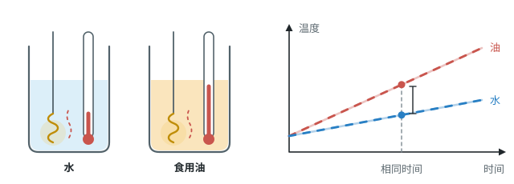
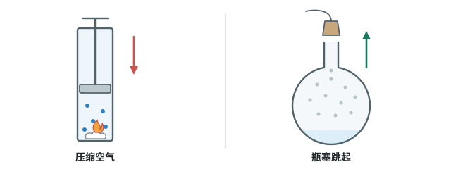

# 第十三章 内能

这一章先学“物体吸收了多少热”，再往物体内部看：物质由分子构成，分子在不停地运动，所以物体内部有一种能量，叫内能。

标着**重点**的三个知识点，中考几乎每年都考，要花最多时间；标着**了解**的，读懂就行。

## 本章前置自查

下面四件事，哪一件没把握，先回看八年级课本：

1. 把克换算成千克；用 $m=\rho V$ 由体积求质量。（八上 第六章 质量、密度）
2. 说出晶体熔化时温度怎么变。（八上 第三章第 2 节）
3. 说出什么是动能、势能。（八下 第十一章第 3 节）
4. 判断一个力有没有做功。（八下 第十一章第 1 节）

---

## 13.1a 热量和比热容

```yaml
id: PHY-9-13-1a
weight: 一般
textbook: 九全 13.1 热量 比热容，p.2–4
prerequisites:
  - id: PHY-8A-03-1b
    strength: hard
    reason: 实验靠读温度计、比较升高的温度来判断吸热多少
  - id: PHY-8A-06-1a
    strength: hard
    reason: 实验必须控制质量相等
evidence:
  - 能说出热量是热传递中传递的热的多少，单位是焦耳
  - 能说出比热容是物质自身的性质，不随质量、吸热多少改变
figure: 已完成 figures/specific-heat-compare.svg（装置 + 温度—时间图）
sources: [TB9-13.1, NOTES-内能]
```

### 本次只学

知道热量是什么，用比热容比较不同物质吸热的本领。

### 先认住

- **热量**：热传递过程中，传递的热的多少，单位是焦耳（J）。
- **比热容** $c$：表示物质吸热本领的物理量，单位 $\mathrm{J/(kg\cdot{}^\circ C)}$。水的比热容是 $4.2\times10^{3}\ \mathrm{J/(kg\cdot{}^\circ C)}$，表示 1 kg 水温度升高 1 ℃ 吸收 $4.2\times10^{3}$ J 的热量。
- 比热容是物质自身的性质，和质量、吸热多少无关。

课本演示：相同的电加热器加热质量相等的水和食用油。加热相同时间，两者吸热相同，食用油升温更多，说明水的比热容更大。



### 容易错

- 比热容不会因为质量变大、吸热变多而改变。
- 同一物质状态变了，比热容会变：冰的比热容只有水的一半。

### 练一练

- `Q-PHY-TB9-13.1-2`

---

## 13.1b 用比热容解释现象

```yaml
id: PHY-9-13-1b
weight: 一般
textbook: 九全 13.1 热量 比热容，p.4–5
prerequisites:
  - id: PHY-9-13-1a
    strength: hard
    reason: 解释现象要用到比热容的含义
evidence:
  - 能用“质量相等、吸放热相同时，比热容大的温度变化小”解释海边和沙漠的温差
  - 解释时能写出完整的因果链
figure: 不需要
sources: [TB9-13.1, NOTES-内能]
```

### 本次只学

用“水的比热容大”解释温差、取暖和冷却。

### 先认住

质量相等的不同物质，吸收或放出相同的热量，**比热容大的，温度变化小**。

- 海边昼夜温差小：水吸收或放出相同热量，温度变化小，白天升温慢、夜里降温慢。
- 暖气用水：质量相同、降低相同温度时，水放出的热量多，输送的热量多。
- 发动机用水冷却：质量相同、升高相同温度时，水吸收的热量多，带走的热量多。

### 容易错

- 只答“水的比热容大”会扣分，要接着写“吸收（放出）相同热量时，温度变化小”。
- 比较时必须先说“质量相等”；不知道质量，就不能比较比热容。

### 练一练

- `Q-PHY-GZ2023-09`

---

## 13.1c 计算吸收或放出的热量

```yaml
id: PHY-9-13-1c
weight: 重点
textbook: 九全 13.1 热量 比热容，p.5–6
prerequisites:
  - id: PHY-9-13-1a
    strength: hard
    reason: 要知道公式里的 c 是什么意思
  - id: PHY-8A-06-1a
    strength: hard
    reason: 质量必须换算成千克再代入
  - id: PHY-8A-03-1b
    strength: hard
    reason: 要分清初温、末温和温度变化量
  - id: PHY-8A-06-4a
    strength: soft
    reason: 题目常给水的体积，要先用 m=ρV 求质量
evidence:
  - 能写出吸热、放热公式，并说出每个字母的单位
  - 能把克、体积换算成千克再计算
  - 已知其中三个量，能求出第四个
figure: 不需要
sources: [TB9-13.1, NOTES-内能]
```

### 本次只学

用公式算出物体吸收或放出了多少热量。

### 先认住

$$Q_{\text{吸}}=cm(t-t_0)\qquad Q_{\text{放}}=cm(t_0-t)$$

$t_0$ 是初温，$t$ 是末温。$m$ 用 kg，算出的 $Q$ 是 J。

### 走一遍

课本“想想议议”：2 kg 沙子从 20 ℃ 加热到 30 ℃，吸收多少热量？（沙子的比热容约为 $0.92\times10^{3}\ \mathrm{J/(kg\cdot{}^\circ C)}$）

1. 温度变化：$\Delta t=\textcolor{#287fc4}{30}\ ^\circ\mathrm{C}-\textcolor{#287fc4}{20}\ ^\circ\mathrm{C}=10\ ^\circ\mathrm{C}$
2. $Q_{\text{吸}}=cm\Delta t=\textcolor{#287fc4}{0.92\times10^{3}}\ \mathrm{J}/(\cancel{\mathrm{kg}}\cdot\cancel{^\circ\mathrm{C}})\times\textcolor{#287fc4}{2}\ \cancel{\mathrm{kg}}\times\textcolor{#287fc4}{10}\ \cancel{^\circ\mathrm{C}}=\boxed{1.84\times10^{4}\ \mathrm{J}}$
3. 同样的热量给 2 kg 的水，水只升高约 2.2 ℃。这就是“水的比热容大”。

计算四步：找谁吸热放热 → 质量化成 kg → 算温度变化 → 代公式、带单位。

### 容易错

- “升高了 20 ℃”是温度变化；“升高到 20 ℃”是末温。
- 质量用 g 直接代入，结果差 1000 倍。
- “加热至沸腾”：标准大气压下末温是 100 ℃。

### 练一练

- `Q-PHY-TB9-13.1-5`
- `Q-PHY-GZ2025-16-3a`

---

## 13.2a 分子热运动与扩散

```yaml
id: PHY-9-13-2a
weight: 一般
weight_note: 5 次，但都是填空、选择里的送分题
textbook: 九全 13.2 分子动理论的初步知识，p.8–9
prerequisites:
  - id: CHEM-9A-U3
    strength: soft
    reason: 化学课里已经学过物质由分子、原子构成
evidence:
  - 能判断闻到气味属于扩散现象，并说出它说明了什么
  - 能说出温度越高，分子热运动越剧烈
figure: 已完成 figures/particle-motion.svg（2026-10-05 按动态示意图规范重画）
sources: [TB9-13.2, NOTES-内能]
```

### 本次只学

闻到气味就是扩散，扩散说明分子在不停地做无规则运动。

### 先认住

- **扩散**：不同物质互相接触时，彼此进入对方的现象。气体、液体、固体之间都能发生。
- 扩散说明：一切物质的分子都在不停地做无规则运动（分子热运动）。
- 温度越高，分子热运动越剧烈，扩散越快。


### 容易错

- 尘土飞扬、雪花纷飞是肉眼看得见的物体在运动，不是分子运动。

### 练一练

- `Q-PHY-GD2023-02`

---

## 13.2b 分子间的作用力

```yaml
id: PHY-9-13-2b
weight: 了解
weight_note: 10 套卷中没有直接考查，只在选择题干扰项里出现
textbook: 九全 13.2 分子动理论的初步知识，p.10–11
prerequisites:
  - id: PHY-9-13-2a
    strength: hard
    reason: 先知道分子在运动、分子间有间隙
evidence:
  - 能说出分子间同时存在引力和斥力
figure: 可选 figures/three-states.svg，纸质版不放
sources: [TB9-13.2]
```

### 先认住

- 分子之间同时存在**引力**和**斥力**。两个铅柱压紧后能吊起重物，说明分子间有引力；固体、液体很难被压缩，说明分子间有斥力。
- 气体分子相距很远，几乎没有作用力，所以气体容易被压缩。

---

## 13.3a 内能

```yaml
id: PHY-9-13-3a
weight: 了解
weight_note: 只作为选择题选项出现，如“火箭发射前内能为零”
textbook: 九全 13.3 内能，p.13–15
prerequisites:
  - id: PHY-8B-11-3a
    strength: hard
    reason: 内能由分子动能和分子势能组成
  - id: PHY-9-13-2a
    strength: hard
    reason: 分子在运动，才有分子动能
evidence:
  - 能说出一切物体在任何温度下都有内能
  - 能区分内能和机械能
figure: 不需要
sources: [TB9-13.3]
```

### 先认住

- **内能**：物体内所有分子热运动的动能与分子势能的总和，单位是焦耳。
- 一切物体，不论温度高低，都有内能。0 ℃ 的冰也有。
- 物体被举高、跑得更快，增加的是机械能，不是内能。

---

## 13.3b 改变内能的两种方式

```yaml
id: PHY-9-13-3b
weight: 重点
textbook: 九全 13.3 内能，p.15–16
prerequisites:
  - id: PHY-9-13-3a
    strength: hard
    reason: 先知道内能是什么
  - id: PHY-9-13-1a
    strength: hard
    reason: 热传递里传递的就是热量
  - id: PHY-8B-11-1a
    strength: hard
    reason: 要判断过程中有没有做功
  - id: PHY-8A-03-3c
    strength: soft
    reason: 瓶塞跳起时的“白雾”是水蒸气液化成的小水滴
evidence:
  - 能判断一个过程是热传递还是做功改变了内能
  - 能说出压缩气体内能增加，气体膨胀对外做功内能减少
figure: 已完成 figures/work-demos.svg（课本两个演示）
sources: [TB9-13.3, NOTES-内能]
```

### 本次只学

判断内能是通过热传递还是做功改变的。

### 先认住

- **热传递**：有温度差，热量从高温物体传到低温物体。烤火、热水袋取暖、用火加热。
- **做功**：摩擦、压缩使物体内能**增加**（搓手、钻木取火）；物体对外做功，内能**减少**（气体膨胀推开瓶塞）。

### 走一遍



1. 压缩空气：活塞对空气做功 → 空气内能增加、温度升高 → 棉花燃烧。
2. 瓶塞跳起：瓶内气体对瓶塞做功 → 气体内能减少、温度降低 → 水蒸气液化成小水滴，出现白雾。

### 容易错

- 白雾是小水滴，不是水蒸气。
- 气体膨胀对外做功，内能是减少，不是增加。

### 练一练

- `Q-PHY-GZ2025-04`
- `Q-PHY-SZ2023-04`

---

## 13.3c 分清温度、热量和内能

```yaml
id: PHY-9-13-3c
weight: 重点
weight_note: 出现次数不多，但是选择题的常见陷阱，失分率高
textbook: 九全 13.1–13.3 综合，p.2、p.9、p.13–16
prerequisites:
  - id: PHY-9-13-1a
    strength: hard
    reason: 要知道热量的准确含义
  - id: PHY-9-13-3b
    strength: hard
    reason: 内能变化要考虑做功和热传递两种方式
  - id: PHY-8A-03-2a
    strength: hard
    reason: 晶体熔化、凝固时温度不变，是这里最关键的反例
evidence:
  - 能说出热量只能说“吸收”“放出”，不能说“含有”
  - 能举出“内能变化而温度不变”的例子
figure: 不需要
sources: [TB9-13.1, TB9-13.3, NOTES-内能, NOTES-易错归纳]
```

### 本次只学

把温度、热量、内能分清楚，判断常见说法的对错。

### 先认住

- **温度**：冷热程度。**内能**：物体内分子能量的总和，任何时候都有。**热量**：传递的热的多少，只能说“吸收”“放出”。
- 同一物体，温度升高，内能增加。
- 内能变了，温度不一定变：冰熔化时吸热、内能增加，温度一直是 0 ℃。
- 温度升高，不一定是吸热，也可能是做功（搓手）。

### 走一遍

判断四句话：

1. “物体温度越高，含有的热量越多。”——错，热量不能说“含有”。
2. “0 ℃ 的冰没有内能。”——错，一切物体都有内能。
3. “物体内能增加，一定是吸收了热量。”——错，也可能是做功。
4. “同一物体温度降低，内能减少。”——对。

### 练一练

- `Q-PHY-GZ2023-08`
